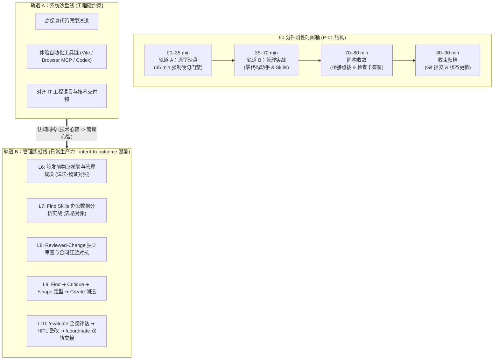

# 企业 AI 业务原型训练营·课程重新编排与双轨延伸优化方案

> **文档定位**：课程架构设计与双轨优化方案标准说明书（v1.4.1 终审闭环版：正式吸纳方案 1.1 与 2.1 决策，确立四类业务原型体系与 Universal Dual Delivery 全原型双重交付终局，发布基线修正案二，贯通 L10 结业闭环；v1.4.1 重定位 L6 轨道 B 为签发前核验，业务五层全量退役，主管判断线交付物更新为《签发前核验与裁决单》）。
> **版本**：v1.4.1 (Approved & Frozen Baseline · 终审闭环版)
> **更新日期**：2026-09-16
> **状态**：课程所有者与独立同行评审批准并正式冻结为全课执行基线 (APPROVED & FROZEN BASELINE)

---

## 一、 执行摘要 (Executive Summary)

本训练营的核心宗旨不仅是“培养懂业务原型的超级 PM”，更是**“以 Agentic 协作底层心智为基石，培养能够驾驭 AI Agent 提效日常工位的数字化业务领航者”**。

针对现场交付实践中暴露出的三大结构性病灶：
1. **目标单一化**：过往方案将目标过度锚定在“给 IT 提需求的原型样板间”，一旦课后 IT 不给排期立项，培训价值大打折扣；
2. **L7 认知强行嫁接**：原方案在第 7 课（浏览器自动化验收）突兀插入软件交付工具 `intent-to-outcome-loop`，学员在浏览器与代码工程之间频繁割裂，无法理解工具相关性；
3. **教学大跃进与表演性垃圾产出**：原方案让零基础学员在第 9 课凭空手写工业级 Skill，产出的必然是缺乏容错与防错的脆弱提示词垃圾；结业答辩宣称“每周省 20 小时”更沦为脱离事实的表演自嗨。

在 **v1.2 冻结基线** 与 **v1.3 终审基线** 的基础上，本版（v1.4.1）实施**“四类原型全覆盖、双重交付终局化、规则注入工业化、结业验收闭环化、签发核验实战化”**的升级：

### 版本变更历史 (Changelog)
- **v1.4.1 (2026-09-16 · 当前法定冻结版本)**：
  - **L6 轨道 B 重定位为签发前核验**：联动 Brief v2.2，业务五层全量退役（通信/单据/状态/留痕/制度五层全量退役，代码侧五层诊断原样保留）；
  - **主管判断线证据更新**：原《客观事实事故调查单》更新为签署的《签发前核验与裁决单》（含 Agent 核验底稿与主管裁决）；
  - **配套模具与案例重构**：模具更新为《签发前核验与裁决单模具》（`SIGNOFF_VERIFICATION_TEMPLATE.md`）及教师参考样例，案例更新为待签发草案与原始物证素材；
  - **纪律回环**：将签字动作与 L5 智能机会卡的 HITL 检查点建立回环，课后微任务升级为双环核验（补充 L5 检查点 + 真实材料核验并于次课开场汇报）。
- **v1.4 (2026-09-15)**：
  - **决策 1（方案 1.1）落地**：正式确立第四类业务原型为 `D. 研发创作工作台型 (R&D & Creative Studio)`，覆盖品牌设计、服装研发、视觉企划、包装打样等非线性、多模态、重资产流转部门；
  - **决策 2（方案 2.1）落地**：确立所有原型（A/B/C/D）的 **Universal Dual Delivery Model（双重交付终局）**：既可提交 IT 研发立项（《产品决策与开发启动包》），亦可作为《工位自治单机工具》（127.0.0.1）在学员工位开箱自用，彻底消除“IT 不排期则原型作废”的交付风险；
  - **发布基线修正案二**：正式发布针对《`TEN_LESSON_FROZEN_BASELINE.md`》L129 等条款的法定替代声明，调和三类与四类原型体系；
  - **贯通 L10 结业闭环**：将《工位自用单机工具包》作为法定成果正式纳入 L10 轨道 A、双线最低证据与结业归档流程，配套《工位单机自治运行自检表》（`DESK_STANDALONE_UTILITY_SOP.md`）；
  - **注入红线桥接条款**：严格调和单机自用形态与 Mock 数据红线、非生产声明的边界，确立工位运行四大护栏。
- **v1.3 (2026-09-15)**：重构 L7–L10 认知演进动线（L7 回归表格数据分析 Skill、L8 双盲独立内审、L9 四步闭环与 `/shape`、L10 评估与交接）。
- **v1.2 (2026-09-14)**：确立 35+35+10+10 双轨制与 P-04 独立证据准则。

### 核心升级四大支柱：
1. **双重使命并立（对外控盘 + 对内赋能 · 原型双重交付终局）**：
   - **对外**：借助 Coding Agent 做出高保真原型样板间，冻结数据契约，形成《产品决策与开发启动包》，让 IT 研发零返工；
   - **对内**：掌握 Agentic 协作理论、分工边界与控制技巧（上下文、护栏、工具、人在回路），哪怕 IT 彻底不立项，主管也掌握了标准风控与交互方法论，能够自行摸索并在受控边界内探索部门日常业务的试点增效；
   - **四类业务原型体系**：全面支持 `A. 监控决策型`、`B. 任务流程型`、`C. 操作工具型` 与 `D. 研发创作工作台型 (R&D & Creative Studio)` 四大原型体系；
   - **工位单机自治运行形态强制红线与数据桥接规约**：单机自用形态绝不等于生产系统上线，必须严格遵守四条刚性边界：
     1. *非生产声明不降级*：本地单机运行仅作为个人/科室日常办公辅助决策工具，严禁对外开放公网访问或多用户并发部署；
     2. *本地脱敏输入*：严禁在单机工具中明文录入未脱敏的机密商业数据、敏感客户个人信息（PII）或生产系统核心密钥；
     3. *人在回路（HITL）逐笔确权*：单机工具中任何分析、建议或导出动作，必须由主管人工逐笔核验确认后方可采用，严禁赋予其免审自动闭环权限；
     4. *严禁越过 IT 生产接口*：单机工具严禁擅自私接未经 IT 部门审核授权的内部生产数据库或写操作 API；生产级系统开发与推广必须以《产品决策与开发启动包》移交 IT 团队排期实施。
2. **第 7 课（Find Skills）：全面回归高频办公刚需（Excel / 数据处理）**：
   - 拿掉抽象的交付母法，换成主管最高频的**“Excel / CSV 表格数据自动化分析与对账 Skill”**；
   - 运用《外部 Skill 安全体检表》（`FIND_SKILLS_VETTING_CHECKLIST.md`）审查：只读性、无数据出境、输出结构确定；
   - 现场喂入脱敏业务表格，体验“外部技能即插即用”对日常工位的倍增效应。
3. **第 9 课（Create Skills）：破除手写垃圾，落地“调研 ➔ 剖析 ➔ 定型 ➔ 创造”四步闭环**：
   - **调研 (Find)**：用 `find-skills` 检索本部门业务领域的现有技能；
   - **剖析 (Critique & Retain)**：拆解优质案例结构（看契约、SOP、红线），挑选标杆留存；
   - **定型 (Shape)**：**首次调用 `/shape`**，对部门模糊痛点进行结构化追问，锁定真实问题、最小充分解与明确非目标；
   - **创造 (Create)**：基于工业级模具（`SKILL_TEMPLATE_BUSINESS.md`），将 `/shape` 结论转化为**注入本部门刚性制度、金额阈值与强制 HITL 门禁**的专属 `SKILL.md`，彻底杜绝玩具垃圾。
4. **第 10 课（结业交付）：综合评估 (`/evaluate`) ➔ 人在回路改进 (HITL) ➔ 标准双轨交接 (`/coordinate`)**：
   - **全面评估 (`/evaluate`)**：对 10 课全量交付物（原型契约、测试证据、部门 Skill、安全红线）进行系统化挑刺体检；
   - **人工整改 (HITL)**：主管审阅漏洞清单，手动修补非目标与审批门禁；
   - **标准交接 (`/coordinate`)**：规范导出《IT 系统开发启动包》（严守非生产声明）与《部门日常 Agent 落地装备包》（含部门专属 Skill + 周一安全实施方案）；
   - **务实答辩**：汇报原型排除了哪些伪需求、自查出哪些漏洞、下周一在哪个具体工位由谁把关试点，实事求是，杜绝画大饼。

---

## 二、 核心痛点与教学逻辑重构 (Pedagogical Rationale)

```text
┌─────────────────────────────────────────────────────────────────────────┐
│                     v1.2 痛点诊断与 v1.3 务实重构对照                     │
├──────────────┬────────────────────────────┬─────────────────────────────┤
│ 模块         │ v1.2 现存痛点              │ v1.3 重构解决方案           │
├──────────────┼────────────────────────────┼─────────────────────────────┤
│ 核心使命     │ 仅定位为 Super Business PM │ 确立双重使命：              │
│              │ （过度依赖 IT 排期立项）   │ 对外面向 IT 控盘需求 +      │
│              │                            │ 对内面向工位日常提效        │
├──────────────┼────────────────────────────┼─────────────────────────────┤
│ 第 7 课      │ 浏览器测试硬塞代码交付库   │ 转向高频办公刚需：          │
│ (Find Skills)│ 学员认知断层，不知为何要学 │ 检索与体检 Excel/CSV 数据   │
│              │                            │ 分析 Skill，实操跨表对账    │
├──────────────┼────────────────────────────┼─────────────────────────────┤
│ 第 8 课      │ 双 Agent 审查与合同对抗    │ 深度融入 Reviewed-Change 心智│
│ (Dual-Agent) │ 缺乏体系化的 delivery 理论 │ 确立“双盲独立审查”铁律，   │
│              │ 支撑                       │ 主管行使 4 项裁决并规范交接 │
├──────────────┼────────────────────────────┼─────────────────────────────┤
│ 第 9 课      │ 逼主管手写工业级 Skill     │ 建立四步闭环：              │
│(Create Skill)│ 产出必然是脆弱、空泛的垃圾 │ 调研 ➔ 剖析留存 ➔ /shape 定型│
│              │                            │ ➔ 注入部门制度与红线阈值    │
├──────────────┼────────────────────────────┼─────────────────────────────┤
│ 第 10 课     │ 答辩虚夸 ROI（每周省20h）  │ 严肃工程大验收：            │
│ (Graduation) │ 缺乏落地前全量体检与挑刺   │ /evaluate 评估 ➔ HITL 整改  │
│              │                            │ ➔ /coordinate 双轨标准导出  │
└──────────────┴────────────────────────────┴─────────────────────────────┘
```

---

## 三、 双轨教学架构与 Intent-to-Outcome 精准归位

自第 6 课开始，每节 90 分钟课堂刚性执行 **“35 分钟沙盘硬切 + 35 分钟管理实操 + 10 分钟同构收敛 + 10 分钟收束归档”**：



### 3.1 `intent-to-outcome-loop` 核心工具的精准教学归位表

| 工具名称 | 原始工程定位 | 课程业务化重塑 | 对应课次 | 核心教学作用 |
| --- | --- | --- | --- | --- |
| **`reviewed-change`** | 独立计划审查与代码复核 | **【双盲独立内审法】** | **第 8 课** | 确立“上下文隔离”审查红线，红方起草、蓝方独立挑刺，防自审自欺 |
| **`find-skills`** | 检索已安装与生态技能 | **【生态找技能探针】** | **第 7/9 课** | L7 查找办公数据工具；L9 调研领域业务技能标杆 |
| **`/shape`** | 需求定型与边界锁定 | **【业务立项定型器】** | **第 9 课** | 追问部门真实痛点，提炼真实问题、最小充分解与明确非目标 |
| **`/evaluate`** | 交付物针对期望结果判决 | **【结业成果判决官】** | **第 10 课** | 结业前系统化体检挑刺，出具漏洞清单，驱动 HITL 修正 |
| **`/coordinate`** | 跨窗口/跨角色交接协调 | **【标准交接协调器】** | **第 8/10 课** | L8 作为跨部门交接心智预演；L10 消除跨部门信息衰减，规范导出 IT 启动包与部门落地包 |

---

## 四、 十课全景实施方案 (L1–L10 Detailed Blueprint)

### 阶段一：原型沙盘与认知建构（L1–L5：专心减负，打牢基座）
*在 L1–L5 中，专心打牢原型基础，严禁插入 Skill 编写等认知过载任务，保证主管专心完成代码沙盘的基础搭建。*

*   **L1：从业务问题创建第一个系统页面 (85 min)**：环境预检、Tools 权限沙箱、模拟数据红线、初始化 `PROJECT_STATE.md`，生成首屏受控页面。
*   **L2：让原型变得清楚、可信、能用 (80 min)**：查阅 `DESIGN.md` 字典，完成设计规范映射，执行 Keep/Omit 裁决与视觉重构，形成视觉基线。
*   **L3：把模糊业务说成可执行契约 (85 min)**：使用 `grill-me` 追问锁定业务边界，生成数据契约表与 TypeScript 类型定义。
*   **L4：把契约切成一个可实施的薄片 (80 min)**：Plan & Execute 增量实施，拆解 Step 1 调试切片，精准区分技术状态与业务状态，完成页面调试器验证。
*   **L5：第一次把 AI/Agent 融入业务 (85 min)**：
    *   *前半段 (45 min)*：在薄切片中划分确定性算数与概率性建议，在原型中接入模拟智能抽屉。
    *   *后半段 (35 min)*：**日常管理选型初筛**——梳理部门日常工作（发票审核、客户跟进、排班），制定部门《确定性 vs 概率性任务红线清单》。

---

### 阶段二：双轨驱动与能力跃迁（L6–L10：35+35+10+10 双轨工作坊）

#### 第 6 课：用事实找 Bug，在边界内修复
*   **[00–35 min] 轨道 A（系统沙盘）**：
    *   原型注入状态标签字段错配 Bug，运行 `$diagnose` 脚本，输出五层诊断卡；Agent 在 2 轮预算内自修。
    *   **第 35 分钟硬切门禁 (P-01)**：未跑通的学员由助教一键派发已修复分支快照，所有人准时切入轨道 B。
*   **[35–70 min] 轨道 B（管理平移）：签发前物证核验管理实战**：
    *   *业务素材*：提供待签发情况说明草案（各部门各执一词）与原始物流/通信/IT日志物证；
    *   *实战指令*：引导 Agent 执行签发前物证核验，输出说法-物证对照表、时间线与存疑清单，严密剥离事实 (Fact)、推测 (Assumption) 与虚构 (Hallucination)；主管抽查核验底稿并签发裁决；
    *   *产出成果*：签署《签发前核验与裁决单》（含 2 条确定性制度卡点与整改责任人期限），直击制度与流程根因。
*   **[70–80 min] 同构点拨与签署**：点拨“代码沙盘核验 Agent‘修好了’的物证”与“签字之前让 Agent 对着物证核验待签材料”的物证纪律同构性；签署《签发前核验与裁决单》。
*   **[80–90 min] 收束与归档**：Git Commit、更新 `PROJECT_STATE.md`；布置课后双环微任务（补充 L5 检查点 + 真实材料签发核验并在次课开场汇报）。

#### 第 7 课：自动化工具验收与生态借力（日常办公数据工具实战）
*   **[00–35 min] 轨道 A（系统沙盘）**：
    *   启动单一入口驱动浏览器 MCP，调度 Subagent 完成自动化页面点击，截取图片生成证据索引。
    *   **第 35 分钟硬切门禁 (P-01)**：测试未完成者直接载入标准证据包。
*   **[35–70 min] 轨道 B（生态借力）：Find Skills 实战与工位高频办公工具选型**：
    *   *实操 Task 1（外部技能检索、预审清单与安全体检）*：
        - 学习开源与企业技能生态检索标准与目录结构；优先选用官方预审与开箱即用的离线实用数据分析技能（`student-package/templates/skills/csv-data-analyzer/SKILL.md`），保证断网或受控环境下亦可在本地直接挂载运行；
        - 运用《主管级 Skill 选型与安全体检表》（`student-package/templates/FIND_SKILLS_VETTING_CHECKLIST.md`）对工位高频实用 Skill 进行现场体检（只读性、敏感数据本地脱敏后喂入、输出格式确定）；
    *   *实操 Task 2（一键挂载与真实业务表格对账实测）*：
        - 学员在本地环境挂载该 Skill；
        - 投喂脱敏业务表格样例（`student-package/cases/monthly_expense_sample.csv`，严守敏感数据本地脱敏与非生产原则），指挥 Agent 完成自动化异动筛查与汇总；
    *   *产出成果*：签署《外部 Skill 安全体检表》+ 产出一份《业务数据分析与异动筛查实测报告》。
*   **[70–80 min] 同构点拨与签署**：点拨“Agent 调浏览器工具”与“主管为 Agent 装配外部数据分析技能”的工具扩展同构性。
*   **[80–90 min] 收束与归档**：Git Commit、归档证据索引与体检卡。

#### 第 8 课：独立审查与高危文档红蓝对抗（Reviewed-Change 心智融合）
*   **[00–35 min] 轨道 A（系统沙盘）**：
    *   开启隔离上下文会话，驱动 Codex 对 Git Commit 进行独立审查，吐出 Findings。
    *   **第 35 分钟硬切门禁 (P-01)**：审查未完成者载入预置 Findings 报告。
*   **[35–70 min] 轨道 B（管理平移）：重大方案/合同的双 Agent 红蓝对抗**：
    *   *Reviewed-Change 心智融入*：结合 `intent-to-outcome-loop` 独立审查思想，讲解为何“自写自审必出事故”，确立“上下文隔离（双盲）”审查铁律；
    *   *红蓝对抗实操*：红方 Agent A 起草部门待发布规章（如《考勤绩效考核细则》）或外包合同草案；**新建纯净独立窗口（上下文隔离）**，蓝方 Agent B 扮演合规总监挑出 3 条阻断性漏洞；
    *   *主管裁决与交接*：主管依据《主管处置框架》签署 `accept / fix / stop / defer`，并运用 `/coordinate` 逻辑（作为跨部门交接心智预演，正式工具调用在 L10）生成一份标准的跨部门复核交接包。
*   **[70–80 min] 同构点拨与签署**：点拨 Codex 查代码与蓝军查合同的隔离审查心智；签署《重大方案独立内审卡》（`student-package/templates/RED_BLUE_AUDIT_CARD.md`）。
*   **[80–90 min] 收束与归档**：记录处置日志，Git Commit。

#### 第 9 课：部门 AI 机会与 Create Skills 标杆解剖、`/shape` 定型与规则注入
*   **[00–35 min] 轨道 A（系统沙盘）**：
    *   绘制部门业务流程图，标注 AI 介入层级，梳理三链关系。
    *   **第 35 分钟硬切门禁 (P-01)**：画图未完成者加载标准流程模板。
*   **[35–70 min] 轨道 B（技能沉淀）：调研 ➔ 剖析 ➔ 定型 ➔ 创造四步闭环**：
    *   *Step 1（调研 Find）*：用 `find-skills` 检索本部门业务领域的现有技能；
    *   *Step 2（剖析 Critique & Retain）*：基于 3 套工业级成熟模具（财务 `student-package/templates/skills/fin-invoice-audit/SKILL.md`、人事 `student-package/templates/skills/hr-interview-screener/SKILL.md`、采购 `student-package/templates/skills/ops-supplier-quote-compare/SKILL.md`），拆解标准 `SKILL.md` 的 5 大解剖结构，挑选标杆留存；
    *   *Step 3（定型 Shape）*：**首次调用 `/shape`**，设定 **2–3 轮有界追问预算 (Bounded Questioning Budget)**，对部门高频痛点进行结构化追问，提炼真实问题、最小充分解与明确非目标，生成《Shape Brief》；
    *   *Step 4（创造 Create）*：依托《业务主管专属 SKILL.md 模具》（`student-package/templates/SKILL_TEMPLATE_BUSINESS.md`），将 `/shape` 结论转化为**注入本部门刚性制度条款、金额阈值与强制 HITL 门禁**的《部门专属业务 SKILL.md》，并进行测试运行。
*   **[70–80 min] 同构点拨与签署**：点拨“软件系统”与“高质量数字化 SOP 规则注入”的替代价值；核验微调后 Skill 的严密性与防错门禁。
*   **[80–90 min] 收束与归档**：将配置好的部门规则 Skill 写入工程与个人资产包。

#### 第 10 课：结业交付“双重交付终局”与综合评估交接（全量落地 intent-to-outcome 闭环）
*   **[00–35 min] 轨道 A（双重交付通道收口与启动包归档）**：
    *   盘点十课原型资产与证据链（已证实/仅Mock/未验证/明确未实现/单机依赖边界），按原型定位与部门承接能力**二选一**收口：
        - *通道 1（部门级系统原型）*：A/B/C 类默认生成交付 IT 的《产品决策与开发启动包》（系统定义、数据契约、明确非目标、生产差距分析，依托 `student-package/templates/IT_DEVELOPMENT_STARTER_PACK_TEMPLATE.md`）；
        - *通道 2（个人工作台/IT无法承接）*：D 类或评估 IT 短期难承接者，生成工位自治闭环的《工位自用单机工具包》（代码与配置包、环境依赖表、数据脱敏规约、桌面一键启动脚本与实施 SOP，依托 `student-package/templates/DESK_STANDALONE_UTILITY_SOP.md`）。
    *   **第 35 分钟设立硬切门禁 (P-01)**：未完成者载入对应通道的预置冻结包。
*   **[35–70 min] 轨道 B（综合评估 ➔ HITL 修订 ➔ 标准交接 ➔ 抽签答辩）**：
    *   *Step 1（全量体检 Evaluate，课前前置运行/课内5m核对）*：**调用 `/evaluate`** 对前九课全量成果进行系统化挑刺，输出漏洞与改进清单；
    *   *Step 2（人在回路 HITL，10 min）*：主管审阅漏洞清单，手动修补非目标与审批门禁，完成合规确认；
    *   *Step 3（标准交接 Coordinate，10 min）*：**调用 `/coordinate`** 规范导出交付资产：
        1. 通道 1 交付《产品决策与开发启动包》（交付 IT 评审立项，严守非生产代码声明），或通道 2 交付《工位自用单机工具包》（工位自闭环自用）；
        2. 全员统一沉淀《部门日常 Agent 赋能落地清单与认证工具包》（包含官方认证工具库 + L9 淬炼的部门专属 Skill + 周一安全试水 SOP 与责任人，依托 `student-package/templates/DEPARTMENT_AGENT_DEPLOYMENT_SOP_TEMPLATE.md`）；
    *   *Step 4（抽签代表答辩与全员双轨提交，10 min）*：
        现场随机抽签 3–5 名学员代表上台进行 2–3 分钟务实双轨汇报（通道 1 向 IT 交代验证边界与生产差距，或通道 2 向部门交代工位单机工具部署边界与四项红线；交代低风险日常启动方案）；全体学员同步提交汇报讲稿/PPT 与签署的《部门日常 Agent 赋能落地清单》（严禁画大饼，实事求是）。
*   **[70–80 min] 同构收敛与双签验收**：收束两套交付物（IT 启动包或工位单机工具包 + 部门落地清单），完成双重交付双签核验。
*   **[80–90 min] 收束结业与大礼包分发**：发放结业大礼包（官方认证工具库 + 调优规则卡 + 周一启动规程）并完成 Git Commit 最终归档。

---

## 五、 配套标准化脚手架模具库 (Standardized Scaffolds)

1. **L6 模具**：
   - 《签发前核验与裁决单模具》（`student-package/templates/SIGNOFF_VERIFICATION_TEMPLATE.md`）；
   - 《跨部门交付延误案卷》（含待签发草案与原始物证素材，`student-package/cases/cross_department_delay_case.md`）及多分支案卷包（`student-package/cases/signoff_practice_packs.md`）。
2. **L7 模具**：
   - 《业务主管外部 Skill 选型与安全体检表》（`student-package/templates/FIND_SKILLS_VETTING_CHECKLIST.md`）；
   - 随堂脱敏数据表格样例（`student-package/cases/monthly_expense_sample.csv`）；
   - 官方预审与离线实用数据分析技能模具（`student-package/templates/skills/csv-data-analyzer/SKILL.md`）。
3. **L8 模具**：
   - 《重大业务方案/合同双 Agent 独立内审卡》（`student-package/templates/RED_BLUE_AUDIT_CARD.md`）。
4. **L9 模具**：
   - 《业务主管专属 SKILL.md 模具》（`student-package/templates/SKILL_TEMPLATE_BUSINESS.md`）；
   - 3 套工业级防冷启动 Golden Sample：
     * 财务审核：`student-package/templates/skills/fin-invoice-audit/SKILL.md`；
     * 人事初筛：`student-package/templates/skills/hr-interview-screener/SKILL.md`；
     * 采购比价：`student-package/templates/skills/ops-supplier-quote-compare/SKILL.md`。
5. **L10 模具**：
   - 《IT 系统开发启动包规范模板》（`student-package/templates/IT_DEVELOPMENT_STARTER_PACK_TEMPLATE.md`）；
   - 《部门日常 Agent 赋能落地清单与安全启动规程》（`student-package/templates/DEPARTMENT_AGENT_DEPLOYMENT_SOP_TEMPLATE.md`）；
   - 《工位单机自治运行自检表与交接规程》（`student-package/templates/DESK_STANDALONE_UTILITY_SOP.md`）。

---

## 六、 TPA 双线最低证据独立性准则 (P-04 落实要求)

全课程在 L6–L10 严格区分两类证据，**两线独立考核，绝不相互抵扣**：

```text
┌─────────────────────────────────────────────────────────────────────────┐
│                      TPA 双线最低证据准则 (互不抵扣)                     │
├───────────────────────────────────┬─────────────────────────────────────┤
│ 轨道 A：原型推进线最低证据 (代码沙盘) │ 轨道 B：主管判断线最低证据 (管理实操)│
├───────────────────────────────────┼─────────────────────────────────────┤
│ • L6: Git Commit + 终端自修日志   │ • L6: 签署的《签发前核验与裁决单》（含 Agent 核验底稿与主管裁决）│
│ • L7: Playwright 浏览器自动化截图 │ • L7: 签署的《外部 Skill 体检表》+  │
│                                   │       表格数据分析实测报告          │
│ • L8: Codex 独立审查 Markdown 记录│ • L8: 签署四项处置的《重大方案内审卡》│
│                                   │       + 跨部门交接包                │
│ • L9: 包含三链标记的业务流程图    │ • L9: 完成部门规则注入并通过核验的   │
│                                   │       业务《SKILL.md》与测试记录    │
│                                   │       (含 /shape 定型记录)          │
│ • L10: 导出的《IT 系统开发启动包》│ • L10: 全员提交的务实双轨答辩 PPT/  │
│        或《工位自用单机工具包》   │        讲稿 + 签署的落地清单 + 抽签 │
│        完整目录与生产/落地差距    │        答辩现场记录                 │
│        清单（二选一通道收口）     │                                     │
└───────────────────────────────────┴─────────────────────────────────────┘
```

---

## 七、 供同行评审 Agent 的终审聚焦指南 (Peer Review Focus for v1.4)

请独立评审 Agent（Independent Peer Reviewer Agent）针对本版（v1.4）的最新整合重点审查以下要点：

1. **认知负荷与工具自然衔接性**：
   - 审查维度：L7 从代码交付工具调整为 Excel/表格数据分析工具后，是否显著提升了非技术业务主管的认知平滑度与工位相关度？
2. **防范伪产出与教学求真性**：
   - 审查维度：L9 采用“调研 ➔ 剖析 ➔ `/shape` 定型 ➔ 规则注入”四步闭环，是否有效根除了零基础学员凭空手写脆弱代码/垃圾 Skill 的教学缺陷？
3. **四类原型覆盖与双重终局落地严密性**：
   - 审查维度：L1–L5 对 D 类研发创作工作台的适配与 L10 通用双重交付终局（IT 启动包或工位单机工具包二选一 + 部门落地清单）是否实现端到端闭环，是否存在断链或红线冲突？

---

## 八、 基线修正案（Baseline Amendments for TEN_LESSON_FROZEN_BASELINE.md）

> **法理效力与继承声明**：
> 本方案（v1.4.1 终审闭环版）经课程所有者与独立同行评审整改通过后，正式确立为全课程最高法定教学设计与实施基线。

1. **基线修正案一：L7–L10 双轨架构与交付闭环替代声明**：
   - 针对 **第 7 课至第 10 课的轨道 B（管理实战线与日常 Agentic 生产力沉淀）**，本方案全量替代并废止《`TEN_LESSON_FROZEN_BASELINE.md`》中原有的单轨代码交付、零基础盲目手写 Skill 与无依据 ROI 答辩相关要求；
   - 针对 **第 6 课至第 10 课的轨道 A（代码原型沙盘线）**，本方案与《`TEN_LESSON_FROZEN_BASELINE.md`》完全兼容且承袭其技术规格与冻结契约。
2. **基线修正案二：四类业务原型体系与双重交付终局法定替代声明**：
   - **条款替代范围**：本修正案正式替代《`TEN_LESSON_FROZEN_BASELINE.md`》L100、L129 等条款（原仅限 A/B/C 三类原型起点），将业务原型体系正式扩充为四类：`A. 监控与决策型`、`B. 任务与流程型`、`C. 操作工具型` 以及 `D. 研发创作工作台型 (R&D & Creative Studio)`；
   - **交付终局替代**：替代原基线中仅面向 IT 研发立项的单一终局假设，确立“IT 立项开发包 (IT Starter Pack)”与“工位自治单机工具 (Standalone Desk Utility)”双重交付终局对等有效；
   - **L1–L5 承袭关系修正**：第 1 课至第 5 课教案与指南在完全继承原基线认知负荷控制、ReAct 范式、增量实施（Plan & Execute）与确定性/概率性逻辑切割原则的前提下，以本修正案规定的四类原型体系与双重交付架构为准。
3. **Skill 契约与模具一致性约束**：
   - `.agents/skills/teaching-lesson-plan`、`.agents/skills/teacher-plan-architect` 以及 `lesson-design-brief-template.md` 统一将本方案（`CURRICULUM_REBALANCING_AND_DUAL_TRACK_OPTIMIZATION_PROPOSAL.md` v1.4.1）标记为 `FROZEN_APPROVED_BASELINE`；
   - 任何教案生成或简报编写 Agent 不得再回退至旧版单轨或不完全闭环定义，严格执行双线证据独立准则（P-04）、35 分钟硬切门禁（P-01）、四类原型适配与双重交付终局规约。
