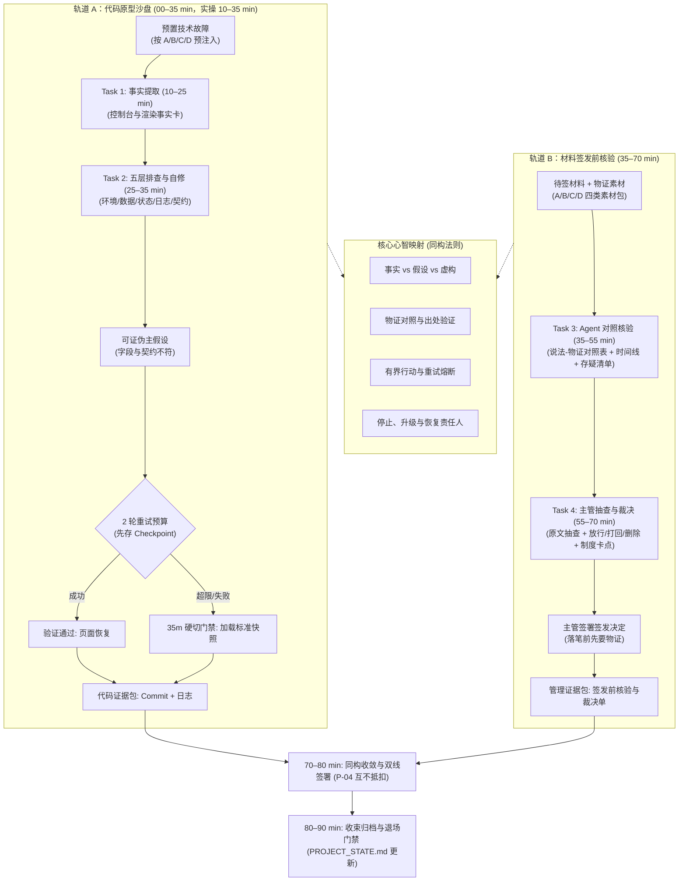

# 第六课课程设计简报 (Lesson Design Brief)

<!-- v2.2.0 Track B 重定位：从“业务五层事故调查”重定位为“签发前核验”（落笔之前，先要物证）；已获课程所有者批准 -->

`contract_version: 2.1`

---

## 1. 课程元数据与权威依据 (Metadata and Authority)

| 字段 | 设定值 | 契约约束说明 |
| --- | --- | --- |
| `lesson_number` | 6 | 对应第 6 课《用事实找 Bug，在边界内修复》 |
| `course_context` | 目标学员为具备业务管理经验的部门主管（非技术/AI新手），已完成 L1–L5，拥有可运行的业务薄片与受控智能候选；采用线下/线上混合工作坊模式；配备助教（3分钟响应接管）；课时硬上限 90 分钟 | 严格执行双轨工作坊时间与认知负荷限制 |
| `authority_refs` | 1. `lessons/TEN_LESSON_FROZEN_BASELINE.md`<br>2. `lessons/CURRICULUM_REBALANCING_AND_DUAL_TRACK_OPTIMIZATION_PROPOSAL.md` (v1.4 Approved & Frozen Baseline · 2026-09-15)<br>3. `lessons/COURSE_ROADMAP.md`<br>4. `lessons/COURSE_ROADMAP_STUDENT.md`<br>5. `lessons/GLOSSARY.md` | 严禁引用陈旧 `docs/` 目录；所有引用均基于 `lessons/` 权威文件 |
| `contract_version` | 2.1 | 严格遵循 2.1 契约标准 |
| `candidate_version` | 2.2.0 | 本次升级设计版本号（Track B 重定位为签发前核验） |
| `comparison_baseline` | `lessons/LESSON_06_TEACHER_PLAN.md` 与 `lessons/LESSON_06_GUIDE.md` (原 90 分钟单轨版本) | 用于显式对比并形成继承表 |

---

## 2. 成果与非目标 (Result and Non-goals)

### 2.1 课堂主成果 (`classroom_main_result`)
**诊断与事实归因双成果包**：
1. **代码沙盘成果**：在限定 2 轮重试预算内，通过五层诊断定位并修复个人原型中的预置技术故障（或在触发熔断后生成标准停止交接记录）；
2. **管理实战成果**：在待签发业务材料（如《关于 8.10 订单延误的情况说明（草案）》等四类素材包）中，驱动 Agent 进行“说法-物证”严密核验，剥离无物证与矛盾表述，起草并签署落盘《签发前核验与裁决单》（A段核验底稿 + B段主管裁决）。

### 2.2 双轨结构分配 (`dual_track_structure`)
严格执行 **35 + 35 + 10 + 10** 刚性时间预算：
- **`track_a_sandpit` (00–35 min)**：导入与原型沙盘技术排错（Task 1–2）。
  - 导入、痛点唤醒与模型建立 (00–10 min)：对比“盲目反复试越改越乱” vs “有界排错”，讲解 5 大核心概念与排错边界（10 min）；
  - Task 1 (10–25 min)：运行 `$diagnose` 脚本，确认故障现象，审查 Agent 产出的事实报告（15 min）；
  - Task 2 (25–35 min)：运行五层诊断定位问题层，选定可证伪主假设，存 Checkpoint，在 2 轮预算内有界修复与刷新验证（10 min）；
  - **35 分钟硬切门禁 (P-01)**：第 35 分钟一到，未跑通的学员由助教一键下发预置修复分支快照，全员准时切入轨道 B。
- **`track_b_management` (35–70 min)**：签发前物证核验实战（Task 3–4）。
  - Task 3 (35–55 min)：载入待签材料与物证素材包，指挥 Agent 进行核验并产出“说法-物证对照表 + 时间线 + 存疑清单”核验底稿（20 min）；
  - Task 4 (55–70 min)：主管抽查出处真实性，下达放行/打回/删除裁决，锁定流程卡点与整改期限，落盘《签发前核验与裁决单》至学员项目 `docs/SIGNOFF_VERIFICATION_REPORT.md`（15 min）。
- **同构收敛与签署 (70–80 min)**：
  - 点拨“代码控制台排错（修好了拿事实来验）”与“材料签发前核验（落笔前先要物证）”的认知同构性；核验并签署裁决单（10 min）。
- **收束与归档 (80–90 min)**：
  - 执行 Git Commit、更新 `docs/PROJECT_STATE.md`，完成 5 道随堂测试题并执行退场门禁（10 min）。

### 2.3 双线最低证据契约 (`prototype_progress_line` & `supervisor_judgment_line`)
- **`prototype_progress_line`（原型推进线）**：
  - Git Commit 存档记录（`checkpoint: before lesson 6 debug` 与修复后 commit）；
  - 本地预览端口（`127.0.0.1:8888`）页面状态标签恢复正常渲染的可观察状态截图或记录；
  - 控制台 `$diagnose` 自动化执行日志（无多余文件扩散）。
- **`supervisor_judgment_line`（主管判断线）**：
  - 完整填写的《签发前核验与裁决单》（包含：A段核验底稿[说法-物证对照、时间线、存疑清单]与B段主管裁决[出处抽查、放行/打回/删除裁决、制度卡点、整改期限与签名]）。
- **`line_merge`（双线汇聚与 P-04 互不抵扣铁律）**：
  - 原型代码自修成功**绝对不可抵扣**主管签发前核验与裁决单的缺失；
  - 裁决单完成度**绝对不可抵扣**沙盘代码的执行与验证。两条主线必须独立核验通过。

### 2.4 明确非目标 (`non_goals`)
- 不同时排查多个故障，一次只诊断和修复一个单一故障；
- 不允许 Agent 盲目深挖框架源码（如 `node_modules`）或编写庞大的单元测试套件；
- 不运行无范围的危险恢复命令（如 `git reset --hard` 清空未备份工作区）；
- 不把“Agent 自动修复”宣传为 100% 的确定性保证；
- 不在业务素材中使用未脱敏的真实企业敏感数据；
- 不在第 6 课提前引入第三方外部 Skill 检索（该动作严格锁定在 L7）；
- **课程边界防重复约定**：L6 聚焦“签发前的自查核验（我方物证对照）”，明确不涉及 L7 的“处理手里的数据（数据分析与处理，不涉及签发）”，亦明确不涉及 L8 的“发布前的双盲对抗审查（独立蓝方挑刺）”。

### 2.5 AI/Agent 融入业务节点 (`next_ai_integration_boundary`)
承接 L5 智能机会候选，把 ReAct 探索与人在回路（HITL）控制落实到排错现场：Agent 具备推理和建议能力，但主管牢牢掌握“事实审查、范围核对、两轮熔断与最终裁决”四大权力。本课不仅为原型提供抗脆弱保障，更将排错心智迁移为管理利器，为 L7 引入自动化工具（Browser MCP）与外部生态技能打下严谨的事实锚定基础。

### 2.6 四类业务原型适配与预置故障机制 (`archetype_adaptations`)
- **四类原型故障与签发素材包映射**：
  - **Type A（监控与决策型，如质量预警看板）**：
    - 沙盘故障：指标状态标签由于字段拼写错误（`status_name` vs `status`）空白；
    - 签发素材包：《经营异动归因说明（待签稿）》（待签稿 vs 车间温湿度监控日志与 ERP 工单流水，设 3 处冲突：说法①与物证矛盾[技术缺陷推诿给天气]、说法②无物证[声称走标准预警流实为私信未创工单]、说法③属虚构瞒报[未出具正式质检报告即宣称合格率 99.8%]）。
  - **Type B（任务与流程型，如客诉处理审批流）**：
    - 沙盘故障：审批节点处理人字段类型不匹配导致流程挂起；
    - 签发素材包：《关于 8.10 订单延误的情况说明（草案）》（待签稿 vs 微信记录/ERP订单/IT日志/物流凭证，设 3 处冲突：说法①与物证矛盾[声称正规渠道通知与加急发货但ERP为普通]、说法②无物证[尽职通知义务无据推论]、说法③属虚构瞒报[声称系统偶发宕机但IT日志证实全天正常运行]）。
  - **Type C（操作工具型，如供应商报价核算器）**：
    - 沙盘故障：计算输入项缺失导致合计栏渲染为 `NaN`；
    - 签发素材包：《月度采购费用汇总与汇率调差点说明（待签稿）》（待签稿 vs 财务指导汇率通知表/国际电汇水单/OA流水，设 3 处冲突：说法①与物证矛盾[未在下单日拉取最新牌价而用过期货品汇率]、说法②属虚构谎报[把算错增值税税差谎称为银行系统升级]、说法③无物证[口头声称特批但总监邮箱与OA无痕迹]）。
  - **Type D（研发创作工作台型，如服装研发/品牌视觉企划工作台）**：
    - 沙盘故障：设计变体卡片展开抽屉后，面料规格与打样说明字段未双向绑定导致更新丢失；
    - 签发素材包：《秋冬季样衣打样定稿确认单（待签稿）》（待签稿 vs 主企划规格确认单/面料入库检验卡/企划定版评审表，设 3 处冲突：说法①与物证矛盾[私自降级混纺违背主企划纯羊毛硬红线]、说法②属虚构瞒报[未按新色号打样却谎称完全达标]、说法③无物证[口头客套“版型先看看”包装为全票通过建议签字]）。
- **预置故障下发与标准快照恢复机制 (P1-3)**：
  - **课前故障注入**：由助教在课前巡检时，根据学员在前序课程所选业务原型类别（A/B/C/D），在学员当前工作区分支对应注入单一故障点（保证故障单一、确定且具备最小证据复现性）；
  - **4 套标准修复分支快照**：助教端集中维护 4 套与原型严格对应的修复分支快照（`fix-branch-type-a`, `fix-branch-type-b`, `fix-branch-type-c`, `fix-branch-type-d`）；
  - **35 分钟硬切降级兜底**：当学员达到 2 轮重试预算上限或到达第 35 分钟硬切门禁时，助教一键为其检出对应原型类别的标准修复快照（统一沙盘或未明确类别的学员，缺省采用 Type B 快照兜底），在控制台标记 `STATUS: RECOVERED_BY_SNAPSHOT`，确保 100% 学员准时且带着可运行的原型进入轨道 B。

---

## 3. 目标、证据与对齐映射 (Objectives and Evidence)

### 3.1 学习目标 (`objectives`)
1. **[应用]** 学员能在原型沙盘中复现脱敏故障，驱动 Agent 运行五层诊断卡，且在 2 轮重试预算内完成有界自修或触发熔断停止；
2. **[分析]** 学员能让 Agent 对待签结论性材料产出“说法-物证对照表 + 时间线 + 存疑清单”（核验底稿），严密剥离无物证与矛盾表述，指出至少 1 项不可信信息；
3. **[评价]** 学员能基于核验底稿与出处抽查，起草含放行/打回/删除裁决、流程漏洞拦截卡点及整改期限的《签发前核验与裁决单》，并由本人作出签发决定；
4. **[决策]** 学员能基于证据独立作出继续、重试、停止或签发裁决，严禁将“Agent 还想试”或“材料看着顺眼”作为行动理由。

### 3.2 目标—活动—证据对齐图 (`alignment_map`)

| 学习目标 | 对应活动 | 验收证据 | 主管裁决动作 |
| --- | --- | --- | --- |
| 1. 2 轮内有界技术自修 | Task 1 & Task 2 (沙盘排错) | Git Commit 记录 + 预览页面正常显示（或标准停止记录） | 核对修改文件范围，下达修复授权口令 |
| 2. 说法-物证核验底稿 | Task 3 (签发前对照核验) | 说法-物证对照表 + 时间线 + 存疑清单，明确标出不可信项 | 审查核验底稿，核定物证对应关系与存疑点 |
| 3. 主管裁决与签发单 | Task 4 (签发前裁决与落盘) | 签署落盘的《签发前核验与裁决单》 | 抽查原文出处，下达裁决、卡点与期限并签字 |
| 4. 熔断与签发决策 | 综合复盘与随堂测试 | 5 道随堂必答题 + 随堂口头问答 | 拒绝盲目重试与无物证签字，执行熔断与归档 |

### 3.3 自动化校验与教师裁决界限 (`auto_checkable` vs `teacher_judged`)
- **自动化可校验项 (`auto_checkable`)**：
  - Git working tree 是否干净，是否存在 Checkpoint commit；
  - 本地预览服务 `http://127.0.0.1:8888/` 是否正常响应；
  - `$diagnose` 脚本输出格式是否包含 5 层状态。
- **教师/主管人工裁决项 (`teacher_judged`)**：
  - 核验底稿中是否做到说法与物证严格逐条对照，存疑清单是否准确识别无物证与矛盾项；
  - 修改范围是否严格限定在故障组件内，无代码污染；
  - 裁决单中的放行/打回/删除裁决是否客观公正，制度卡点是否具备系统或流程强制拦截刚性；
  - 整改第一责任人与完成期限是否明确具体，签发栏是否由主管本人签署。

---

## 4. 概念曝光台账 (Concept Exposure Ledger)

严格遵循 commit `7114ddc` 规范，所有 5 个核心概念均采用**「是什么 / 怎么用 / 避坑红线」**三段式结构，并附带明确的**交接价值**与回指 Task。

### 4.1 核心概念清单 (`core_concepts`，共 5 个)

#### 1. 事实、假设与生成错误
- **是什么**：事实是看到的真实报错或落盘凭证；假设是对根因的推测；生成错误是 AI 凭空捏造的不实信息。
- **怎么用**：故障排查与签发核验时建立严格对照清单，严禁把推测当事实。双轨双用：轨道 A 用于 Bug 复现物证（界面报错与控制台堆栈真实可验）；轨道 B 用于待签材料说法与原始单据/记录对照（落笔之前先对物证，无出处一律归入待验证假设）。
- **避坑红线**：严禁把 AI 生成的解释或待签材料中的主观汇报直接当成最终结论，缺少日志、单据与代码物证一律视为未证明。
- **交接价值**：回指 Task 1 与 Task 3——事实卡与核验底稿只记录看到和查验到的物证，不记推测。

#### 2. 根因定位与五层诊断
- **是什么**：按“环境层 → 数据层 → 状态层 → 日志层 → 契约层”逐级排查问题的技术诊断方法。
- **怎么用**：提出一个有明确验证依据的推断，按层搜集证据；推断被推翻立刻更换方向。仅用于代码沙盘排错定位技术根因（业务侧全量收敛为“说法-物证对照”与制度卡点，不再套用业务五层）。
- **避坑红线**：严禁看到界面报错就胡乱动手修改，没有定位到具体层级之前禁止动手。
- **交接价值**：回指 Task 2——五层定位报告必须附带具体证据，作为向技术团队汇报的统一结构。

#### 3. 有界排错（限时限范围）
- **是什么**：锁定单一问题、限定修改范围、设定最多只试两轮的止损排查机制。
- **怎么用**：排错前先存快照，第一轮不通调整思路试第二轮，两轮仍未解决立即停机转人工。
- **避坑红线**：严禁放任 AI 无限试错，两轮无进展时必须导出补丁快照并恢复现场，绝不扩大破坏面。
- **交接价值**：回指 Task 2——严格限定修改的文件范围与次数，防止技术负债失控。

#### 4. 重试预算与熔断
- **是什么**：为自动修复设定的次数上限（如最多 2 次），达到阈值强制停止。
- **怎么用**：防止 AI 在错误思路上越陷越深，保护上下文干净，及时触发人工介入。
- **避坑红线**：严禁解除重试限制，盲目重试不仅浪费成本，还会造成代码大面积污染。
- **交接价值**：回指 Task 2 与宏观阶段硬切门禁——两轮未解决必须触发熔断转人工或切入下一阶段。

#### 5. 停止、升级与恢复
- **是什么**：停止当前自动化、交由明确责任人接管、从 Checkpoint 存档安全回退到已知版本。
- **怎么用**：达到停止条件时保留现场物证与所需证据清单，交接给对应技术或业务责任人。
- **避坑红线**：严禁在未保留现场证据的情况下直接无差别清空工作区，严禁无责任人悬空。
- **交接价值**：回指 Task 2 与 Task 4——沙盘停止时留下证据包并交接技术；签发裁决时明确制度卡点、整改责任人与期限。

### 4.2 扩展认识 (`extension_concepts`，共 2 个)
1. **表象与根因的深层分离**：界面红字（表象）往往由数据契约缺失（根因）引起；客诉推诿（表象）往往由跨部门单据缺少幂等锁（根因）引起。仅作认知拓展，不设独立考核。
2. **诊断快照（Checkpoint & Patch）**：在动工前使用 Git 留下存档，并在排错失败时提取补丁脱困的高阶工程心智。

### 4.3 操作术语与教师背景 (`operation_language` & `teacher_background`)
- **操作术语**：事实锚定排错、五层诊断口语化标签（环境/数据/状态/日志/契约）、最小证据集、2 轮硬熔断、35 分钟硬切门禁。
- **教师背景**：LLM 在长会话下的自圆其说（Attention Drift）机制、浏览器 DevTools Console 堆栈原理、Git Working Tree Clean 状态机原理。

### 4.4 复合规则核查 (`composite_rule_check`)
核验确认：上述 5 个核心概念各自拥有独立的判断标准与排他性语义，无复合词隐藏独立判断的情形。

---

## 5. 课程融合心智模型 (Integrated Lesson Model)

- **模型类型 (`type`)**：`method_loop`（方法闭环）+ `evidence_chain`（双轨证据链）
- **核心逻辑 (`learning_function`)**：
  揭示“代码沙盘排错（修好了拿事实来验）”与“材料签发前核验（落笔前先要物证）”在底层认知结构上的完全同构性：均遵循“观察客观事实 ➔ 对照物证证据 ➔ 严格限定边界 ➔ 验证出处真实性 ➔ 明确落笔责任”的方法论。
- **非时间表核验 (`not_timetable`)**：`true`。该图表达的是逻辑决策模型与证据流动拓扑，绝非课堂时间推进表。



---

## 6. 活动与任务实施逻辑 (Activity and Task Logic)

### 6.1 刚性时间预算 (`macro_phases` & `time_budget`)

| 时间段 | 阶段名称 | 核心驱动 | 产出物 | 门禁规则 |
| --- | --- | --- | --- | --- |
| **00–10 min** | 导入、痛点唤醒与模型建立 | 教师对比“盲目反复试越改越乱” vs “有界排错”，讲解 5 大核心概念与示范 | 明确双轨目标与排错边界 | 无 |
| **10–25 min** | **轨道 A：Task 1 故障事实提取** | 激活 `$diagnose`，复现故障现象，审查 Agent 产出的事实卡 | 结构化事实卡（零推测、敏感信息脱敏） | 严禁动代码，必须剥离假设 |
| **25–35 min** | **轨道 A：Task 2 五层有界自修** | 运行五层诊断定位问题层，存 Checkpoint，2 轮预算内完成有界修复 | Git Commit + 原型修复证据 | **35m 硬切门禁 (P-01)**：未跑通者立即加载预置修复快照切出 |
| **35–55 min** | **轨道 B：Task 3 待签材料物证核验** | 载入待签材料与物证素材包，指挥 Agent 进行说法-物证对照核验 | 核验底稿（说法-物证对照表 + 时间线 + 存疑清单） | 严禁凭主观猜测，必须逐条索取物证 |
| **55–70 min** | **轨道 B：Task 4 主管抽查与裁决签署** | 抽查 Agent 核验底稿出处真实性，下达裁决与制度卡点并签署 | 《签发前核验与裁决单》（保存于学员项目 `docs/SIGNOFF_VERIFICATION_REPORT.md`） | 必须完成出处抽查、制度卡点与主管签字 |
| **70–80 min** | **同构收敛与双线签署** | 教师点拨代码与管理同构性（修好了拿事实来验，落笔前先要物证），核验双线成果并盖章 | 签署裁决单 | **P-04 铁律**：双线独立核准，严禁相互抵扣 |
| **80–90 min** | **收束、归档与退场门禁** | 提交 Git Commit，更新 `PROJECT_STATE.md`，完成 5 题随堂测验 | 归档项目状态单 + 随堂测验答卷 | 随堂测验提交，工作区干净 |

### 6.2 任务卡片定义 (`tasks`)

#### Task 1 (Track A, 10–25 min)：激活 `$diagnose`，确认故障现象，审查事实报告

- **教师卡片 (`teacher_card`)**：
  - **示范**：打开工单看板页面，确认“状态标签空白”；激活 `$diagnose` 执行 Phase 1–2，展示 Agent 生成的事实卡（仅记录可观察现象，剔除“可能是字段写错”等推测）。
  - **口令**：“看一眼你的页面确认故障存在，激活 `$diagnose` 让 Agent 复现并生成事实卡。你负责审查报告，确认只有客观事实、没有主观猜测。不要自己查代码，不要让 AI 动代码。”
  - **巡视判断**：学员是否先看一眼故障；事实卡是否混入推测；敏感信息是否已替换为 `<REDACTED>`。
  - **失败降级**：若学员尝试自己看控制台，提醒“让 Agent 查，你审报告”；若 AI 混入猜测，要求执行事实假设分离。
- **学员卡片 (`learner_card`)**：
  - **目的**：获取一份只含事实、不含推测的技术事实卡。
  - **直接可复制提示词**：
    ```text
    我已在本地预览确认页面故障存在。现在激活 $diagnose，请按 Phase 1—2 执行：
    1. 检查当前本地开发服务（127.0.0.1:8888）与页面可见状态；
    2. 生成一张事实卡，严格只记录可观察事实（页面报什么、数据显示什么、控制台报错第一行）；
    3. 严禁写入任何猜测原因（假设下一步再做）；
    4. 严禁修改任何代码文件；
    5. 日志中若出现 Token/Key 等敏感信息，必须脱敏为 <REDACTED>。

    输出格式：
    - 故障现象：（肉眼看到什么）
    - 复现路径：（点击哪一步触发）
    - 控制台关键信息：（脱敏后第一行）
    - 数据状态：（组件接收到的具体字段名与值）
    ```
  - **预期观察**：Agent 给出结构化事实卡，无任何代码修改。
  - **自检点**：事实卡是否全为客观记录？是否有未授权的文件变动？
  - **强制停止门禁 (Mandatory Stop)**：若 Agent 擅自修改代码，立即运行 `git checkout .` 还原并重新发指令。

#### Task 2 (Track A, 25–35 min)：运行五层诊断，存 Checkpoint，在 2 轮预算内完成有界修复

- **教师卡片 (`teacher_card`)**：
  - **示范**：指导 Agent 运行五层诊断定位到契约层（`status_name` 与 `status` 不一致）；先执行 `git commit` 存档，然后让 Agent 提出“只改 1 个字段”的修复方案，主管核对范围后授权执行；刷新页面验证；宣告第 35 分钟硬切门禁规则。
  - **口令**：“五层排查定位到一层；动代码前先存 Checkpoint；核对修改范围不超过 1 个文件；刷新验证通过即完成。超时未完成者，35 分钟一律由助教下发修复分支，准时进入管理实操！”
  - **巡视判断**：是否已存 Checkpoint；修改范围是否扩散；是否在 2 轮预算内收敛。
  - **失败降级**：达到第 35 分钟或满 2 轮失败，强制触发 **P-01 硬切门禁**，由助教执行快照覆盖，标记 `STATUS: RECOVERED_BY_SNAPSHOT`，直接推进到 Task 3。
- **学员卡片 (`learner_card`)**：
  - **目的**：在有界控制下完成技术修复，体验 2 轮重试预算与 Checkpoint 防护。
  - **直接可复制提示词**：
    ```text
    $diagnose 处于运行中，请按 Phase 3—5 执行：
    1. 执行五层诊断（环境 -> 数据 -> 状态 -> 日志 -> 契约），给出每一层 PASS/FAIL 判定；
    2. 定位到具体问题层，提出 1 个可证伪主假设；
    3. 先运行 git commit -m "checkpoint: before lesson 6 debug" 建立存档快照；
    4. 读取最小证据，提出修复方案（明确列出拟修改文件名、行号与修改内容），等待我核准；
    5. 未经我核准修改范围前，绝对禁止修改文件。
    ```
  - **预期观察**：Agent 报告五层结论，定位到契约层，完成 git commit，列出极小范围修复草案并等待。
  - **核准后修改与验证提示词**：
    ```text
    批准上述修复范围。请执行单点修复，并自动刷新验证结果。若 1 轮未通过，允许微调假设再试 1 轮；若 2 轮仍未通过，必须立即停止并报告！
    ```
  - **自检点**：页面标签是否正常显示？修改文件是否仅为目标组件？
  - **强制停止门禁**：满 2 轮未修好，或时间到达第 35 分钟，立即喊助教派发标准快照，严禁拖堂！

---

#### Task 3 (Track B, 35–55 min)：载入待签材料与物证素材包，指挥 Agent 进行说法-物证对照核验

- **教师卡片 (`teacher_card`)**：
  - **示范**：展示待签发材料《关于 8.10 订单延误的情况说明（草案）》（内含销售已通知、系统故障、物流赶发等断言）与随卷物证。指导 Agent 扮演物证核验员，建立“说法-物证对照表 + 时间线 + 存疑清单”。
  - **口令**：“还记得 L5 你在智能机会卡上填的 HITL 检查点吗？那时候它只是表格里的一格。今天它长出肉来了——你要签字的那支笔，就是那个检查点。打开待签材料与物证素材，要求 Agent 像刚才查代码一样，逐条对照单据、时间戳和记录。凡是没有物证的踢进‘待验证假设’，矛盾的直接标红！严禁编造物证！若你的原型为 A/C/D 类，请打开 `student-package/cases/signoff_practice_packs.md`，将提示词中【待核验材料】与【物证素材】两段替换为你的原型对应案卷，其余指令逐字保留！”
  - **巡视判断**：学员是否让 Agent 逐条核验说法与物证；A/C/D 原型学员是否已根据 `signoff_practice_packs.md` 替换对应案卷；是否标出不可信项；核验底稿中是否零责任道德评判。
  - **失败降级**：若学员直接问 Agent“这篇写得好不好”，提醒“落笔前先要物证，让 Agent 做核验底稿”；若 Agent 编造出处，执行事实假设分离。
- **学员卡片 (`learner_card`)**：
  - **目的**：掌握结论性材料签发前的物证核验技术，驱动 Agent 产出说法-物证对照表、时间线与存疑清单（核验底稿）。
  - **直接可复制提示词**（若你的原型为 A/C/D 类，请打开 `student-package/cases/signoff_practice_packs.md`，将提示词中【待核验材料】与【物证素材】两段替换为你的原型对应案卷内容，其余指令逐字保留；Type B 原型直接复制下述提示词）：
    ```text
    我即将签发一份结论性材料，在签字前需要你做物证核验。
    【待核验材料】：
    《关于 8.10 订单延误的情况说明（草案）》
    1. 销售部于 8 月 10 日 14:00 获悉客户次日达加急需求后，已在 14:05 通过正规发货协同渠道向仓储部下达了加急发货指令；
    2. 仓储部未能及时安排当晚加急出库，承运商已于 8 月 11 日按加急物流通道全力组织赶发，但受陆运干线周转影响发生滞留；
    3. 8 月 11 日下午客服跟单排查期间，适逢后台业务系统偶发故障宕机，导致技术人员与客服均无法调取在途流水向客户反馈；
    4. 本次延误系跨部门协同衔接与外部系统偶发故障叠加所致，销售人员已尽到尽职通知义务。特此说明，请予签发上报。

    【物证素材】：
    1. 销售 A 14:05 仅在微信协作大群发消息“这单急”，未在 ERP 系统勾选【加急】标签；
    2. ERP 订单 #ORD-20260810-092 原始记录：is_urgent: false, shipping_method: standard_ground，录入时间 14:10；
    3. 仓库 8 月 10 日 16:30 依 ERP 单据按普通件排期，承运商 8 月 11 日按普通陆运装车，无航空专线记录；
    4. IT 运维日志证实 ERP 与客服系统全天正常运行，无服务宕机或断流记录，客服未执行流水查询；
    5. 货物 8 月 13 日 11:00 送达，延误 48 小时。

    请严格执行：
    1. 从待核验材料中逐条提取可核验的说法（数据、时间、责任归属、"已通知/已完成"类断言）；
    2. 对每条说法在物证素材中寻找支持或反证，标注三项之一：物证支持（给出出处）/ 无物证（归入待验证假设）/ 与物证矛盾（标红并给出反证出处）；
    3. 重建关键事件时间线，标出材料中与时间线冲突的表述；
    4. 你自己严禁编造物证：找不到就写"未在素材中找到"，严禁推测补全；
    5. 输出核验底稿：说法-物证对照表 + 时间线 + 存疑清单。不做责任评判，不写"谁错"，只报事实与冲突。
    ```
  - **预期观察**：Agent 给出结构化核验底稿（说法-物证对照表、时间线、存疑清单），清晰标出客服谎报系统故障与销售口头通知缺乏单据支持。
  - **自检点**：说法是否逐条对照？是否标明物证出处？存疑清单是否至少识别 1 项矛盾与 1 项无物证？
  - **强制停止门禁**：若 Agent 试图替当事人辩解或进行主观责任归咎，要求其立即重写，只保留中立事实与物证对照。

#### Task 4 (Track B, 55–70 min)：主管出处抽查，起草裁决并签署《签发前核验与裁决单》

- **教师卡片 (`teacher_card`)**：
  - **示范**：主管审查 Agent 核验底稿，下达抽查指令要求 Agent 出示原文出处并核验；指导 Agent 起草《签发前核验与裁决单》B 段（逐条下达放行/打回修正/删除裁决、2 条确定性制度卡点、明确第一责任人与期限）；主管亲自签署签发决定。
  - **口令**：“Agent 核验完了，不能凭‘Agent 说核过了’就直接签字！必须逐条抽查原文出处，落笔签发前下达裁决：哪些说法放行，哪些打回重写，哪些必须删除。最后锁死制度卡点和整改责任人。签发责任永远在你身上！”
  - **巡视判断**：学员是否执行抽查指令；裁决单是否逐条作出放行/打回/删除裁决；制度卡点是否落在具体流程拦截点而非口头说教；整改责任人与完成期限是否明确。
  - **失败降级**：若学员未抽查直接签字，强制要求下发抽查指令；若防范措施写“加强员工培训”，打回并要求写出具体制度拦截卡点（如：ERP 未勾选加急禁止承诺发货）。
- **学员卡片 (`learner_card`)**：
  - **目的**：审查 Agent 核验底稿真实性，起草并签署企业合规水准的《签发前核验与裁决单》（B段主管裁决）。
  - **抽查口令（直接可复制）**：
    ```text
    现在由我审查你的核验底稿：
    1. 对你标注"物证支持"的每一条，把素材原文引用出来给我看，我要逐条抽查出处真实性；
    2. 对你标注"与物证矛盾"的条目，列出双方原文对照；
    3. 若我发现任何一条出处不存在或被你改写，你必须立即声明并修正。
    ```
  - **裁决落盘提示词（直接可复制）**：
    ```text
    基于核验底稿与我的抽查结论，起草《签发前核验与裁决单》B 段：
    1. 逐条给出裁决：放行 / 打回修正 / 删除该说法；
    2. 对暴露出的流程漏洞，给出 2 条确定性制度卡点（写明系统或流程在哪里强制拦截）；
    3. 明确恢复整改第一责任人（具体岗位）与期限；
    4. 起草完成后停下，最终签发决定由我本人作出并签字。
    ```
  - **预期观察**：Agent 输出出处原文供抽查，起草裁决单 B 段，列出逐条裁决、2 条确定性制度卡点及责任人，停下等待主管签字。
  - **自检点**：抽查是否核对出处原文？裁决单 B 段是否包含放行/打回/删除裁决、制度卡点、整改责任人与完成期限？
  - **强制停止门禁**：裁决单必须保存至学员个人项目根目录下的 `docs/SIGNOFF_VERIFICATION_REPORT.md`（严禁写入共享仓库 `student-package/` 目录），最终签发必须由主管本人签字，绝不可让 Agent 代签。

---

## 7. 评估与支持支架 (Assessment and Support)

### 7.1 随堂必答题 (`required_questions`，共 5 题，分散与收束结合)
1. **事实、假设和生成错误有什么本质区别？为什么排错和管理归因时必须分开记录？**
   - *参考答案*：事实是可观察物证（日志/单据），假设是待验证推断，生成错误是无依据捏造。分开记录才能保证决策链可追溯，防止基于伪事实采取错误行动。
2. **五层诊断卡的五层分别是什么？为什么要从上到下逐层排除而非到处乱猜？**
   - *参考答案*：环境、数据、状态、日志、契约。逐层排除能建立最小排查漏斗，防止因跳层排查而把浅层配置错误误诊为深层代码缺陷。
3. **有界排错要求明确哪四项约束？为什么不能无限试错？**
   - *参考答案*：明确单一故障、可证伪主假设、限定修改文件范围、最多 2 轮重试预算。无限试错会导致上下文污染、引入次生破坏并浪费管理时间。
4. **两轮技术诊断仍未通过时，主管应该采取什么行动？为什么不能继续试第三轮？**
   - *参考答案*：立即停止自动修改，触发熔断，记录当前物证、新证据需求并交由技术人员恢复；不能继续试第三轮是因为 2 轮无进展证明现有上下文或假设已失效，继续盲目尝试只会破坏代码库。
5. **在签发前核验与业务流程审查中，为什么“员工粗心/责任心不强”不是合格的根因分析？合格的防范应该落在哪里？**
   - *参考答案*：“员工粗心”属于主观情绪归因，无法转化为系统改进。合格的防范必须落在制度卡点与流程控制层（如系统强制字段校验、无单据禁止口头承诺等刚性拦截机制）。

### 7.2 拓展选做题 (`extension_questions`，共 2 题)
1. 重试预算（Retry Budget）设为 1 轮或设为 5 轮分别会带来什么管理风险？为什么课程推荐设为 2 轮？
2. 修复了界面上的报错（技术状态正常），是否意味着业务逻辑就一定正确了？请举一例说明。

### 7.3 常见误区清单 (`misconceptions`，5 项)

| 误区编号 | 典型错误认知 | 纠偏正解 |
| --- | --- | --- |
| M-01 | “遇到报错把几十页的控制台长堆栈全复制给 AI” | 长堆栈大多是框架链式抛错，只需提供脱敏后的第一行核心 Error 信息与组件事实卡。 |
| M-02 | “AI 信誓旦旦说‘已经修复了’，那肯定就修好了” | AI 存在幻觉与自圆其说倾向，必须在本地实际刷新预览并核对界面物证才算验证通过。 |
| M-03 | “排错只要能把 Bug 改好，改了哪些文件无所谓” | 必须严格限定修改范围，严禁允许 Agent 扩散修改底层依赖或无关模块。 |
| M-04 | “下属或合作方交上来的材料写得很规范、措辞很诚恳，就可以直接签字” | 签字必须核验物证。下属或 AI 写的材料再漂亮，凡涉及关键数据、时间节点、履约断言，必须逐一索取原始单据或日志对照，落笔前先要物证。 |
| M-05 | “两轮修不好说明 AI 不够聪明，再给它试一次可能就灵了” | 2 轮不收敛是硬熔断信号，必须坚决叫停并提取 Checkpoint，严禁侥幸心理。 |

### 7.4 现场 Debug 处置类别 (`troubleshooting_categories`，5 类)

| 故障类别 | 现场典型现象 | 处置动作 (Action) | 降级预案 (Fallback) |
| --- | --- | --- | --- |
| **T-01 假设混入** | 学员/AI 把推测原因写进事实卡，或在核验底稿中把材料说法直接当物证采信 | 提示“事实是看到的/物证是落盘的，材料说法只是待验假设”，要求打回重写 | 教师下发标准核验底稿示例强制对照 |
| **T-02 范围越界** | Agent 尝试修改 `node_modules` 或底层脚本 | 立即发送停止指令，限定只改业务组件 | 运行 `git checkout .` 还原越界修改 |
| **T-03 执意重试** | 2 轮未通学员执意进行第 3 轮 | 教师执行硬阻断，要求立即写停止记录 | 助教直接派发已修复分支快照 |
| **T-04 泄露风险** | 日志或案卷中粘贴了敏感密钥或真实客资 | 立即清屏，指导学员替换为 `<REDACTED>` | 启动独立只读新会话重置上下文 |
| **T-05 虚假成功** | AI 声称修好但本地预览毫无变化 | 要求学员实际刷新浏览器，以真实观察为准 | 重新核对修改文件是否为运行态源码 |

### 7.5 教师备课质量自测清单 (`teacher_checklist_budget`，8 项)
- [ ] 00–10 分钟开场演示是否直接呈现“越改越崩” vs “有界排错”的强烈对照？
- [ ] 5 个核心概念是否全部按“是什么/怎么用/避坑红线”讲透，并严格对应到四个 Task？
- [ ] 35 分钟硬切门禁（P-01）的预置修复分支快照是否已提前准备就绪？
- [ ] 轨道 B 签发素材包《跨部门交付延误与客诉案卷》（含待签发材料草案）与《四类原型签发实战素材包》是否已脱敏并在学生端正常下发？
- [ ] 是否在现场严格执行 2 轮技术自修上限，绝不纵容第 3 轮尝试？
- [ ] 随堂 5 道必答题是否贯穿在各 Task 节点并完成回收？
- [ ] 是否向学员明确宣告 P-04 铁律：代码沙盘成果与签发前核验裁决单绝不能互相抵扣？
- [ ] 课堂结束前是否留足 10 分钟完成 Git 提交与 `PROJECT_STATE.md` 更新？

### 7.6 配套标准化脚手架 (`support_scaffolds`)
1. **预置故障与恢复快照包 (P1-3)**：
   - 课前注入故障包：助教按 A/B/C/D 四类业务原型在学员分支预注入的单一故障（Type A: 字段错配, Type B: 处理人类型不匹配, Type C: 计算输入缺失导致 NaN, Type D: 面料与打样规格双向绑定丢失）；
   - 4 套标准修复分支快照：助教端集中维护 4 套与原型严格对应的修复分支快照（`fix-branch-type-a`, `fix-branch-type-b`, `fix-branch-type-c`, `fix-branch-type-d`）（沙盘缺省环境统一采用 Type B 快照兜底）；
2. **脱敏业务案卷与签发素材包**：《跨部门交付延误与客诉案卷》（`student-package/cases/cross_department_delay_case.md`，含待签稿与合成免责声明）与《四类原型签发实战素材包》（`student-package/cases/signoff_practice_packs.md`）；
3. **管理模具与参考样例 (P0-B)**：
   - 《签发前核验与裁决单模版》（空白学员模具：`student-package/templates/SIGNOFF_VERIFICATION_TEMPLATE.md`）；
   - 《签发前核验与裁决单标准样例》（教师参考样例：`student-package/templates/SIGNOFF_VERIFICATION_GOLDEN_SAMPLE.md`，仅用于 70–80 分钟同构收敛展示与教师巡视对照）；
4. **排错脚本**：`$diagnose` 结构化诊断指令集。

---

## 8. 产物渲染契约 (Output Rendering Contracts)

| 契约项目 | 约定规则 |
| --- | --- |
| `teacher_plan_contract` | 严格渲染为 8 个二级标题（H2）模块；严格贯彻 35+35+10+10 双轨时间分配；Task 包含教师卡（示范、口令、巡视、降级）；严格落实 35 分钟硬切门禁与 P-04 互不抵扣铁律 |
| `learner_guide_contract` | 严格渲染为 6 个二级标题（H2）章节；单一学员指南文档；Task 包含学员卡（目的、直接可复制提示词、预期观察、自检点、强制停止门禁）；提示词中零占位符 |
| `guide_requires_approved_plan` | `true`（必须在教案独立评审通过并获批准后方可生成指南） |
| `guide_conformance_required` | `true`（学员指南必须与本简报及教案保持 100% 结构一致性） |

---

## 9. 安全与数据红线契约 (Safety and Data Redlines)

1. **全程模拟与脱敏数据红线 (`mock_chain`)**：原型排错只使用 Mock 数据；业务案卷只使用脱敏虚拟场景；任何系统日志中的 Token、Password、Key 均必须事前脱敏为 `<REDACTED>`。
2. **无真实凭证红线 (`no_real_keys`)**：课堂中绝对禁止学员填入真实大模型 API Key 或第三方密钥。
3. **事前脱敏红线 (`pre_deidentification`)**：所有外部材料在送入大模型或 Agent 提示词前，必须完成脱敏审查。
4. **环境隔离与控制 (`teacher_real_calls`)**：一切涉及真实网络调用的工具演示必须在教师受控环境中展示，不向学员机开放无界权限。
5. **杜绝虚构能力 (`no_fabricated_capabilities`)**：严禁在教案或指南中编造不存在的校验脚本或控制能力；实际使用什么工具（如 `$diagnose`、`git`），就如实展示什么证据。

---

## 10. 准备度与继承追溯表 (Readiness and Inheritance)

### 10.1 简报就绪状态 (`brief_readiness`)
**`HANDOFF_READY`**。本简报内容完备，厚度校验通过，双轨逻辑与时间预算自洽，无任何未解决的悬空占位符。

### 10.2 内容继承与调整全景表 (`inheritance_table`)

| 原教案/指南内容项 | 冻结基线与双轨优化要求 (v1.4) | 判定 (Judgment) | 具体处理方案 (Treatment) | 决策依据与理由 (Rationale) |
| --- | --- | --- | --- | --- |
| 原 5 个核心概念 | commit `7114ddc` 规范（是什么/怎么用/避坑红线） | **Rewrite** | 全面重写为三段式规范定义，并补充交接价值与回指 Task | 确保概念表达高度精炼，杜绝废话与学术黑话 |
| 原排错流程模型 | 课程融合心智模型（Method Loop + Evidence Chain） | **Rewrite** | 改造为双轨同构映射图（沙盘排错 ➔ 同构心智 ➔ 业务调查），明确声明非时间表 | 直观展现技术排错与管理归因的内在同构性 |
| 原 Task 1–5 (90分纯排错) | 35+35+10+10 双轨制架构 (L6–L10) | **Split & Migrate** | 将原沙盘排错紧凑压缩为 Task 1–2 (实操 10–35 min，整体沙盘 00–35 min)；新增业务案卷实战为 Task 3–4 (35–70 min) | 彻底解决原课程排错耗时不足 45 分钟、主管缺乏管理获得感的痛点 |
| 原 2 轮硬熔断规则 | 35 分钟硬切门禁 (P-01) + 2 轮重试预算 | **Retain & Enhance** | 保留 2 轮重试预算概念，强化 35 分钟助教一键派发快照的刚性门禁 | 保证课堂进度绝对不脱节，确保全员准时切入管理实战 |
| 原提示词模板 | 零占位符、直接可执行、支持四类原型 | **Rewrite** | 重构 Task 1–4 提示词，补充业务案卷提示词，彻底消除 `【...】` 等占位符 | 降低学员输入认知负担，确保复制即可运行 |
| 原现场 Debug 处置 | 现场 Debug 5 类根因分类 | **Retain** | 保留并增强为 T-01 至 T-05，明确教师动作与降级预案 | 现场实战指导性极强，完全契合真实课堂偶发状况 |
| 原 5 道必答题与拓展题 | 随堂测评与双轨知识点核对 | **Retain & Enhance** | 保留并调整第 5 题，使其直接覆盖业务制度根因归因分析 | 闭环评估双轨教学成效 |
| 原成果验收标准 | P-04 双线最低证据互不抵扣铁律 | **Rewrite** | 明确定义代码沙盘线与主管判断线的最低物证，严禁互相抵扣 | 树立严肃的教学交付标准，杜绝“代码没跑通靠写文章糊弄”或反之 |
| Track B 业务实战定位 | 业务五层事故调查单 ➔ 签发前物证核验与裁决单 | **Rewrite** | 全面重构为签发前核验（A段核验底稿+B段主管裁决），退役业务侧五层，挂靠主管签字时刻与 L5 HITL 检查点回环 | 彻底消除业务五层的生搬硬套与晦涩感，还原部门主管真实的日常签发场景，已获课程所有者批准（v2.2.0） |
