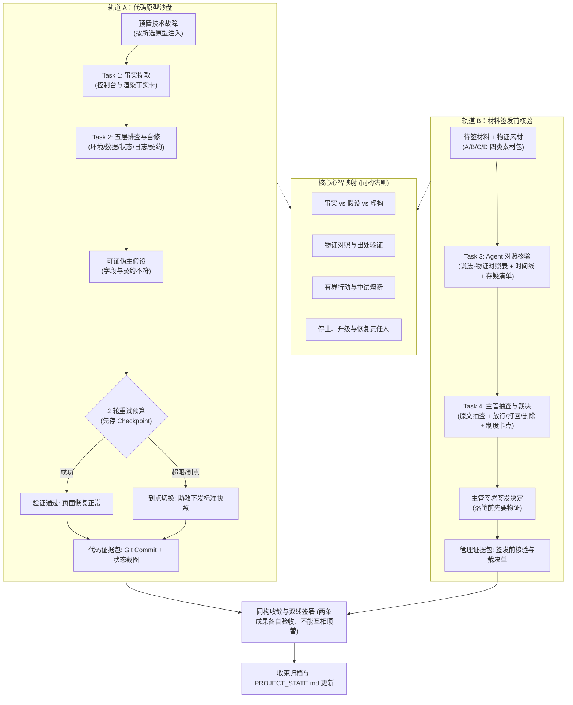

# 第六课学员指南——用事实找 Bug，在边界内修复

> **本课核心思想只有一句话：**
> **排错不是让 Agent 反复盲试，而是从可观察事实出发、限制轮次预算，在证据不足时坚决停下来交由责任人接管。**

---

## 一、先看懂：今天为什么学、要带走什么

### 1.1 先看一个反差

在开始操作前，请先看两种完全不同的排错方式带来的结果对比：

| 让 Agent 盲目反复试 | 从事实出发、有界控制、修不好就停 |
| :--- | :--- |
| 看到页面报错，就对 AI 说“帮我看看怎么修”，AI 开始天马行空胡乱猜测并四处修改代码。 | 先在浏览器中看一眼确认故障，命令 AI 只记录客观物证，再逐层排查定位根因。 |
| AI 改动范围越来越大，原本正常的组件和依赖也被改坏，上下文陷入严重混乱。 | 动代码前先存 Checkpoint 存档快照，将修改严格限定在 1 个组件内的单一字段。 |
| 连续尝试三四轮依然不收敛，项目彻底黑屏死锁，历史记录全部被污染。 | 严格执行 2 轮重试预算，两轮不通坚决触发熔断，保留现场物证并由责任人接管。 |
| AI 信誓旦旦说“已经修好了”就盲目相信，从未在浏览器中亲自刷新验证。 | 绝不听信 AI 自称，必须在本地浏览器中肉眼核实界面恢复的可观察物证。 |

今天你将通过亲手实操，掌握这套**“有界排错”**的核心控制力。

### 1.2 今天你要带走什么

完成本课后，你将带走一份**“诊断与事实归因双成果包”**：
1. **代码沙盘成果**：在你的个人原型中，面对预置故障，在 2 轮预算内完成五层诊断并有界自修；若触发熔断，则完整体验由助教加载标准快照恢复现场的工程纪律。
2. **管理实战成果**：在待签发业务材料中，让 Agent 产出“说法-物证对照表 + 时间线 + 存疑清单”（核验底稿），严密剥离无物证与矛盾表述，抽查出处原文，起草含放行/打回/删除裁决与制度卡点的《签发前核验与裁决单》，并由本人签字落盘。

> **两条成果各自验收、不能互相顶替**：沙盘代码跑通不能顶替签发前核验裁决单的缺失，裁决单写得再完善也不能顶替沙盘代码的实际验证。两条主线均需独立通过。

### 1.3 本课融合心智模型 (Cognitive Model)

技术排错与管理归因在底层认知结构上是完全同构的。下面的模型图展示了两者统一的思维闭环（**本图表达决策与证据流动关系，非课堂时间表**）：



### 1.4 五个必须掌握的核心概念

#### 1. 事实、假设与生成错误
- **是什么**：事实是看到的真实报错或落盘凭证；假设是对根因的推测；生成错误是 AI 凭空捏造的不实信息。
- **怎么用**：故障排查与签发核验时建立严格对照清单，严禁把推测当事实。双轨双用：轨道 A 用于 Bug 复现物证（界面报错与控制台堆栈真实可验）；轨道 B 用于待签材料说法与原始单据/记录对照（落笔之前先对物证，无出处一律归入待验证假设）。
- **避坑红线**：严禁把 AI 生成的解释或待签材料中的主观汇报直接当成最终结论，缺少日志、单据与代码物证一律视为未证明。

#### 2. 根因定位与五层诊断
- **是什么**：按“环境层 → 数据层 → 状态层 → 日志层 → 契约层”逐级排查问题的技术诊断方法。
- **怎么用**：提出一个有明确验证依据的推断，按层搜集证据；推断被推翻立刻更换方向。仅用于代码沙盘排错定位技术根因（业务侧全量收敛为“说法-物证对照”与制度卡点，不再套用业务五层）。
- **避坑红线**：严禁看到界面报错就胡乱动手修改，没有定位到具体层级之前禁止动手。

#### 3. 有界排错（限时限范围）
- **是什么**：锁定单一问题、限定修改范围、设定最多只试两轮的止损排查机制。
- **怎么用**：排错前先存快照，第一轮不通调整思路试第二轮，两轮仍未解决立即停机转人工。
- **避坑红线**：严禁放任 AI 无限试错，两轮无进展时必须导出补丁快照并恢复现场，绝不扩大破坏面。

#### 4. 重试预算与熔断
- **是什么**：为自动修复设定的次数上限（如最多 2 次），达到阈值强制停止。
- **怎么用**：防止 AI 在错误思路上越陷越深，保护上下文干净，及时触发人工介入。
- **避坑红线**：严禁解除重试限制，盲目重试不仅浪费成本，还会造成代码大面积污染。

#### 5. 停止、升级与恢复
- **是什么**：停止当前自动化、交由明确责任人接管、从 Checkpoint 存档安全回退到已知版本。
- **怎么用**：达到停止条件时保留现场物证与所需证据清单，交接给对应技术或业务责任人。
- **避坑红线**：严禁在未保留现场证据的情况下直接无差别清空工作区，严禁无责任人悬空。

#### 扩展认识
1. **表象与根因的深层分离**：界面报错往往只是表象，数据契约不一致才是根因；业务扯皮往往只是表象，系统缺乏防错卡点才是根因。
2. **诊断快照（Checkpoint & Patch）**：在动工前执行 Git 提交保留存档，排错受挫时可随时一键安全回退。

---

## 二、准备好：回顾第五课原型并确认环境

### 2.1 确认第五课原型运行正常

1. 打开终端，检查当前工作区是否干净：
   ```powershell
   git status
   ```
   *预期输出*：`nothing to commit, working tree clean`。
2. 启动本地开发预览服务：
   ```powershell
   npm run dev
   ```
   *预期输出*：本地服务器在 `http://127.0.0.1:8888/` 正常运行。若超过 3 分钟打不开，请立即呼叫助教接管。

### 2.2 确认你的原型类别与预置故障

助教已在课前根据你在 L1–L5 选择的业务原型类别，在你的工作区分支中注入了对应的单一技术故障。请根据自己的原型类型在本地浏览器中观察故障现象：

- **Type A（监控与决策型，如质量预警看板）**：
  - *故障现象*：打开工单看板或指标页面，指标卡片中的状态标签完全空白；
- **Type B（任务与流程型，如客诉审批工作流）**：
  - *故障现象*：打开审批流页面，点击审批节点按钮无任何响应，流程状态机挂起；
- **Type C（操作工具型，如供应商报价核算器）**：
  - *故障现象*：在核算表单中输入采购价格与数量后，总计金额合计栏渲染为 `NaN`；
- **Type D（研发创作工作台型，如服装/品牌企划工作台）**：
  - *故障现象*：展开企划变体抽屉编辑面料规格与打样说明后，点击保存表单数据丢失。

> **提示**：具体的技术底层根因留待你在 Task 2 中通过五层诊断自行排查定位，请勿向助教或教师提前索要答案！

### 2.3 确认实操素材就绪

1. **诊断指令**：`$diagnose` 结构化诊断提示词随时可用；
2. **业务素材包**：打开 `student-package/cases/cross_department_delay_case.md`，确认可以阅读《跨部门交付延误与客诉案卷》（含待签发材料草案）；或根据原型查阅 `student-package/cases/signoff_practice_packs.md`；
3. **裁决单模具**：打开 `student-package/templates/SIGNOFF_VERIFICATION_TEMPLATE.md`，确认这是一个干净的空白模板；
4. **输出路径约定**：你在 Task 4 产出的裁决单必须保存至个人项目目录下的 **`docs/SIGNOFF_VERIFICATION_REPORT.md`**，严禁写回共享仓库目录。

---

## 三、动手做：技术排错与管理归因双轨实操

### 3.1 轨道 A：沙盘技术排错 (Tasks 1–2)

#### Task 1：激活 `$diagnose`，确认故障现象，审查事实报告

- **本步目的**：
  在浏览器中亲眼看一眼故障，激活 `$diagnose` 命令让 Agent 复现并生成事实卡。你的核心工作是**审查事实卡**，确保只记录看到的内容、彻底剔除主观猜测，并对敏感信息进行脱敏。
- **复制提示词 (直接复制发给 Agent)**：
  ```text
  我已在本地预览确认页面故障存在。现在激活 $diagnose，请按 Phase 1—2 执行：
  1. 检查当前本地开发服务（127.0.0.1:8888）与页面可见状态；
  2. 生成一张事实卡，严格只记录可观察事实（页面报什么、数据显示什么、控制台报错第一行）；
  3. 严禁写入任何猜测原因（假设下一步再做）；
  4. 严禁修改任何代码文件；
  5. 日志中若出现 Token/Key 等敏感信息，必须脱敏为 <REDACTED>。

  输出格式：
  - 故障现象：（肉眼看到什么）
  - 复现路径：（点击哪一步触发）
  - 控制台关键信息：（脱敏后第一行）
  - 数据状态：（组件接收到的具体字段名与值）
  ```
- **你应该看见**：
  Agent 输出了一份结构化事实卡，清晰记录了故障现象与数据状态，没有任何推测原因，且未修改任何代码。
- **本步自检**：
  - [ ] 你是否先在浏览器中看了一眼故障？
  - [ ] 事实卡中是否只记录客观现象，没有任何“可能是……”、“应该是……”的推测？
  - [ ] 日志中若出现敏感 Key/Token，是否已脱敏为 `<REDACTED>`？
  - [ ] 代码文件是否完全未被修改（`git status` 显示干净）？
- **必须停止**：
  - 如果你开始尝试自己翻看代码或长堆栈，立刻停手——让 Agent 查，你只负责审报告！
  - 如果 Agent 擅自修改了代码文件，立即运行 `git checkout .` 还原，并打回重发指令。

---

#### Task 2：运行五层诊断，存 Checkpoint，在 2 轮预算内完成有界修复

- **本步目的**：
  指挥 Agent 运行五层诊断定位问题层，选定可证伪主假设；动代码前先建立 Checkpoint 存档快照；在主管严格核准修改范围的前提下执行修复并刷新验证。严格执行最多 2 轮重试预算。
- **复制提示词 1：五层排查与 Checkpoint 存档**：
  ```text
  $diagnose 处于运行中，请按 Phase 3—5 执行：
  1. 执行五层诊断（环境 -> 数据 -> 状态 -> 日志 -> 契约），给出每一层 PASS/FAIL 判定；
  2. 定位到具体问题层，提出 1 个可证伪主假设；
  3. 先运行 git commit -m "checkpoint: before lesson 6 debug" 建立存档快照；
  4. 读取最小证据，提出修复方案（明确列出拟修改文件名、行号与修改内容），等待我核准；
  5. 未经我核准修改范围前，绝对禁止修改文件。
  ```
- **复制提示词 2：核准范围与执行单点修复**：
  ```text
  批准上述修复范围。请执行单点修复，并自动刷新验证结果。若 1 轮未通过，允许微调假设再试 1 轮；若 2 轮仍未通过，必须立即停止并报告！
  ```
- **你应该看见**：
  Agent 逐层给出 PASS/FAIL 判定，定位到契约层，自动执行了 git commit 建立存档，列出仅改动 1 个组件中单一字段的极小方案；在你授权后完成修复，浏览器刷新后故障现象消失。
- **本步自检**：
  - [ ] 动代码前是否确认已经执行了 `checkpoint` 提交？
  - [ ] 修改范围是否仅限 1 个文件，没有扩散到其他无关模块？
  - [ ] 是否在本地浏览器中实际刷新肉眼确认界面恢复？
- **必须停止（到点切换，助教发快照）**：
  - 严格遵守 **2 轮重试预算**：如果第 1 轮未通过，允许微调假设再试 1 轮；若第 2 轮仍未通过，坚决强制停手，严禁盲目尝试第 3 轮！
  - **到点切换规则**：实操时间一到，无论你的沙盘是否修好，助教将一键下发已修复分支快照（`STATUS: RECOVERED_BY_SNAPSHOT`），全员必须准时切入业务案卷实战，绝不拖堂！

---

### 3.2 轨道 B：签发前物证核验管理实战 (Tasks 3–4)

#### Task 3：载入待签材料与物证素材包，指挥 Agent 进行说法-物证对照核验

- **本步目的**：
  将技术排错的心智平移到企业管理签发时刻。面对待签发的结论性材料（呈批件），指挥 Agent 扮演物证核验员，对照单据、时间戳与日志，产出“说法-物证对照表 + 时间线 + 存疑清单”（核验底稿）。严禁把推测当事实，严禁让 Agent 编造物证。
- **复制提示词 (直接复制发给 Agent)**：
  > **多原型素材指引**：若你的原型为 A/C/D 类，请打开 `student-package/cases/signoff_practice_packs.md`，将提示词中【待核验材料】与【物证素材】两段替换为你的原型对应案卷内容，其余指令逐字保留；Type B 原型直接复制下述提示词执行：

  ```text
  我即将签发一份结论性材料，在签字前需要你做物证核验。
  【待核验材料】：
  《关于 8.10 订单延误的情况说明（草案）》
  1. 销售部于 8 月 10 日 14:00 获悉客户次日达加急需求后，已在 14:05 通过正规发货协同渠道向仓储部下达了加急发货指令；
  2. 仓储部未能及时安排当晚加急出库，承运商已于 8 月 11 日按加急物流通道全力组织赶发，但受陆运干线周转影响发生滞留；
  3. 8 月 11 日下午客服跟单排查期间，适逢后台业务系统偶发故障宕机，导致技术人员与客服均无法调取在途流水向客户反馈；
  4. 本次延误系跨部门协同衔接与外部系统偶发故障叠加所致，销售人员已尽到尽职通知义务。特此说明，请予签发上报。

  【物证素材】：
  1. 销售 A 14:05 仅在微信协作大群发消息“这单急”，未在 ERP 系统勾选【加急】标签；
  2. ERP 订单 #ORD-20260810-092 原始记录：is_urgent: false, shipping_method: standard_ground，录入时间 14:10；
  3. 仓库 8 月 10 日 16:30 依 ERP 单据按普通件排期，承运商 8 月 11 日按普通陆运装车，无航空专线记录；
  4. IT 运维日志证实 ERP 与客服系统全天正常运行，无服务宕机或断流记录，客服未执行流水查询；
  5. 货物 8 月 13 日 11:00 送达，延误 48 小时。

  请严格执行：
  1. 从待核验材料中逐条提取可核验的说法（数据、时间、责任归属、"已通知/已完成"类断言）；
  2. 对每条说法在物证素材中寻找支持或反证，标注三项之一：物证支持（给出出处）/ 无物证（归入待验证假设）/ 与物证矛盾（标红并给出反证出处）；
  3. 重建关键事件时间线，标出材料中与时间线冲突的表述；
  4. 你自己严禁编造物证：找不到就写"未在素材中找到"，严禁推测补全；
  5. 输出核验底稿：说法-物证对照表 + 时间线 + 存疑清单。不做责任评判，不写"谁错"，只报事实与冲突。
  ```
- **你应该看见**：
  Agent 输出了一份结构化核验底稿（说法-物证对照表、时间线、存疑清单），清晰标出客服谎报系统故障与销售口头通知缺乏单据支持。
- **本步自检**：
  - [ ] 说法是否逐条在物证中寻找出处？
  - [ ] 是否按物证支持/无物证/与物证矛盾三类严格标注？
  - [ ] 存疑清单是否抓出销售未勾选加急与客服虚构系统故障？
  - [ ] 核验底稿是否保持中立客观，零道德情绪评价？
- **必须停止**：
  - 如果 Agent 试图替当事人辩解或进行道德责任归咎，立即打回重写——核验底稿只报事实与冲突！

---

#### Task 4：主管出处抽查，起草裁决并签署《签发前核验与裁决单》

- **本步目的**：
  审查 Agent 核验底稿真实性，逐条抽查原文出处；下达放行/打回修正/删除裁决，锁定 2 条确定性制度卡点与第一责任人；由主管本人签字，将《签发前核验与裁决单》签署落盘。
- **复制提示词 1：主管出处抽查口令 (直接复制发给 Agent)**：
  ```text
  现在由我审查你的核验底稿：
  1. 对你标注"物证支持"的每一条，把素材原文引用出来给我看，我要逐条抽查出处真实性；
  2. 对你标注"与物证矛盾"的条目，列出双方原文对照；
  3. 若我发现任何一条出处不存在或被你改写，你必须立即声明并修正。
  ```
- **复制提示词 2：起草裁决与落盘提示词 (直接复制发给 Agent)**：
  ```text
  基于核验底稿与我的抽查结论，起草《签发前核验与裁决单》B 段：
  1. 逐条给出裁决：放行 / 打回修正 / 删除该说法；
  2. 对暴露出的流程漏洞，给出 2 条确定性制度卡点（写明系统或流程在哪里强制拦截）；
  3. 明确恢复整改第一责任人（具体岗位）与期限；
  4. 起草完成后停下，最终签发决定由我本人作出并签字。
  ```
- **你应该看见**：
  Agent 输出出处原文供抽查，起草裁决单 B 段，列出逐条裁决、2 条确定性制度卡点及责任人，停下等待主管签字。
- **本步自检**：
  - [ ] 是否下达抽查指令并核验了出处原文？
  - [ ] 裁决单 B 段是否包含放行/打回/删除逐条裁决？
  - [ ] 制度卡点是否具备系统或流程刚性拦截能力（非空洞说教）？
  - [ ] 整改第一责任人是否落实到具体岗位、期限是否明确？
- **必须停止**：
  - 裁决单必须保存至个人项目目录 **`docs/SIGNOFF_VERIFICATION_REPORT.md`**。严禁写回共享仓库 `student-package/` 目录！最终签发必须由主管本人签字，绝不可让 Agent 代签。

---

### 3.3 同构收敛与双线签署

在实操收尾阶段（70–80 min），教师将在大屏幕上统一出示满分参考样例：
1. **核对同构认知**：对比代码沙盘中的“修好了拿事实来验”与材料签发中的“落笔前先要物证”，理解两者在控制逻辑上的完全一致性；
2. **核对裁决单完整度**：对照教师出示的标准样例，检查你的说法-物证对照表是否完整、出处抽查是否真实、制度卡点是否具备系统拦截刚性；
3. **完成主管签署**：在你的 `docs/SIGNOFF_VERIFICATION_REPORT.md` 底部签上你的姓名与日期，接受教师的双线核验。

---

## 四、守边界：安全防线与常见误区排查

### 4.1 五条红线绝不能碰

在任何排错与管理分析中，必须严格恪守以下 5 项安全红线：
1. **Mock 与脱敏红线**：只在脱敏数据上排错，任何真实企业凭证、密钥或客户手机号绝不送入 AI；
2. **无真实凭证红线**：禁止在代码或提示词中配置真实大模型 API Key；
3. **事前脱敏红线**：日志在粘贴给 AI 前，必须先用肉眼审查并将其中的敏感 Token 替换为 `<REDACTED>`；
4. **范围受控红线**：排错只准修改具体的业务代码，绝不允许 Agent 修改框架配置或底层依赖；
5. **杜绝虚构红线**：AI 声称修好不算数，必须亲自在本地浏览器刷新核验物证。

#### 4.2 常见认知误区清单 (Misconceptions，5 项)

请对照以下 5 大典型错误认知，检查自己是否陷入误区：

| 误区编号 | 典型错误认知 | 纠偏正解与实战对策 |
| --- | --- | --- |
| **M-01** | “遇到报错把几十页的控制台长堆栈全复制给 AI” | 长堆栈大多是底层框架的链式反应，复制太多只会污染 AI 上下文。只需提供脱敏后的第一行核心 Error 信息与组件事实卡。 |
| **M-02** | “AI 信誓旦旦说‘已经修复了’，那肯定就修好了” | AI 存在严重的幻觉与自圆其说倾向。必须在本地浏览器实际刷新，亲眼看到界面正常才算修复通过。 |
| **M-03** | “排错只要能把 Bug 改好，改了哪些文件无所谓” | 盲目扩大修改范围会埋下巨大的次生灾害。必须严格限定修改范围，一次只准修改单一组件内的几行代码。 |
| **M-04** | “下属或合作方交上来的材料写得很规范、措辞很诚恳，就可以直接签字” | 签字必须核验物证。下属或 AI 写的材料再漂亮，凡涉及关键数据、时间节点、履约断言，必须逐一索取原始单据或日志对照，落笔前先要物证。 |
| **M-05** | “两轮修不好说明 AI 不够聪明，再给它试一次可能就灵了” | 2 轮不收敛说明现有上下文或思路已经走入死胡同。继续盲目尝试只会毁坏代码库，必须坚决停手并触发熔断。 |

### 4.3 现场偶发问题与处置方案 (5 类排查)

实操过程中遇到以下异常，按此表规范果断处置：

| 故障类别 | 现场典型现象 | 处置动作 (Action) | 降级兜底预案 (Fallback) |
| --- | --- | --- | --- |
| **T-01 假设混入** | AI 或你在事实卡中写了推测原因，或在核验底稿中把材料说法直接当物证采信 | 立即打回指令，提醒“事实是看到的/物证是落盘的，材料说法只是待验假设”，要求重新输出纯事实与物证对照 | 对照 Task 1 与 Task 3 格式，强制剔除所有原因分析与无物证采信 |
| **T-02 范围越界** | Agent 尝试修改底层构建文件或修改了多个页面 | 立即向 Agent 发送停止指令，限定只准修改业务组件内的 1 行代码 | 在终端运行 `git checkout .` 强制还原所有越界修改 |
| **T-03 执意重试** | 满 2 轮未修好，总想给 AI 再试一轮 | 坚决执行熔断，记录当前停止原因，不再做任何修改尝试 | 呼叫助教一键检出标准修复分支快照 |
| **T-04 泄露风险** | 不小心在日志或案卷中粘贴了真实密钥或客户信息 | 立即清屏，在指令中将其手动替换为 `<REDACTED>` | 关闭当前对话窗口，开启新的空白会话重置上下文 |
| **T-05 虚假成功** | AI 声称已经改好，但浏览器刷新后依然异常 | 严禁相信文字答复，强制核对修改文件的真实行号与组件 | 检查是否修改了未生效的文件或缓存未刷新 |

---

## 五、验成果：双线独立考核与随堂测验

### 5.1 双线独立通过标准（两条成果各自验收、不能互相顶替）

本课结课考核执行严格的独立双线标准，**两线必须同时达到合格线**：

1. **原型推进线最低硬证据**：
   - 包含动工前的存档快照提交（`git log` 可见 `checkpoint: before lesson 6 debug`）；
   - 本地预览服务（`127.0.0.1:8888`）页面恢复正常渲染的截图或记录（若触发熔断，则包含助教快照检出与恢复标记）；
   - 控制台 `$diagnose` 规范执行记录，且工作区干净（无多余文件变动）。
2. **主管判断线最低硬证据**：
   - 完整落盘于 `docs/SIGNOFF_VERIFICATION_REPORT.md` 的《签发前核验与裁决单》；
   - 包含说法-物证对照表、关键时间线、存疑清单、原文出处抽查记录、逐条裁决（放行/打回/删除）、确定性制度卡点、整改第一责任人与期限；
   - 末尾完成主管本人签署。
3. **互不顶替铁律**：代码排错完成绝不能替代裁决单，裁决单写完绝不能替代沙盘验证。

### 5.2 随堂必答题（共 5 题）

完成实操后，请独立完成以下 5 道必答题：

1. **事实、假设和生成错误有什么本质区别？为什么排错和管理归因时必须分开记录？**
   - *参考答案*：事实是可观察的客观物证（报错日志/系统单据）；假设是待验证的主观推测；生成错误是凭空捏造的不实信息。分开记录才能保证决策链客观可追溯，防止基于伪事实采取错误行动。
2. **五层诊断卡的五层分别是什么？为什么要从上到下逐层排除而非到处乱猜？**
   - *参考答案*：环境层、数据层、状态层、日志层、契约层。逐层排除能建立最小排查漏斗，防止因跳层排查而把浅层配置错误误诊为深层代码缺陷。
3. **有界排错要求明确哪四项约束？为什么不能无限试错？**
   - *参考答案*：明确单一故障、可证伪主假设、限定修改文件范围、最多 2 轮重试预算。无限试错会导致模型上下文严重污染、引入次生破坏并浪费宝贵管理时间。
4. **两轮技术诊断仍未通过时，主管应该采取什么行动？为什么不能继续试第三轮？**
   - *参考答案*：立即停止自动修改，触发熔断，记录当前物证、新证据需求并交由技术责任人接管（或加载标准快照）；不能继续试第三轮是因为 2 轮无进展证明现有上下文或假设已失效，继续盲目尝试只会破坏代码库。
5. **在签发前核验与业务流程审查中，为什么“员工粗心/责任心不强”不是合格的根因分析？合格的防范应该落在哪里？**
   - *参考答案*：“员工粗心”属于主观情绪与道德归因，无法转化为管理流程的确定性改进。合格防范必须落在制度卡点与流程控制层（如缺少字段防错校验、接口缺乏幂等机制）。

### 5.3 拓展选做题（共 2 题）

1. **重试预算设为 1 轮或设为 5 轮分别会带来什么管理风险？为什么课程推荐设为 2 轮？**
   - *参考要点*：设 1 轮容错率太低，模型可能因轻微格式偏差直接夭折；设 5 轮会导致模型在错误道路上自圆其说、修改面无限扩散。2 轮既给了一次调整假设的弹性，又能在破坏扩散前及时踩下刹车。
2. **修复了界面上的报错（技术状态正常），是否意味着业务逻辑就一定正确了？请举一例说明。**
   - *参考要点*：不一定。例如：前端界面把 `NaN` 强制显示为 `0`，界面红字消失了，但底层的计费计算逻辑依然是错误的。表象修复不等于根因解决。

---

## 六、做交接：更新项目状态单并准备第七课

### 6.1 更新项目状态单 (`docs/PROJECT_STATE.md`)

打开你个人原型项目目录下的 `docs/PROJECT_STATE.md`，在底部追加本课的完成记录：
- 记录当前原型的最新稳定基线状态；
- 记录本次排错所修改的组件及字段（或标注由助教标准快照恢复）；
- 确认裁决单已保存至 `docs/SIGNOFF_VERIFICATION_REPORT.md`。

### 6.2 执行 Git 归档提交

在终端执行以下命令，完成本课全部资产的代码库归档：
```powershell
git status
git add .
git commit -m "feat(lesson-06): complete bounded debugging and signoff verification report"
```
确认终端输出 `nothing to commit, working tree clean`，确保工作区干净退场。

### 6.3 课后微任务：签发前核验与机会卡回环 (10–15 min)

课后请结合你实际管理工作中的日常签字场景，完成以下双环微任务：
- **微任务内容**：
  > “① 回到你 L5 的智能机会卡，检查 HITL 检查点里有没有‘输出采信’这类节点，没有就补上；② 本周挑一份要签的材料，让 Agent 对物证核一遍再签。下次课开场 3 分钟汇报你的签字前核验经历。”
- **交付标准**：完成 L5 机会卡 HITL 检查点回查标注，并记录一次真实材料的 Agent 物证核验经历（待签说法 vs 原始物证）；
- **课次衔接**：本微任务成果将在第七课开场 3 分钟内进行口头汇报与核对。

### 6.4 第七课衔接预告

恭喜你完成了第六课的硬核训练！你不仅学会了如何驾驭 AI 进行有界技术排错，更掌握了一套直击流程本质的企业管理签发核验利器。

> **下一课预告**：
> 在第七课中，我们将跨出关键的一步——不再满足于静态组件的调试，而是**引入自动化浏览器工具（Browser MCP）与外部生态工具**，让 Agent 能够真正像真人一样自主浏览网页、操作界面并采集数据，为你构建更强大的业务自动化闭环！
