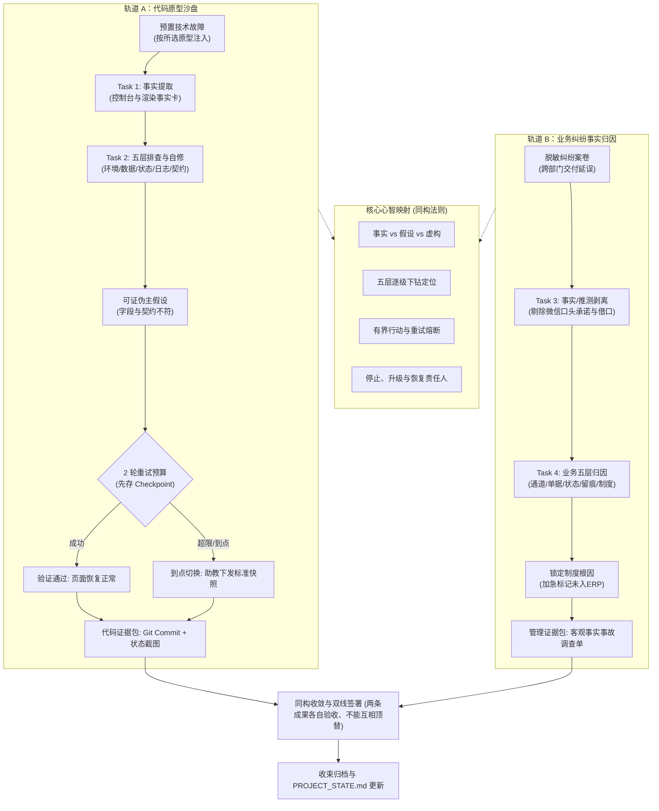

# 第六课学员指南——用事实找 Bug，在边界内修复

> **本课核心思想只有一句话：**
> **排错不是让 Agent 反复盲试，而是从可观察事实出发、限制轮次预算，在证据不足时坚决停下来交由责任人接管。**

---

## 一、先看懂：今天为什么学、要带走什么

### 1.1 先看一个反差

在开始操作前，请先看两种完全不同的排错方式带来的结果对比：

| 让 Agent 盲目反复试 | 从事实出发、有界控制、修不好就停 |
| :--- | :--- |
| 看到页面报错，就对 AI 说“帮我看看怎么修”，AI 开始天马行空胡乱猜测并四处修改代码。 | 先在浏览器中看一眼确认故障，命令 AI 只记录客观物证，再逐层排查定位根因。 |
| AI 改动范围越来越大，原本正常的组件和依赖也被改坏，上下文陷入严重混乱。 | 动代码前先存 Checkpoint 存档快照，将修改严格限定在 1 个组件内的单一字段。 |
| 连续尝试三四轮依然不收敛，项目彻底黑屏死锁，历史记录全部被污染。 | 严格执行 2 轮重试预算，两轮不通坚决触发熔断，保留现场物证并由责任人接管。 |
| AI 信誓旦旦说“已经修好了”就盲目相信，从未在浏览器中亲自刷新验证。 | 绝不听信 AI 自称，必须在本地浏览器中肉眼核实界面恢复的可观察物证。 |

今天你将通过亲手实操，掌握这套**“有界排错”**的核心控制力。

### 1.2 今天你要带走什么

完成本课后，你将带走一份**“诊断与事实归因双成果包”**：
1. **代码沙盘成果**：在你的个人原型中，面对预置故障，在 2 轮预算内完成五层诊断并有界自修；若触发熔断，则完整体验由助教加载标准快照恢复现场的工程纪律。
2. **管理实战成果**：在复杂的跨部门交付纠纷案卷中，指挥 Agent 像排查代码一样拆解事实、假设与虚构，直击制度与流程根因，完成并签署落盘一份企业级的《客观事实事故调查单》。

> **两条成果各自验收、不能互相顶替**：沙盘代码跑通不能顶替事故调查单的缺失，调查单写得再完善也不能顶替沙盘代码的实际验证。两条主线均需独立通过。

### 1.3 本课融合心智模型 (Cognitive Model)

技术排错与管理归因在底层认知结构上是完全同构的。下面的模型图展示了两者统一的思维闭环（**本图表达决策与证据流动关系，非课堂时间表**）：



### 1.4 五个必须掌握的核心概念

#### 1. 事实、假设与生成错误
- **是什么**：事实是看到的真实报错；假设是对根因的推测；生成错误是 AI 凭空捏造的不实信息。
- **怎么用**：故障排查与业务调查时建立三栏清单，严禁把推测当事实，对 AI 声称“已经修好”或员工口头声称的表述必须索取物证。
- **避坑红线**：严禁把 AI 生成的解释直接当成最终结论，缺少日志与代码物证一律视为未证明。

#### 2. 根因定位与五层诊断
- **是什么**：按“环境层 → 数据层 → 状态层 → 日志层 → 契约层”逐级排查问题的诊断方法。
- **怎么用**：提出一个有明确验证依据的推断，按层搜集证据；推断被推翻立刻更换方向。业务排查对应“通信通道 → 单据流转 → 业务状态 → 操作留痕 → 制度契约”。
- **避坑红线**：严禁看到界面报错或听到客诉就胡乱动手修改，没有定位到具体层级之前禁止动手。

#### 3. 有界排错（限时限范围）
- **是什么**：锁定单一问题、限定修改范围、设定最多只试两轮的止损排查机制。
- **怎么用**：排错前先存快照，第一轮不通调整思路试第二轮，两轮仍未解决立即停机转人工。
- **避坑红线**：严禁放任 AI 无限试错，两轮无进展时必须导出补丁快照并恢复现场，绝不扩大破坏面。

#### 4. 重试预算与熔断
- **是什么**：为自动修复设定的次数上限（如最多 2 次），达到阈值强制停止。
- **怎么用**：防止 AI 在错误思路上越陷越深，保护上下文干净，及时触发人工介入。
- **避坑红线**：严禁解除重试限制，盲目重试不仅浪费成本，还会造成代码大面积污染。

#### 5. 停止、升级与恢复
- **是什么**：停止当前自动化、交由明确责任人接管、从 Checkpoint 存档安全回退到已知版本。
- **怎么用**：达到停止条件时保留现场物证与所需证据清单，交接给对应技术或业务责任人。
- **避坑红线**：严禁在未保留现场证据的情况下直接无差别清空工作区，严禁无责任人悬空。

#### 扩展认识
1. **表象与根因的深层分离**：界面报错往往只是表象，数据契约不一致才是根因；业务扯皮往往只是表象，系统缺乏防错卡点才是根因。
2. **诊断快照（Checkpoint & Patch）**：在动工前执行 Git 提交保留存档，排错受挫时可随时一键安全回退。

---

## 二、准备好：回顾第五课原型并确认环境

### 2.1 确认第五课原型运行正常

1. 打开终端，检查当前工作区是否干净：
   ```powershell
   git status
   ```
   *预期输出*：`nothing to commit, working tree clean`。
2. 启动本地开发预览服务：
   ```powershell
   npm run dev
   ```
   *预期输出*：本地服务器在 `http://127.0.0.1:8888/` 正常运行。若超过 3 分钟打不开，请立即呼叫助教接管。

### 2.2 确认你的原型类别与预置故障

助教已在课前根据你在 L1–L5 选择的业务原型类别，在你的工作区分支中注入了对应的单一技术故障。请根据自己的原型类型在本地浏览器中观察故障现象：

- **Type A（监控与决策型，如质量预警看板）**：
  - *故障现象*：打开工单看板或指标页面，指标卡片中的状态标签完全空白；
- **Type B（任务与流程型，如客诉审批工作流）**：
  - *故障现象*：打开审批流页面，点击审批节点按钮无任何响应，流程状态机挂起；
- **Type C（操作工具型，如供应商报价核算器）**：
  - *故障现象*：在核算表单中输入采购价格与数量后，总计金额合计栏渲染为 `NaN`；
- **Type D（研发创作工作台型，如服装/品牌企划工作台）**：
  - *故障现象*：展开企划变体抽屉编辑面料规格与打样说明后，点击保存表单数据丢失。

> **提示**：具体的技术底层根因留待你在 Task 2 中通过五层诊断自行排查定位，请勿向助教或教师提前索要答案！

### 2.3 确认实操素材就绪

1. **诊断指令**：`$diagnose` 结构化诊断提示词随时可用；
2. **业务案卷**：打开 `student-package/cases/cross_department_delay_case.md`，确认可以阅读《跨部门交付延误与客诉案卷》；
3. **调查单模具**：打开 `student-package/templates/ACCIDENT_INVESTIGATION_TEMPLATE.md`，确认这是一个干净的空白模板；
4. **输出路径约定**：你在 Task 4 产出的调查单必须保存至个人项目目录下的 **`docs/ACCIDENT_INVESTIGATION_REPORT.md`**，严禁写回共享仓库目录。

---

## 三、动手做：技术排错与管理归因双轨实操

### 3.1 轨道 A：沙盘技术排错 (Tasks 1–2)

#### Task 1：激活 `$diagnose`，确认故障现象，审查事实报告

- **本步目的**：
  在浏览器中亲眼看一眼故障，激活 `$diagnose` 命令让 Agent 复现并生成事实卡。你的核心工作是**审查事实卡**，确保只记录看到的内容、彻底剔除主观猜测，并对敏感信息进行脱敏。
- **复制提示词 (直接复制发给 Agent)**：
  ```text
  我已在本地预览确认页面故障存在。现在激活 $diagnose，请按 Phase 1—2 执行：
  1. 检查当前本地开发服务（127.0.0.1:8888）与页面可见状态；
  2. 生成一张事实卡，严格只记录可观察事实（页面报什么、数据显示什么、控制台报错第一行）；
  3. 严禁写入任何猜测原因（假设下一步再做）；
  4. 严禁修改任何代码文件；
  5. 日志中若出现 Token/Key 等敏感信息，必须脱敏为 <REDACTED>。

  输出格式：
  - 故障现象：（肉眼看到什么）
  - 复现路径：（点击哪一步触发）
  - 控制台关键信息：（脱敏后第一行）
  - 数据状态：（组件接收到的具体字段名与值）
  ```
- **你应该看见**：
  Agent 输出了一份结构化事实卡，清晰记录了故障现象与数据状态，没有任何推测原因，且未修改任何代码。
- **本步自检**：
  - [ ] 你是否先在浏览器中看了一眼故障？
  - [ ] 事实卡中是否只记录客观现象，没有任何“可能是……”、“应该是……”的推测？
  - [ ] 日志中若出现敏感 Key/Token，是否已脱敏为 `<REDACTED>`？
  - [ ] 代码文件是否完全未被修改（`git status` 显示干净）？
- **必须停止**：
  - 如果你开始尝试自己翻看代码或长堆栈，立刻停手——让 Agent 查，你只负责审报告！
  - 如果 Agent 擅自修改了代码文件，立即运行 `git checkout .` 还原，并打回重发指令。

---

#### Task 2：运行五层诊断，存 Checkpoint，在 2 轮预算内完成有界修复

- **本步目的**：
  指挥 Agent 运行五层诊断定位问题层，选定可证伪主假设；动代码前先建立 Checkpoint 存档快照；在主管严格核准修改范围的前提下执行修复并刷新验证。严格执行最多 2 轮重试预算。
- **复制提示词 1：五层排查与 Checkpoint 存档**：
  ```text
  $diagnose 处于运行中，请按 Phase 3—5 执行：
  1. 执行五层诊断（环境 -> 数据 -> 状态 -> 日志 -> 契约），给出每一层 PASS/FAIL 判定；
  2. 定位到具体问题层，提出 1 个可证伪主假设；
  3. 先运行 git commit -m "checkpoint: before lesson 6 debug" 建立存档快照；
  4. 读取最小证据，提出修复方案（明确列出拟修改文件名、行号与修改内容），等待我核准；
  5. 未经我核准修改范围前，绝对禁止修改文件。
  ```
- **复制提示词 2：核准范围与执行单点修复**：
  ```text
  批准上述修复范围。请执行单点修复，并自动刷新验证结果。若 1 轮未通过，允许微调假设再试 1 轮；若 2 轮仍未通过，必须立即停止并报告！
  ```
- **你应该看见**：
  Agent 逐层给出 PASS/FAIL 判定，定位到契约层，自动执行了 git commit 建立存档，列出仅改动 1 个组件中单一字段的极小方案；在你授权后完成修复，浏览器刷新后故障现象消失。
- **本步自检**：
  - [ ] 动代码前是否确认已经执行了 `checkpoint` 提交？
  - [ ] 修改范围是否仅限 1 个文件，没有扩散到其他无关模块？
  - [ ] 是否在本地浏览器中实际刷新肉眼确认界面恢复？
- **必须停止（到点切换，助教发快照）**：
  - 严格遵守 **2 轮重试预算**：如果第 1 轮未通过，允许微调假设再试 1 轮；若第 2 轮仍未通过，坚决强制停手，严禁盲目尝试第 3 轮！
  - **到点切换规则**：实操时间一到，无论你的沙盘是否修好，助教将一键下发已修复分支快照（`STATUS: RECOVERED_BY_SNAPSHOT`），全员必须准时切入业务案卷实战，绝不拖堂！

---

### 3.2 轨道 B：业务事实归因管理实战 (Tasks 3–4)

#### Task 3：载入业务案卷，剥离事实、假设与推测虚构

- **本步目的**：
  将技术排错的心智平移到企业管理现场。面对真实的跨部门延误纠纷与大额索赔，指挥 Agent 扮演中立调查官，将各方陈述彻底剥离为“客观物证”、“主观假设”与“虚构捏造”三栏清单，严禁把道德批判当成事实。
- **复制提示词 (直接复制发给 Agent)**：
  ```text
  我们现在进行业务事故事实调查。请阅读《跨部门交付延误与客诉案卷》：
  【案卷素材：
  1. 8月10日 14:00 销售A与客户微信确认：“放心，给您安排加急发货，明天准到”；但销售A未在ERP系统勾选【加急】标签，仅在群里发了一句“这单急”；
  2. 8月10日 16:30 仓管B导出普通发货清单并打印，按常规顺序排期待发；仓管声称“群里消息太多没看到，一切以ERP单据为准”；
  3. 8月11日 10:00 物流承运商揽件，按普通陆运装车发运（加急单需走航空专线）；
  4. 8月13日 11:00 货物送达，延误48小时，客户提出索赔20万元违约金；
  5. 客服C声称“系统坏了无法查流水”，经技术核查系统当天正常运行。】

  请执行事实锚定分析：
  1. 整理【客观事实清单】（必须具备系统日志、时间戳或物理单据支撑）；
  2. 整理【主观假设与推测清单】（未经证实的主观判断）；
  3. 找出至少 1 项【虚构/伪造信息】（如客服谎称系统坏了）；
  4. 严禁得出“都是销售的错”等主观道德评价，只列物证与矛盾。
  ```
- **你应该看见**：
  Agent 输出了一份清晰严密的三栏证据表：带时间戳的客观事实、各方推测借口、以及客服利用“系统坏了”谎报瞒报的确凿物证。
- **本步自检**：
  - [ ] 客观事实栏是否每一条都有时间戳或单据支撑？
  - [ ] 销售在微信里的口头承诺是否被正确归类（不具备生产指令效力）？
  - [ ] 是否成功识别出至少 1 项虚构伪造信息？
- **必须停止**：
  - 如果 Agent 或你在分析中写出“销售缺乏责任心”、“仓管故意刁难”等情绪化道德批判，立即打回重写——管理调查只看物证与流程！

---

#### Task 4：业务五层归因，输出《客观事实事故调查单》

- **本步目的**：
  运用业务五层诊断模型（通信层 ➔ 单据层 ➔ 状态层 ➔ 留痕层 ➔ 制度契约层）逐级穿透，彻底锁定事故的首要制度根因，制定具体的前置防错卡点与明确的第一责任人，将调查单签署落盘。
- **复制提示词 (直接复制发给 Agent)**：
  ```text
  基于刚才提取的事实清单，请按照“业务五层诊断模型”输出《客观事实事故调查单》：

  按以下五层逐级排查并给出结论：
  - Layer 1 通信层：微信与邮件等外部通道是否构成有效审批指令？
  - Layer 2 单据层：ERP 订单创建与数据流转是否完整？
  - Layer 3 状态层：加急与普通发货状态转换是否具备排他性锁？
  - Layer 4 留痕层：仓管导出与承运商交接是否有物理签名与时间戳？
  - Layer 5 制度契约层：跨部门 SOP 对“加急订单认定与承诺权限”是如何约定的？

  输出要求：
  1. 锁定本次交付事故的首要制度根因；
  2. 制定 2 条针对该流程的确定性防范卡点（如：系统未勾选加急禁止销售承诺发货）；
  3. 明确恢复整改的第一责任人（岗位/角色）。
  ```
- **你应该看见**：
  Agent 输出了一份企业级水准的《客观事实事故调查单》，精准定位于制度契约缺失（缺乏前置阻断门禁与口头承诺无效规约），并给出了具体的系统防错卡点与岗位责任人。
- **本步自检**：
  - [ ] 首要根因是否直击制度契约层，而非归咎于员工个人？
  - [ ] 防范措施是否具体可落地（如 ERP 增加必填字段、SOP 明确口头无效）？
  - [ ] 第一责任人是否明确到具体岗位角色，而非空泛的“各部门”？
- **必须停止**：
  - 调查单必须保存至你的个人项目目录：**`docs/ACCIDENT_INVESTIGATION_REPORT.md`**。严禁将产物保存到共享仓库的 `student-package/` 目录！

---

### 3.3 同构收敛与双线签署

在实操收尾阶段，教师将在屏幕上首次出示满分标准示范（Golden Sample）：
1. **核对同构认知**：对比代码排错中的“契约字段错配”与业务事故中的“制度契约缺失”，理解两者在控制逻辑上的完全一致性；
2. **核对调查单完整度**：对照标准样例，检查你的客观物证是否完整、防范卡点是否具备阻断能力；
3. **完成主管签署**：在你的 `docs/ACCIDENT_INVESTIGATION_REPORT.md` 底部签上你的姓名与日期，接受教师的双线核验。

---

## 四、守边界：安全防线与常见误区排查

### 4.1 五条红线绝不能碰

在任何排错与管理分析中，必须严格恪守以下 5 项安全红线：
1. **Mock 与脱敏红线**：只在脱敏数据上排错，任何真实企业凭证、密钥或客户手机号绝不送入 AI；
2. **无真实凭证红线**：禁止在代码或提示词中配置真实大模型 API Key；
3. **事前脱敏红线**：日志在粘贴给 AI 前，必须先用肉眼审查并将其中的敏感 Token 替换为 `<REDACTED>`；
4. **范围受控红线**：排错只准修改具体的业务代码，绝不允许 Agent 修改框架配置或底层依赖；
5. **杜绝虚构红线**：AI 声称修好不算数，必须亲自在本地浏览器刷新核验物证。

### 4.2 常见认知误区清单 (Misconceptions，5 项)

请对照以下 5 大典型错误认知，检查自己是否陷入误区：

| 误区编号 | 典型错误认知 | 纠偏正解与实战对策 |
| :--- | :--- | :--- |
| **M-01** | “遇到报错把几十页的控制台长堆栈全复制给 AI” | 长堆栈大多是底层框架的链式反应，复制太多只会污染 AI 上下文。只需提供脱敏后的第一行核心 Error 信息与组件事实卡。 |
| **M-02** | “AI 信誓旦旦说‘已经修复了’，那肯定就修好了” | AI 存在严重的幻觉与自圆其说倾向。必须在本地浏览器实际刷新，亲眼看到界面正常才算修复通过。 |
| **M-03** | “排错只要能把 Bug 改好，改了哪些文件无所谓” | 盲目扩大修改范围会埋下巨大的次生灾害。必须严格限定修改范围，一次只准修改单一组件内的几行代码。 |
| **M-04** | “业务扯皮时，谁的态度更诚恳、谁的理由充分就信谁” | 态度和理由都是主观推测。业务纠纷排查坚决只认时间戳、系统日志与物理单据，主观陈述一律归入假设待查。 |
| **M-05** | “两轮修不好说明 AI 不够聪明，再给它试一次可能就灵了” | 2 轮不收敛说明现有上下文或思路已经走入死胡同。继续盲目尝试只会毁坏代码库，必须坚决停手并触发熔断。 |

### 4.3 现场偶发问题与处置方案 (5 类排查)

实操过程中遇到以下异常，按此表规范果断处置：

| 故障类别 | 现场典型现象 | 处置动作 (Action) | 降级兜底预案 (Fallback) |
| :--- | :--- | :--- | :--- |
| **T-01 假设混入** | AI 或你在事实卡中写了“可能是字段错了”等推测 | 立即打回指令，提醒“事实是看到的，假设是想到的”，要求重新输出纯事实 | 对照 Task 1 格式，强制剔除所有原因分析 |
| **T-02 范围越界** | Agent 尝试修改底层构建文件或修改了多个页面 | 立即向 Agent 发送停止指令，限定只准修改业务组件内的 1 行代码 | 在终端运行 `git checkout .` 强制还原所有越界修改 |
| **T-03 执意重试** | 满 2 轮未修好，总想给 AI 再试一轮 | 坚决执行熔断，记录当前停止原因，不再做任何修改尝试 | 呼叫助教一键检出标准修复分支快照 |
| **T-04 泄露风险** | 不小心在日志或案卷中粘贴了真实密钥或客户信息 | 立即清屏，在指令中将其手动替换为 `<REDACTED>` | 关闭当前对话窗口，开启新的空白会话重置上下文 |
| **T-05 虚假成功** | AI 声称已经改好，但浏览器刷新后依然异常 | 严禁相信文字答复，强制核对修改文件的真实行号与组件 | 检查是否修改了未生效的文件或缓存未刷新 |

---

## 五、验成果：双线独立考核与随堂测验

### 5.1 双线独立通过标准（两条成果各自验收、不能互相顶替）

本课结课考核执行严格的独立双线标准，**两线必须同时达到合格线**：

1. **原型推进线最低硬证据**：
   - 包含动工前的存档快照提交（`git log` 可见 `checkpoint: before lesson 6 debug`）；
   - 本地预览服务（`127.0.0.1:8888`）页面恢复正常渲染的截图或记录（若触发熔断，则包含助教快照检出与恢复标记）；
   - 控制台 `$diagnose` 规范执行记录，且工作区干净（无多余文件变动）。
2. **主管判断线最低硬证据**：
   - 完整落盘于 `docs/ACCIDENT_INVESTIGATION_REPORT.md` 的《客观事实事故调查单》；
   - 包含带时间戳的客观物证、剥离后的假设与虚构、五层诊断推导、首要制度根因、确定性防范卡点与具体岗位责任人；
   - 末尾完成主管签署。
3. **互不顶替铁律**：代码排错完成绝不能替代调查单，调查单写完绝不能替代沙盘验证。

### 5.2 随堂必答题（共 5 题）

完成实操后，请独立完成以下 5 道必答题：

1. **事实、假设和生成错误有什么本质区别？为什么排错和管理归因时必须分开记录？**
   - *参考答案*：事实是可观察的客观物证（报错日志/系统单据）；假设是待验证的主观推测；生成错误是凭空捏造的不实信息。分开记录才能保证决策链客观可追溯，防止基于伪事实采取错误行动。
2. **五层诊断卡的五层分别是什么？为什么要从上到下逐层排除而非到处乱猜？**
   - *参考答案*：环境层、数据层、状态层、日志层、契约层（业务平移为通信层、单据层、状态层、留痕层、制度契约层）。逐层排除能建立最小排查漏斗，防止因跳层排查而把浅层配置错误误诊为深层代码缺陷。
3. **有界排错要求明确哪四项约束？为什么不能无限试错？**
   - *参考答案*：明确单一故障、可证伪主假设、限定修改文件范围、最多 2 轮重试预算。无限试错会导致模型上下文严重污染、引入次生破坏并浪费宝贵管理时间。
4. **两轮技术诊断仍未通过时，主管应该采取什么行动？为什么不能继续试第三轮？**
   - *参考答案*：立即停止自动修改，触发熔断，记录当前物证、新证据需求并交由技术责任人接管（或加载标准快照）；不能继续试第三轮是因为 2 轮无进展证明现有上下文或假设已失效，继续盲目尝试只会破坏代码库。
5. **在业务事故调查中，为什么“员工粗心/责任心不强”不是合格的根因分析？合格的根因应该落在哪里？**
   - *参考答案*：“员工粗心”属于主观情绪与道德归因，无法转化为管理流程的确定性改进。合格根因必须落在制度契约层或流程控制层（如缺少字段防错校验、接口缺乏幂等机制）。

### 5.3 拓展选做题（共 2 题）

1. **重试预算设为 1 轮或设为 5 轮分别会带来什么管理风险？为什么课程推荐设为 2 轮？**
   - *参考要点*：设 1 轮容错率太低，模型可能因轻微格式偏差直接夭折；设 5 轮会导致模型在错误道路上自圆其说、修改面无限扩散。2 轮既给了一次调整假设的弹性，又能在破坏扩散前及时踩下刹车。
2. **修复了界面上的报错（技术状态正常），是否意味着业务逻辑就一定正确了？请举一例说明。**
   - *参考要点*：不一定。例如：前端界面把 `NaN` 强制显示为 `0`，界面红字消失了，但底层的计费计算逻辑依然是错误的。表象修复不等于根因解决。

---

## 六、做交接：更新项目状态单并准备第七课

### 6.1 更新项目状态单 (`docs/PROJECT_STATE.md`)

打开你个人原型项目目录下的 `docs/PROJECT_STATE.md`，在底部追加本课的完成记录：
- 记录当前原型的最新稳定基线状态；
- 记录本次排错所修改的组件及字段（或标注由助教标准快照恢复）；
- 确认调查单已保存至 `docs/ACCIDENT_INVESTIGATION_REPORT.md`。

### 6.2 执行 Git 归档提交

在终端执行以下命令，完成本课全部资产的代码库归档：
```powershell
git status
git add .
git commit -m "feat(lesson-06): complete bounded debugging and accident investigation report"
```
确认终端输出 `nothing to commit, working tree clean`，确保工作区干净退场。

### 6.3 课后微任务：提炼一条防扯皮事实指标 (10–15 min)

课后请结合你实际管理工作中的日常痛点，完成以下微任务：
- **微任务目标**：提炼一条本部门高频推诿项的“防扯皮事实指标”；
- **操作方式**：从本周部门沟通或跨部门协作中挑选一个容易产生责任推诿的高频卡点（如“设计稿确认延误”、“加急采购单确认”等），写下一张包含以下三要素的**三行事实卡**：
  1. **争议事实**：具体是哪一步流转容易产生口头争议？（只写可观察物证，不写道德推测）
  2. **各方假设**：各部门在推诿时最常用的主观借口或假设是什么？
  3. **物证取证方式**：用什么系统时间戳、电子单据或审批留痕可以一票否决扯皮？
- **课次衔接**：本微任务成果将在第七课开场 3 分钟内进行口头核对。

### 6.4 第七课衔接预告

恭喜你完成了第六课的硬核训练！你不仅学会了如何驾驭 AI 进行有界技术排错，更掌握了一套直击流程本质的企业管理调查利器。

> **下一课预告**：
> 在第七课中，我们将跨出关键的一步——不再满足于静态组件的调试，而是**引入自动化浏览器工具（Browser MCP）与外部生态工具**，让 Agent 能够真正像真人一样自主浏览网页、操作界面并采集数据，为你构建更强大的业务自动化闭环！
