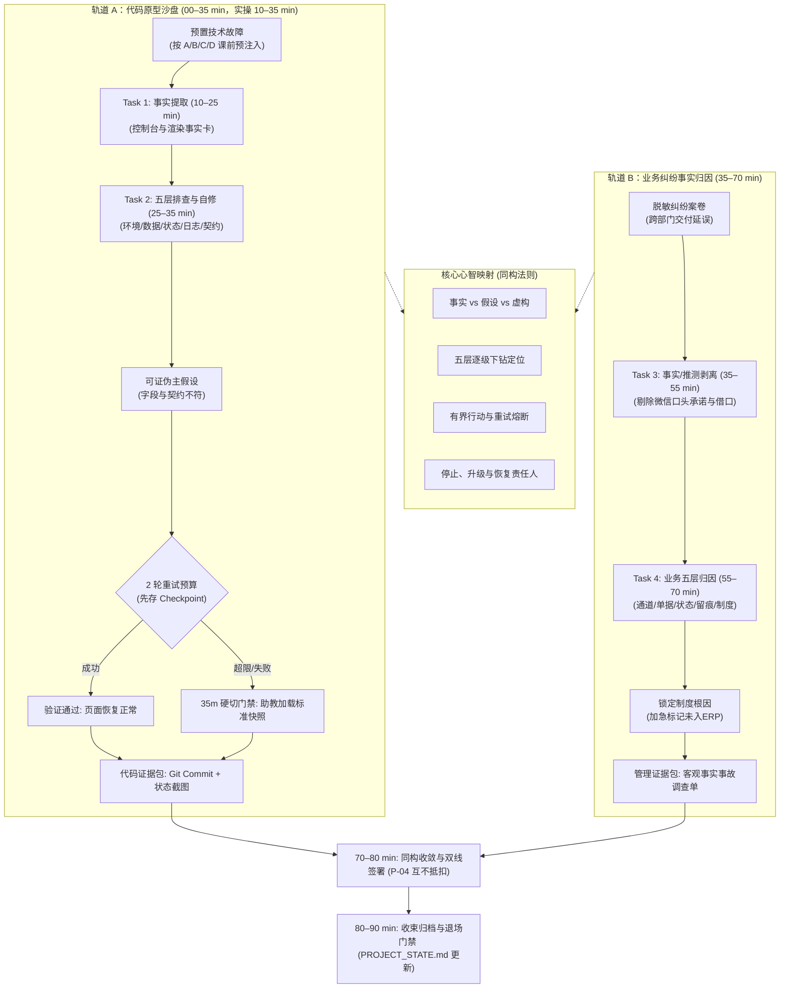

# 第六课教师教案——用事实找 Bug，在边界内修复

> **核心思想：排错不是让 Agent 反复盲试，而是从可观察事实出发、限制轮次预算，在证据不足时坚决熔断并交由责任人接管。**

---

## 一、课程元数据与定位

| 项目 | 本课设定与契约约束 |
| :--- | :--- |
| **课次名称** | 第六课《用事实找 Bug，在边界内修复》 |
| **权威依据** | 1. `lessons/TEN_LESSON_FROZEN_BASELINE.md`<br>2. `lessons/CURRICULUM_REBALANCING_AND_DUAL_TRACK_OPTIMIZATION_PROPOSAL.md` (v1.4 Approved & Frozen Baseline · 2026-09-15 · Tag: `curriculum-v1.4`)<br>3. `lessons/COURSE_ROADMAP.md` 与 `lessons/COURSE_ROADMAP_STUDENT.md`<br>4. `lessons/GLOSSARY.md` |
| **简报基线与批准追溯** | 1. 简报依据：`lessons/LESSON_06_DESIGN_BRIEF.md` (`contract_version: 2.1`, `HANDOFF_READY`)<br>2. 独立评审记录：2026-09-15 第七轮复核独立评审通过 (`HANDOFF_READY` 确认)<br>3. 课程所有者正式批准：2026-09-15 批准授权 PLAN 渲染；2026-09-16 第八轮复核通过并确认教案基线 |
| **学员画像** | 已完成 L1–L5，掌握智能机会卡与个人原型业务薄片的业务主管（非技术人员、AI 协作新手） |
| **课时架构** | **90 分钟刚性上限**：严格执行 **35 + 35 + 10 + 10** 双轨工作坊结构（00–10 min 导入示范归入轨道 A 宏观时段） |
| **课堂主成果** | **诊断与事实归因双成果包**：<br>1. **代码沙盘成果**：在 2 轮重试预算内定位并修复预置故障，或触发熔断加载标准快照；<br>2. **管理实战成果**：在跨部门交付延误案卷中，完成五层事实归因，落盘并签署《客观事实事故调查单》。 |
| **现场助教配比** | 1:15 线下或专属线上支持（3 分钟响应接管；负责课前故障注入与 35 分钟硬切快照派发） |
| **数据与安全边界** | 全程 Mock 数据与脱敏案卷；敏感信息强制替换为 `<REDACTED>`；禁止真实 API Key 与真实 PII |

### 1.1 课次定位与双轨核心价值

本课是全课程进入中级进阶（L6–L10）的**首门双轨制课程**。在课程体系中承担着双重枢纽功能：
1. **技术抗脆弱保障（轨道 A）**：承接 L5 智能机会候选，当原型引入 Agent 出现异常时，破除学员对 AI 的盲目迷信，建立“事实核查、五层下钻、Checkpoint 存档、2 轮熔断”的工程控制闭环；
2. **管理心智平移跃迁（轨道 B）**：揭示技术排错与管理归因的**底层同构性**——代码界面的报错推诿与跨部门业务事故的扯皮推诿，在认知逻辑上完全同构。学员通过实操脱敏案卷，学会以事实为锚、直击制度契约根因，彻底告别“员工责任心不强”的主观偷懒归因。

### 1.2 严肃声明“不做清单”（Non-goals）

教师在授课现场必须严格坚守以下非目标红线，绝不允许发生教学发散：
- **不同时排查多个故障**：一次只诊断和修复一个单一故障；
- **不盲目深挖底层框架**：严禁让 Agent 翻查 `node_modules` 源码或试图重写底层构建脚本；
- **不运行无界破坏命令**：回退必须依靠 Checkpoint 存档或标准快照，严禁无授权 `git reset --hard`；
- **不将自动修复宣传为确定性保证**：文字规约与主管确认是工作约束，不冒充运行时硬控制；
- **不在业务案卷中使用未脱敏数据**：案卷均为合成虚拟案例；
- **不提前引入外部生态工具**：第 6 课严格收敛于内部排错与案卷归因，外部 Skill 检索与浏览器 MCP 工具严格锁定在 L7 引入。

### 1.3 开场反差制造策略

开场 00–10 分钟内，教师**严禁平铺直叙念 PPT 概念**，必须直接演示强烈反差：
- **反差 A（失控路线）**：界面报错后，主管直接对 AI 说“帮我修好它”。AI 开启无限盲目重试，第 1 轮改动了 5 个文件，第 2 轮改动了配置，第 3 轮直接导致整个项目黑屏死锁，历史记录全部被污染。
- **反差 B（有界路线）**：界面报错后，主管先提取客观事实卡，执行五层排查定位到契约层，先打 `checkpoint` 存档，限定 AI“只准修改 1 个组件内的 1 个字段”，2 轮预算内精准恢复；两轮不收敛立即熔断转人工。

让主管在 5 分钟内肉眼看见“有界排错”的确定性与威慑力，再顺理成章导入 5 大核心概念。

---

## 二、逆向目标、证据与核心概念

### 2.1 目标—活动—证据对齐图

| 学习目标 | 对应课堂活动 | 验收硬证据 | 主管裁决动作 |
| :--- | :--- | :--- | :--- |
| **1. 2 轮内有界技术自修** | Task 1 & Task 2 (沙盘排错) | Git Commit 记录 + 预览页面正常显示（或标准快照恢复标记） | 核对修改文件范围，下达范围授权指令 |
| **2. 剥离事实与推测虚构** | Task 3 (案卷事实诊断) | 事实/假设/虚构三栏对比表，明确标出不可信项 | 剔除主观猜测，锁定可采信物证清单 |
| **3. 业务五层归因与责任** | Task 4 (事故调查单) | 学员项目 `docs/ACCIDENT_INVESTIGATION_REPORT.md` 签署落盘 | 裁决事故首要制度根因与恢复责任人 |
| **4. 熔断与停止决策** | 综合复盘与随堂测试 | 5 道随堂必答题 + 随堂口头问答 | 拒绝无效重试，执行熔断与归档 |

### 2.2 课程融合心智模型 (Method Loop + Evidence Chain)

该模型揭示了“技术控制台排错”与“业务事故管理归因”在底层认知结构上的完全同构性。**该图表达逻辑拓扑与证据流动，非课堂时间推进表**：



### 2.3 核心概念清单（共 5 个，三段实战化 + 交接价值）

严格执行 commit `7114ddc` 与 GLOSSARY 规范，所有概念按「是什么 / 怎么用 / 避坑红线 / 交接价值」交付：

#### 1. 事实、假设与生成错误
- **是什么**：事实是看到的真实报错；假设是对根因的推测；生成错误是 AI 凭空捏造的不实信息。
- **怎么用**：故障排查与业务调查时建立三栏清单，严禁把推测当事实，对 AI 声称“已经修好”或员工口头声称的表述必须索取物证。
- **避坑红线**：严禁把 AI 生成的解释直接当成最终结论，缺少日志与代码物证一律视为未证明。
- **交接价值**：回指 Task 1 与 Task 3——事实卡与案卷清单只记录看到和查验到的物证，不记推测。

#### 2. 根因定位与五层诊断
- **是什么**：按“环境层 → 数据层 → 状态层 → 日志层 → 契约层”逐级排查问题的诊断方法。
- **怎么用**：提出一个有明确验证依据的推断，按层搜集证据；推断被推翻立刻更换方向。业务排查对应“通信通道 → 单据流转 → 业务状态 → 操作留痕 → 制度契约”。
- **避坑红线**：严禁看到界面报错或听到客诉就胡乱动手修改，没有定位到具体层级之前禁止动手。
- **交接价值**：回指 Task 2 与 Task 4——五层定位报告必须附带具体证据，作为向技术团队和管理层汇报的统一结构。

#### 3. 有界排错（限时限范围）
- **是什么**：锁定单一问题、限定修改范围、设定最多只试两轮的止损排查机制。
- **怎么用**：排错前先存快照，第一轮不通调整思路试第二轮，两轮仍未解决立即停机转人工。
- **避坑红线**：严禁放任 AI 无限试错，两轮无进展时必须导出补丁快照并恢复现场，绝不扩大破坏面。
- **交接价值**：回指 Task 2——严格限定修改的文件范围与次数，防止技术负债失控。

#### 4. 重试预算与熔断
- **是什么**：为自动修复设定的次数上限（如最多 2 次），达到阈值强制停止。
- **怎么用**：防止 AI 在错误思路上越陷越深，保护上下文干净，及时触发人工介入。
- **避坑红线**：严禁解除重试限制，盲目重试不仅浪费成本，还会造成代码大面积污染。
- **交接价值**：回指 Task 2 与宏观阶段硬切门禁——两轮未解决必须触发熔断转人工或切入下一阶段。

#### 5. 停止、升级与恢复
- **是什么**：停止当前自动化、交由明确责任人接管、从 Checkpoint 存档安全回退到已知版本。
- **怎么用**：达到停止条件时保留现场物证与所需证据清单，交接给对应技术或业务责任人。
- **避坑红线**：严禁在未保留现场证据的情况下直接无差别清空工作区，严禁无责任人悬空。
- **交接价值**：回指 Task 2 与 Task 4——停止时留下证据包并指定恢复责任人。

### 2.4 扩展认识（2 个）

1. **表象与根因的深层分离**：界面红字或空白标签（表象）往往由底层数据契约字段拼写或类型不一致（根因）引起；客诉推诿与延误（表象）往往由跨部门单据缺乏前置防错校验（根因）引起。
2. **诊断快照（Checkpoint & Patch）**：在动工前执行 Git 提交保留基线快照，排错受挫时可毫秒级回滚，避免污染主分支。

---

## 三、教学准备与安全边界

### 3.1 课前环境预检（教师与助教硬性检查）

1. **第五课原型运行检查**：确认学员拥有 L5 产出的可运行原型（`127.0.0.1:8888` 可正常交互），且 Working Tree 处于 Clean 状态；
2. **四类业务原型故障预注入**：由助教在课前巡检时，根据学员所选原型分类，在学员分支注入对应的单一故障点：
   - **Type A（监控与决策型）**：指标状态标签组件中，故意将字段名拼写错误（`status_name` 代替 `status`），导致界面标签空白；
   - **Type B（任务与流程型）**：审批节点组件中，将处理人字段类型写为布尔值导致状态机挂起；
   - **Type C（操作工具型）**：报价核算器中，缺失输入参数默认值导致合计栏渲染为 `NaN`；
   - **Type D（研发创作工作台型）**：企划工作台抽屉组件中，面料规格与打样说明缺失双向绑定导致编辑丢失。
3. **4 套标准快照分支就绪**：助教端集中维护 `fix-branch-type-a`, `fix-branch-type-b`, `fix-branch-type-c`, `fix-branch-type-d` 4 套修复分支，确保 35 分钟硬切门禁可一键下发（缺省环境统一以 Type B 兜底）；
4. **诊断工具可用性**：确认终端 `$diagnose` 指令集或诊断提示词可在本地 Agent 会话中正常执行；
5. **学员端素材就绪**：
   - 脱敏案卷：《跨部门交付延误与客诉案卷》（`student-package/cases/cross_department_delay_case.md`）已下发；
   - 空白模具：《客观事实事故调查单模版》（`student-package/templates/ACCIDENT_INVESTIGATION_TEMPLATE.md`）已下发；
6. **教师端样例隔离核实**：确认《客观事实事故调查单标准样例》（`student-package/templates/ACCIDENT_INVESTIGATION_GOLDEN_SAMPLE.md`）仅教师可见，**严禁在实操阶段提前向学员透露**。

### 3.2 五大安全与数据红线（现场宣导口令）

1. **全程模拟与脱敏红线**：只使用 Mock 数据排错，日志若含 Token/Key，强制替换为 `<REDACTED>`；
2. **无真实凭证红线**：严禁填入任何企业真实 API Key、个人账号密码或真实客户电话；
3. **事前审查红线**：所有外部材料送入 Agent 对话框前必须经学员肉眼脱敏审查；
4. **环境受控红线**：排错操作严格限制在当前业务组件内，严禁扩大至框架底层或全局依赖；
5. **杜绝虚构能力**：严禁吹嘘“AI 全自动百分之百修复”，代码与制度必须靠人审查与签字确认。

---

## 四、90 分钟双轨控场主线

严格执行 **35 + 35 + 10 + 10** 刚性时间预算。**00–10 min 导入示范属于轨道 A 的宏观阶段分配**：

| 时间段 | 宏观阶段 | 教师动作 | 学员动作 | 产出物与门禁规则 |
| :--- | :--- | :--- | :--- | :--- |
| **00–10 min** | **导入、痛点唤醒与模型建立** (轨道 A 导入) | 演示“盲目反复试导致越改越乱” vs “有界排错”强烈对照；剖析 5 大核心概念与双轨同构法则 | 观察反差，理解双轨主线与 P-04 互不抵扣铁律 | 明确课堂双线交付物与排错边界 |
| **10–25 min** | **轨道 A：Task 1 故障事实提取** (15 min) | 巡视示范：打开原型看一眼故障，指导激活 `$diagnose` 运行 Phase 1–2，审查事实卡 | 确认故障存在，发出指令，审查事实报告，剔除主观猜测，敏感信息脱敏 | 结构化事实卡（零推测、严禁动代码） |
| **25–35 min** | **轨道 A：Task 2 五层有界自修** (10 min) | 巡视五层定位；监督存 Checkpoint；核对修改范围不超过 1 个文件；执行 2 轮预算管理 | 运行五层诊断定位契约层，存 Checkpoint，核准极小修复范围，刷新验证 | Git Commit + 修复证据<br>**35m 硬切门禁 (P-01)**：未完成者助教一键派发快照强制切出 |
| **35–55 min** | **轨道 B：Task 3 案卷事实剥离** (20 min) | 下发业务案卷；指导学员扮演中立调查官，指挥 Agent 将微信、单据、日志拆解为三栏清单 | 阅读案卷，指挥 Agent 严密剥离事实、假设与虚构，找出客服撒谎物证 | 事实/假设/虚构三栏对比表（必须揪出至少 1 处伪造） |
| **55–70 min** | **轨道 B：Task 4 业务五层归因** (15 min) | 点拨业务五层诊断（通道/单据/状态/留痕/制度）；指导学员下钻至契约层缺陷，明确防范措施与责任人 | 运行业务五层模型，锁定制度根因，填写调查单并落盘至个人项目 `docs/` | 《客观事实事故调查单》（`docs/ACCIDENT_INVESTIGATION_REPORT.md`） |
| **70–80 min** | **同构收敛与双线签署** (10 min) | **亮出 Golden Sample**；点拨技术排错与管理归因的内在同构性；执行双线独立核验并盖章 | 对照标准样例复盘，核验自身调查单，主管签字落盘 | 签署事故调查单<br>**P-04 铁律**：沙盘线与管理线互不抵扣 |
| **80–90 min** | **收束、归档与退场门禁** (10 min) | 监督执行 Git 归档与 `PROJECT_STATE.md` 更新；收取 5 道随堂测试题并快速讲评 | 执行 Git Commit，更新项目状态，提交随堂测试，确认工作区干净 | 归档项目状态单 + 随堂测验答卷（Clean 退场） |

### 4.1 控场与时间压缩预案

- **若 00–10 min 导入拖堂**：优先压缩教师讲解概念的时间，**严禁压缩 Task 2 的 Checkpoint 存档与 Task 4 的制度根因锁定**；
- **P-01 硬切绝对不可妥协**：到达第 35 分钟时，无论学员沙盘修到哪一步，**助教必须无差别执行快照覆盖**，确保全员准时在第 35 分钟切入轨道 B。严禁拖堂排错！

---

## 五、逐 Task 示范、口令、巡视与降级

### Task 1 (Track A, 10–25 min)：激活 `$diagnose`，确认故障现象，审查事实报告

- **教师示范 (`teacher_demo`)**：
  - 教师投屏展示本地预览（`127.0.0.1:8888`），打开工单看板：“大家看，工单列表里的【状态标签】位置是空白的，但页面没有崩溃红屏。现在我们打开 Agent 终端，激活 `$diagnose` 执行 Phase 1–2。注意我的动作：我不去翻看控制台几百行报错，也不去猜是不是网络慢，我只要求 Agent 告诉我‘肉眼看到什么、组件拿到什么、控制台第一行关键报错是什么’。报告出来后，我一眼看出 Agent 写了‘可能是字段写错’，我立即打回——推测是下一阶段的事，事实卡上只准留事实！”
- **教师口令 (`teacher_cue`)**：
  - “所有人先在浏览器里看一眼你的故障，确认它存在。然后直接复制 Task 1 提示词激活 `$diagnose`。你的核心任务是**审查 Agent 的事实卡**，确保里面只有客观现象、没有主观臆测。不要自己查控制台，严禁让 AI 修改任何代码！”
- **学员实操提示词 (零占位符，直接复制)**：
  ```text
  我已在本地预览确认页面故障存在。现在激活 $diagnose，请按 Phase 1—2 执行：
  1. 检查当前本地开发服务（127.0.0.1:8888）与页面可见状态；
  2. 生成一张事实卡，严格只记录可观察事实（页面报什么、数据显示什么、控制台报错第一行）；
  3. 严禁写入任何猜测原因（假设下一步再做）；
  4. 严禁修改任何代码文件；
  5. 日志中若出现 Token/Key 等敏感信息，必须脱敏为 <REDACTED>。

  输出格式：
  - 故障现象：（肉眼看到什么）
  - 复现路径：（点击哪一步触发）
  - 控制台关键信息：（脱敏后第一行）
  - 数据状态：（组件接收到的具体字段名与值）
  ```
- **巡视判断 (`patrol_judgment`)**：
  - 学员是否先肉眼确认了现象；
  - 事实卡中是否混入了“可能是……”、“应该是……”等主观假设；
  - 是否有未脱敏的长日志或敏感 Token；
  - Agent 是否私自修改了代码文件（查看 Git working tree）。
- **失败降级 (`failure_fallback`)**：
  - 学员自己翻看控制台代码时，提醒：“让 Agent 去查，你只负责审报告！”；
  - 事实卡混入假设时，要求其发送：“剔除所有推测原因，重新生成纯事实卡”；
  - Agent 擅自修改代码时，立即运行 `git checkout .` 还原并重新约束。

---

### Task 2 (Track A, 25–35 min)：运行五层诊断，存 Checkpoint，在 2 轮预算内完成有界修复

- **教师示范 (`teacher_demo`)**：
  - 教师演示五层逐级排查：“Agent 汇报环境层 PASS、数据层 PASS、状态层 FAIL、日志层 PASS、契约层 FAIL。定位到契约层后，提出主假设‘前端组件引用的字段名 `status_name` 与数据契约定义的 `status` 不一致’。注意，动代码前，我先在终端执行 `git commit -m "checkpoint: before lesson 6 debug"` 存档！随后 Agent 给出修复方案：仅修改 `src/components/TaskCard.vue` 第 24 行的 1 处字段。我核准范围，执行修改，刷新浏览器——状态标签立刻恢复正常！两轮内解决，验证通过！”
- **教师口令 (`teacher_cue`)**：
  - “五层排查定位到一层；动代码前必须先存 Checkpoint；核对修改范围不超过 1 个文件；刷新浏览器验证。记住 2 轮重试预算铁律：两轮修不好坚决停手。35 分钟一到，未解决者全员由助教下发标准快照，准时切入管理实战！”
- **学员实操提示词 (零占位符，直接复制)**：
  - **步骤一：五层排查与存档提示词**：
    ```text
    $diagnose 处于运行中，请按 Phase 3—5 执行：
    1. 执行五层诊断（环境 -> 数据 -> 状态 -> 日志 -> 契约），给出每一层 PASS/FAIL 判定；
    2. 定位到具体问题层，提出 1 个可证伪主假设；
    3. 先运行 git commit -m "checkpoint: before lesson 6 debug" 建立存档快照；
    4. 读取最小证据，提出修复方案（明确列出拟修改文件名、行号与修改内容），等待我核准；
    5. 未经我核准修改范围前，绝对禁止修改文件。
    ```
  - **步骤二：核准后修复与验证提示词**：
    ```text
    批准上述修复范围。请执行单点修复，并自动刷新验证结果。若 1 轮未通过，允许微调假设再试 1 轮；若 2 轮仍未通过，必须立即停止并报告！
    ```
- **巡视判断 (`patrol_judgment`)**：
  - 是否已成功执行 Checkpoint 提交；
  - 修改文件是否严格限制在故障组件（未扩散至框架底层）；
  - 是否在 2 轮预算内收敛；是否有学员执意尝试第 3 轮。
- **失败降级与 35m 硬切门禁 (`failure_fallback` & P-01 Gate)**：
  - **满 2 轮未收敛**：主管强制向 Agent 发送 `停止自动修改，保留当前现场并导出日志`；
  - **第 35 分钟硬切门禁 (P-01)**：助教巡视全场，到达第 35 分钟，所有未通过学员的工作区由助教直接执行对应原型的标准修复分支快照检出（`git checkout fix-branch-type-<a/b/c/d>`，统一沙盘加载 `fix-branch-type-b`），在控制台标记 `STATUS: RECOVERED_BY_SNAPSHOT`，全员准时推进到 Task 3。

---

### Task 3 (Track B, 35–55 min)：载入业务案卷，剥离事实、假设与推测虚构

- **教师示范 (`teacher_demo`)**：
  - 教师投屏展示《跨部门交付延误与客诉案卷》：“大家看，现在我们从技术沙盘切入管理实战。跨部门延误导致 20 万元索赔，销售、仓管、客服互相甩锅。我们指挥 Agent 扮演中立事实调查官，把案卷拆解为三栏：第一栏客观物证（销售 14:00 微信答应加急、14:10 ERP 订单 `is_urgent: false`、16:30 仓管打普通单、13 日送达延误 48 小时）；第二栏主观假设（销售说仓管肯定能看见群消息、仓管说销售故意坑人）；第三栏虚构捏造（客服声称系统坏了查不到流水，但 IT 日志证实全天正常）。大家看，事实一剥离，是非立刻水落石出！”
- **教师口令 (`teacher_cue`)**：
  - “打开案卷，像刚才审查代码事实卡一样，把主观陈述、情绪推诿和客观物证彻底切开。凡是没有单据、时间戳或系统日志支撑的，一律踢进假设栏或虚构栏。必须找出客服撒谎的物证！”
- **学员实操提示词 (零占位符，直接复制)**：
  ```text
  我们现在进行业务事故事实调查。请阅读《跨部门交付延误与客诉案卷》：
  【案卷素材：
  1. 8月10日 14:00 销售A与客户微信确认：“放心，给您安排加急发货，明天准到”；但销售A未在ERP系统勾选【加急】标签，仅在群里发了一句“这单急”；
  2. 8月10日 16:30 仓管B导出普通发货清单并打印，按常规顺序排期待发；仓管声称“群里消息太多没看到，一切以ERP单据为准”；
  3. 8月11日 10:00 物流承运商揽件，按普通陆运装车发运（加急单需走航空专线）；
  4. 8月13日 11:00 货物送达，延误48小时，客户提出索赔20万元违约金；
  5. 客服C声称“系统坏了无法查流水”，经技术核查系统当天正常运行。】

  请执行事实锚定分析：
  1. 整理【客观事实清单】（必须具备系统日志、时间戳或物理单据支撑）；
  2. 整理【主观假设与推测清单】（未经证实的主观判断）；
  3. 找出至少 1 项【虚构/伪造信息】（如客服谎称系统坏了）；
  4. 严禁得出“都是销售的错”等主观道德评价，只列物证与矛盾。
  ```
- **巡视判断 (`patrol_judgment`)**：
  - 学员是否把销售的微信口头承诺误当成了“具有法律效力的业务事实”；
  - 三栏清单是否界限分明；
  - 是否准确抓出客服利用“系统坏了”掩盖未查单据的虚构行为。
- **失败降级 (`failure_fallback`)**：
  - 学员若陷入道德批判（“销售太不负责任了”），教师敲桌提醒：“管理调查只看物证和制度契约，不看道德指责！把情绪话从事实栏移除去！”

---

### Task 4 (Track B, 55–70 min)：业务五层归因，输出《客观事实事故调查单》

- **教师示范 (`teacher_demo`)**：
  - 教师示范业务五层下钻诊断：“通信层（微信非正式指令，FAIL）➔ 单据层（ERP 订单流转正常，PASS）➔ 状态层（加急标记未打，状态机按普通件流转，FAIL）➔ 留痕层（打单揽件时间戳完整，PASS）➔ 制度契约层（公司缺乏刚性门禁：未在系统层面阻断销售在未录入加急前对外承诺时效；未确立‘口头通知无效’的制度红线，FAIL——首要根因层！）。大家看，真正的问题是制度与系统没有设卡，而不是员工粗心！最后我们落实防范卡点与责任人，将调查单保存至学员项目的 `docs/ACCIDENT_INVESTIGATION_REPORT.md`。”
- **教师口令 (`teacher_cue`)**：
  - “严禁写‘加强员工责任心’这种废话！用五层诊断穿透到制度契约层。制定具体的系统防错卡点和 SOP 规则，指定第一责任人，完成调查单并落盘至你个人项目的 `docs/` 目录！”
- **学员实操提示词 (零占位符，直接复制)**：
  ```text
  基于刚才提取的事实清单，请按照“业务五层诊断模型”输出《客观事实事故调查单》：

  按以下五层逐级排查并给出结论：
  - Layer 1 通信层：微信与邮件等外部通道是否构成有效审批指令？
  - Layer 2 单据层：ERP 订单创建与数据流转是否完整？
  - Layer 3 状态层：加急与普通发货状态转换是否具备排他性锁？
  - Layer 4 留痕层：仓管导出与承运商交接是否有物理签名与时间戳？
  - Layer 5 制度契约层：跨部门 SOP 对“加急订单认定与承诺权限”是如何约定的？

  输出要求：
  1. 锁定本次交付事故的首要制度根因；
  2. 制定 2 条针对该流程的确定性防范卡点（如：系统未勾选加急禁止销售承诺发货）；
  3. 明确恢复整改的第一责任人（岗位/角色）。
  ```
- **巡视判断 (`patrol_judgment`)**：
  - 根因分析是否直击制度契约层；
  - 防范措施是否具体可落地（如系统字段必填、SOP 流程锁）；
  - 第一责任人是否落实到具体岗位（如 IT 负责人、运营总监），而非泛指“相关部门”；
  - 调查单是否正确保存至学员个人项目 `docs/ACCIDENT_INVESTIGATION_REPORT.md`。
- **失败降级 (`failure_fallback`)**：
  - 学员建议写“加强培训/罚款”时，教师打回：“罚款改不了流程漏洞！写出系统怎么卡住这个动作！”；
  - 学员试图将文件写回 `student-package/` 共享目录时，立即纠正其输出路径。

---

### 70–80 min：同构收敛与双线签署核验 (10 min)

- **教师示范与点拨话术**：
  - 教师打开 `student-package/templates/ACCIDENT_INVESTIGATION_GOLDEN_SAMPLE.md` 满分参考样例进行投屏展示（**注意：此为全堂首次向学员出示样例，仅用于同构收敛展示与巡视对照，严禁在实操阶段提前下发**）：
  - “各位主管请看屏幕：左边是我们在 10–35 分钟排查的代码故障——环境正常、数据有值、组件拿到但界面空白、控制台无错、契约层 `status_name` 错配；右边是我们在 35–70 分钟调查的跨部门延误——微信通道非正式、ERP 数据完整、加急状态未触发、操作留痕完整、制度契约层缺乏承诺与录入的强制锁！
  - **大家看，这难道不是同一套逻辑吗？**
  - 代码里的 Bug，是程序员违背了数据契约；管理里的事故，是员工违背或缺失了制度契约！代码排错要求我们不盲目试错、先存快照、限定范围；业务管理同样要求我们不听信情绪、只认物证、下钻制度、明确责任！这就是 AI 时代业务主管必须具备的顶级工程素养——**用事实说话，在边界内控制！**”
- **双线签署核验 (P-04 铁律落地)**：
  - 教师巡视核验学员的个人原型修复状态截图（或快照恢复标记）与 `docs/ACCIDENT_INVESTIGATION_REPORT.md`；
  - 在学员调查单末尾正式签署主管裁决并盖章核准。

---

## 六、现场 Debug 与降级预案

### 6.1 现场 Debug 处置类别 (Troubleshooting Categories，共 5 类)

教师与助教在现场严格按照以下 5 类根因分类进行诊断处置，严禁说出右侧禁止表述：

| 故障类别 | 现场典型现象 | 处置动作 (Action) | 降级预案 (Fallback) | 教师现场绝对禁止说法 |
| :--- | :--- | :--- | :--- | :--- |
| **T-01 假设混入** | 学员/AI 把推测原因写进事实卡（如“可能是字段错了”） | 敲桌提示“事实是看到的，假设是想到的”，要求指令打回重写 | 教师下发两栏示例强制学员对照剔除 | “先写上原因也没关系，后面再改” |
| **T-02 范围越界** | Agent 尝试修改 `node_modules`、底层构建配置或无关页面 | 立即在对话框发送停止指令，限定只准修改业务组件内的 1 行代码 | 运行 `git checkout .` 强制还原越界文件 | “AI 觉得是底层框架问题，让它改改看” |
| **T-03 执意重试** | 2 轮未通学员执意进行第 3 轮尝试，拒绝停手 | 教师执行硬阻断，要求立即写停止记录，触发熔断 | 助教直接检出标准修复分支快照并打标 | “再给它试一次，可能这次就蒙对了” |
| **T-04 泄露风险** | 日志或案卷对话中粘贴了真实密钥、Token 或真实客户手机号 | 立即要求清屏，指导学员全部替换为 `<REDACTED>` | 启动独立只读新会话，重置模型上下文 | “这是内网环境，稍微贴一点真实信息没事” |
| **T-05 虚假成功** | AI 声称“已经完全修复”，但本地浏览器刷新后毫无变化 | 要求学员不要听 AI 自吹自擂，强制在浏览器中肉眼核验界面物证 | 重新核对 AI 修改的文件是否为当前正在运行的源码组件 | “AI 都说修好了，那应该就是修好了” |

### 6.2 常见认知误区清单 (Misconceptions，共 5 项)

本清单直接作为学员指南（GUIDE）第 4 章的输入权威，教师在巡视与示范时针对以下 5 大典型错误认知进行重点纠偏：

| 误区编号 | 典型错误认知 | 纠偏正解与实战对策 | 对应 Debug 类别 / 示范动作 |
| :--- | :--- | :--- | :--- |
| **M-01** | “遇到报错把几十页的控制台长堆栈全复制给 AI” | 长堆栈大多是框架链式抛错，只需提供脱敏后的第一行核心 Error 信息与组件事实卡。 | 对应 Task 1 示范（仅脱敏第一行，不翻长堆栈） |
| **M-02** | “AI 信誓旦旦说‘已经修复了’，那肯定就修好了” | AI 存在幻觉与自圆其说倾向，必须在本地实际刷新预览并核对界面物证才算验证通过。 | 对应 T-05（虚假成功处置，强制肉眼看界面） |
| **M-03** | “排错只要能把 Bug 改好，改了哪些文件无所谓” | 必须严格限定修改范围，严禁允许 Agent 扩散修改底层依赖或无关模块。 | 对应 T-02（范围越界阻断，只改 1 个字段） |
| **M-04** | “业务扯皮时，谁的态度更诚恳、谁的理由充分就信谁” | 业务纠纷排查坚决只认时间戳、操作留痕与系统单据，主观陈述一律归入假设待查。 | 对应 Task 3 / T-01（假设剥离，严禁道德评价） |
| **M-05** | “两轮修不好说明 AI 不够聪明，再给它试一次可能就灵了” | 2 轮不收敛是硬熔断信号，必须坚决叫停并提取 Checkpoint，严禁侥幸心理。 | 对应 T-03（执意重试熔断，强制停手转快照） |

---

## 七、随堂测试、通过标准与课后任务

### 7.1 双线独立通过标准（P-04 互不抵扣铁律）

学员必须**同时独立通过**以下两条学习线，方可判定本课结课合规。任何单条线的突出表现绝不能掩盖另一条线的缺失：

1. **原型推进线最低证据 (`prototype_progress_line`)**：
   - Git Commit 记录（含 `checkpoint: before lesson 6 debug` 存档快照与修复后提交）；
   - 本地预览服务（`127.0.0.1:8888`）状态标签恢复正常渲染的可观察截图或记录（若触发熔断，则必须包含助教标准快照检出记录与 `STATUS: RECOVERED_BY_SNAPSHOT` 标记）；
   - 控制台 `$diagnose` 自动化执行日志（无多余文件扩散）。
2. **主管判断线最低证据 (`supervisor_judgment_line`)**：
   - 完整落盘并签署的《客观事实事故调查单》（`docs/ACCIDENT_INVESTIGATION_REPORT.md`），必须包含：客观物证清单（含时间戳）、剔除的主观推测与虚构捏造、业务五层穿透诊断、首要制度根因定性、确定性防范卡点与明确的第一责任人。
3. **P-04 互不抵扣铁律**：
   - 代码排错跑通**绝对不可抵扣**事故调查单缺失；
   - 事故调查单写得再完美**绝对不可抵扣**沙盘排错的执行与验证。双线必须独立通过。

### 7.2 随堂必答题（5 题，课堂收束阶段必测）

1. **事实、假设和生成错误有什么本质区别？为什么排错和管理归因时必须分开记录？**
   - *参考答案*：事实是看到的真实报错与客观物证（日志/单据）；假设是对根因的主观推测；生成错误是 AI 或员工凭空捏造的不实信息。分开记录才能保证决策链客观可追溯，防止基于伪事实采取错误行动。
2. **五层诊断卡的五层分别是什么？为什么要从上到下逐层排除而非到处乱猜？**
   - *参考答案*：环境层、数据层、状态层、日志层、契约层（业务平移为通信层、单据层、状态层、留痕层、制度契约层）。逐层排除能建立最小排查漏斗，防止跳层排查将浅层配置错误误诊为深层代码缺陷。
3. **有界排错要求明确哪四项约束？为什么不能无限试错？**
   - *参考答案*：锁定单一故障、提出可证伪主假设、限定修改文件范围、最多 2 轮重试预算。无限试错会导致模型上下文严重污染、引入次生破坏并造成技术负债失控。
4. **两轮技术诊断仍未通过时，主管应该采取什么行动？为什么不能继续试第三轮？**
   - *参考答案*：立即停止自动修改，触发熔断，保留现场物证与新证据需求，交由技术责任人接管（或加载标准快照）；不能继续试第三轮是因为 2 轮无进展证明现有上下文或假设已失效，盲目尝试只会破坏代码库。
5. **在业务事故调查中，为什么“员工粗心/责任心不强”不是合格的根因分析？合格的根因应该落在哪里？**
   - *参考答案*：“员工粗心”属于主观情绪与道德归因，无法转化为管理流程的确定性改进。合格根因必须落在制度契约层或流程控制层（如：缺少系统级强制前置校验、缺乏排他性状态锁）。

### 7.3 拓展选做题（2 题，供高阶学员研讨）

1. **重试预算（Retry Budget）设为 1 轮或设为 5 轮分别会带来什么管理风险？为什么课程推荐设为 2 轮？**
   - *参考要点*：设 1 轮容错率太低，模型可能因轻微格式偏差直接夭折；设 5 轮会导致模型在错误道路上自圆其说、修改面无限扩散。2 轮既给了一次调整假设的弹性，又能在破坏扩散前及时踩下刹车。
2. **修复了界面上的报错（技术状态恢复正常），是否意味着业务逻辑就一定正确了？请举一例说明。**
   - *参考要点*：不一定。例如：前端界面把 `NaN` 强制显示为 `0`，页面报错消失了，但底层的计费或汇率计算逻辑依然是错误的。表象修复不等于根因解决。

### 7.4 课后任务与跨课交接 (10–15 min)

1. **项目状态归档**：在个人原型项目的 `docs/PROJECT_STATE.md` 中补齐本次诊断与恢复记录，标记当前运行基线状态；
2. **课后微任务（路线图强制要求 · 10–15 min）**：
   - **任务内容**：提炼一条本部门高频推诿项的防扯皮事实指标；
   - **交付标准**：写下一张包含“争议事实 / 各方假设 / 物证取证方式”的三行事实卡；
   - **核对机制**：第七课开场 3 分钟进行口头核对。
3. **跨课交接预告**：
   - 第七课我们将迈出关键一步——不再局限于静态组件排错，而是引入自动化浏览器工具（Browser MCP）与外部生态工具，让 Agent 真正能够像真人一样自主访问网页、提取数据并完成端到端业务验收！

---

## 八、教师备课质量自测 Checklist

- [ ] **1. 开场反差演示**：00–10 分钟开场是否先演示“盲目反复修越改越崩” vs “有界排错”，让学员亲眼看见价值后再讲概念？
- [ ] **2. 概念三段式交付**：5 个核心概念是否全部按“是什么/怎么用/避坑红线/交接价值”讲透，并严格回指到四个具体 Task？
- [ ] **3. 四类原型故障注入**：助教是否已按 A/B/C/D 原型完成故障注入，并备好 4 套 `fix-branch-type-a/b/c/d` 标准快照？
- [ ] **4. 35m 硬切门禁执行**：第 35 分钟一到，是否坚决执行硬切门禁（P-01），由助教无差别为未跑通学员检出标准快照切出？
- [ ] **5. 模具与参考样例隔离**：学员端是否只下发空白模版，而满分样例严格锁定在 70–80 分钟同构收敛环节仅由教师投屏展示？
- [ ] **6. 2 轮预算刚性熔断**：现场实操中是否严格执行 2 轮技术自修上限，坚决阻断任何学员的第 3 轮盲目尝试？
- [ ] **7. P-04 铁律严厉宣导**：是否向全班宣告并严格执行代码沙盘线与管理调查单绝不互相抵扣的考核标准？
- [ ] **8. 产物落盘与收束退场**：是否监督学员将调查单保存至学员项目 `docs/ACCIDENT_INVESTIGATION_REPORT.md`，并在课末留足 10 分钟完成 Git 归档与工作区 Clean 退场？
