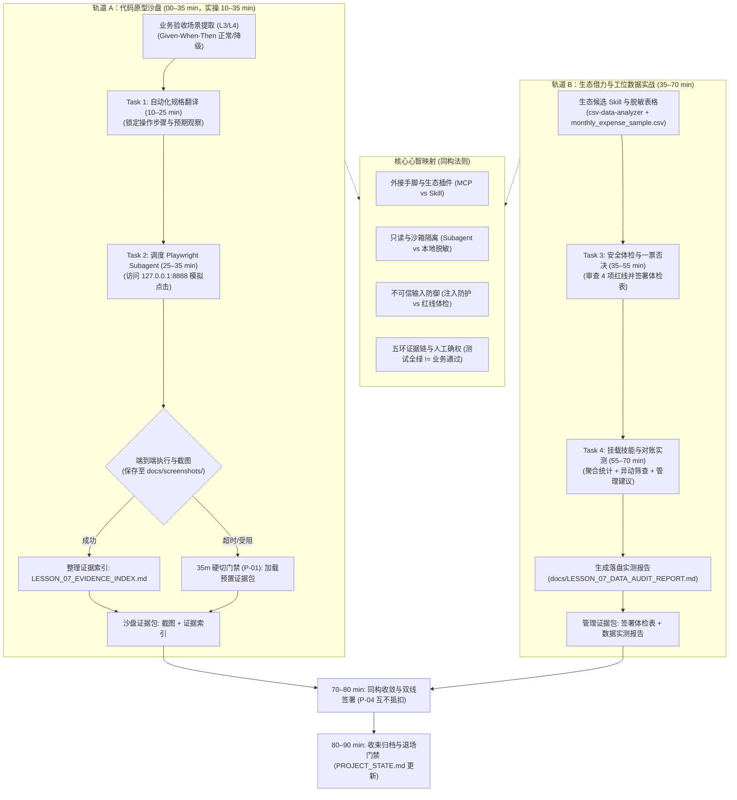

# 第七课课程设计简报 (Lesson Design Brief)

<!-- candidate_version: 2.1.0 双轨架构与生态借力升级：原型沙盘浏览器自动化验收 + 工位日常办公数据分析 Skill 安全体检与表格对账实战 -->

`contract_version: 2.1`

---

## 1. 课程元数据与权威依据 (Metadata and Authority)

| 字段 | 设定值 | 契约约束说明 |
| --- | --- | --- |
| `lesson_number` | 7 | 对应第 7 课《让 Agent 实际操作页面完成验收》（双轨主题：自动化工具验收与生态借力 · 日常办公数据工具实战） |
| `course_context` | 目标学员为具备业务管理经验的部门主管（非技术/AI新手），已完成 L1–L6，拥有可运行的业务薄片与事实核验能力；采用线下/线上混合工作坊模式；配备助教（3分钟响应接管）；课时硬上限 90 分钟 | 严格执行双轨工作坊时间与认知负荷限制 |
| `authority_refs` | 1. `lessons/TEN_LESSON_FROZEN_BASELINE.md`<br>2. `lessons/CURRICULUM_REBALANCING_AND_DUAL_TRACK_OPTIMIZATION_PROPOSAL.md` (v1.4.1 Approved & Frozen Baseline · 2026-09-16)<br>3. `lessons/COURSE_ROADMAP.md`<br>4. `lessons/COURSE_ROADMAP_STUDENT.md`<br>5. `lessons/GLOSSARY.md` | 严禁引用陈旧 `docs/` 目录；所有引用均基于 `lessons/` 权威文件 |
| `contract_version` | 2.1 | 严格遵循 2.1 契约标准 |
| `candidate_version` | 2.1.0 | 本次升级设计版本号（双轨架构化与办公数据工具实战化） |
| `comparison_baseline` | `lessons/LESSON_07_TEACHER_PLAN.md` 与 `lessons/LESSON_07_GUIDE.md` (原 90 分钟单轨版本) | 用于显式对比并形成继承表 |

---

## 2. 成果与非目标 (Result and Non-goals)

### 2.1 课堂主成果 (`classroom_main_result`)
**自动化工具验收与生态借力双成果包**：
1. **代码沙盘成果**：在预配置单一入口下，调度 Playwright Subagent 驱动浏览器自动化访问本地预览页面（`http://127.0.0.1:8888/`），完成端到端场景操作与关键节点界面截图，生成结构化《浏览器验收证据索引》（`docs/LESSON_07_EVIDENCE_INDEX.md`）；
2. **管理实战成果**：运用《业务主管外部 Skill 选型与安全体检表》（`student-package/templates/FIND_SKILLS_VETTING_CHECKLIST.md`）对工位高频实用数据技能（`csv-data-analyzer`）进行合规体检并签署放行裁决，随后挂载该技能对已脱敏月度费用表（`student-package/cases/monthly_expense_sample.csv`）进行自动化异动筛查，生成落盘的《业务数据分析与异动筛查实测报告》（`docs/LESSON_07_DATA_AUDIT_REPORT.md`）。

### 2.2 双轨结构分配 (`dual_track_structure`)
严格执行 **35 + 35 + 10 + 10** 刚性时间预算：
- **`track_a_sandpit` (00–35 min)**：导入与原型沙盘浏览器自动化验收（Task 1–2）。
  - 导入、痛点唤醒与模型建立 (00–10 min)：开场前 3 分钟抽查 2 名学员汇报 L6 课后微任务落实情况（真实材料签发前核验经历与发现的存疑点），顺势引出本课主题（“上节课你核的是一份材料的说法与物证，今天你核的是 Agent 的外部手脚和插件生态”）；对比“口头问 AI 好了没（口说无凭）” vs “浏览器实际操作留痕（物证落盘）”，讲解 5 大核心概念与工具边界（10 min）；
  - Task 1 (10–25 min)：从 L3/L4 业务契约中提取核心业务切片，明确正常路径与失败/降级路径的 Given-When-Then 自动化验收规格（15 min）；
  - Task 2 (25–35 min)：在预配置入口启动浏览器自动化（Playwright Subagent），打开本地预览服务（`127.0.0.1:8888`），执行端到端页面点击交互，截图保存至 `docs/screenshots/` 并整理生成 `docs/LESSON_07_EVIDENCE_INDEX.md`（10 min）；
  - **35 分钟硬切门禁 (P-01)**：第 35 分钟一到，未跑通的学员由助教一键下发预置标准证据包（包含截图与标准证据索引），标记 `STATUS: RECOVERED_BY_SNAPSHOT`，全员准时切入轨道 B。
- **`track_b_management` (35–70 min)**：生态借力（Find Skills）与日常办公数据分析体检对账实战（Task 3–4）。
  - Task 3 (35–55 min)：学习开源与企业技能生态的检索标准与目录结构（用 `find-skills` / `skills.sh` 体验生态检索，树立“检索看生态、引入必体检——高赞技能亦须过四红线”的防御心智）；通读候选技能规范文件（`student-package/templates/skills/csv-data-analyzer/SKILL.md`），对照《业务主管外部 Skill 选型与安全体检表》（`student-package/templates/FIND_SKILLS_VETTING_CHECKLIST.md`）执行价值契约审查与 4 项安全红线一票否决体检，输出审核出处并由主管签署放行裁决（20 min）；
  - Task 4 (55–70 min)：挂载通过体检的 `csv-data-analyzer` 技能，投喂脱敏业务流水（`student-package/cases/monthly_expense_sample.csv`），指挥 Agent 严格执行只读 SOP 完成 4 步分析，生成并落盘《业务数据分析与异动筛查实测报告》至 `docs/LESSON_07_DATA_AUDIT_REPORT.md`（15 min）。
- **同构收敛与签署 (70–80 min)**：
  - 点拨“Agent 调浏览器工具（外接手脚去操作取证）”与“主管为 Agent 装配外部数据分析技能（给大脑装专业插件提效工位）”的工具扩展同构性；核验双线最低证据，签署验收卡与体检表（10 min）。
- **收束与归档 (80–90 min)**：
  - 执行 Git Commit、更新 `docs/PROJECT_STATE.md`，完成 5 道随堂测试题并执行退场门禁（10 min）。

### 2.3 双线最低证据契约 (`prototype_progress_line` & `supervisor_judgment_line`)
- **`prototype_progress_line`（原型推进线）**：
  - 结构化浏览器验收证据索引文件（`docs/LESSON_07_EVIDENCE_INDEX.md`）；
  - 实际端到端操作页面截图（至少包含正常路径与失败/降级路径各 1 张保存在 `docs/screenshots/` 目录）；
  - Git Commit 存档记录。
- **`supervisor_judgment_line`（主管判断线）**：
  - 完整填写并由主管签字的《业务主管外部 Skill 选型与安全体检表》（`student-package/templates/FIND_SKILLS_VETTING_CHECKLIST.md`，包含契约审查、4 项安全红线逐项引证出处与 APPROVED 裁决）；
  - 符合规范契约并落盘保存的《业务数据分析与异动筛查实测报告》（`docs/LESSON_07_DATA_AUDIT_REPORT.md`，包含概览统计、部门/科目分布、高危异动与 3 条管理建议）。
- **`line_merge`（双线汇聚与 P-04 互不抵扣铁律）**：
  - 原型浏览器自动化截图与证据索引**绝对不可抵扣**主管外部 Skill 体检表与数据分析报告的缺失；
  - 技能体检与数据分析报告完成度**绝对不可抵扣**沙盘浏览器工具的调度与验收截图。两条主线必须独立核验通过。

### 2.4 明确非目标 (`non_goals`)
- 不让学员在课堂上自行安装和配置多套 MCP、Playwright、Node.js 驱动或浏览器运行环境（必须由教师和系统环境预配置，课堂不变成 MCP 环境排错课）；
- 不把 JSON-RPC、YAML 语法、DOM 元素选择器（如 XPath / CSS Selector）或底层前端 API 变成主管的考核要点；
- 严禁连接任何真实生产环境系统，或在页面与提示词中输入真实机密业务数据、敏感个人信息（PII）或 API Key；
- 不把“测试通过”宣传为“业务正确”或“可以立即上线”；
- 不在第 7 课要求零基础学员凭空手写工业级 Skill（手写与 `/shape` 规约锁定在第 9 课，本课聚焦生态技能的检索、审查、体检与挂载使用）；
- **课程边界防重复约定（Anti-Collision Triad）**：
  - L6 聚焦“签发前的自查核验（落笔之前先要物证，我方材料核验）”；
  - L7 聚焦“处理手里的数据（数据分析与技能体检，不涉及最终签发决策）”；
  - L8 聚焦“发布前的双盲对抗审查（独立蓝方挑刺，重大合同内审）”。

### 2.5 AI/Agent 融入业务节点 (`next_ai_integration_boundary`)
承接 L5 智能候选与 L6 有界排错，本课正式推进至**“工具调用（Tools & MCP）与技能生态（Skills）外接”**阶段。
学员不仅在沙盘中看到 Agent 如何通过 Browser MCP 扩展出“操作页面并留下物理证据”的实体能力，更在工位实战中掌握为 Agent 装配即插即用外部专业技能（`csv-data-analyzer`）的安全评估准则，为 L8 独立审查与 L9 自定义规则注入打下坚实的生态协作基石。

### 2.6 四类业务原型适配与验收场景机制 (`archetype_adaptations`)
- **四类原型验收场景映射**：
  - **Type A（监控与决策型，如质量预警看板）**：
    - 验收场景：在看板中触发“时间范围切换（如昨日 vs 今日）”或“阈值筛选”，验证异常批次高亮与图表指标联动刷新（正常路径），以及选择无数据日期时展示“暂无报警数据”占位卡（降级路径）；
    - 截图重点：指标卡前后数值对比图、空状态降级截图。
  - **Type B（任务与流程型，如客诉处理审批流）**：
    - 验收场景：打开工单详情，录入流转备注并点击“处理流转”按钮，验证工单状态由“待处理”流转为“已处理”（正常路径），以及必填流转原因留空时弹出“请填写处理意见”校验拦截（降级路径）；
    - 截图重点：操作前后状态标签变化图、表单校验高亮截图。
  - **Type C（操作工具型，如供应商报价核算器）**：
    - 验收场景：输入采购数量与单价，验证总价、阶梯折扣与税金自动完成重新核算渲染（正常路径），以及输入非法字符或负数时总计栏不报 `NaN` 而是提示“请输入合法数值”（降级路径）；
    - 截图重点：核算器计算结果渲染图、非法输入校验拦截截图。
  - **Type D（研发创作工作台型，如服装研发/品牌视觉企划工作台）**：
    - 验收场景：在工作台中展开企划变体抽屉，修改面料规格参数并保存，验证主卡片规格与面料标签实时同步更新（正常路径），以及上传非支持格式或清空关键面料时给出友好警示且不丢失草稿（降级路径）；
    - 截图重点：抽屉修改前后主界面联动截图、格式校验拦截截图。
- **35 分钟硬切门禁预置证据包机制 (P-01 & P1-3)**：
  - 助教端针对四类原型（A/B/C/D）各预置一套标准验收证据包（包含正常/降级截图与规范的 `LESSON_07_EVIDENCE_INDEX.md`；未声明原型缺省采用 Type B 兜底）；
  - 当学员在第 35 分钟因浏览器环境或自动化脚本受阻时，助教一键下发对应原型快照证据包，在控制台标记 `STATUS: RECOVERED_BY_SNAPSHOT`，确保 100% 学员准时进入轨道 B。

---

## 3. 目标、证据与对齐映射 (Objectives and Evidence)

### 3.1 学习目标 (`objectives`)
1. **[应用]** 学员能从自身原型契约中提取 1 个包含 Given-When-Then 的端到端验收场景（含正常路径与失败/降级路径），并驱动 Playwright Subagent 自动化操作页面获取截图与日志；
2. **[分析]** 学员能把浏览器观察事实与验收标准逐项对照，识别证据盲区，整理生成落盘的《浏览器验收证据索引》（`docs/LESSON_07_EVIDENCE_INDEX.md`）；
3. **[评价]** 学员能对照《业务主管外部 Skill 选型与安全体检表》（4 项安全红线：权限只读、本地脱敏、数据不出境、无破坏性命令），对候选开源/企业技能进行合规体检并给出放行/否决裁决；
4. **[决策]** 学员能挂载合规 Skill 对脱敏业务数据进行只读分析，根据异动筛查结果签署主管处置意见，分清“自动化验证行为正常”与“业务主管签署验收”的权责边界。

### 3.2 目标—活动—证据对齐图 (`alignment_map`)

| 学习目标 | 对应活动 | 验收证据 | 主管裁决动作 |
| --- | --- | --- | --- |
| 1. 自动化验收规格与执行 | Task 1 & Task 2 (沙盘自动化) | Playwright 自动化操作日志 + 关键节点截图（`docs/screenshots/`） | 审查自动化操作路径与截图真实性，下达执行授权 |
| 2. 整理验收证据索引 | Task 2 (证据整理) | 结构化《浏览器验收证据索引》（包含正常与降级路径判定） | 审查未证明内容与证据盲区标注，确认证据链完整性 |
| 3. 外部 Skill 安全体检 | Task 3 (技能体检) | 签署的《业务主管外部 Skill 选型与安全体检表》（4 项红线逐项引证出处） | 抽查权限只读性与无数据出境判定依据，行使一票否决权 |
| 4. 表格数据异动筛查 | Task 4 & 70–80 收敛 (数据实战) | 落盘保存的《业务数据分析与异动筛查实测报告》+ 签署验收 | 审查高危异动识别准确性与 3 条管理建议，签署最终验收意见 |

### 3.3 自动化校验与教师裁决界限 (`auto_checkable` vs `teacher_judged`)
- **自动化可校验项 (`auto_checkable`)**：
  - `docs/screenshots/` 目录下是否存在对应操作节点的 PNG 图片文件；
  - `docs/LESSON_07_EVIDENCE_INDEX.md` 与 `docs/LESSON_07_DATA_AUDIT_REPORT.md` 文件是否落盘存在且包含必要段落；
  - Git working tree 是否干净，是否存在对应提交记录。
- **教师/主管人工裁决项 (`teacher_judged`)**：
  - 自动化场景是否真实反映 L3/L4 业务契约，而非临时拼凑的无效点击；
  - 证据索引中是否诚实标记“未证明”事项，是否存在虚构 `[PASS]` 的行为；
  - Skill 安全体检表中 4 项一票否决红线是否均找到具体的文档或代码引证依据；
  - 业务数据分析报告中的异动判断是否符合业务逻辑，3 条管理建议是否具备事实支撑。

---

## 4. 概念曝光台账 (Concept Exposure Ledger)

严格遵循 commit `7114ddc` 规范，所有 5 个核心概念均采用**「是什么 / 怎么用 / 避坑红线」**三段式结构，并附带明确的**交接价值**与回指 Task。

### 4.1 核心概念清单 (`core_concepts`，共 5 个)

#### 1. MCP 协议（标准化工具扩展协议）
- **是什么**：AI 领域的“通用 USB 接口协议”（Host 通过 Client 连接 Server，Server 暴露 Tools），让大模型能够按需即插即用外部现成的工具生态（如浏览器自动化、文件系统、数据库探针）。
- **怎么用**：在受控配置中为 Agent 插上工具手脚（如 `@playwright/mcp`），由 Agent 调度执行外部操作与取证。
- **避坑红线**：MCP 只是外接工具标准通道，绝对不是企业内部生产系统的业务 API；严禁将未审计的破坏性工具直接暴露给 Agent。
- **交接价值**：回指 Task 2——区分通用外接工具协议层与企业私有业务系统层。

#### 2. Subagent（现场调研子代理）
- **是什么**：由主 Agent 调度的具有独立上下文的限定任务执行者，拥有只读、隔离、超时和落盘特性，任务完成后汇报结果并立即释放。
- **怎么用**：用于承接长耗时、高交互或容易污染主上下文的专项任务（如打开浏览器点击页面、通读大量日志并截图）。
- **避坑红线**：严禁赋予 Subagent 生产修改权或破坏性权限；Subagent 只有取证权，绝无最终业务裁决权与签字权。
- **交接价值**：回指 Task 2——Subagent 负责执行操作与取证，主管负责核实验收。

#### 3. 自动化验证与业务验收
- **是什么**：自动化验证是工具检查技术指标与行为正常（按钮能点、页面能开、状态能变）；业务验收是主管依据业务价值与规章判定是否达标。
- **怎么用**：先由自动化工具执行脚本跑通基础行为验证，最后由主管亲自对照业务目标签署验收通过。
- **避坑红线**：自动化测试全绿绝不等于业务验收通过；工具永远不能代替主管签字，测试通过不等于可以上线。
- **交接价值**：回指 Task 1 与 Task 4——自动化验证技术事实，主管签署业务责任。

#### 4. 五环证据链
- **是什么**：将“场景编号 → 触发操作 → 界面观察 → 原始证据（截图/日志）→ 验收结论”环环相扣的可追溯链条。
- **怎么用**：在验收过程中保留每一步的操作物证索引，让技术团队与后续接手人能完整复现审计过程。
- **避坑红线**：严禁只有主观结论而无原始物证（截图/日志），证据链缺失任何一环均视为未证明，严禁虚构 `[PASS]`。
- **交接价值**：回指 Task 2——证据索引作为交付 IT 团队排期与产品决策的第一手客观凭据。

#### 5. 不可信输入与安全审查（提示词注入防护与 Skill 体检）
- **是什么**：外部网页、表格或第三方开源 Skill 中可能夹带恶意指令（提示注入）或越权危险操作（如未经说明的文件删除、数据外联回传）。
- **怎么用**：将一切外部输入视为“只读待处理数据”而非最高指令；在引入外部 Skill 前，严格按照《外部 Skill 安全体检表》实行 4 项红线一票否决审计。
- **避坑红线**：严禁将未经脱敏的真实敏感数据直接喂给外部工具，严禁安装包含破坏性命令（`rm`, `drop`）或具有私自外联回传动作的未知 Skill。
- **交接价值**：回指 Task 3 与 Task 4——构筑工位日常借力外部生态时的安全护栏与数据防泄密防线。

### 4.2 扩展认识 (`extension_concepts`，共 2 个)
1. **Playwright / DOM / Console / Network**：帮助 Agent 操作浏览器和取证的工程底层能力（DOM 为页面元素结构，Console 为前端日志堆栈，Network 为网络交互记录）。只要求识别名称，不设代码考核。
2. **离线技能沙盒化运行机制**：在断网或内网受控环境下，通过本地 Markdown 规约与纯函数逻辑运行的单机自治技能形态。

### 4.3 操作术语与教师背景 (`operation_language` & `teacher_background`)
- **操作术语**：端到端验收、Given-When-Then、截图物证索引、一票否决体检、高额异动筛查。
- **教师背景**：Playwright Headless 协议、MCP JSON-RPC 通信原理、CSV 结构化流式解析。

### 4.4 复合规则核查 (`composite_rule_check`)
核验确认：上述 5 个核心概念各自拥有独立的判断标准与排他性语义，无复合词隐藏独立判断的情形。

---

## 5. 课程融合心智模型 (Integrated Lesson Model)

- **模型类型 (`type`)**：`method_loop`（方法闭环）+ `evidence_chain`（双轨证据链）
- **核心逻辑 (`learning_function`)**：
  揭示“代码沙盘中的浏览器工具扩展（给 Agent 配手脚操作页面取证）”与“日常工位中的外部 Skill 生态借力（给 Agent 配专业表格分析插件提效）”在工具外接心智上的完全同构性：
  两者均遵循“定义需求边界 ➔ 装配外接工具 ➔ 设定安全护栏 ➔ 收集落盘证据 ➔ 人工核验确权”的严密工程与管理逻辑。
- **非时间表核验 (`not_timetable`)**：`true`。该图表达的是逻辑决策模型与证据流动拓扑，绝非课堂时间推进表。



---

## 6. 活动与任务实施逻辑 (Activity and Task Logic)

### 6.1 刚性时间预算 (`macro_phases` & `time_budget`)

| 时间段 | 阶段名称 | 核心驱动 | 产出物 | 门禁规则 |
| --- | --- | --- | --- | --- |
| **00–10 min** | 导入、痛点唤醒与模型建立 | 教师开场前 3 分钟抽查 2 名学员汇报 L6 真实材料签发核验经历，借“材料物证 ➔ 工具物证”顺势导入；对比“口头问 AI 好了没” vs “浏览器自动化取证”，讲解 5 大核心概念与示范 | 明确双轨目标与工具扩展边界 | 无 |
| **10–25 min** | **轨道 A：Task 1 自动化规格翻译** | 从 L3/L4 契约中提取核心业务切片，明确正常与降级 Given-When-Then 规格 | 结构化端到端验收规格（零代码、防虚构） | 严禁凭空胡编，必须基于现有原型契约 |
| **25–35 min** | **轨道 A：Task 2 浏览器操作与证据索引** | 在预配置入口调度 Playwright Subagent 操作页面，截图并生成证据索引 | 页面截图 + `docs/LESSON_07_EVIDENCE_INDEX.md` | **35m 硬切门禁 (P-01)**：未跑通者立即加载预置证据包切出 |
| **35–55 min** | **轨道 B：Task 3 外部 Skill 安全体检** | 体验外部技能生态检索标准与目录结构，通读候选技能规范，运用体检表审查 4 项红线，引证出处并签署裁决 | 签署的《外部 Skill 安全体检表》（`FIND_SKILLS_VETTING_CHECKLIST.md`） | 必须逐项引证出处，严禁未体检直接放行 |
| **55–70 min** | **轨道 B：Task 4 挂载技能与对账实测** | 挂载技能，投喂脱敏流水，执行 4 步只读 SOP，生成异动实测报告 | 《业务数据分析与异动筛查实测报告》（`docs/LESSON_07_DATA_AUDIT_REPORT.md`） | 必须落盘报告，严禁篡改源 CSV 文件 |
| **70–80 min** | **同构收敛与双线签署** | 教师点拨外接工具同构性（调浏览器 vs 装 Skill），核验双线最低证据并签署 | 签署验收卡与体检表 | **P-04 铁律**：双线独立核准，严禁相互抵扣 |
| **80–90 min** | **收束、归档与退场门禁** | 提交 Git Commit，更新 `PROJECT_STATE.md`，完成 5 题随堂测验 | 归档项目状态单 + 随堂测验答卷 | 随堂测验提交，工作区干净 |

### 6.2 任务卡片定义 (`tasks`)

#### Task 1 (Track A, 10–25 min)：从 L3/L4 选择一个验收场景，翻译为自动化验收规格

- **教师卡片 (`teacher_card`)**：
  - **示范**：打开标准案例（工单看板），从 L3 业务功能卡中提取场景：“工单状态从待处理变为已处理”；翻译为 Given-When-Then 规格，明确正常预期（状态标签更新为已处理）和失败/降级预期（流转备注为空时弹出校验拦截）。
  - **口令**：“从你的 L3 业务功能卡或 L4 薄切片中选出一个核心业务场景。写清给定条件、触发操作、正常预期与失败/降级预期。先不要让 Agent 操作浏览器，不要修改代码，先把验收规格固定下来。”
  - **巡视判断**：学员是否提取了明确的 Given-When-Then 三要素；是否包含失败/降级路径；场景是否基于项目现有原型而非凭空捏造。
  - **失败降级**：若学员场景过大（包含多页面长流程），指导其缩小到一个可观察的界面交互切片；若缺乏降级预期，要求补充一个非法输入或空状态预期。
- **学员卡片 (`learner_card`)**：
  - **目的**：将业务契约转化为机器可执行、人类可核对的端到端自动化验收规格。
  - **直接可复制提示词**：
    ```text
    请帮我从我的 L3 业务功能卡与契约中提取一个核心业务验收场景，并翻译为自动化验收规格。

    输出要求：
    1. 【场景名称】：明确业务切片名称；
    2. 【前置条件 (Given)】：页面初始状态与 Mock 初始数据；
    3. 【触发操作 (When)】：用户在界面上的具体操作步骤（点击哪个按钮、输入什么字段）；
    4. 【预期观察 (Then)】：正常情况下界面应出现的肉眼可见状态变化；
    5. 【正常路径预期】：业务操作成功时的可见状态、数据刷新与文案反馈；
    6. 【失败/降级路径预期】：设定一个异常输入或边界条件（如：必填项留空、非法数值、网络超时或空数据状态），说明界面应给出的合法降级反馈。

    严禁临时胡乱编造，必须严格基于我现有的业务原型与数据契约！输出完成后停下，不要操作浏览器，不要修改代码。
    ```
  - **预期观察**：Agent 给出结构化验收规格说明，清晰列出正常路径与降级路径预期，无任何代码修改与浏览器动作。
  - **自检点**：是否明确了前置条件、操作与预期？失败/降级预期是否明确？
  - **强制停止门禁 (Mandatory Stop)**：若 Agent 擅自启动浏览器或尝试修改代码，立即打断并要求其仅输出文本规格。

---

#### Task 2 (Track A, 25–35 min)：调度 Playwright Subagent 浏览器自动化操作，生成证据索引

- **教师卡片 (`teacher_card`)**：
  - **示范**：下发浏览器验收指令，调度预配置的 Playwright Subagent，自动启动浏览器访问本地预览 `http://127.0.0.1:8888/`；演示点击操作、保存截图至 `docs/screenshots/`、收集控制台与网络状态，最后汇总生成 `docs/LESSON_07_EVIDENCE_INDEX.md`。
  - **口令**：“现在把刚才生成的验收规格喂给 Agent，调度浏览器自动化工具实际操作页面。检查截图是否存入 `docs/screenshots/`，检查 `docs/LESSON_07_EVIDENCE_INDEX.md` 证据索引是否落盘。超时或脚本报错不用慌，35 分钟一到助教统一发标准证据包！”
  - **巡视判断**：Agent 是否真实启动浏览器操作页面（而非静态读取源码）；截图是否真实落盘；工具遇到报错时是否如实报告（严禁偷偷换成代码推测宣布通过）。
  - **失败降级**：若环境偶发启动失败或达到第 35 分钟门禁，强制触发 **P-01 硬切门禁**，由助教一键派发预置标准证据包，标记 `STATUS: RECOVERED_BY_SNAPSHOT`，全员准时切入 Task 3。
- **学员卡片 (`learner_card`)**：
  - **目的**：驱动 Agent 执行真实浏览器交互并截图留存物理证据，形成可追溯证据索引。
  - **直接可复制提示词**：
    ```text
    现在请启动浏览器自动化工具（Playwright Subagent），打开我的本地预览服务（http://127.0.0.1:8888/），按以下场景执行端到端页面验收：

    【验收场景规格】：
    请严格依据上一步我们共同确定的业务验收场景规格（包含前置条件、操作步骤、正常路径与降级路径）。

    执行要求：
    1. 实际启动浏览器访问本地预览页面，严禁仅通过读取前端代码进行静态推测；
    2. 依次执行正常路径与失败/降级路径的页面交互操作；
    3. 在关键操作节点（操作前、操作后、异常触发时）分别截取完整页面截图并保存至 docs/screenshots/ 目录；
    4. 记录控制台 Console 日志与网络 Network 状态，严禁向页面中录入未脱敏的真实个人信息或敏感密钥；
    5. 若自动化工具执行受阻或元素未找到，必须如实报告具体报错，绝对禁止偷偷换成代码推测宣布通过；
    6. 整理生成验收证据底稿，记录每步操作、观察结果、截图路径与 PASS/FAIL 判定，保存至 docs/LESSON_07_EVIDENCE_INDEX.md。
    ```
  - **预期观察**：Agent 调度浏览器完成页面操作，本地 `docs/screenshots/` 目录出现对应操作截图，项目生成 `docs/LESSON_07_EVIDENCE_INDEX.md`。
  - **自检点**：截图是否清晰展示操作前后变化？证据索引中是否包含正常与降级两条路径的判定？
  - **强制停止门禁**：时间到达第 35 分钟无论是否跑通，立即停止调试，举手示意助教下发标准证据包，严禁拖堂！

---

#### Task 3 (Track B, 35–55 min)：候选 Skill 选型审查，对照体检表执行安全体检与签署

- **教师卡片 (`teacher_card`)**：
  - **示范**：“先别急着把代码或技能往 Agent 里塞，先看清生态长什么样。”教师用 2 分钟演示外部技能生态检索标准与目录结构（使用 `find-skills` 或 skills.sh 检索表格处理类技能，展示开源社区的丰富性与良莠不齐），重点强调：“检索看生态、引入必体检——哪怕是高赞技能，也可能存在权限越界或数据外联，必须先过四项安全红线体检！”随后展示候选技能 `student-package/templates/skills/csv-data-analyzer/SKILL.md`，对照《业务主管外部 Skill 选型与安全体检表》（`FIND_SKILLS_VETTING_CHECKLIST.md`）逐项审查：功能专注度、输入契约、输出格式，重点核查 4 项安全红线（权限只读性、本地脱敏、网络不出境、无破坏性命令），逐条在规范中找到原文出处；签署 APPROVED 放行裁决。
  - **口令**：“工位提效不能盲目乱装插件！看一眼开源技能生态，学会看技能目录结构与契约规范。打开候选技能 `csv-data-analyzer` 的说明文件，要求 Agent 扮演首席合规官对照体检表逐条排查。4 项安全红线一票否决：只要有写权限、有外部网址回传、有破坏性命令，立即否决！全部通过后，由你在体检表上签署 APPROVED！”
  - **巡视判断**：学员是否要求 Agent 引证原文出处；4 项红线是否全量核验；学员是否亲自在体检表签字确认。
  - **失败降级**：若学员只让 AI 说“好不好”，提醒“按体检表逐项引证出处”；若学员未签署放行直接尝试运行，强制要求完成签字流程。
- **学员卡片 (`learner_card`)**：
  - **目的**：了解外部技能生态检索标准与目录结构，掌握企业级外部 Skill 引入的安全审查流程，行使主管一票否决与签署放行权。
  - **直接可复制提示词**：
    ```text
    我们部门计划引入外部开源/企业级 Skill 来提效日常工位表格审计。在正式挂载前，请你严格依照《业务主管外部 Skill 选型与安全体检表》对候选技能进行合规体检。

    【候选 Skill 规范文件】：
    请通读 student-package/templates/skills/csv-data-analyzer/SKILL.md 的完整内容。

    请严格执行以下体检项目：
    1. 【价值与契约审查】：
       - 功能专注度：是否只聚焦于表格数据分析与异动筛查，是否存在不相关功能？
       - 输入契约：是否明确界定了所需文件格式（CSV/Excel）与参数字段？
       - 输出格式：是否具备结构化 Markdown 表格输出定义？
    2. 【安全与红线审查 (全勾选方可放行，任一不符一票否决)】：
       - 权限只读性：该 Skill 是否仅执行只读分析？有无任何修改、删除源文件或执行未知系统脚本的危险动作？
       - 敏感数据本地脱敏要求：SOP 中是否明确要求本地脱敏后再喂入，严禁明文上传客户隐私？
       - 网络与数据不出境：调用链中是否存在向外部不可信第三方服务/域名回传数据的外联指令？
       - 无破坏性命令：代码与 SOP 中是否绝对不含 rm、drop、format 等破坏性指令？
    3. 【体检结论建议】：
       - 逐项给出 PASS / FAIL 判定与引证出处；
       - 给出放行建议（APPROVED 批准引入 / REJECTED 拒绝引入）。
    ```
  - **预期观察**：Agent 输出结构化体检报告，逐项给出 PASS/FAIL 及对应行号与条款引证，建议 APPROVED 放行。
  - **自检点**：4 项安全红线是否均有明确引证出处？体检表模版中是否已完成勾选并由主管本人签名？
  - **强制停止门禁**：若候选 Skill 存在未说明的外联或修改源文件动作，必须立即判定 REJECTED 终止挂载。

---

#### Task 4 (Track B, 55–70 min)：挂载通过体检的 Skill，投喂脱敏业务表格执行对账并落盘报告

- **教师卡片 (`teacher_card`)**：
  - **示范**：激活 `csv-data-analyzer` 技能，指定数据源为 `student-package/cases/monthly_expense_sample.csv`，设定高额监控阈值为 5000 元；指挥 Agent 按 SOP 四步执行：数据结构解析 ➔ 部门与科目聚合 ➔ 高危异动筛查（金额超标、个人抬头异常、待初审状态）➔ 提炼 3 条管理洞察；将报告保存至 `docs/LESSON_07_DATA_AUDIT_REPORT.md`。
  - **口令**：“体检放行后，现在让 Agent 实际跑一次业务表格！输入脱敏月度报销流水，执行自动化审计。核对总金额、找出单笔超 5000 元的大单和个人抬头异常，提炼 3 条管理建议。严禁改动源文件，报告必须落盘到 docs/LESSON_07_DATA_AUDIT_REPORT.md！”
  - **巡视判断（教师侧核验提示，严禁向学员提前透露或泄入学员指南）**：源 CSV 文件是否未被修改（只读性）；异动清单中是否准确抓出全部高危项——包含 EXP-202608-002（个人抬头/待初审/1280.00元）、两笔 ≥5000 元大额支出：EXP-202608-005（8900.00元大单/待初审）与 EXP-202608-009（5200.00元大单/待初审），以及 EXP-202608-006（980.00元超单日800元住宿标准/待初审）；报告是否符合格式契约并成功落盘。
  - **失败降级**：若 Agent 试图修改 CSV，立即按只读铁律喝止；若报告未落盘，要求其将完整 Markdown 写入目标文件。
- **学员卡片 (`learner_card`)**：
  - **目的**：体验外部专业 Skill 对日常高频表格分析的即插即用倍增效应，产出标准审计报告。
  - **直接可复制提示词**：
    ```text
    候选 Skill csv-data-analyzer 已通过安全体检并获准挂载。现在进行随堂业务表格对账实测。

    【待分析数据源】：
    文件路径：student-package/cases/monthly_expense_sample.csv
    文件性质：已脱敏部门 8 月份月度报销与采购支出流水

    【执行参数与指令】：
    1. 挂载并激活 csv-data-analyzer 技能；
    2. 核查基准参数：单笔高额支出监控阈值设定为 5000.00 元；
    3. 严格按照技能 SOP 的四步执行：
       - 第一步：检查行数、字段与有效性，确认无 NaN 或负数异常；
       - 第二步：统计总申报金额、平均金额、最大单笔，按部门与费用科目聚合；
       - 第三步：排查单笔 ≥ 5000 元项目、发票抬头非公司全称（如个人抬头）条目及待初审异常；
       - 第四步：提炼 3 条事实支撑的管理建议。
    4. 严格执行只读操作，严禁篡改源 CSV 文件，严禁自行编造调整项强行平账；
    5. 将符合格式契约的完整分析结果输出为《业务数据分析与异动筛查实测报告》，并落盘保存至 docs/LESSON_07_DATA_AUDIT_REPORT.md。
    ```
  - **预期观察**：Agent 自动完成数据解析与分类汇总，精准识别出个人抬头与超额支出项，输出符合格式契约的完整报告并落盘至指定路径。
  - **自检点**：报告中申报总金额与笔数是否与原表一致？高危异动是否命中关键异常？3 条管理建议是否具备针对性？源 CSV 文件是否完好无损？
  - **强制停止门禁**：若 Agent 擅自编造数据调整项强行“平账”，必须打回重做，严禁虚假对账。

---

## 7. 评估与支持支架 (Assessment and Support)

### 7.1 随堂必答题 (`required_questions`，共 5 题，分散与收束结合)
1. **MCP 的 Host、Client、Server 和 Tool 之间是什么关系？为什么说 MCP 不是企业业务 API？**
   - *参考答案*：Host 是运行宿主环境，通过 Client 发起连接，Server 运行在后台并暴露 Tool 给大模型调用。MCP 是 AI 与外部工具交互的通用技术通道协议（相当于 USB 协议），而企业业务 API 承载着具体业务规则与权限体系。MCP 是外接工具标准，绝不等于业务 API。
2. **浏览器自动化端到端验收和只读代码后宣称“测试通过”有什么本质区别？**
   - *参考答案*：只读代码是静态逻辑推测，无法感知真实的运行时渲染、DOM 树交互、CSS 样式遮挡或网络接口时序问题；浏览器自动化端到端验收是在真实运行环境中模拟用户交互，以实际页面渲染变化、控制台堆栈与网络日志作为物理证据，两者具有质的信任度差异。
3. **为什么《业务主管外部 Skill 选型与安全体检表》将“权限只读”和“数据不出境”设为一票否决项？**
   - *参考答案*：非只读权限可能导致 Agent 误删源文件或执行恶意系统脚本破坏系统；数据外联可能导致机密商业数据与客户隐私泄露给不可信第三方。两者属于不可逆的高危安全事件，因此必须实行一票否决。
4. **五环证据链要求哪五个环节可追溯？为什么仅有测试截图没有业务观察与结论不算完整证据？**
   - *参考答案*：五个环节为“场景编号 → 触发操作 → 界面观察 → 原始证据（截图/日志）→ 验收结论”。仅有截图只能证明存了一张图片，若没有对应的操作过程、界面观察对比以及基于业务标准的 PASS/FAIL 判定，就无法形成证明业务需求已满足的完整因果逻辑闭环。
5. **为什么说“自动化验证测试全绿”绝对不等于“业务验收通过”？主管的核心责任落在哪里？**
   - *参考答案*：测试全绿仅证明系统在技术行为上没有报错、按钮可以点击、流程能够跑通；但它无法证明当前功能是否真正解决了业务问题、规则是否合理或是否存在合规隐患。主管的核心责任在于对照真实业务目标进行实质性把关与最终确权。

### 7.2 拓展选做题 (`extension_questions`，共 2 题)
1. 在使用外部开源 Skill 或分析不可信外部网页数据时，如何防范潜在的“提示词注入（Prompt Injection）”攻击？
2. 如果部门月度表格数据量从 10 行激增至 10 万行，工位单机 Agent 分析可能面临哪些瓶颈？此时应如何向 IT 团队提出系统级承接需求？

### 7.3 常见误区清单 (`misconceptions`，5 项)

| 误区编号 | 典型错误认知 | 纠偏正解 |
| --- | --- | --- |
| M-01 | “AI 读完了前端代码说逻辑完全正确，那就不用真跑浏览器测试了” | 静态代码分析无法替代动态运行时验证，页面元素遮挡、时序问题与接口通信必须在浏览器中真实呈现并截图取证。 |
| M-02 | “开源社区高赞的 Skill 肯定好用安全，直接下载挂载即可” | 外部 Skill 必须经过《安全体检表》的 4 项红线一票否决审查，防范越权破坏命令与潜在数据外联风险。 |
| M-03 | “自动化工具跑通了页面流转，这套原型就算业务达标可以上线了” | 自动化验证行为正常不等于业务验收通过，工具永远不能代替主管的业务确权与上线批准。 |
| M-04 | “只要是用于做报销或财务对账的工具，把真实流水直接丢给 AI 也没事” | 严守本地脱敏红线！涉及真实身份证号、银行卡号与机密金额必须在本地打码脱敏后方可投喂。 |
| M-05 | “截几张图存下来就算完成证据链了，证据索引写不写无所谓” | 证据索引是连接“操作、现象与业务结论”的关键纽带，无索引的散落截图无法被技术团队复现与采信。 |

### 7.4 现场 Debug 处置类别 (`troubleshooting_categories`，5 类)

| 故障类别 | 现场典型现象 | 处置动作 (Action) | 降级预案 (Fallback) |
| --- | --- | --- | --- |
| **T-01 自动化受阻** | Playwright 找不到页面元素或超时卡死 | 检查本地开发服务 8888 端口是否存活，确认选择器是否漂移 | 助教下发标准截图包，切入人工手动验证 |
| **T-02 偷懒代码推测** | Agent 未启动浏览器，仅通过代码分析宣称通过 | 立即打断，严禁静态推测，指令必须包含浏览器启动动作 | 演示单步调试口令，强制执行外部工具调用 |
| **T-03 敏感数据泄露** | 表格或日志中粘贴了未经打码的真实卡号或机密信息 | 立即停止当前会话并清屏，指导学员执行本地脱敏 | 新建只读独立会话，重新加载脱敏样例 |
| **T-04 Skill 越权企图** | 候选 Skill 试图执行写操作或修改源 CSV 文件 | 严厉制止，声明只读铁律，在体检表中判定一票否决 | 强制切换为官方预审技能 `csv-data-analyzer` |
| **T-05 盲目全量标记** | 学员未逐条核对，盲目在验收卡中全量勾选 PASS | 教师提问抽查证据盲区，要求标出未证明项 | 退回验收卡，指导补充失败/降级路径对比 |

### 7.5 教师备课质量自测清单 (`teacher_checklist_budget`，8 项)
- [ ] 00–10 分钟开场是否先用 3 分钟抽查 2 名学员汇报 L6 签发前核验经历，并直接呈现“口头问 AI 好了没（口说无凭）” vs “浏览器实际操作（物证落盘）”的强烈对比？
- [ ] 5 个核心概念是否全部按“是什么/怎么用/避坑红线”讲透，并严格对应到四个 Task？
- [ ] 35 分钟硬切门禁（P-01）的标准证据快照包是否已在助教机就绪，确保卡顿学员准时切出？
- [ ] 轨道 B 必备的三套标准化脚手架（体检表模版、预审 Skill、脱敏流水样例）是否已确认存盘并可供学员只读访问？
- [ ] 是否在现场严格执行 4 项安全红线一票否决制，指导学员核验只读性与无外联？
- [ ] 随堂 5 道必答题是否贯穿在各 Task 节点并完成有效回收？
- [ ] 是否向学员明确宣告 P-04 铁律：原型浏览器验收证据与主管数据体检报告绝不能互相抵扣？
- [ ] 课堂结束前是否留足 10 分钟完成 Git 提交与 `PROJECT_STATE.md` 更新？

### 7.6 配套标准化脚手架 (`support_scaffolds`)
1. **浏览器验收预配置环境与预置证据包 (P-01)**：
   - 教师预置 Playwright Subagent 运行脚本与浏览器自动化启动配置；
   - 4 套与业务原型（A/B/C/D）严格对应的标准验收证据包（包含正常/降级截图与标准 `LESSON_07_EVIDENCE_INDEX.md`）；
2. **外部 Skill 安全审查模具 (P0-B)**：
   - 《业务主管外部 Skill 选型与安全体检表》（空白模具：`student-package/templates/FIND_SKILLS_VETTING_CHECKLIST.md`）；
3. **官方预审高频办公分析技能**：
   - 《业务表格数据分析与异动筛查执行手册》（预审通过规范：`student-package/templates/skills/csv-data-analyzer/SKILL.md`）；
4. **脱敏业务流水实测案例**：
   - 《脱敏月度报销与采购支出流水样例》（标准 CSV 表格：`student-package/cases/monthly_expense_sample.csv`）。

### 7.7 课后微任务 (`between_lesson_task`，10–15 分钟)
- **任务内容**：学员在自己的 `docs/LESSON_07_EVIDENCE_INDEX.md` 中，明确标注出**至少 1 处当前端到端验收仍未覆盖的“证据盲区”**（如：多浏览器兼容性、极端网络延迟、超大数值边界或特定异常流），并写出对应的**补证方式建议**（需补充哪类数据或测试用例）。
- **闭环机制**：该微任务记录于个人项目 `docs/PROJECT_STATE.md` 中，在第八课（L8）开场前 3 分钟进行抽查核对，作为向 Codex 独立审查输入上下文前的证据完备性自查基础。

---

## 8. 产物渲染契约 (Output Rendering Contracts)

| 契约项目 | 约定规则 |
| --- | --- |
| `teacher_plan_contract` | 严格渲染为 8 个二级标题（H2）模块；严格贯彻 35+35+10+10 双轨时间分配；Task 包含教师卡（示范、口令、巡视、降级）；严格落实 35 分钟硬切门禁与 P-04 互不抵扣铁律 |
| `learner_guide_contract` | 严格渲染为 6 个二级标题（H2）章节；单一学员指南文档；Task 包含学员卡（目的、直接可复制提示词、预期观察、自检点、强制停止门禁）；提示词中零占位符 |
| `guide_requires_approved_plan` | `true`（必须在教案独立评审通过并获批准后方可生成指南） |
| `guide_conformance_required` | `true`（学员指南必须与本简报及教案保持 100% 结构一致性） |

---

## 9. 安全与数据红线契约 (Safety and Data Redlines)

1. **全程模拟与脱敏数据红线 (`mock_chain`)**：原型操作与表格分析只使用 Mock 或已事前脱敏的数据；严禁在表格或提示词中输入真实身份证号、银行卡号、手机号或企业核心密钥。
2. **无真实凭证红线 (`no_real_keys`)**：课堂中绝对禁止学员填入真实大模型 API Key 或第三方凭证，所有工具演示均在沙箱或预配置环境中执行。
3. **事前脱敏红线 (`pre_deidentification`)**：所有外部材料与表格在送入大模型前，必须完成脱敏审查；发现敏感数据立即打码。
4. **权限只读与无外联一票否决红线 (`readonly_and_no_exfiltration`)**：外部引入的 Skill 必须严格遵循只读权限与无外部不可信网络外联，严禁执行文件写操作、文件删除或破坏性系统脚本。
5. **杜绝虚构能力与诚信证据红线 (`no_fabricated_capabilities`)**：严禁在教案或指南中编造不存在的校验脚本或控制能力；实际使用什么工具（如 Playwright、CSV 解析），就如实展示什么物理证据，严禁虚构 `[PASS]`。

---

## 10. 准备度与继承追溯表 (Readiness and Inheritance)

### 10.1 简报就绪状态 (`brief_readiness`)
**`HANDOFF_READY`**。本简报内容完备，厚度校验通过，双轨逻辑与时间预算自洽，无任何未解决的悬空占位符。

### 10.2 内容继承与调整全景表 (`inheritance_table`)

| 原教案/指南内容项 | 冻结基线与双轨优化要求 (v1.4.1) | 判定 (Judgment) | 具体处理方案 (Treatment) | 决策依据与理由 (Rationale) |
| --- | --- | --- | --- | --- |
| 原 5 个核心概念 | commit `7114ddc` 规范（是什么/怎么用/避坑红线） | **Rewrite** | 全面重写为三段式规范定义，并补充交接价值与回指 Task | 确保概念表达高度精炼，杜绝废话与工程黑话，突出主管价值 |
| 原端到端验证模型 | 课程融合心智模型（Method Loop + Evidence Chain） | **Rewrite** | 改造为双轨同构映射图（沙盘工具扩展 ➔ 同构心智 ➔ 工位生态借力），明确声明非时间表 | 直观展现工具外接与日常工位借力生态的内在同构性 |
| 原 Task 1–5 (90分纯浏览器测试) | 35+35+10+10 双轨制架构 (L6–L10) | **Split & Migrate** | 将原浏览器测试紧凑压缩为 Task 1–2 (00–35 min)；新增工位高频办公数据工具选型与实操为 Task 3–4 (35–70 min) | 彻底解决原课程单轨耗时过长、缺乏日常工位直接获得感的结构性病灶 |
| 原抽象交付工具强插 | v1.3/v1.4.1 方案确立的办公刚需回归 | **Delete & Replace** | 坚决剔除原方案突兀插入的代码交付工具 `intent-to-outcome-loop`，全面替换为 Excel/CSV 自动化分析技能 `csv-data-analyzer` | 消除非技术学员在浏览器与代码工程之间的认知割裂，回归主管高频刚需 |
| 原 Playwright 自动化操作 | 35 分钟硬切门禁 (P-01) + 标准证据包 | **Retain & Enhance** | 保留 Playwright Subagent 真实操作页面与截图能力，增加 35 分钟助教一键派发快照兜底 | 保证实操体验的同时，确保全员准时切入轨道 B 管理实战 |
| 原提示词模板 | 零占位符、直接可执行、支持四类原型 | **Rewrite** | 重构 Task 1–4 提示词，补充外部技能审查与表格对账提示词，彻底消除 `【...】` 等占位符 | 降低学员输入认知负担，确保复制即可运行 |
| 原现场 Debug 处置 | 现场 Debug 5 类根因分类 | **Retain** | 保留并重塑为 T-01 至 T-05，覆盖自动化受阻、偷懒推测、敏感泄露、Skill 越权等实战场景 | 现场指导性极强，完全契合真实课堂偶发状况 |
| 原 5 道必答题与拓展题 | 随堂测评与双轨知识点闭环 | **Retain & Enhance** | 保留 MCP/证据链考点的同时，补充外部 Skill 安全体检与一票否决红线考题 | 闭环评估双轨教学成效 |
| 原成果验收标准 | P-04 双线最低证据互不抵扣铁律 | **Rewrite** | 明确定义沙盘线（截图+证据索引）与主管判断线（体检表+数据实测报告）的最低物证，严禁互相抵扣 | 树立严肃的教学交付标准，杜绝互相替代糊弄 |
| 原 MCP 环境配置考点 | 零基础主管减负红线 | **Delete** | 坚决删除任何要求学员手动配置 Node.js、Playwright 或修改 JSON-RPC 配置的要求，全部由环境预置 | 严防课堂沦为环境排错课，守住主管认知负荷边界 |
