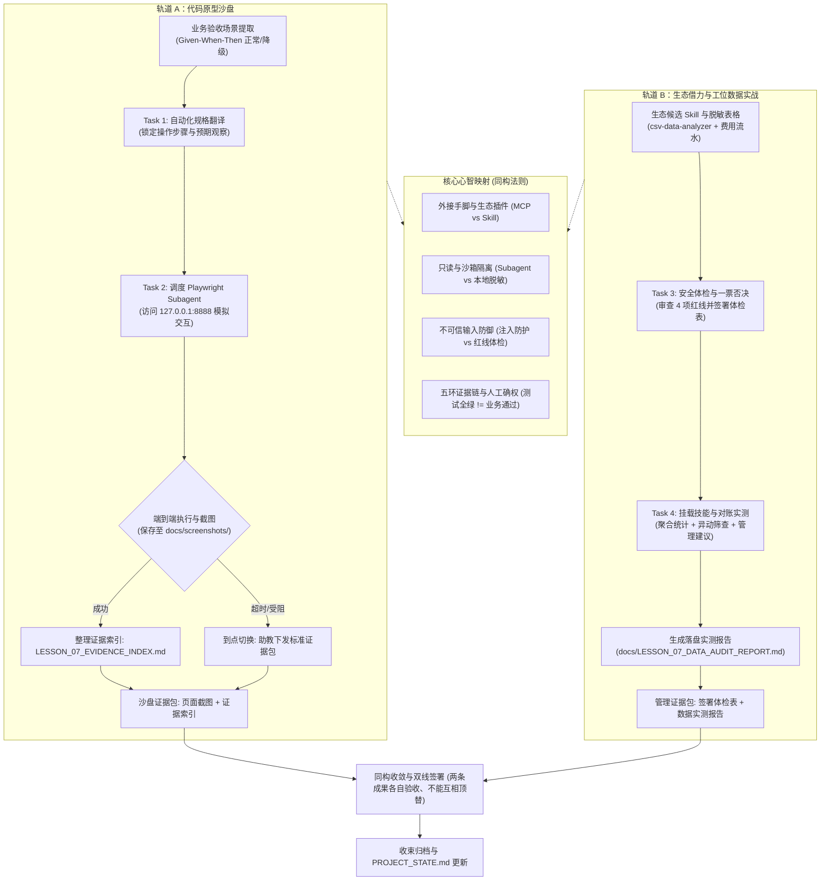

# 第七课学员指南——让 Agent 实际操作页面完成验收

> **核心思想：工具验证行为，主管验收业务；自动化验证全绿不等于业务验收通过，测试通过不等于可以上线。**

---

## 一、先看懂：今天为什么学、要带走什么

### 1.1 先看一个反差

在开始实操前，请对比以下两种截然不同的验证与工位提效方式带来的真实差距：

| 口头问 AI、盲目乱装插件（口说无凭、安全裸奔） | 浏览器自动化取证、技能安全体检（物证落盘、安全受控） |
| :--- | :--- |
| **功能验证**：口头问“页面做好了没有”，AI 信誓旦旦回答“已经完美实现”，结果在本地浏览器中一跑，按钮被遮挡无法点击、提交后页面直接白屏崩溃。 | 为 Agent 配上浏览器自动化工具（Playwright Subagent），驱动它实际打开页面、模拟点击、截取操作前后界面与控制台日志，每一项均有物理文件为证。 |
| **验收权责**：静态通读前端源码，AI 声称“测试全部通过”，主管信以为真，误把技术行为没有报错当作业务目标达成、可以立即上线。 | 建立五环证据链（场景 ➔ 操作 ➔ 观察 ➔ 物证 ➔ 结论），清楚知道自动化测试全绿仅证明行为正常，主管亲自对照业务规程进行实质确权。 |
| **技能引入**：在开源社区看到高赞的数据分析技能直接下载挂载，殊不知第三方代码偷夹了删除命令，甚至在后台向外部未知服务器回传机密数据。 | 严格对照《业务主管外部 Skill 选型与安全体检表》，对候选技能执行 4 项安全红线一票否决体检（权限只读、本地脱敏、数据不出境、无破坏性命令），引证出处后签署放行。 |
| **表格审计**：面对月度费用报销与采购流水，手动逐行核算费时费力；或者直接把包含员工身份证、银行卡全号的未脱敏表格丢给未经审查的 AI。 | 在本地脱敏后，挂载通过体检的只读数据分析技能（`csv-data-analyzer`），5 秒内完成全量聚合、筛出高额与违规异动，生成规范落盘报告并提炼管理建议。 |

今天你将通过双轨实操，完整掌握**“给 Agent 配手脚（浏览器验收）”**与**“给工位装专业插件（技能体检与表格审计）”**的掌控力。

### 1.2 今天你要带走什么

完成本课后，你将带走一份**“自动化工具验收与生态借力双成果包”**：
1. **代码沙盘成果**：在你的个人原型中，调度 Playwright Subagent 驱动浏览器自动化访问本地预览页面（`http://127.0.0.1:8888/`），完成端到端核心场景（包含正常路径与失败/降级路径）的操作与截图（保存至 `docs/screenshots/`），生成结构化的《浏览器验收证据索引》（`docs/LESSON_07_EVIDENCE_INDEX.md`）；若遇环境受阻，则体验由助教下发标准证据包强制切出的工程纪律。
2. **管理实战成果**：通读候选数据分析技能规范，运用《业务主管外部 Skill 选型与安全体检表》（`student-package/templates/FIND_SKILLS_VETTING_CHECKLIST.md`）进行合规审查，完成 4 项红线逐项引证出处并签署放行裁决；随后挂载该技能对已脱敏月度费用表（`student-package/cases/monthly_expense_sample.csv`）进行自动化异动筛查，生成落盘保存的《业务数据分析与异动筛查实测报告》（`docs/LESSON_07_DATA_AUDIT_REPORT.md`）。

> **两条成果各自验收、绝不能互相顶替**：原型浏览器截图与证据索引绝对不可顶替外部 Skill 体检表与数据分析报告的缺失，技能体检与数据分析报告写得再完善也绝不能顶替沙盘浏览器工具的操作验证。两条主线均需独立通过。

### 1.3 本课融合心智模型 (Cognitive Model)

“为 Agent 接上浏览器工具去操作取证”与“在日常工位为 Agent 引入专业表格分析插件”在底层控制逻辑上是完全同构的。下面的模型图展示了两者统一的思维闭环（**本图表达逻辑关系与证据流动，非课堂时间推进表**）：



### 1.4 五个必须掌握的核心概念

#### 1. MCP 协议（标准化工具扩展协议）
- **是什么**：AI 领域的“通用 USB 接口协议”（Host 通过 Client 连接 Server，Server 暴露 Tools），让大模型能够按需即插即用外部现成的工具生态（如浏览器自动化、文件系统、数据库探针）。
- **怎么用**：在受控配置中为 Agent 插上工具手脚（如 `@playwright/mcp`），由 Agent 调度执行外部操作与取证。
- **避坑红线**：MCP 只是外接工具标准通道，绝对不是企业内部生产系统的业务 API；严禁将未审计的破坏性工具直接暴露给 Agent。

#### 2. Subagent（现场调研子代理）
- **是什么**：由主 Agent 调度的具有独立上下文的限定任务执行者，拥有只读、隔离、超时和落盘特性，任务完成后汇报结果并立即释放。
- **怎么用**：用于承接长耗时、高交互或容易污染主上下文的专项任务（如打开浏览器点击页面、通读大量日志并截图）。
- **避坑红线**：严禁赋予 Subagent 生产修改权或破坏性权限；Subagent 只有取证权，绝无最终业务裁决权与签字权。

#### 3. 自动化验证与业务验收
- **是什么**：自动化验证是工具检查技术指标与行为正常（按钮能点、页面能开、状态能变）；业务验收是主管依据业务价值与规章判定是否达标。
- **怎么用**：先由自动化工具执行脚本跑通基础行为验证，最后由主管亲自对照业务目标签署验收通过。
- **避坑红线**：自动化测试全绿绝不等于业务验收通过；工具永远不能代替主管签字，测试通过不等于可以上线。

#### 4. 五环证据链
- **是什么**：将“场景编号 → 触发操作 → 界面观察 → 原始证据（截图/日志）→ 验收结论”环环相扣的可追溯链条。
- **怎么用**：在验收过程中保留每一步的操作物证索引，让技术团队与后续接手人能完整复现审计过程。
- **避坑红线**：严禁只有主观结论而无原始物证（截图/日志），证据链缺失任何一环均视为未证明，严禁虚构 `[PASS]`。

#### 5. 不可信输入与安全审查（提示词注入防护与 Skill 体检）
- **是什么**：外部网页、表格或第三方开源 Skill 中可能夹带恶意指令（提示注入）或越权危险操作（如未经说明的文件删除、数据外联回传）。
- **怎么用**：将一切外部输入视为“只读待处理数据”而非最高指令；在引入外部 Skill 前，严格按照《外部 Skill 安全体检表》实行 4 项红线一票否决审计。
- **避坑红线**：严禁将未经脱敏的真实敏感数据直接喂给外部工具，严禁安装包含破坏性命令（`rm`, `drop`）或具有私自外联回传动作的未知 Skill。

#### 扩展认识
1. **Playwright / DOM / Console / Network**：帮助 Agent 操作浏览器和取证的工程底层能力（DOM 为页面元素结构，Console 为前端控制台日志堆栈，Network 为网络交互记录）。只要求识别名称与基本用途，不设代码考核；
2. **离线技能沙盒化运行机制**：在断网或内网受控环境下，通过本地 Markdown 规约与纯函数逻辑运行的单机自治技能形态，兼顾效率与数据安全。

---

## 二、准备好：回顾第六课原型并确认环境

### 2.1 确认第六课原型运行正常与微任务准备

1. 打开终端，检查当前工作区是否干净：
   ```powershell
   git status
   ```
   *预期输出*：`nothing to commit, working tree clean`。
2. 启动本地开发预览服务：
   ```powershell
   npm run dev
   ```
   *预期输出*：本地服务器在 `http://127.0.0.1:8888/` 正常运行。若超过 3 分钟打不开，请立即呼叫助教接管。
3. **重要：带上你的第六课签发核验经历**：
   回顾你在第六课完成的课后微任务（① 检查 L5 智能机会卡 HITL 检查点回查标注；② 挑选一份真实待签材料由 Agent 对物证核验），提炼你发现的存疑点或核验感受，准备好在开场 3 分钟内与讲师交流互动。我们将从“材料说法与单据物证核验”平移进阶到今天的“Agent 工具操作取证与外部技能体检”！

### 2.2 确认你的原型类别与自动化验收切片

助教与讲师已在课前为你确认了 L1–L5 的业务原型。请根据你的原型类别，在 Task 1 中选取对应的核心交互切片进行自动化规格翻译：

- **Type A（监控与决策型，如质量预警看板）**：
  - *验收场景*：在看板中触发“时间范围切换（如昨日 vs 今日）”或“阈值筛选”，验证异常批次高亮与图表指标联动刷新（正常路径）；选择无数据日期时展示“暂无报警数据”占位卡（降级路径）；
  - *截图重点*：指标卡前后数值对比图、空状态降级截图。
- **Type B（任务与流程型，如客诉处理审批流）**：
  - *验收场景*：打开工单详情，录入流转备注并点击“处理流转”按钮，验证工单状态由“待处理”流转为“已处理”（正常路径）；必填流转原因留空时弹出“请填写处理意见”校验拦截且状态保持不变（降级路径）；
  - *截图重点*：操作前后状态标签变化图、表单校验高亮截图。
- **Type C（操作工具型，如供应商报价核算器）**：
  - *验收场景*：输入采购数量与单价，验证总价、阶梯折扣与税金自动完成重新核算渲染（正常路径）；输入非法字符或负数时总计栏不报 `NaN` 而是提示“请输入合法数值”（降级路径）；
  - *截图重点*：核算器计算结果渲染图、非法输入校验拦截截图。
- **Type D（研发创作工作台型，如服装研发/品牌视觉企划工作台）**：
  - *验收场景*：在工作台中展开企划变体抽屉，修改面料规格参数并保存，验证主卡片规格与面料标签实时同步更新（正常路径）；上传非支持格式或清空关键面料时给出友好警示且不丢失草稿（降级路径）；
  - *截图重点*：抽屉修改前后主界面联动截图、格式校验拦截截图。

### 2.3 确认实操素材与脚手架就绪

在开始动手前，请在文件树中检查并确认以下文件已存在且处于只读状态：
1. **浏览器自动化运行环境**：本地已预置 Playwright Subagent 调度入口，8888 端口正常响应；
2. **体检表模具**：打开 `student-package/templates/FIND_SKILLS_VETTING_CHECKLIST.md`，确认包含价值契约审查、4 项安全红线与 APPROVED / REJECTED 放行裁决；
3. **离线候选技能清单**：打开 `student-package/templates/OFFLINE_SKILL_CATALOG.md`，确认包含 4 个候选技能规范及合成示例标识，供网络受限或技能生态检索受阻时兜底使用；
4. **官方预审技能规范**：打开 `student-package/templates/skills/csv-data-analyzer/SKILL.md`，确认可以阅读《业务表格数据分析与异动筛查执行手册》；
5. **脱敏数据案例**：打开 `student-package/cases/monthly_expense_sample.csv`，确认包含 10 行脱敏月度报销与采购支出流水；
6. **输出路径约定**：
   - 浏览器截图存放目录：`docs/screenshots/`
   - 浏览器验收证据索引：`docs/LESSON_07_EVIDENCE_INDEX.md`
   - 数据分析实测报告：`docs/LESSON_07_DATA_AUDIT_REPORT.md`
   > **注意**：所有实操产物必须保存至个人原型项目 `docs/` 目录下，严禁写回共享的 `student-package/` 模具目录！

---

## 三、动手做：自动化工具验收与生态借力双轨实操

### 3.1 轨道 A：沙盘自动化工具验收 (Tasks 1–2)

#### Task 1：从 L3/L4 选择一个验收场景，翻译为自动化验收规格

- **本步目的**：
  从你的个人原型（L3 业务功能卡或 L4 薄切片）中提取 1 个核心业务切片，清晰界定 Given-When-Then。不仅要定义操作成功的正常路径预期，更要锁定异常输入或边界条件下的失败/降级路径拦截预期（如必填项留空提示、非法数值拦截或空状态占位）。在动手前把验收规格白纸黑字固定下来，严禁临时胡乱编造，严禁修改代码，严禁私自启动浏览器。
- **复制提示词 (直接复制发给 Agent)**：
  ```text
  请帮我从我的 L3 业务功能卡与契约中提取一个核心业务验收场景，并翻译为自动化验收规格。

  输出要求：
  1. 【场景名称】：明确业务切片名称；
  2. 【前置条件 (Given)】：页面初始状态与 Mock 初始数据；
  3. 【触发操作 (When)】：用户在界面上的具体操作步骤（点击哪个按钮、输入什么字段）；
  4. 【预期观察 (Then)】：正常情况下界面应出现的肉眼可见状态变化；
  5. 【正常路径预期】：业务操作成功时的可见状态、数据刷新与文案反馈；
  6. 【失败/降级路径预期】：设定一个异常输入或边界条件（如：必填项留空、非法数值、网络超时或空数据状态），说明界面应给出的合法降级反馈。

  严禁临时胡乱编造，必须严格基于我现有的业务原型与数据契约！输出完成后停下，不要操作浏览器，不要修改代码。
  ```
- **你应该看见**：
  Agent 输出了一份结构化验收规格说明，清晰列出场景名称、前置条件、操作步骤、正常路径预期与失败/降级路径预期；Agent 保持静默停下，没有修改任何代码文件，也没有擅自打开浏览器。
- **本步自检**：
  - [ ] 验收规格是否包含清晰的 Given-When-Then 三要素？
  - [ ] 是否包含明确的失败/降级路径预期（如必填项拦截或空状态占位），而非仅有正常流程？
  - [ ] 场景是否来自你原型的现有业务契约，而非临时凭空编造？
  - [ ] 代码文件是否完全未被修改（`git status` 显示干净）？
- **必须停止**：
  - 如果 Agent 输出了代码修改建议或擅自尝试启动浏览器，立即打断并要求其停手——本步只锁定文本规格！
  - 如果场景过于庞大复杂（跨越多个页面），立即要求 Agent 缩小到一个可观察的单步界面交互切片。

---

#### Task 2：调度 Playwright Subagent 浏览器自动化操作，生成证据索引

- **本步目的**：
  将 Task 1 锁定的验收规格喂给 Agent，调度预配置的 Playwright Subagent 驱动浏览器实际访问本地服务（`http://127.0.0.1:8888/`），依次执行正常与降级操作并自动截取关键节点页面图片保存至 `docs/screenshots/`，捕获控制台日志与网络状态，最后汇总整理生成落盘的《浏览器验收证据索引》（`docs/LESSON_07_EVIDENCE_INDEX.md`）。
- **复制提示词 (直接复制发给 Agent)**：
  ```text
  现在请启动浏览器自动化工具（Playwright Subagent），打开我的本地预览服务（http://127.0.0.1:8888/），按以下场景执行端到端页面验收：

  【验收场景规格】：
  请严格依据上一步我们共同确定的业务验收场景规格（包含前置条件、操作步骤、正常路径与降级路径）。

  执行要求：
  1. 实际启动浏览器访问本地预览页面，严禁仅通过读取前端代码进行静态推测；
  2. 依次执行正常路径与失败/降级路径的页面交互操作；
  3. 在关键操作节点（操作前、操作后、异常触发时）分别截取完整页面截图并保存至 docs/screenshots/ 目录；
  4. 记录控制台 Console 日志与网络 Network 状态，严禁向页面中录入未脱敏的真实个人信息或敏感密钥；
  5. 若自动化工具执行受阻或元素未找到，必须如实报告具体报错，绝对禁止偷偷换成代码推测宣布通过；
  6. 整理生成验收证据底稿，记录每步操作、观察结果、截图路径与 PASS/FAIL 判定，保存至 docs/LESSON_07_EVIDENCE_INDEX.md。
  ```
- **你应该看见**：
  浏览器自动启动并在页面上执行点击与输入操作；`docs/screenshots/` 目录下生成了对应操作节点的真实 PNG 截图文件；控制台输出了操作日志；个人项目目录下生成了结构完整的 `docs/LESSON_07_EVIDENCE_INDEX.md`。
- **本步自检**：
  - [ ] Agent 是否真实启动了浏览器并操作了页面（查看截图生成时间与控制台日志）？
  - [ ] `docs/screenshots/` 目录下是否存有至少 2 张对应节点的真实截图？
  - [ ] 证据索引是否完整覆盖正常路径与失败/降级路径两条判定？
  - [ ] 是否诚实记录了未通过或未覆盖项，绝无未经证明强行标注 `[PASS]` 的行为？
- **必须停止（到点切换，助教发标准证据包）**：
  - 如果 Agent 试图静态通读前端源码后宣布“测试通过”，立即喝止并打回重跑真实浏览器！
  - **到点切换规则**：若遇本地浏览器驱动偶发故障、端口占用或脚本执行超时，实操时间一到，坚决执行到点切换门禁。助教将统一下发对应原型的预置标准证据包快照（包含截图与标准证据索引，标记 `STATUS: RECOVERED_BY_SNAPSHOT`），全员准时切入轨道 B，绝不拖堂！

---

### 3.2 轨道 B：工位生态借力与表格数据实战 (Tasks 3–4)

#### Task 3：外部技能生态检索登记，候选 Skill 安全体检与签署放行

- **本步目的**：
  先亲手找到自己部门可能用到的技能，再以体检裁决是否引入。使用 `find-skills` 检索外部技能生态，为自己部门高频表格场景寻找候选技能并登记前 3 项；对首选候选技能对照《业务主管外部 Skill 选型与安全体检表》严格核查价值契约与 4 项安全红线（权限只读、本地脱敏、数据不出境、无破坏性命令），逐项引证出处并签署放行裁决；首选体检对象为你登记的第 1 候选；若候选文档不全、无法判断权限边界，或网络受限，切换官方预审技能 `csv-data-analyzer` 作为体检对象——切换动作本身也是裁决的一部分，请在体检表备注栏写明切换原因。课上只读不装：检索与体检均为只读审查，严禁下载或挂载任何自行检索的第三方技能；课内唯一可挂载对象为官方预审技能 `csv-data-analyzer`；你体检通过的自选技能，挂载只允许发生在课后自测通过之后。
- **复制提示词 1：部门技能检索与候选登记 (直接复制发给 Agent)**：
  ```text
  请使用 find-skills（或通过 npx skills find）检索外部技能生态，为我的部门日常表格工作寻找候选技能。

  我的检索关键词：【填写你的部门高频场景，如：报销对账 / 销售流水汇总 / 供应商比价】

  请严格执行：
  1. 按关键词检索开源与企业技能生态，列出排名前 3 的候选技能；
  2. 每个候选登记四项信息：技能名称、来源平台/仓库、一句话功能描述、热度或安装量指标；
  3. 标注与我的部门场景最匹配的一个候选，并说明理由；
  4. 本轮严禁安装任何技能——只检索、只登记，不下载、不挂载；
  5. 若网络不可用，直接回复"检索不可用"，我将改用课程提供的离线候选清单。
  ```
- **复制提示词 2：候选 Skill 安全体检 (直接复制发给 Agent)**：
  > **体检对象选取指引**：首选体检对象为你登记的第 1 候选；若候选规范文档不全、无法判断权限边界，或网络不可用，直接切换官方预审技能 `student-package/templates/skills/csv-data-analyzer/SKILL.md` 作为体检对象（切换动作本身也是裁决的一部分，在体检表备注栏写明切换原因）。
  ```text
  我们部门计划引入外部开源/企业级 Skill 来提效日常工位表格审计。在正式挂载前，请你严格依照《业务主管外部 Skill 选型与安全体检表》对候选技能进行合规体检。

  【候选 Skill 规范文件】：
  请通读 student-package/templates/skills/csv-data-analyzer/SKILL.md 的完整内容。

  请严格执行以下体检项目：
  1. 【价值与契约审查】：
     - 功能专注度：是否只聚焦于表格数据分析与异动筛查，是否存在不相关功能？
     - 输入契约：是否明确界定了所需文件格式（CSV/Excel）与参数字段？
     - 输出格式：是否具备结构化 Markdown 表格输出定义？
  2. 【安全与红线审查 (全勾选方可放行，任一不符一票否决)】：
     - 权限只读性：该 Skill 是否仅执行只读分析？有无任何修改、删除源文件或执行未知系统脚本的危险动作？
     - 敏感数据本地脱敏要求：SOP 中是否明确要求本地脱敏后再喂入，严禁明文上传客户隐私？
     - 网络与数据不出境：调用链中是否存在向外部不可信第三方服务/域名回传数据的外联指令？
     - 无破坏性命令：代码与 SOP 中是否绝对不含 rm、drop、format 等破坏性指令？
  3. 【体检结论建议】：
     - 逐项给出 PASS / FAIL 判定与引证出处；
     - 给出放行建议（APPROVED 批准引入 / REJECTED 拒绝引入）。
  ```
- **你应该看见**：
  1. 检索登记阶段：Agent 列出排名前 3 的候选技能及其来源平台、一句话描述与热度指标，并清晰标注出最匹配你部门场景的候选及理由；
  2. 体检裁决阶段：Agent 输出详尽的体检报告，逐项列出审查结论，并精确引证候选规范中的行号与条款（如只读铁律、本地脱敏要求、无外联等），给出建议 APPROVED 的放行意见。
- **本步自检**：
  - [ ] 是否在体检表“来源平台/仓库”栏登记了自行检索的候选（≥1 条）？
  - [ ] Agent 是否对每项审查标准均给出了具体的文档行号或条款出处，而非泛泛自称合格？
  - [ ] 4 项安全红线（权限只读、本地脱敏、网络不出境、无破坏性命令）是否全量核验通过？
  - [ ] 若首选候选文档不全或网络受限，是否已切换官方预审技能并在备注栏写明切换原因？
  - [ ] 你是否已在 `student-package/templates/FIND_SKILLS_VETTING_CHECKLIST.md` 模板中完成勾选并签署了你的姓名与日期？
- **必须停止**：
  - 严禁未经体检直接挂载运行任何外部技能！
  - **课上只读不装铁律**：课上只读不装：检索与体检均为只读审查，严禁下载或挂载任何自行检索的第三方技能；课内唯一可挂载对象为官方预审技能 `csv-data-analyzer`；你体检通过的自选技能，挂载只允许发生在课后自测通过之后。
  - 4 项安全红线实行**一票否决制**：一旦发现候选技能包含文件篡改/删除权限、向外部未知域名回传数据或含有破坏性脚本，必须坚决判定 REJECTED 并立即停止引入！

---

#### Task 4：挂载通过体检的 Skill，投喂脱敏业务表格执行对账并落盘报告

- **本步目的**：
  你自己体检通过的技能，课后先用这张脱敏样表自测——跑得通、抓得出同类异常，才允许用于部门真实表格。今天课上统一挂载官方预审技能，保证全班结果可比、可验证。挂载并激活已通过安全体检的 `csv-data-analyzer` 技能，投喂已脱敏月度费用流水（`student-package/cases/monthly_expense_sample.csv`），设定 5000.00 元高额监控阈值；指挥 Agent 严格按照 4 步只读 SOP 执行分析（结构校验 ➔ 维度聚合 ➔ 异动排查 ➔ 提炼建议）；确保源文件不被修改，将完整分析结果落盘保存为《业务数据分析与异动筛查实测报告》（`docs/LESSON_07_DATA_AUDIT_REPORT.md`）。
- **复制提示词 (直接复制发给 Agent)**：
  ```text
  候选 Skill csv-data-analyzer 已通过安全体检并获准挂载。现在进行随堂业务表格对账实测。

  【待分析数据源】：
  文件路径：student-package/cases/monthly_expense_sample.csv
  文件性质：已脱敏部门 8 月份月度报销与采购支出流水

  【执行参数与指令】：
  1. 挂载并激活 csv-data-analyzer 技能；
  2. 核查基准参数：单笔高额支出监控阈值设定为 5000.00 元；
  3. 严格按照技能 SOP 的四步执行：
     - 第一步：检查行数、字段与有效性，确认无 NaN 或负数异常；
     - 第二步：统计总申报金额、平均金额、最大单笔，按部门与费用科目聚合；
     - 第三步：排查单笔 ≥ 5000 元项目、发票抬头非公司全称（如个人抬头）条目及待初审异常；
     - 第四步：提炼 3 条事实支撑的管理建议。
  4. 严格执行只读操作，严禁篡改源 CSV 文件，严禁自行编造调整项强行平账；
  5. 将符合格式契约的完整分析结果输出为《业务数据分析与异动筛查实测报告》，并落盘保存至 docs/LESSON_07_DATA_AUDIT_REPORT.md。
  ```
- **你应该看见**：
  Agent 严格按照 SOP 四步输出了结构化报告，包含表格数据概览（总金额、平均金额、最大单笔）、部门与科目分布统计表、高危异动与需重点关注清单（准确排查出单笔超 5000 元大额支出、发票个人抬头违规及待初审超标差旅等项目），以及 3 条针对性的管理改进建议；源 CSV 文件毫无改动，报告已成功落盘至目标路径。
- **本步自检**：
  - [ ] 源 CSV 文件是否保持只读（未发生任何改动）？
  - [ ] 异动清单中是否准确识别出了所有单笔 ≥ 5000 元的高额支出项目？
  - [ ] 异动清单中是否抓出了发票抬头非公司全称（个人抬头）的违规项目？
  - [ ] 提炼的 3 条管理建议是否由排查出的客观事实支撑，而非空洞说教？
  - [ ] 完整报告是否已成功落盘保存至 `docs/LESSON_07_DATA_AUDIT_REPORT.md`？
- **必须停止**：
  - 严禁 Agent 篡改源 CSV 文件！若发现 Agent 试图修改原文件或编造平账数据，立即喝止！
  - 报告必须落盘保存为个人项目目录下的 `docs/LESSON_07_DATA_AUDIT_REPORT.md`，严禁写回共享目录。

---

### 3.3 同构收敛与双线签署

在双轨实操完成后，请跟随讲师进行全课认知收敛与双线成果核验：
1. **核对工具扩展同构性**：
   - 轨道 A 中，你为 Agent 插上了 **Browser MCP**，让它有了“在浏览器页面上点击、浏览与截图存证的手脚”；
   - 轨道 B 中，你为 Agent 装配了 **`csv-data-analyzer` 技能**，让它在只读受控环境下成了“能够快速审计万行表格的专业工位插件”；
   - 两者底层认知完全一致：**外接工具扩充能力 ➔ 严格恪守只读与脱敏红线 ➔ 自动收集落盘物理证据 ➔ 主管独立核验并最终确权**。
2. **核对产物完整度**：对照标准要求，确认你的个人项目目录下已存在：
   - 页面操作截图文件（`docs/screenshots/`）；
   - 《浏览器验收证据索引》（`docs/LESSON_07_EVIDENCE_INDEX.md`）；
   - 签署完成的《业务主管外部 Skill 选型与安全体检表》（`student-package/templates/FIND_SKILLS_VETTING_CHECKLIST.md`）；
   - 《业务数据分析与异动筛查实测报告》（`docs/LESSON_07_DATA_AUDIT_REPORT.md`）。
3. **完成双线签署**：在体检表与实测报告末尾签上你的姓名与日期，接受讲师的双线独立核验。

---

## 四、守边界：安全防线与常见误区排查

### 4.1 五条红线绝不能碰

在任何工具扩展与外部技能使用中，必须严格恪守以下 5 项安全红线：
1. **全程模拟与脱敏红线**：原型操作与表格分析只使用 Mock 或事前脱敏数据，严禁在表格或提示词中输入真实身份证号、银行卡号、手机号或企业核心密钥；
2. **无真实凭证红线**：实操中绝对禁止填入真实大模型 API Key 或第三方企业生产凭证，所有工具演示均在沙箱或受控环境中执行；
3. **事前脱敏审查红线**：所有外部材料与表格在送入大模型前，必须肉眼完成脱敏审查；发现敏感信息立即在本地打码脱敏；
4. **权限只读与无外联一票否决红线**：外部引入的 Skill 必须严格遵循只读权限与无外部不可信网络外联，严禁执行文件修改、文件删除或未知破坏性系统脚本；
5. **杜绝虚构能力与诚信证据红线**：严禁在教案或证据索引中编造不存在的校验脚本或控制能力；实际使用什么工具（如 Playwright、CSV 解析），就如实展示什么物理证据，严禁虚构 `[PASS]`。

### 4.2 常见认知误区清单 (Misconceptions，5 项)

请对照以下 5 大典型错误认知，检查自己是否陷入误区：

| 误区编号 | 典型错误认知 | 纠偏正解与实战对策 |
| :--- | :--- | :--- |
| **M-01** | “AI 读完了前端代码说逻辑完全正确，那就不用真跑浏览器测试了” | 静态代码分析无法替代动态运行时验证，页面元素遮挡、时序问题与接口通信必须在浏览器中真实呈现并截图取证。 |
| **M-02** | “开源社区高赞的 Skill 肯定好用安全，直接下载挂载即可” | 外部 Skill 必须经过《安全体检表》的 4 项红线一票否决审查，防范越权破坏命令与潜在数据外联风险。 |
| **M-03** | “自动化工具跑通了页面流转，这套原型就算业务达标可以上线了” | 自动化验证行为正常不等于业务验收通过，工具永远不能代替主管的业务确权与上线批准。 |
| **M-04** | “只要是用于做报销或财务对账的工具，把真实流水直接丢给 AI 也没事” | 严守本地脱敏红线！涉及真实身份证号、银行卡号与机密金额必须在本地打码脱敏后方可投喂。 |
| **M-05** | “截几张图存下来就算完成证据链了，证据索引写不写无所谓” | 证据索引是连接“操作、现象与业务结论”的关键纽带，无索引的散落截图无法被技术团队复现与采信。 |

### 4.3 现场偶发问题与处置方案 (5 类排查)

实操过程中遇到以下异常，按此表规范果断处置：

| 故障类别 | 现场典型现象 | 处置动作 (Action) | 降级预案 (Fallback) |
| :--- | :--- | :--- | :--- |
| **T-01 自动化受阻** | Playwright 找不到页面元素或超时卡死 | 检查本地开发服务 8888 端口是否存活，确认元素选择器是否发生漂移 | 助教下发标准截图包，切入人工手动验证 |
| **T-02 偷懒代码推测** | Agent 未启动浏览器，仅通过静态读取前端代码宣称“测试通过” | 立即打断，严禁静态推测，指令必须包含真实浏览器启动与截图动作 | 演示单步调试口令，强制执行外部工具调用 |
| **T-03 敏感数据泄露** | 表格或日志中粘贴了未经打码的真实卡号、手机号或机密信息 | 立即停止当前会话并清屏，指导学员执行本地脱敏 | 新建只读独立会话，重新加载脱敏样例 |
| **T-04 Skill 越权企图** | 候选 Skill 试图执行写操作或修改源 CSV 文件，或尝试下载/挂载自行检索的技能 | 严厉制止，重申只读铁律；若尝试下载/挂载自行检索的技能，立即喝止并重申课上只读不装纪律；在体检表中判定一票否决 | 强制切换为官方预审技能 `csv-data-analyzer` |
| **T-05 盲目全量标记** | 学员未逐条核对，盲目在验收卡中全量勾选 PASS | 讲师提问抽查证据盲区，要求标出未证明项 | 退回验收卡，指导补充失败/降级路径对比 |

---

## 五、验成果：双线独立考核与随堂测验

### 5.1 双线独立通过标准（两条成果各自验收、绝不能互相顶替）

本课结课考核执行严格的独立双线标准，**两线必须同时达到合格线**：

1. **原型推进线最低硬证据**：
   - 结构化浏览器验收证据索引文件（`docs/LESSON_07_EVIDENCE_INDEX.md`）；
   - 实际端到端操作页面截图（至少包含正常路径与失败/降级路径各 1 张保存在 `docs/screenshots/` 目录）；
   - Git Commit 存档记录。
2. **主管判断线最低硬证据**：
   - 完整填写并由主管签字放行的《业务主管外部 Skill 选型与安全体检表》（`student-package/templates/FIND_SKILLS_VETTING_CHECKLIST.md`，包含契约审查、4 项安全红线逐项引证出处与 APPROVED 裁决）；
   - 符合规范契约并落盘保存的《业务数据分析与异动筛查实测报告》（`docs/LESSON_07_DATA_AUDIT_REPORT.md`，包含概览统计、部门/科目分布、高危异动与 3 条管理建议）。
3. **互不顶替铁律**：
   - 原型浏览器自动化截图与证据索引**绝对不可抵扣**主管外部 Skill 体检表与数据分析报告的缺失；
   - 技能体检与数据分析报告完成度**绝对不可抵扣**沙盘浏览器工具的调度与验收截图。两条主线必须独立核验通过。

### 5.2 随堂必答题（共 5 题）

完成实操后，请独立完成以下 5 道必答题：

1. **MCP 的 Host、Client、Server 和 Tool 之间是什么关系？为什么说 MCP 不是企业业务 API？**
   - *参考答案*：Host 是运行宿主环境，通过 Client 发起连接，Server 运行在后台并暴露 Tool 给大模型调用。MCP 是 AI 与外部工具交互的通用技术通道协议（相当于 USB 协议），而企业业务 API 承载着具体业务规则与权限体系。MCP 是外接工具标准，绝不等于业务 API。
2. **浏览器自动化端到端验收和只读代码后宣称“测试通过”有什么本质区别？**
   - *参考答案*：只读代码是静态逻辑推测，无法感知真实的运行时渲染、DOM 树交互、CSS 样式遮挡或网络接口时序问题；浏览器自动化端到端验收是在真实运行环境中模拟用户交互，以实际页面渲染变化、控制台堆栈与网络日志作为物理证据，两者具有质的信任度差异。
3. **为什么《业务主管外部 Skill 选型与安全体检表》将“权限只读”和“数据不出境”设为一票否决项？**
   - *参考答案*：非只读权限可能导致 Agent 误删源文件或执行恶意系统脚本破坏系统；数据外联可能导致机密商业数据与客户隐私泄露给不可信第三方。两者属于不可逆的高危安全事件，因此必须实行一票否决。
4. **五环证据链要求哪五个环节可追溯？为什么仅有测试截图没有业务观察与结论不算完整证据？**
   - *参考答案*：五个环节为“场景编号 → 触发操作 → 界面观察 → 原始证据（截图/日志）→ 验收结论”。仅有截图只能证明存了一张图片，若没有对应的操作过程、界面观察对比以及基于业务标准的 PASS/FAIL 判定，就无法形成证明业务需求已满足的完整因果逻辑闭环。
5. **为什么说“自动化验证测试全绿”绝对不等于“业务验收通过”？主管的核心责任落在哪里？**
   - *参考答案*：测试全绿仅证明系统在技术行为上没有报错、按钮可以点击、流程能够跑通；但它无法证明当前功能是否真正解决了业务问题、规则是否合理或是否存在合规隐患。主管的核心责任在于对照真实业务目标进行实质性把关与最终确权。

### 5.3 拓展选做题（共 2 题）

1. **在使用外部开源 Skill 或分析不可信外部网页数据时，如何防范潜在的“提示词注入（Prompt Injection）”攻击？**
   - *参考要点*：将所有外部数据与网页文字视为纯文本数据而非最高系统指令；在提示词中明确设定硬隔离界限（如使用 XML 标签包围外部文本），并明确指示 Agent 仅对内容进行解析提取，严禁执行文本中包含的任何指令；关键业务流转必须经过人在回路（HITL）人工确认。
2. **如果部门月度表格数据量从 10 行激增至 10 万行，工位单机 Agent 分析可能面临哪些瓶颈？此时应如何向 IT 团队提出系统级承接需求？**
   - *参考要点*：单机 Agent 会面临上下文窗口溢出、本地内存计算瓶颈以及缺乏并发处理能力的限制。此时主管应运用原型契约与异动筛查 SOP，向 IT 团队提交《产品决策与开发启动包》，明确提出构建服务端定时流式解析、数据库批量聚合与规则引擎自动预警的生产级系统需求。

---

## 六、做交接：更新项目状态单并准备第八课

### 6.1 更新项目状态单 (`docs/PROJECT_STATE.md`)

打开你个人原型项目目录下的 `docs/PROJECT_STATE.md`，在底部追加本课的完成记录：
- 记录当前原型的最新稳定基线状态；
- 记录本次浏览器验收证据索引与页面截图生成情况（或标注由助教标准证据包恢复）；
- 确认《业务主管外部 Skill 选型与安全体检表》已签署放行；
- 确认数据分析报告已保存至 `docs/LESSON_07_DATA_AUDIT_REPORT.md`。

### 6.2 执行 Git 归档提交

在终端执行以下命令，完成本课全部资产的代码库归档：
```powershell
git status
git add .
git commit -m "feat(lesson-07): complete browser acceptance evidence and csv data analyzer vetting"
```
确认终端输出 `nothing to commit, working tree clean`，确保工作区干净退场。

### 6.3 课后微任务：证据盲区排查与补证计划

课后请结合你在 Task 2 整理的证据索引（建议用时 10–15 min），完成以下微任务：
- **微任务内容**：
  > 在你的 `docs/LESSON_07_EVIDENCE_INDEX.md` 中，明确标注出**至少 1 处当前端到端验收仍未覆盖的“证据盲区”**（如：多浏览器兼容性、极端网络延迟、超大数值边界或特定异常流），并写出对应的**补证方式建议**（需补充哪类数据或测试用例）；
- **闭环机制**：
  该微任务记录于个人项目 `docs/PROJECT_STATE.md` 中，将在**第八课（L8）开场前 3 分钟进行抽查核对**，作为向 Codex 独立审查输入上下文前的证据完备性自查基础。

### 6.4 第八课衔接预告

恭喜你完成了第七课的硬核训练！你不仅掌握了如何调度浏览器工具留下无可辩驳的自动化验收物证，更学会了如何在安全红线护栏下，为日常工位借力外部专业技能生态。

> **下一课预告**：
> 在第八课中，我们将迎来一次重磅升级——**双 Agent 协同与独立审查机制**！我们将让 Claude 负责功能开发，而在全新的独立会话中唤醒 Codex 担任“合规蓝军”，进行双盲代码审查与重大合同红蓝对抗，为你构建无死角的质量与风控防线！
