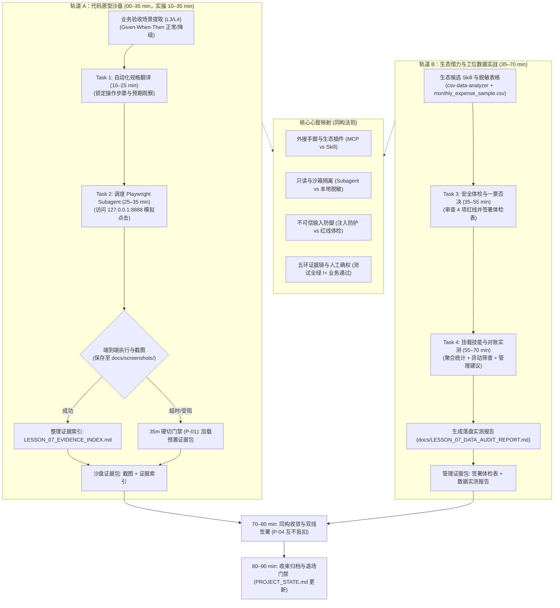

# 第七课教师教案——让 Agent 实际操作页面完成验收

> **核心思想：工具验证行为，主管验收业务；自动化验证全绿不等于业务验收通过，测试通过不等于可以上线。**

---

## 一、课程元数据与定位

| 项目 | 本课设定与契约约束 |
| :--- | :--- |
| **课次名称** | 第七课《让 Agent 实际操作页面完成验收》（双轨主题：自动化工具验收与生态借力 · 日常办公数据工具实战） |
| **权威依据** | 1. `lessons/TEN_LESSON_FROZEN_BASELINE.md`<br>2. `lessons/CURRICULUM_REBALANCING_AND_DUAL_TRACK_OPTIMIZATION_PROPOSAL.md` (v1.4.2 Approved Baseline · 2026-09-16)<br>3. `lessons/COURSE_ROADMAP.md` 与 `lessons/COURSE_ROADMAP_STUDENT.md`<br>4. `lessons/GLOSSARY.md` |
| **简报基线与批准追溯** | 1. 简报依据：`lessons/LESSON_07_DESIGN_BRIEF.md` (`contract_version: 2.1`, `candidate_version: 2.1.1`, `HANDOFF_READY`)<br>2. 独立评审记录：2026-09-16 第十四轮独立评审通过 (`HANDOFF_READY` 放行)<br>3. 课程所有者正式批准：2026-09-16 批准授权 PLAN 渲染 (Git Commit: `a1b8fa3`) |
| **学员画像** | 已完成 L1–L6，掌握智能机会卡、原型业务薄片与有界排错/物证核验能力的部门主管（非技术人员、AI 协作新手） |
| **课时架构** | **90 分钟刚性上限**：严格执行 **35 + 35 + 10 + 10** 双轨工作坊结构（00–10 min 导入示范归入轨道 A 宏观时段） |
| **课堂主成果** | **自动化工具验收与生态借力双成果包**：<br>1. **代码沙盘成果**：在预配置单一入口下，调度 Playwright Subagent 驱动浏览器自动化访问本地预览页面（`http://127.0.0.1:8888/`），完成端到端场景操作与关键节点界面截图，生成结构化《浏览器验收证据索引》（`docs/LESSON_07_EVIDENCE_INDEX.md`）；<br>2. **管理实战成果**：运用《业务主管外部 Skill 选型与安全体检表》（`student-package/templates/FIND_SKILLS_VETTING_CHECKLIST.md`）对工位高频实用数据技能（`csv-data-analyzer`）进行合规体检并签署放行裁决，随后挂载该技能对已脱敏月度费用表（`student-package/cases/monthly_expense_sample.csv`）进行自动化异动筛查，生成落盘的《业务数据分析与异动筛查实测报告》（`docs/LESSON_07_DATA_AUDIT_REPORT.md`）。 |
| **现场助教配比** | 1:15 线下或专属线上支持（3 分钟响应接管；负责预置浏览器运行环境与 35 分钟硬切标准证据包派发） |
| **数据与安全边界** | 全程 Mock 数据与脱敏流水；严禁真实生产环境、真实客户个人信息（PII）或真实 API Key；外部 Skill 严格执行权限只读与无外联红线 |

### 1.1 课次定位与双轨核心价值

本课是双轨工作坊的第二课，从 L6 的代码与材料“内部排错核验”进阶到**“工具调用（Tools & MCP）与技能生态（Skills）外接”**：
1. **沙盘工程能力跃迁（轨道 A）**：破除对 AI“静态读代码自评通过”的幻觉，引入 Browser MCP（Playwright Subagent），驱动大模型像真实用户一样自主打开网页、点击按钮、触发异常并截图存证，建立端到端“可见可查”的技术验收证据链；
2. **管理工位生态借力（轨道 B）**：坚决剔除原方案强插的代码交付工具，全面回归业务主管高频刚需——日常办公表格分析与对账。通过生态技能检索体验（`find-skills`/skills.sh），掌握《业务主管外部 Skill 选型与安全体检表》的 4 项一票否决红线（权限只读、本地脱敏、数据不出境、无破坏性命令），挂载官方预审技能 `csv-data-analyzer`，实测 10 行月度费用流水的异动筛查，直观体验“外部生态技能即插即用”对日常工位的倍增效应。
3. **工具外接同构性**：揭示沙盘技术层（给 Agent 配浏览器手脚去操作取证）与管理实战层（给 Agent 配专业表格分析插件提效工位）的底层同构性——两者均遵循“明确需求边界 ➔ 装配外接工具 ➔ 严守安全红线 ➔ 收集落盘证据 ➔ 主管确权验收”的严密工程与管理逻辑。

### 1.2 严肃声明“不做清单”（Non-goals）

教师在授课现场必须严格坚守以下非目标红线，绝不允许发生教学发散：
- **不让学员现场配置 MCP 环境**：课堂绝不变成 Node.js、Playwright 驱动或浏览器运行环境的排错课；所有自动化环境由教师在课前统一预置；
- **不将底层协议与选择器变成考点**：不要求主管学习或编写 JSON-RPC、YAML 配置、DOM 树节点或 CSS/XPath 元素选择器；
- **严禁连接真实生产系统**：不得在页面交互或提示词中输入真实机密商业数据、敏感客户个人信息（PII）或企业 API Key；
- **不把“测试通过”宣传为“业务正确”**：自动化工具测试全绿仅证明系统行为正常，绝不等于业务目标已达成，绝不等于可以立即上线；
- **不在此课手写工业级 Skill**：零基础学员凭空手写 Skill 属于伪产出（手写与 `/shape` 规约严格锁定在第 9 课），本课严格聚焦于外部生态技能的检索、安全审查、体检与挂载使用；
- **课程边界防重复约定（Anti-Collision Triad）**：
  - L6 聚焦“签发前的自查核验（落笔之前先要物证，我方材料核验）”；
  - L7 聚焦“处理手里的数据（数据分析与技能体检，不涉及最终签发决策）”；
  - L8 聚焦“发布前的双盲对抗审查（独立蓝方挑刺，重大合同内审）”。

### 1.3 开场反差与信任链回环策略

开场 00–10 分钟内，教师**严禁平铺直叙念概念**，必须按以下节奏制造强烈教学反差：
1. **回环回收（前 3 分钟）**：开场抽查 2 名学员汇报 L6 课后微任务落实情况（真实材料签发前核验经历与发现的存疑点），借“材料物证 ➔ 工具物证”顺势引入本课主题：“上节课你在签字前核验了下属汇报材料里的说法与物证；今天这节课，我们要核验的是 Agent 自己的手脚（浏览器工具）和装进工位的外部插件（技能生态）！”
2. **反差演示（后 7 分钟）**：
   - **反差 A（口说无凭路线）**：主管口头问 AI：“我的工单流转功能写好了没有？”AI 信誓旦旦回答：“已经完美实现，逻辑完全正确，可以直接交付！”结果主管在浏览器中实际一跑，按钮被遮挡无法点击，提交后页面直接白屏报错！
   - **反差 B（证据落盘路线）**：为主管的大模型外接 Browser MCP 工具，下达端到端验收指令。Agent 自动启动浏览器访问页面，模拟真实用户点击，截取操作前后界面图片，捕获控制台日志，整理生成结构化证据索引。每一条通过或失败，均有物理文件为证。

---

## 二、逆向目标、证据与核心概念

### 2.1 目标—活动—证据对齐图

| 学习目标 | 对应课堂活动 | 验收硬证据 | 主管裁决动作 |
| :--- | :--- | :--- | :--- |
| **1. 自动化验收规格与执行** | Task 1 & Task 2 (沙盘自动化) | Playwright 自动化操作日志 + 关键节点截图（`docs/screenshots/`） | 审查自动化操作路径与截图真实性，下达执行授权 |
| **2. 整理验收证据索引** | Task 2 (证据整理) | 结构化《浏览器验收证据索引》（`docs/LESSON_07_EVIDENCE_INDEX.md`，含正常与降级判定） | 审查未证明内容与证据盲区标注，确认证据链完整性 |
| **3. 外部 Skill 安全体检** | Task 3 (技能体检) | 签署的《业务主管外部 Skill 选型与安全体检表》（4 项红线逐项引证出处） | 抽查权限只读性与无数据出境判定依据，行使一票否决权 |
| **4. 表格数据异动筛查** | Task 4 & 70–80 收敛 (数据实战) | 落盘保存的《业务数据分析与异动筛查实测报告》（`docs/LESSON_07_DATA_AUDIT_REPORT.md`） | 审查高危异动识别准确性与 3 条管理建议，签署最终验收意见 |

### 2.2 课程融合心智模型 (Method Loop + Evidence Chain)

该模型揭示了“沙盘工具扩展（给 Agent 配浏览器手脚去操作取证）”与“日常工位生态借力（给 Agent 配专业表格分析插件提效）”在底层认知逻辑上的完全同构性。**该图表达逻辑拓扑与证据流动，非课堂时间推进表**：



### 2.3 核心概念清单（共 5 个，三段实战化 + 交接价值）

严格执行 commit `7114ddc` 与 GLOSSARY 规范，所有概念按「是什么 / 怎么用 / 避坑红线 / 交接价值」四部分交付：

#### 1. MCP 协议（标准化工具扩展协议）
- **是什么**：AI 领域的“通用 USB 接口协议”（Host 通过 Client 连接 Server，Server 暴露 Tools），让大模型能够按需即插即用外部现成的工具生态（如浏览器自动化、文件系统、数据库探针）。
- **怎么用**：在受控配置中为 Agent 插上工具手脚（如 `@playwright/mcp`），由 Agent 调度执行外部操作与取证。
- **避坑红线**：MCP 只是外接工具标准通道，绝对不是企业内部生产系统的业务 API；严禁将未审计的破坏性工具直接暴露给 Agent。
- **交接价值**：回指 Task 2——区分通用外接工具协议层与企业私有业务系统层。

#### 2. Subagent（现场调研子代理）
- **是什么**：由主 Agent 调度的具有独立上下文的限定任务执行者，拥有只读、隔离、超时和落盘特性，任务完成后汇报结果并立即释放。
- **怎么用**：用于承接长耗时、高交互或容易污染主上下文的专项任务（如打开浏览器点击页面、通读大量日志并截图）。
- **避坑红线**：严禁赋予 Subagent 生产修改权或破坏性权限；Subagent 只有取证权，绝无最终业务裁决权与签字权。
- **交接价值**：回指 Task 2——Subagent 负责执行操作与取证，主管负责核实验收。

#### 3. 自动化验证与业务验收
- **是什么**：自动化验证是工具检查技术指标与行为正常（按钮能点、页面能开、状态能变）；业务验收是主管依据业务价值与规章判定是否达标。
- **怎么用**：先由自动化工具执行脚本跑通基础行为验证，最后由主管亲自对照业务目标签署验收通过。
- **避坑红线**：自动化测试全绿绝不等于业务验收通过；工具永远不能代替主管签字，测试通过不等于可以上线。
- **交接价值**：回指 Task 1 与 Task 4——自动化验证技术事实，主管签署业务责任。

#### 4. 五环证据链
- **是什么**：将“场景编号 → 触发操作 → 界面观察 → 原始证据（截图/日志）→ 验收结论”环环相扣的可追溯链条。
- **怎么用**：在验收过程中保留每一步的操作物证索引，让技术团队与后续接手人能完整复现审计过程。
- **避坑红线**：严禁只有主观结论而无原始物证（截图/日志），证据链缺失任何一环均视为未证明，严禁虚构 `[PASS]`。
- **交接价值**：回指 Task 2——证据索引作为交付 IT 团队排期与产品决策的第一手客观凭据。

#### 5. 不可信输入与安全审查（提示词注入防护与 Skill 体检）
- **是什么**：外部网页、表格或第三方开源 Skill 中可能夹带恶意指令（提示注入）或越权危险操作（如未经说明的文件删除、数据外联回传）。
- **怎么用**：将一切外部输入视为“只读待处理数据”而非最高指令；在引入外部 Skill 前，严格按照《外部 Skill 安全体检表》实行 4 项红线一票否决审计。
- **避坑红线**：严禁将未经脱敏的真实敏感数据直接喂给外部工具，严禁安装包含破坏性命令（`rm`, `drop`）或具有私自外联回传动作的未知 Skill。
- **交接价值**：回指 Task 3 与 Task 4——构筑工位日常借力外部生态时的安全护栏与数据防泄密防线。

### 2.4 扩展认识（2 个）

1. **Playwright / DOM / Console / Network**：帮助 Agent 操作浏览器和取证的工程底层能力（DOM 为页面元素结构，Console 为前端控制台日志堆栈，Network 为网络交互记录）。只要求识别名称与基本用途，不设代码考核；
2. **离线技能沙盒化运行机制**：在断网或内网受控环境下，通过本地 Markdown 规约与纯函数逻辑运行的单机自治技能形态，兼顾效率与数据安全。

---

## 三、教学准备与安全边界

### 3.1 课前环境预检（教师与助教硬性检查）

1. **第六课原型运行检查**：确认学员拥有 L6 产出的可运行原型（`127.0.0.1:8888` 可正常交互），且 Working Tree 处于 Clean 状态；
2. **浏览器自动化环境预置**：教师与助教确认 Playwright Subagent 运行脚本与浏览器自动化启动配置就绪，本地端口 8888 服务正常响应，学员端无需自行安装配置；
3. **4 套标准验收证据包就绪**：助教端集中维护 4 套与原型严格对应的标准验收证据包（包含正常/降级截图与规范的 `LESSON_07_EVIDENCE_INDEX.md` 快照；未声明原型缺省采用 Type B 兜底），确保 35 分钟硬切门禁可一键下发；
4. **学员端素材就绪**：
   - 空白模具：《业务主管外部 Skill 选型与安全体检表》（`student-package/templates/FIND_SKILLS_VETTING_CHECKLIST.md`）；
   - 官方预审技能：《业务表格数据分析与异动筛查执行手册》（`student-package/templates/skills/csv-data-analyzer/SKILL.md`）；
   - 脱敏数据案例：《脱敏月度报销与采购支出流水样例》（`student-package/cases/monthly_expense_sample.csv`）；
   - 离线候选清单：《外部技能离线候选清单》（`student-package/templates/OFFLINE_SKILL_CATALOG.md`，断网/受控环境备用）；
5. **离线候选清单与网络连通性预检**：确认 `student-package/templates/OFFLINE_SKILL_CATALOG.md` 在库，测试网络连通性，若网络受限则课前下发离线候选清单兜底；
6. **教师侧答案隔离核实**：确认 Task 4 巡视判断中的全量单号答案（EXP-202608-002, 005, 009, 006）仅教师侧可见，**严禁向学员提前透露，严禁带入学员指南**。

### 3.2 五大安全与数据红线（现场宣导口令）

1. **全程模拟与脱敏红线**：原型操作与表格分析只使用 Mock 或事前脱敏数据，严禁在表格或提示词中输入真实身份证号、银行卡号、手机号或企业核心密钥；
2. **无真实凭证红线**：课堂中绝对禁止学员填入真实大模型 API Key 或第三方凭证，所有工具演示均在沙箱或受控环境中执行；
3. **事前脱敏审查红线**：所有外部材料与表格在送入大模型前，必须完成脱敏审查；发现敏感数据立即打码；
4. **权限只读与无外联一票否决红线**：外部引入的 Skill 必须严格遵循只读权限与无外部不可信网络外联，严禁执行文件写操作、文件删除或破坏性系统脚本；
5. **杜绝虚构能力与诚信证据红线**：严禁在教案或指南中编造不存在的校验脚本或控制能力；实际使用什么工具（如 Playwright、CSV 解析），就如实展示什么物理证据，严禁虚构 `[PASS]`。

---

## 四、90 分钟双轨控场主线

严格执行 **35 + 35 + 10 + 10** 刚性时间预算。**00–10 min 导入示范属于轨道 A 的宏观阶段分配**：

| 时间段 | 宏观阶段 | 教师动作 | 学员动作 | 产出物与门禁规则 |
| :--- | :--- | :--- | :--- | :--- |
| **00–10 min** | **导入、痛点唤醒与模型建立** (轨道 A 导入) | **开场前 3 分钟抽查 2 名学员汇报 L6 真实材料签发核验经历**，借“材料物证 ➔ 工具物证”顺势导入；演示“口头问 AI 好了没（口说无凭）” vs “浏览器自动化取证（物证落盘）”强烈反差；讲解 5 大核心概念与双轨同构法则 | 汇报微任务经历；观察反差，理解双轨主线与 P-04 互不抵扣铁律 | 明确课堂双线交付物与工具扩展边界 |
| **10–25 min** | **轨道 A：Task 1 自动化规格翻译** (15 min) | 从标准案例（工单看板）示范提取 Given-When-Then 规格，明确正常预期与降级预期 | 从个人 L3/L4 业务契约中提取核心业务切片，生成结构化自动化验收规格 | 结构化端到端验收规格（零代码、防虚构） |
| **25–35 min** | **轨道 A：Task 2 浏览器操作与证据索引** (10 min) | 巡视并指导调度 Playwright Subagent 操作本地预览服务，截取图片并生成证据索引 | 运行提示词，观察浏览器自动操作，检查截图落盘与证据索引生成 | 页面截图 + `docs/LESSON_07_EVIDENCE_INDEX.md`<br>**35m 硬切门禁 (P-01)**：未完成者助教一键派发证据包强制切出 |
| **35–55 min** | **轨道 B：Task 3 外部 Skill 检索与安全体检** (20 min) | **示范 2 分钟生态检索**；指导学员动手检索并登记候选 (5 min)；指导对首选候选对照体检表审查 4 项红线 (15 min)；讲解兜底规则（R1）与课上只读不装铁律（R2） | 使用 `find-skills` 检索并登记排名前 3 候选 (5 min)；选定首选候选执行 4 项红线体检并引证出处 (15 min，受阻切换 `csv-data-analyzer` 兜底)；签署 APPROVED 放行裁决；恪守只读不装铁律 | 签署的《业务主管外部 Skill 选型与安全体检表》（`FIND_SKILLS_VETTING_CHECKLIST.md`，含登记候选与裁决） |
| **55–70 min** | **轨道 B：Task 4 挂载技能与对账实测** (15 min) | 指导学员激活技能，投喂脱敏费用流水，设定 5000 元阈值，严格按 4 步只读 SOP 执行分析并落盘报告 | 挂载技能，投喂流水，指挥 Agent 完成聚合汇总与异动筛查，生成完整报告并落盘 | 《业务数据分析与异动筛查实测报告》（`docs/LESSON_07_DATA_AUDIT_REPORT.md`） |
| **70–80 min** | **同构收敛与双线签署** (10 min) | 点拨外接工具同构性（调浏览器外接手脚 vs 装 Skill 外接专业插件）；执行双线独立核验并签署体检表与验收卡 | 复盘自身双线成果，核验证据链完整性，主管签署落盘 | 签署体检表与验收卡<br>**P-04 铁律**：沙盘线与管理线互不抵扣 |
| **80–90 min** | **收束、归档与退场门禁** (10 min) | 监督执行 Git 归档与 `PROJECT_STATE.md` 更新；收取 5 道随堂测试题并快速讲评；布置课后微任务 | 执行 Git Commit，更新项目状态，提交随堂测试，确认工作区干净 | 归档项目状态单 + 随堂测验答卷（Clean 退场） |

### 4.1 控场与时间压缩预案

- **若 00–10 min 导入拖堂**：优先压缩教师对扩展背景概念的讲解时间，**严禁压缩开场 3 分钟微任务回环核对、Task 2 浏览器操作与 Task 3 的安全体检**；
- **P-01 硬切绝对不可妥协**：到达第 35 分钟时，无论学员浏览器测试跑通与否，**助教必须无差别执行标准证据包下发**（标记 `STATUS: RECOVERED_BY_SNAPSHOT`），确保全员准时在第 35 分钟切入轨道 B。严禁拖堂调试！

---

## 五、逐 Task 示范、口令、巡视与降级

### Task 1 (Track A, 10–25 min)：从 L3/L4 选择一个验收场景，翻译为自动化验收规格

- **教师示范 (`teacher_demo`)**：
  - 教师投屏展示工单看板案例：“大家看，我们不要一上来就盲目点浏览器，必须先给机器定出不可推翻的验收规格。
  - 打开 L3 业务功能卡，我选定一个核心场景：‘工单状态从待处理流转为已处理’。
  - 翻译为标准 Given-When-Then：
    - **前置条件 (Given)**：工单列表存在编号 #ORD-001，状态显示为‘待处理’；
    - **触发操作 (When)**：点击进入详情页，输入处理意见‘已电话核实’，点击‘确认流转’按钮；
    - **预期观察 (Then)**：页面弹出‘流转成功’提示，列表中该工单状态标签刷新为绿色‘已处理’。
  - 更关键的是**失败/降级预期**：如果处理意见输入框留空直接点击流转，系统必须弹出黄色提示‘请填写处理意见’，状态保持‘待处理’不变，严禁静默提交！
  - 规格锁死后，才准进行下一步！”
- **教师口令 (`teacher_cue`)**：
  - “从你的 L3 业务功能卡或 L4 薄切片中选出一个核心业务场景。写清给定条件、触发操作、正常预期与失败/降级预期。先不要让 Agent 操作浏览器，不要修改代码，先把验收规格固定下来！”
- **学员实操提示词 (零占位符，直接复制)**：
  ```text
  请帮我从我的 L3 业务功能卡与契约中提取一个核心业务验收场景，并翻译为自动化验收规格。

  输出要求：
  1. 【场景名称】：明确业务切片名称；
  2. 【前置条件 (Given)】：页面初始状态与 Mock 初始数据；
  3. 【触发操作 (When)】：用户在界面上的具体操作步骤（点击哪个按钮、输入什么字段）；
  4. 【预期观察 (Then)】：正常情况下界面应出现的肉眼可见状态变化；
  5. 【正常路径预期】：业务操作成功时的可见状态、数据刷新与文案反馈；
  6. 【失败/降级路径预期】：设定一个异常输入或边界条件（如：必填项留空、非法数值、网络超时或空数据状态），说明界面应给出的合法降级反馈。

  严禁临时胡乱编造，必须严格基于我现有的业务原型与数据契约！输出完成后停下，不要操作浏览器，不要修改代码。
  ```
- **巡视判断 (`patrol_judgment`)**：
  - 场景是否有明确的 Given-When-Then 三要素；
  - 是否包含清晰的失败/降级路径预期（非只有正常流）；
  - 场景是否取自项目现有契约（非现场凭空编造）；
  - Agent 是否私自修改代码或擅自操作浏览器。
- **失败降级 (`failure_fallback`)**：
  - 若学员场景过大（包含多页面长流程），指导其缩小到一个可观察的单步界面交互切片；
  - 若缺乏降级预期，要求补充一个必填项留空或边界数值校验预期；
  - Agent 擅自操作浏览器时，立即要求其停止，先确认规格文本。

---

### Task 2 (Track A, 25–35 min)：调度 Playwright Subagent 浏览器自动化操作，生成证据索引

- **教师示范 (`teacher_demo`)**：
  - 教师下发 Task 2 提示词：“现在把刚才定好的验收规格喂入对话框，调度预配置的 Playwright Subagent。大家看我的屏幕：
  - 浏览器自动弹起，访问本地 `http://127.0.0.1:8888/`！
  - Agent 自主定位到目标按钮，输入测试数据，触发点击；在操作前截一张图、操作后截一张图、触发校验拦截时再截一张图，自动保存进 `docs/screenshots/`！
  - 整个过程捕获了控制台日志与网络状态。
  - 最后，Agent 输出一张结构化的《浏览器验收证据索引》，写明每一步操作、截图路径和 PASS 判定。
  - 注意：如果遇到报错，Agent 必须老老实实报告哪一步失败，严禁偷偷换成代码推测宣布通过！”
- **教师口令 (`teacher_cue`)**：
  - “把刚才生成的验收规格喂给 Agent，调度浏览器自动化工具实际操作页面。检查截图是否存入 `docs/screenshots/`，检查 `docs/LESSON_07_EVIDENCE_INDEX.md` 证据索引是否落盘。超时或脚本报错不用慌，35 分钟一到助教统一发标准证据包！”
- **学员实操提示词 (零占位符，直接复制)**：
  ```text
  现在请启动浏览器自动化工具（Playwright Subagent），打开我的本地预览服务（http://127.0.0.1:8888/），按以下场景执行端到端页面验收：

  【验收场景规格】：
  请严格依据上一步我们共同确定的业务验收场景规格（包含前置条件、操作步骤、正常路径与降级路径）。

  执行要求：
  1. 实际启动浏览器访问本地预览页面，严禁仅通过读取前端代码进行静态推测；
  2. 依次执行正常路径与失败/降级路径的页面交互操作；
  3. 在关键操作节点（操作前、操作后、异常触发时）分别截取完整页面截图并保存至 docs/screenshots/ 目录；
  4. 记录控制台 Console 日志与网络 Network 状态，严禁向页面中录入未脱敏的真实个人信息或敏感密钥；
  5. 若自动化工具执行受阻或元素未找到，必须如实报告具体报错，绝对禁止偷偷换成代码推测宣布通过；
  6. 整理生成验收证据底稿，记录每步操作、观察结果、截图路径与 PASS/FAIL 判定，保存至 docs/LESSON_07_EVIDENCE_INDEX.md。
  ```
- **巡视判断 (`patrol_judgment`)**：
  - Agent 是否真实启动了浏览器进行操作（查看截图时间戳与控制台日志）；
  - `docs/screenshots/` 目录下是否生成了至少 2 张对应节点的截图；
  - 证据索引中是否包含正常与降级两条路径的判定；
  - 是否存在未证明项被强行虚构为 `[PASS]`。
- **失败降级与 35m 硬切门禁 (`failure_fallback` & P-01 Gate)**：
  - **环境偶发报错**：若 Playwright 找不到元素或端口占用，指导切换手动点击验收并手动截图保存；
  - **第 35 分钟硬切门禁 (P-01)**：助教巡视全场，到达第 35 分钟，所有因浏览器环境或脚本受阻的学员，由助教一键派发对应原型的预置标准证据包（包含截图与标准 `LESSON_07_EVIDENCE_INDEX.md` 快照，Type B 兜底），在控制台标记 `STATUS: RECOVERED_BY_SNAPSHOT`，全员准时推进到 Task 3。严禁拖堂排错！

---

### Task 3 (Track B, 35–55 min)：外部技能生态检索与登记，首选候选四红线体检与签署（预审兜底）

- **教师示范 (`teacher_demo`)**：
  - 教师投屏演示：“现在我们切入轨道 B——工位日常提效与生态借力。
  - **第一步：看一眼生态（2 分钟检索体验）**。大家看，我们在终端调用 `find-skills` 或打开 skills.sh，输入‘excel 数据分析’，能搜出几十个开源技能。生态非常丰富，但也泥沙俱下！有人在技能里偷夹了删除命令，有人把数据悄悄发往外部服务器。所以，**检索看生态、引入必体检——哪怕是高赞技能，也必须过四项安全红线体检！**
  - 随后交由学员亲自输入部门关键词动手检索并登记候选。”
- **教师口令 (`teacher_cue`)**：
  - “工位提效不能盲目乱装插件！先亲自检索生态并登记候选，再做四红线体检。首选体检对象为你登记的第 1 候选；若候选文档不全、无法判断权限边界，或网络受限，切换官方预审技能 `csv-data-analyzer` 作为体检对象——切换动作本身也是裁决的一部分，请在体检表备注栏写明切换原因。课上只读不装：检索与体检均为只读审查，严禁下载或挂载任何自行检索的第三方技能；课内唯一可挂载对象为官方预审技能 `csv-data-analyzer`；你体检通过的自选技能，挂载只允许发生在课后自测通过之后。”
- **学员实操提示词 1：部门技能检索与候选登记 (直接复制)**：
  ```text
  请使用 find-skills（或通过 npx skills find）检索外部技能生态，为我的部门日常表格工作寻找候选技能。

  我的检索关键词：【填写你的部门高频场景，如：报销对账 / 销售流水汇总 / 供应商比价】

  请严格执行：
  1. 按关键词检索开源与企业技能生态，列出排名前 3 的候选技能；
  2. 每个候选登记四项信息：技能名称、来源平台/仓库、一句话功能描述、热度或安装量指标；
  3. 标注与我的部门场景最匹配的一个候选，并说明理由；
  4. 本轮严禁安装任何技能——只检索、只登记，不下载、不挂载；
  5. 若网络不可用，直接回复"检索不可用"，我将改用课程提供的离线候选清单。
  ```
- **学员实操提示词 2：候选 Skill 安全体检 (直接复制)**：
  ```text
  我们部门计划引入外部开源/企业级 Skill 来提效日常工位表格审计。在正式挂载前，请你严格依照《业务主管外部 Skill 选型与安全体检表》对候选技能进行合规体检。

  【候选 Skill 规范文件】：
  请通读 student-package/templates/skills/csv-data-analyzer/SKILL.md 的完整内容。

  请严格执行以下体检项目：
  1. 【价值与契约审查】：
     - 功能专注度：是否只聚焦于表格数据分析与异动筛查，是否存在不相关功能？
     - 输入契约：是否明确界定了所需文件格式（CSV/Excel）与参数字段？
     - 输出格式：是否具备结构化 Markdown 表格输出定义？
  2. 【安全与红线审查 (全勾选方可放行，任一不符一票否决)】：
     - 权限只读性：该 Skill 是否仅执行只读分析？有无任何修改、删除源文件或执行未知系统脚本的危险动作？
     - 敏感数据本地脱敏要求：SOP 中是否明确要求本地脱敏后再喂入，严禁明文上传客户隐私？
     - 网络与数据不出境：调用链中是否存在向外部不可信第三方服务/域名回传数据的外联指令？
     - 无破坏性命令：代码与 SOP 中是否绝对不含 rm、drop、format 等破坏性指令？
  3. 【体检结论建议】：
     - 逐项给出 PASS / FAIL 判定与引证出处；
     - 给出放行建议（APPROVED 批准引入 / REJECTED 拒绝引入）。
  ```
- **巡视判断 (`patrol_judgment`)**：
  - 学员是否指挥 Agent 逐项引证了规范文件的行号与条款；
  - 4 项安全红线是否全部得到核查；
  - 学员体检表“来源平台/仓库”栏是否登记了自行检索的候选（≥1 条）；
  - 是否遵守只读铁律（无任何下载/挂载动作）；
  - 学员是否在体检表模版中勾选并亲自签名放行；
  - 是否有学员未体检直接尝试运行技能。
- **失败降级 (`failure_fallback`)**：
  - 若网络不可用，发放离线候选清单（`student-package/templates/OFFLINE_SKILL_CATALOG.md`）继续；
  - 若候选文档不全/无法判断权限边界，切换 `csv-data-analyzer` 作为体检对象（按 R1 规则在体检表备注栏写明切换原因）；
  - 若学员只让 AI 说“好不好”，敲桌提醒：“按体检表逐项引证出处！”；
  - 若学员未签署放行直接尝试挂载，强制阻断并要求先完成安全审查签字；
  - 若学员尝试下载/挂载自行检索的技能，立即喝止并重申只读铁律。

---

#### Task 4 (Track B, 55–70 min)：挂载通过体检的 Skill，投喂脱敏业务表格执行对账并落盘报告

- **教师示范 (`teacher_demo`)**：
  - 教师演示挂载技能与实测流水：“体检批准放行后，我们现在把 `csv-data-analyzer` 技能装载进 Agent，实际跑一次部门 8 月份的报销与采购流水！
  - 数据源是 `student-package/cases/monthly_expense_sample.csv`，共 10 行脱敏记录；
  - 我们设定高额监控阈值为 5000.00 元。
  - Agent 严格按照 SOP 的四步执行：
    - 第一步解析结构：有效数据 10 行，总申报金额 22,970.00 元，单笔平均 2,297.00 元；
    - 第二步维度聚合：销售部、市场部开销占比最大；
    - 第三步异动排查：抓出单号 EXP-202608-002 发票抬头为‘个人抬头’（违规）；单号 EXP-202608-005 金额达 8,900.00 元、EXP-202608-009 金额达 5,200.00 元（两笔超 5000 元大额监控线）；单号 EXP-202608-006 住宿费 980 元超单日 800 元差旅标准且均为待初审状态；
    - 第四步提炼 3 条管理洞察：退回个人发票要求补宴请清单、核实市场大额预算余额、对住宿超标建立事前审批卡点。
  - 最后，完整报告落盘保存至 `docs/LESSON_07_DATA_AUDIT_REPORT.md`，源 CSV 文件毫发无损！”
- **教师口令 (`teacher_cue`)**：
  - “你自己体检通过的技能，课后先用这张脱敏样表自测——跑得通、抓得出同类异常，才允许用于部门真实表格。今天课上统一挂载官方预审技能，保证全班结果可比、可验证。体检放行后，现在让 Agent 实际跑一次业务表格！输入脱敏月度报销流水，执行自动化审计。核对总金额、找出单笔超 5000 元的大单和个人抬头异常，提炼 3 条管理建议。严禁改动源文件，报告必须落盘到 docs/LESSON_07_DATA_AUDIT_REPORT.md！”
- **学员实操提示词 (零占位符，直接复制)**：
  ```text
  候选 Skill csv-data-analyzer 已通过安全体检并获准挂载。现在进行随堂业务表格对账实测。

  【待分析数据源】：
  文件路径：student-package/cases/monthly_expense_sample.csv
  文件性质：已脱敏部门 8 月份月度报销与采购支出流水

  【执行参数与指令】：
  1. 挂载并激活 csv-data-analyzer 技能；
  2. 核查基准参数：单笔高额支出监控阈值设定为 5000.00 元；
  3. 严格按照技能 SOP 的四步执行：
     - 第一步：检查行数、字段与有效性，确认无 NaN 或负数异常；
     - 第二步：统计总申报金额、平均金额、最大单笔，按部门与费用科目聚合；
     - 第三步：排查单笔 ≥ 5000 元项目、发票抬头非公司全称（如个人抬头）条目及待初审异常；
     - 第四步：提炼 3 条事实支撑的管理建议。
  4. 严格执行只读操作，严禁篡改源 CSV 文件，严禁自行编造调整项强行平账；
  5. 将符合格式契约的完整分析结果输出为《业务数据分析与异动筛查实测报告》，并落盘保存至 docs/LESSON_07_DATA_AUDIT_REPORT.md。
  ```
- **巡视判断（教师侧核验提示，严禁向学员提前透露或泄入学员指南） (`patrol_judgment`)**：
  - 源 CSV 文件是否未被修改（严格保持只读）；
  - 异动清单中是否准确抓出全部高危项——包含：
    - `EXP-202608-002`（个人抬头 / 待初审 / 1280.00 元）；
    - 两笔 ≥ 5000 元大额支出：`EXP-202608-005`（8900.00 元大单 / 待初审）与 `EXP-202608-009`（5200.00 元大单 / 待初审）；
    - `EXP-202608-006`（980.00 元超单日 800 元住宿标准 / 待初审）；
  - 报告是否符合格式契约并成功落盘至 `docs/LESSON_07_DATA_AUDIT_REPORT.md`；
  - 提炼的 3 条管理建议是否具有事实支撑与管理针对性。
- **失败降级 (`failure_fallback`)**：
  - 若 Agent 试图修改 CSV，立即按只读铁律喝止；
  - 若报告未落盘，要求其将完整 Markdown 写入目标文件；
  - 若漏判了 5200 元大单，提示其重新核对第三步过滤条件。

---

### 70–80 min：同构收敛与双线签署核验 (10 min)

- **教师示范与点拨话术**：
  - “各位主管请看屏幕：
  - “今天上午，你为 Agent 接上了浏览器工具（Browser MCP），让它像人一样去页面上点击、截图、留下证据链——这是给 Agent 配上了**手脚**；
  - “今天下午，你为 Agent 审查并装配了数据分析技能（`csv-data-analyzer`），让它在只读红线下 5 秒钟审计完全量费用流水并抓出异动——这是给 Agent 配上了**专业工位插件**。
  - “手脚要受控，插件要体检。自动化验证全绿不等于业务验收通过，外部技能再聪明也不能代替主管确权。只要你守住‘只读、脱敏、不出境、无破坏’四条红线，外部生态就能安全地成为你工位上的百倍放大器！”
- **双线签署核验 (P-04 铁律落地)**：
  - 教师巡视核验学员的个人原型浏览器截图与证据索引（`docs/LESSON_07_EVIDENCE_INDEX.md`）；
  - 核验签署放行的《外部 Skill 安全体检表》与落盘的《业务数据分析与异动筛查实测报告》（`docs/LESSON_07_DATA_AUDIT_REPORT.md`）；
  - 主管在两份文件上正式签字确权。

---

## 六、现场 Debug 与降级预案

### 6.1 现场 Debug 处置类别 (Troubleshooting Categories，共 5 类)

教师与助教在现场严格按照以下 5 类根因分类进行诊断处置，严禁说出右侧禁止表述：

| 故障类别 | 现场典型现象 | 处置动作 (Action) | 降级预案 (Fallback) | 教师现场绝对禁止说法 |
| :--- | :--- | :--- | :--- | :--- |
| **T-01 自动化受阻** | Playwright 找不到页面元素或超时卡死 | 检查本地开发服务 8888 端口是否存活，确认元素选择器是否发生漂移 | 助教下发标准截图包，切入人工手动验证 | “自动化工具报错了，跳过这步看代码吧” |
| **T-02 偷懒代码推测** | Agent 未启动浏览器，仅通过静态读取前端代码宣称“测试通过” | 立即打断，严禁静态推测，指令必须包含真实浏览器启动与截图动作 | 演示单步调试口令，强制执行外部工具调用 | “AI 读了代码觉得没问题，那也算一种验证” |
| **T-03 敏感数据泄露** | 表格或日志中粘贴了未经打码的真实卡号、手机号或机密信息 | 立即停止当前会话并清屏，指导学员执行本地脱敏 | 新建只读独立会话，重新加载脱敏样例 | “这是内网环境，稍微贴一点真实信息没事” |
| **T-04 Skill 越权企图** | 候选 Skill 试图执行写操作或修改源 CSV 文件，或尝试下载/挂载自选技能 | 严厉制止，声明只读铁律；若学员尝试下载/挂载自行检索的技能，立即喝止并重申只读铁律，在体检表中判定一票否决 | 强制切换为官方预审技能 `csv-data-analyzer` | “既然能自动改好表格，让它改一下也没关系” |
| **T-05 盲目全量标记** | 学员未逐条核对，盲目在验收卡中全量勾选 PASS | 教师提问抽查证据盲区，要求标出未证明项 | 退回验收卡，指导补充失败/降级路径对比 | “大概都跑通了，直接全勾通过吧” |

### 6.2 常见认知误区清单 (Misconceptions，共 5 项)

本清单直接作为学员指南（GUIDE）第 4 章的输入权威，教师在巡视与示范时针对以下 5 大典型错误认知进行重点纠偏：

| 误区编号 | 典型错误认知 | 纠偏正解与实战对策 | 对应 Debug 类别 / 示范动作 |
| :--- | :--- | :--- | :--- |
| **M-01** | “AI 读完了前端代码说逻辑完全正确，那就不用真跑浏览器测试了” | 静态代码分析无法替代动态运行时验证，页面元素遮挡、时序问题与接口通信必须在浏览器中真实呈现并截图取证。 | 对应 Task 2 / T-02（严禁静态推测，强制真实截图） |
| **M-02** | “开源社区高赞的 Skill 肯定好用安全，直接下载挂载即可” | 外部 Skill 必须经过《安全体检表》的 4 项红线一票否决审查，防范越权破坏命令与潜在数据外联风险。 | 对应 Task 3 示范（2分钟生态检索，强调检索看生态、引入必体检） |
| **M-03** | “自动化工具跑通了页面流转，这套原型就算业务达标可以上线了” | 自动化验证行为正常不等于业务验收通过，工具永远不能代替主管的业务确权与上线批准。 | 对应 70–80 收敛点拨（工具验证行为，主管验收业务） |
| **M-04** | “只要是用于做报销或财务对账的工具，把真实流水直接丢给 AI 也没事” | 严守本地脱敏红线！涉及真实身份证号、银行卡号与机密金额必须在本地打码脱敏后方可投喂。 | 对应 T-03（泄露风险阻断，强制本地打码） |
| **M-05** | “截几张图存下来就算完成证据链了，证据索引写不写无所谓” | 证据索引是连接“操作、现象与业务结论”的关键纽带，无索引的散落截图无法被技术团队复现与采信。 | 对应 Task 2 证据整理 / T-05（建立完整五环证据链） |

---

## 七、随堂测试、通过标准与课后任务

### 7.1 双线独立通过标准（P-04 互不抵扣铁律）

学员必须**同时独立通过**以下两条学习线，方可判定本课结课合规。任何单条线的突出表现绝不能掩盖另一条线的缺失：

1. **原型推进线最低证据 (`prototype_progress_line`)**：
   - 结构化浏览器验收证据索引文件（`docs/LESSON_07_EVIDENCE_INDEX.md`）；
   - 实际端到端操作页面截图（至少包含正常路径与失败/降级路径各 1 张保存在 `docs/screenshots/` 目录）；
   - Git Commit 存档记录。
2. **主管判断线最低证据 (`supervisor_judgment_line`)**：
   - 完整填写并由主管签字放行的《业务主管外部 Skill 选型与安全体检表》（`student-package/templates/FIND_SKILLS_VETTING_CHECKLIST.md`，包含契约审查、4 项安全红线逐项引证出处与 APPROVED 裁决）；
   - 符合规范契约并落盘保存的《业务数据分析与异动筛查实测报告》（`docs/LESSON_07_DATA_AUDIT_REPORT.md`，包含概览统计、部门/科目分布、高危异动与 3 条管理建议）。
3. **P-04 互不抵扣铁律**：
   - 原型浏览器自动化截图与证据索引**绝对不可抵扣**主管外部 Skill 体检表与数据分析报告的缺失；
   - 技能体检与数据分析报告完成度**绝对不可抵扣**沙盘浏览器工具的调度与验收截图。两条主线必须独立核验通过。

### 7.2 随堂必答题（5 题，课堂收束阶段必测）

1. **MCP 的 Host、Client、Server 和 Tool 之间是什么关系？为什么说 MCP 不是企业业务 API？**
   - *参考答案*：Host 是运行宿主环境，通过 Client 发起连接，Server 运行在后台并暴露 Tool 给大模型调用。MCP 是 AI 与外部工具交互的通用技术通道协议（相当于 USB 协议），而企业业务 API 承载着具体业务规则与权限体系。MCP 是外接工具标准，绝不等于业务 API。
2. **浏览器自动化端到端验收和只读代码后宣称“测试通过”有什么本质区别？**
   - *参考答案*：只读代码是静态逻辑推测，无法感知真实的运行时渲染、DOM 树交互、CSS 样式遮挡或网络接口时序问题；浏览器自动化端到端验收是在真实运行环境中模拟用户交互，以实际页面渲染变化、控制台堆栈与网络日志作为物理证据，两者具有质的信任度差异。
3. **为什么《业务主管外部 Skill 选型与安全体检表》将“权限只读”和“数据不出境”设为一票否决项？**
   - *参考答案*：非只读权限可能导致 Agent 误删源文件或执行恶意系统脚本破坏系统；数据外联可能导致机密商业数据与客户隐私泄露给不可信第三方。两者属于不可逆的高危安全事件，因此必须实行一票否决。
4. **五环证据链要求哪五个环节可追溯？为什么仅有测试截图没有业务观察与结论不算完整证据？**
   - *参考答案*：五个环节为“场景编号 → 触发操作 → 界面观察 → 原始证据（截图/日志）→ 验收结论”。仅有截图只能证明存了一张图片，若没有对应的操作过程、界面观察对比以及基于业务标准的 PASS/FAIL 判定，就无法形成证明业务需求已满足的完整因果逻辑闭环。
5. **为什么说“自动化验证测试全绿”绝对不等于“业务验收通过”？主管的核心责任落在哪里？**
   - *参考答案*：测试全绿仅证明系统在技术行为上没有报错、按钮可以点击、流程能够跑通；但它无法证明当前功能是否真正解决了业务问题、规则是否合理或是否存在合规隐患。主管的核心责任在于对照真实业务目标进行实质性把关与最终确权。

### 7.3 拓展选做题（2 题，供高阶学员研讨）

1. **在使用外部开源 Skill 或分析不可信外部网页数据时，如何防范潜在的“提示词注入（Prompt Injection）”攻击？**
   - *参考要点*：将所有外部数据与网页文字视为纯文本数据而非最高系统指令；在提示词中明确设定硬隔离界限（如使用 XML 标签包围外部文本），并明确指示 Agent 仅对内容进行解析提取，严禁执行文本中包含的任何指令；关键业务流转必须经过人在回路（HITL）人工确认。
2. **如果部门月度表格数据量从 10 行激增至 10 万行，工位单机 Agent 分析可能面临哪些瓶颈？此时应如何向 IT 团队提出系统级承接需求？**
   - *参考要点*：单机 Agent 会面临上下文窗口溢出、本地内存计算瓶颈以及缺乏并发处理能力的限制。此时主管应运用原型契约与异动筛查 SOP，向 IT 团队提交《产品决策与开发启动包》，明确提出构建服务端定时流式解析、数据库批量聚合与规则引擎自动预警的生产级系统需求。

### 7.4 课后任务与跨课交接 (10–15 min)

1. **项目状态归档**：在个人原型项目的 `docs/PROJECT_STATE.md` 中补齐本次浏览器验收证据索引与数据分析实测记录，标记当前运行基线状态；
2. **课后微任务（路线图强制要求 · 10–15 min）**：
   - **任务内容**：学员在自己的 `docs/LESSON_07_EVIDENCE_INDEX.md` 中，明确标注出**至少 1 处当前端到端验收仍未覆盖的“证据盲区”**（如：多浏览器兼容性、极端网络延迟、超大数值边界或特定异常流），并写出对应的**补证方式建议**（需补充哪类数据或测试用例）；
   - **闭环机制**：该微任务记录于个人项目 `docs/PROJECT_STATE.md` 中，在第八课（L8）开场前 3 分钟进行抽查核对，作为向 Codex 独立审查输入上下文前的证据完备性自查基础。
3. **跨课交接预告**：
   - 第八课我们将引入重大升级——**双 Agent 协同与独立审查机制**！我们将让 Claude 负责开发执行，而让 Codex 在全新独立的会话中担任合规蓝军，进行双盲代码审查与重大方案/合同红蓝对抗！

---

## 八、教师备课质量自测 Checklist

- [ ] **1. 开场回环核对与反差演示**：00–10 分钟开场是否先用 3 分钟抽查 2 名学员汇报 L6 签发前核验经历，并直接呈现“口头问 AI 好了没（口说无凭）” vs “浏览器实际操作（物证落盘）”的强烈对比？
- [ ] **2. 概念三段式交付**：5 个核心概念是否全部按“是什么/怎么用/避坑红线/交接价值”讲透，并严格回指到四个具体 Task？
- [ ] **3. 35m 硬切门禁执行**：第 35 分钟一到，是否坚决执行硬切门禁（P-01），由助教无差别为未跑通学员检出预置标准证据包切出？
- [ ] **4. 脚手架在库与网络预检**：轨道 B 必备的标准脚手架（体检表模版、预审 Skill、脱敏流水样例、离线候选清单 `OFFLINE_SKILL_CATALOG.md`）是否确认存盘，网络连通性是否预检完成（若网络受限则准备离线清单兜底）？
- [ ] **5. 4 项安全红线一票否决与只读铁律**：是否在现场严格指导学员对照规范核验只读性、本地脱敏、网络不出境与无破坏性命令，并严格执行课上只读不装铁律？
- [ ] **6. 随堂 5 道必答题回收**：随堂 5 道必答题是否贯穿在各 Task 节点并完成有效讲评与回收？
- [ ] **7. P-04 铁律严厉宣导**：是否向全班宣告并严格执行原型浏览器验收证据与主管数据体检报告绝不互相抵扣的考核标准？
- [ ] **8. 产物落盘与收束退场**：是否监督学员将报告保存至 `docs/LESSON_07_DATA_AUDIT_REPORT.md`，并在课末留足 10 分钟完成 Git 归档与工作区 Clean 退场？
