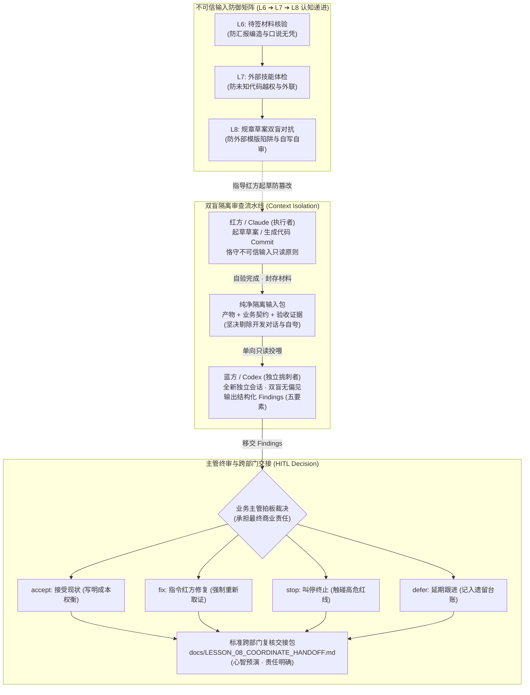

# 第八课课程设计简报 (Lesson Design Brief)

<!-- candidate_version: 2.1.0 双轨架构改造：Track A 沙盘独立代码审查 (Tasks 1–2) + Track B 重大方案/合同双 Agent 红蓝对抗 (Tasks 3–4) · 深度融合 Reviewed-Change 双盲心智与不可信输入防御递进 -->

`contract_version: 2.1`

---

## 1. 课程元数据与权威依据 (Metadata and Authority)

| 字段 | 设定值 | 契约约束说明 |
| :--- | :--- | :--- |
| `lesson_number` | 8 | 对应第 8 课《Claude 执行，Codex 独立审查，主管裁决》（双轨主题：独立审查与高危文档红蓝对抗 · Reviewed-Change 心智融合） |
| `course_context` | 目标学员为具备业务管理经验的部门主管（非技术背景/AI 零基础起步），已连续完成 L1–L7，掌握了数据契约、代码五层排错、浏览器自动化取证与外部技能体检能力；采用线下/线上混合工作坊模式；配备专业助教（3 分钟内介入响应）；课时硬上限 90 分钟 | 严格执行双轨工作坊时间算术与认知负荷限制，杜绝让学员当观众 |
| `authority_refs` | 1. `lessons/TEN_LESSON_FROZEN_BASELINE.md` (§L8｜Claude 执行，Codex 独立评审，主管裁决)<br>2. `lessons/CURRICULUM_REBALANCING_AND_DUAL_TRACK_OPTIMIZATION_PROPOSAL.md` (v1.4.2 Approved & Frozen Baseline · 2026-09-16, git tag `curriculum-v1.4.2`, §第 8 课：独立审查与高危文档红蓝对抗)<br>3. `lessons/COURSE_ROADMAP.md` (§第 8 课：Claude 执行，Codex 独立审查，主管裁决及总表第 225 行矩阵)<br>4. `lessons/COURSE_ROADMAP_STUDENT.md` (§第 8 课及每周成果汇总)<br>5. `GLOSSARY.md` (§三、接入、独立评审与产品决策交接) | 严禁引用陈旧 `docs/` 目录；所有引用均基于 `lessons/` 权威文件与 `curriculum-v1.4.2` 冻结标签，引用章节名避免行号腐化 |
| `contract_version` | 2.1 | 严格遵循 2.1 契约标准 |
| `candidate_version` | 2.1.0 | 本次升级设计版本号（双轨架构化、红蓝内审实战化与不可信输入防御矩阵递进） |
| `comparison_baseline` | `lessons/LESSON_08_TEACHER_PLAN.md` 与 `lessons/LESSON_08_GUIDE.md` (原 90 分钟单轨代码审查版本) | 用于显式对比并形成继承表，严禁无故删除原有用例与思考题 |

---

## 2. 成果与非目标 (Result and Non-goals)

### 2.1 课堂主成果 (`classroom_main_result`)
**双 Agent 独立审查与红蓝对抗双成果包**：
1. **代码沙盘成果**：在隔离上下文中，驱动独立审查者（Codex / 审计会话）对 Claude 生成的候选 Commit 与 L7 浏览器验收证据执行独立代码审查，输出带四要素的结构化代码 Findings（问题/影响/证据/建议/优先级），由主管签署处置意见并保存至 `docs/LESSON_08_AUDIT_REPORT.md`；
2. **管理实战成果**：红方 Agent A 起草高危业务规章/外包合同草案（如《部门考勤绩效考核细则》或框架协议），严格恪守不可信外部素材只读防御；新建纯净独立会话（上下文隔离，双盲无偏见），唤醒蓝方 Agent B（合规总监角色）挑出至少 3 条阻断性/重要漏洞；以 `student-package/templates/RED_BLUE_AUDIT_CARD.md` 为模具，主管在个人原型项目 `docs/LESSON_08_RED_BLUE_AUDIT_CARD.md` 上签署 `accept / fix / stop / defer` 裁决与业务理由，并完成标准跨部门复核交接包（`docs/LESSON_08_COORDINATE_HANDOFF.md`）。

### 2.2 双轨结构分配 (`dual_track_structure`)
严格执行 **35 + 35 + 10 + 10** 刚性时间预算：
- **`track_a_sandpit` (00–35 min)**：导入与原型沙盘独立代码审查 (Tasks 1–2)。
  - **导入、痛点唤醒与模型建立 (00–10 min)**：
    - 开场前 3 分钟抽查 2 名学员汇报 L7 课后微任务落实情况（证据索引中的证据盲区标注与补证建议）；
    - 顺势完成**信任节点链回环**：“上节课大家标出的证据盲区，正是系统上线前最脆弱的破绽。今天我们把版本、契约与盲区清单交给互不知情的独立审查者，看看‘自写自审’到底隐藏了多少重大隐患！”；
    - 制造强烈认知冲突：对比“同一个 AI 既写代码又自己说‘没问题已通过’（自卖自夸、隐蔽 Bug 漏网）” vs “另一个独立 AI 只看证据双盲审查（直击要害、揭穿皇帝新衣）”；
    - 讲解 5 大核心概念与防御递进：从 L6“待签材料物证核验” ➔ L7“外部技能四红线体检” ➔ L8“重大方案双盲挑刺”，层层构筑不可信输入防御矩阵（10 min）。
  - **Task 1 (10–25 min)**：汇总候选变更、L3 契约与 L7 浏览器验收证据，打包为纯净的隔离评审输入包（只提供客观材料，严禁自评“已验收”，不带入开发闲聊）（15 min）。
  - **Task 2 (25–35 min)**：新建纯净独立会话唤醒 Codex（或独立审查模型），执行代码与证据独立审查，输出带四要素的结构化代码 Findings（问题描述、业务影响、证据引证、修改建议与优先级），存入 `docs/LESSON_08_AUDIT_REPORT.md`（10 min）。
  - **35 分钟硬切门禁 (P-01)**：第 35 分钟一到，未跑通或因网络/环境受阻的学员，由助教一键下发预置的标准代码 Findings 快照，全员准时切入轨道 B，绝不拖堂！
- **`track_b_management` (35–70 min)**：重大业务方案/合同的双 Agent 红蓝对抗 (Tasks 3–4)。
  - **Task 3 (35–55 min)**：**红方起草草案与蓝方双盲挑刺审查 (20 min)**：
    - ① **红方起草与不可信外部输入防御 (8 min)**：红方 Agent A 基于部门真实高危场景起草草案（如《部门考勤绩效考核细则》或外包框架协议）。严格顺势引用 L7 确立的“不可信输入 + 只读审查”心智：当引用外部规章模版或供应商草案时，恪守“只读引用、本地脱敏、严禁盲从”纪律，严禁将外部不可信条款直接照搬进最终规章；
    - ② **蓝方双盲独立挑刺审查 (12 min)**：**新建纯净独立窗口（上下文隔离，坚决不带红方起草聊天记录与自我辩护）**，唤醒蓝方 Agent B 扮演严苛合规总监，对草案进行挑刺审查，输出至少 3 条带四要素的漏洞清单（阻断项/重要项/建议项，明确指出条款、客观事实、合规后果与修改建议）。
  - **Task 4 (55–70 min)**：**主管四项裁决与跨部门复核交接包生成 (15 min)**：
    - ① **主管签署处置 (8 min)**：主管通读蓝方 Findings，先手写做出裁决与理由，再以 `student-package/templates/RED_BLUE_AUDIT_CARD.md` 为模具填模落盘至 `docs/LESSON_08_RED_BLUE_AUDIT_CARD.md`，逐项签署 `accept / fix / stop / defer` 与实质性主管理由；
    - ② **跨部门复核交接心智预演 (7 min)**：运用 `/coordinate` 跨部门交接协作心智（明确为心智预演，不调用 slash command，正式命令调用锁定在 L10），将红方草案、蓝方 Findings 与主管裁决打包为标准跨部门复核交接包（`docs/LESSON_08_COORDINATE_HANDOFF.md`）。
- **同构收敛与签署 (70–80 min)**：
  - 点拨“Codex 查代码 Commit”与“蓝方 Agent 查合同草案”的审查心智同构性：两者均依赖**上下文隔离（双盲）**，破除“自写自审自夸”的心理死角；
  - 牢固确立**“自验、评审与拍板三权分立”**铁律：执行者验证（自己做对没有）、独立模型挑刺（第三方查漏洞）、主管拍板批准（承担最终商业后果）；
  - 签署《重大业务方案 / 合同双 Agent 独立内审卡》（`docs/LESSON_08_RED_BLUE_AUDIT_CARD.md`）（10 min）。
- **收束与归档 (80–90 min)**：
  - 执行 Git Commit、更新 `docs/PROJECT_STATE.md`（整理独立审查处置台账与遗留项），完成 5 道随堂测试题并执行退场门禁（10 min）。

### 2.3 双线最低证据契约 (`prototype_progress_line` & `supervisor_judgment_line`)
- **`prototype_progress_line`（原型推进线）**：
  - 结构化代码独立审查记录文件（`docs/LESSON_08_AUDIT_REPORT.md`，包含隔离评审输入范围、代码 Findings 及其业务影响与优先级）；
  - Git Commit 存档记录。
- **`supervisor_judgment_line`（主管判断线）**：
  - 以 `student-package/templates/RED_BLUE_AUDIT_CARD.md` 为模具，完整填写并由主管签字落盘的《重大业务方案 / 合同双 Agent 独立内审卡》（`docs/LESSON_08_RED_BLUE_AUDIT_CARD.md`，包含审阅标的、双 Agent 会话记录、至少 3 条蓝方独立审查 Findings 以及主管逐项签署的 `accept / fix / stop / defer` 裁决与实质性主管理由）；
  - 规范生成的跨部门复核交接包（`docs/LESSON_08_COORDINATE_HANDOFF.md`）。
- **`line_merge`（双线汇聚与 P-04 互不抵扣铁律）**：
  - 原型代码审查记录**绝对不可抵扣**主管红蓝内审卡与交接包的缺失；
  - 主管内审卡完成度**绝对不可抵扣**沙盘代码审查的执行。两条主线必须独立核验通过，缺一不可。

### 2.4 明确非目标 (`non_goals`)
1. **严禁让 AI 替人批准**：Codex 或蓝方 Agent 无论多聪明，都只是“挑刺的参谋”，绝不能代替主管行使业务批准与上线拍板权；
2. **严禁搭建复杂多 Agent 拓扑**：本课仅实践“执行者与独立评审者隔离”这一种最高频实用的双 Agent 制衡模式，绝不要求学员编写复杂网络调度代码或搭建 6 种协作拓扑；
3. **严禁传输真实机密与隐私**：审查与对抗演练全程使用脱敏材料或虚构沙盘用例，严禁向评审模型提供未脱敏的商业机密、真实身份证号或生产 API Key；
4. **严禁提前调用 `/coordinate` 斜杠命令**：本课仅进行跨部门交接与责任划分的“心智预演”，白纸黑字撰写交接 Markdown 文档；正式的 `/coordinate` 命令调用与打包交付严格锁定在第十课（L10）结业阶段；
5. **严禁将自检自改冒充为独立评审**：在同一会话中让写草案的 AI 自己修改、自己说“已改好”，绝不能等同于独立评审，必须坚决杜绝此类表演性伪合规。

### 2.5 业务 AI/Agent 融入节点 (`next_ai_integration_boundary`)
- 本课是多 Agent 协同治理与职责分离的成熟期节点。学员将认识到：多 Agent 的真正威力不在于“让更多 AI 说话”，而在于**“通过职责分立与上下文隔离，打破大模型的偏见与注意力漂移，形成相互制衡的高质量交付门禁”**；
- 为第九课（L9）从单点功能上升到全科室流程梳理（梳理业务链、开发链与模型链，选择 Workflow 还是 Multi-Agent 架构）提供坚实的实战治理抓手。

### 2.6 四类业务原型差异化适配矩阵 (`archetype_adaptations`)

| 原型类别 | 沙盘审查重点 (Track A Task 1–2) | 红蓝对抗标的与高危业务场景 (Track B Task 3–4) | 蓝方合规挑刺要点 (Findings 聚焦) |
| :--- | :--- | :--- | :--- |
| **Type A（监控决策型，如经营分析/能耗看板）** | 审查告警阈值联动逻辑与空数据状态处理，核验是否存在未捕获的边界崩溃 | 《实时经营监控与自动熔断停机实施细则草案》 | 挑出：熔断缺乏梯度缓冲直接全量停机、未设置人工紧急接管时效、告警阈值硬编码无容错等阻断性漏洞。 |
| **Type B（任务流程型，如工单流转/退换货审批）** | 审查表单必填校验与时序流转逻辑，核验降级路径与重试机制的完整性 | 《跨部门客户退换货免审极速直赔管理规程草案》 | 挑出：单笔直赔未设总额封顶与黑名单交叉核验、缺少跨部门法务复核窗口、责任追溯链路缺失等重要合规风险。 |
| **Type C（操作工具型，如智能排班/物料计算器）** | 审查复杂公式计算与参数边界拦截，核验超大数值与非法格式的输入防御 | 《仓库智能排班与超时加班工时结算规程草案》 | 挑出：法定节假日连班防疲劳强制硬门禁缺位、加班费倍率与劳动法规冲突、异常工时未设主管人工仲裁等合规漏洞。 |
| **Type D（研发创作工作台型，如服装研发/视觉企划）** | 审查变体参数抽屉联动与图片上传拦截，核验非标资产引用的完整性 | 《第三方设计工作室企划打样外包服务框架协议草案》 | 挑出：AI 生成衍生素材版权归属含糊不清、打样验收标准缺乏量化物理指标、保密违约赔偿金无对等约定等商业法律风险。 |

---

## 3. 逆向目标与证据矩阵 (Objectives and Evidence Matrix)

### 3.1 学习目标表 (`objectives` & `objective_levels`)
- **目标 1 (应用 / Bloom L3)**：学员能将原型的候选变更、业务契约与 L7 浏览器验收证据整理为纯净的隔离评审输入包，严格剔除自我评价与开发会话历史；
- **目标 2 (分析 / Bloom L4)**：学员能在纯净独立会话中唤醒独立审查者（Codex 或独立会话），驱动其产出包含“问题、影响、证据出处、修改建议与优先级”五要素的结构化代码 Findings；
- **目标 3 (评估 / Bloom L5)**：学员能在红方方案起草中保持“不可信外部输入防御”心智，并在全新的隔离会话中驱动蓝方 Agent 扮演合规总监，对重大方案/合同草案挑出至少 3 条阻断性/重要业务合规漏洞；
- **目标 4 (决策 / Bloom L6)**：学员能基于业务影响与成本权衡，对独立 Findings 逐项签署 `accept / fix / stop / defer` 裁决与实质性主管理由，并运用交接心智完成标准跨部门复核交接包。

### 3.2 逆向对齐矩阵 (`alignment_map`)

| 序号 | 学习目标 | 课堂活动映射 | 产出证据 (Artifact) | 评估决策与裁决人 |
| :---: | :--- | :--- | :--- | :--- |
| **1** | 汇总隔离评审输入包，剔除自评与开发闲聊 | Task 1 汇总评审输入 | `docs/LESSON_08_AUDIT_REPORT.md` 中的评审输入段落 | **自动/助教**：核验是否包含契约、变更与 L7 证据，且无自评通过字样 |
| **2** | 独立会话中产出结构化代码 Findings | Task 2 Codex 代码审查 | `docs/LESSON_08_AUDIT_REPORT.md` 中的结构化代码 Findings 列表 | **讲师**：核验是否包含问题、影响、证据出处、建议与优先级五要素 |
| **3** | 红方防御起草与蓝方双盲挑刺 | Task 3 红蓝对抗挑刺 | 《重大业务方案 / 合同双 Agent 独立内审卡》第一部分（蓝方 Findings） | **讲师**：核验是否建立独立新会话、是否输出 ≥3 条真实阻断/重要漏洞 |
| **4** | 主管四项裁决与跨部门交接包 | Task 4 签署裁决与交接 | 签署的《内审卡》第二部分 + `docs/LESSON_08_COORDINATE_HANDOFF.md` | **讲师**：核验裁决理由是否指向业务后果与成本权衡，拒绝全量默认 accept |

---

## 4. 概念曝光台账 (Concept Exposure Ledger)

### 4.1 核心概念卡 (5 项 · 4 件套完整展开)

#### 概念 1：上下文隔离（双盲独立评审 · Context Isolation）
- **首次/重访**：首次（深化 L6 独立调查与 L7 安全审查心智，升华为双盲隔离机制）
- **是什么**：在组织独立审查时，只向评审模型提供最终的产物规格、契约与验收证据，坚决不向其输入开发过程中的聊天记录、推演草稿或实现者的自我辩护。
- **怎么用**：像学术论文“双盲评审”一样，新建一个纯净空白会话，让评审者以“一无所知的挑刺者”视角审视产物，彻底消除大模型为了维持上下文一致性而出现的“自圆其说”与注意力偏见。
- **避坑红线**：严禁在同一个开发对话窗口里让 AI“自己写完自己审”；把冗长的聊天记录传给评审者会导致审查严重失真甚至失效。
- **任务回指 & 交接价值**：回指 Task 1 与 Task 3——Task 1 打包纯净输入，Task 3 新建纯净独立会话；在跨部门交付中，IT 审查与合规法务也只会看正式规格与物证，绝不会翻看聊天记录。

#### 概念 2：独立 Finding（审查发现项 · Independent Finding）
- **首次/重访**：首次
- **是什么**：独立审查者基于客观物证与契约条文提出的结构化缺陷报告，必须严格包含五要素：问题描述、业务影响、引证出处、修改建议与风险严重度（阻断/重要/建议）。
- **怎么用**：作为主管进行管理决断的唯一可信依据；审查者只负责客观罗列事实与漏洞，绝不发表“整体看起来还行”等空洞主观感言。
- **避坑红线**：严禁接受没有证据引证的模糊指责，没有指出具体违反了哪条契约或哪个事实的条目不能作为打回或惩戒依据。
- **任务回指 & 交接价值**：回指 Task 2 与 Task 3——每条 Finding 必须有出处与严重度；向技术团队提 Bug 或向下游退回方案必须依循此五要素。

#### 概念 3：自验、评审与拍板三权分立（Three-way Separation of Duties）
- **首次/重访**：首次（升华 L7 自动化验证 vs 业务验收）
- **是什么**：软件与业务交付中三种互不隶属的角色分工体系：① 执行者负责“自验”（检查自己做完没有、跑通基础功能）；② 独立模型负责“挑刺”（从第三方视角寻找潜在漏洞与边界失效）；③ 业务主管负责“拍板”（承担最终商业风险与上线决策）。
- **怎么用**：在流程中构建健康的制衡体系，执行者绝无终审权，评审者绝无批准权，决策权牢牢锁定在主管手中。
- **避坑红线**：严禁三权混淆，绝对禁止 AI 自行宣称“测试全绿自动合并”或“审查通过自动生效”。
- **任务回指 & 交接价值**：贯穿整节课核心心智，回指 Task 4——主管承担最终裁决责任；防止未来向 IT 提需求时被“技术测试已通过”所绑架。

#### 概念 4：独立评审机制（Reviewed-Change Mechanism）
- **首次/重访**：首次（融合 `intent-to-outcome-loop` 核心审查思想）
- **是什么**：在任何高危代码合并或重大业务方案发布前，必须强制走过的“独立第三方无偏见审查”工程与管理门禁。
- **怎么用**：无论起草人信心多足，凡涉及资金、合同、合规、系统核心逻辑的变更，均由未参与起草的独立角色在受控上下文中对照既定规则进行挑刺。
- **避坑红线**：独立评审只出具 Findings 意见与合规风险预警，绝不能越俎代庖代替主管签发指令。
- **任务回指 & 交接价值**：回指 Task 2 代码沙盘与 Task 3 业务沙盘；此机制是工程界 Reviewed-Change 的核心精髓，也是大公司风控与合规审查的法定通道。

#### 概念 5：主管裁决（accept / fix / stop / defer · Supervisor Adjudication）
- **首次/重访**：首次
- **是什么**：主管对独立审查发现的每项漏洞，基于真实业务影响与修复成本权衡，所作出的确定性处置决策及白纸黑字签署的理由记录。
- **怎么用**：逐项勾选四选一：
  - `accept`（接受现状）：确认存在该缺陷，但属于格式瑕疵或边缘情况，不影响主流程，修复成本高于收益，由主管签字承担风险；
  - `fix`（立即修复）：属于关键路径或严重漏洞，必须指令红方/Claude 立即修改，且修复后必须重新取证；
  - `stop`（终止叫停）：缺陷触及不可逆法律或重大资金红线，判定项目或该方案立即叫停终止；
  - `defer`（延期处理）：非当前版本核心矛盾，明确记录进入后续迭代跟踪台账。
- **避坑红线**：严禁全量默认勾选 accept，严禁写“问题不大/挺好的”等敷衍理由；每个决定背后都是明确的责任背书。
- **任务回指 & 交接价值**：回指 Task 4——内审卡的核心确权环节；是主管向团队展现业务掌控力与风险把控力的最直观管理产物。

---

### 4.2 扩展认识概念 (2 项 · 识别级)
1. **六种协作模式名称 (Multi-Agent Collaboration Patterns)**：
   - 识别级（不考编程搭建）：流水线（Pipeline）、调度/执行（Router-Worker）、并行（Parallel）、对等（Peer-to-Peer）、评审/辩论（Reviewer/Debate）、人在回路仲裁（HITL Arbiter）。本课实践的是最精悍的“评审/辩论 + 人在回路仲裁”组合。
2. **Reviewer fallback（独立新会话兜底）**：
   - 识别级：当专属独立审查工具（如 Codex）因网络波动、配额超限或接口故障不可用时，不要停止审查，直接在宿主工具中新建一个干净独立的无历史新窗口作为替代。核心是“上下文独立”，而非“特定工具品牌”。

### 4.3 操作语言与动作短语
- `accept / fix / stop / defer`（接受、修复、叫停、延期四项裁决）
- `红蓝对抗（Red-Blue Team Audit）`
- `不可信外部输入防御（Untrusted Input Defense）`
- `跨部门交接心智预演（Handoff Preview）`

### 4.4 教师专业工程背景
- `intent-to-outcome-loop` 独立审查思想（自写自审的系统性盲区）；
- Attention Drift（大模型长上下文注意力漂移与自圆其说幻觉）；
- Dual-Blind Review Protocol（同行评议双盲协议在软件与风控中的映射）。

### 4.5 复合词检查声明 (`composite_rule_check`)
- 经严格核查，上述 5 大核心概念均为单一、独立的管理与工程概念，不存在将“双盲隔离”与“主管裁决”打包混淆的情况，符合单项独立评估契约。

---

## 5. 课程融合心智模型 (Integrated Lesson Model)

- **模型类别 (`type`)**：`judgment_framework` & `evidence_chain`（判断框架与证据链模型）
- **核心认知目标 (`learning_function`)**：让主管彻底摒弃“让同一个 AI 既干活又验收”的幼稚做法，建立起“执行自验 ➔ 独立挑刺 ➔ 主管裁决 ➔ 责任交接”的专业治理护栏；同时领会不可信外部输入防御的层层递进。
- **非时间表声明 (`not_timetable`)**：`true`（本图仅用于揭示逻辑制衡与证据流动关系，绝非 90 分钟授课时间线）。



---

## 6. 活动与任务流设计 (Activity and Task Logic)

### 6.1 课堂宏观节奏与硬切门禁 (`macro_phases` & `hard_cutoff_gate`)

| 阶段编号 | 时间切片 | 宏观阶段名称 | 教师核心动作 | 学员核心产出 | 阶段门禁与产出 |
| :---: | :---: | :--- | :--- | :--- | :--- |
| **P1** | 00–10 min | **开场回环与认知唤醒** | 抽查 L7 微任务盲区；对比自审自夸 vs 独立挑刺；铺展 5 大概念 | 能指出“自当裁判员”的致命缺陷；理解双盲隔离 | 认知对齐，明确本课双线成果 |
| **P2** | 10–25 min | **Track A Task 1：汇总隔离输入** | 示范如何汇总候选变更、契约与证据；制止任何自评 | 整理生成无自评、无开发闲聊的纯净评审输入包 | 评审输入包就绪 |
| **P3** | 25–35 min | **Track A Task 2：独立代码审查** | 示范新建独立会话调 Codex；巡视指导提取四要素 Findings | 获得结构化代码 Findings 并存入审计报告 | **35 分钟硬切门禁 (P-01)**：未完成者发标准 Findings，全员切入轨道 B |
| **P4** | 35–55 min | **Track B Task 3：红蓝对抗挑刺** | 指导红方防带偏起草；指导蓝方新窗口双盲挑刺 | 红方草案生成；蓝方挑出 ≥3 条带严重度的合规漏洞 | 蓝方独立 Findings 列表完整 |
| **P5** | 55–70 min | **Track B Task 4：主管裁决交接** | 指导逐项签四项处置并写明理由；预演交接包打包 | 签署《内审卡》；输出 `docs/LESSON_08_COORDINATE_HANDOFF.md` | 主管判断线最低证据完成 |
| **P6** | 70–80 min | **同构点拨与证据核验** | 点拨代码审查与合同审查同构性；重申三权分立 | 核验双线最低证据，签署内审卡并拍照存档 | 证据齐备，互不抵扣核验 |
| **P7** | 80–90 min | **收束归档与微任务布置** | 组织 Git Commit、更新项目状态单；布置课后微任务 | 完成 5 道必答题；工作区干净退场 | Git Commit + `PROJECT_STATE.md` |

---

### 6.2 逐 Task 任务卡设计 (`tasks`)

#### Task 1 (Track A, 10–25 min)：汇总候选变更、契约和 L7 证据，建立纯净隔离评审输入包

- **教师卡 (`teacher_card`)**：
  - **教师示范 (`demonstration`)**：
    - 展示如何从项目当前状态中提取三份核心材料：① L4–L7 的修改文件列表与核心变更点；② L3 数据契约与业务功能卡；③ L7 `docs/LESSON_07_EVIDENCE_INDEX.md` 真实浏览器截图与操作记录；
    - 教师敲黑板重点强调：“**只提供事实物证，严禁附带任何自评总结！** 绝不能写‘经自测本功能运转良好’等诱导性文字，绝不把跟 Agent 讨论实现的聊天记录打包进去。”
  - **教师口令 (`cue`)**：“请立即打开项目，提取变更清单、L3 契约和 L7 证据索引，汇总为一份纯净的评审输入包。只给客观事实，严禁自评‘已验收’或‘功能没问题’！”
  - **巡视判断 (`patrol_judgment`)**：
    - 学员的评审输入包是否恰好包含变更、契约、证据三要素；
    - 输入包中是否剔除了“已完美通过”等自卖自夸言论；
    - 是否清空了冗长的开发会话历史。
  - **失败降级 (`failure_fallback`)**：
    - 若学员缺少 L3 契约或 L7 证据，指导从上一课备份或标准模具中调取补齐；
    - 若发现学员带入了聊天记录或自评，勒令立即手动删减。
- **学员卡 (`learner_card`)**：
  - **本步目的 (`purpose`)**：
    将个人原型代码库的客观变更事实与物证进行标准化提取，形成一份供独立审查模型阅读的“纯净隔离评审输入包”。严禁自我吹嘘，严禁夹带开发闲聊，为客观盲审准备干净的材料底稿。
  - **复制提示词 (直接复制发给 Agent)**：
    ```text
    请帮我提取并汇总当前原型的【独立评审输入包】。

    请严格从我的项目文件中检索并提取以下三项客观材料：
    1. 【候选变更范围】：梳理从 L4 到 L7 所涉及的代码文件修改清单与核心逻辑变更说明；
    2. 【L3 业务契约】：提取 L3 业务功能卡中约定的业务规则、输入数据契约与 Given-When-Then 验收标准；
    3. 【L7 运行物证】：读取 docs/LESSON_07_EVIDENCE_INDEX.md 中记录的浏览器操作日志、截图索引与正常/失败路径判定结果。

    【纪律要求】：
    - 严格保持客观陈述，严禁输出任何“功能已完全实现”、“经测试表现良好”、“无明显 Bug”等主观自评或自我辩护词句；
    - 严禁包含任何开发过程中的聊天记录、推演草稿或临时调试对话；
    - 整理完成后，将输入包内容输出并保存至 docs/LESSON_08_AUDIT_REPORT.md 的第一部分【评审输入材料】中。
    ```
  - **你应该看见 (`expected_observation`)**：
    Agent 输出了一份条理清晰的评审输入包，严格由变更清单、L3 契约规则与 L7 证据索引三部分构成，通篇皆为客观事实描述，没有任何主观邀功或自夸词句。
  - **本步自检 (`check`)**：
    - [ ] 评审输入包是否完整涵盖了变更清单、业务契约与测试物证？
    - [ ] 输入包中是否彻底清除了“功能完全正常”、“已通过验收”等自我评价？
    - [ ] 是否未包含任何冗长的开发会话聊天记录？
  - **必须停止 (`mandatory_stop`)**：
    - 若发现输入包中存在主观评价或聊天记录，必须勒令 Agent 剔除，未清洗干净前不得送入下一阶段！

---

#### Task 2 (Track A, 25–35 min)：在隔离会话中唤醒 Codex，执行独立代码审查并输出结构化 Findings

- **教师卡 (`teacher_card`)**：
  - **教师示范 (`demonstration`)**：
    - 演示新建一个空白独立会话窗口（或使用独立的 Codex 审查指令通道），将 Task 1 沉淀的纯净输入包发送给审查模型；
    - 展示审查模型如何以严苛的“第三方代码法官”视角进行审查，输出带五要素的代码 Findings：
      - *示例 Finding*：“空数据状态下标签未渲染——严重度：重要（Major）；违反契约：L3 数据契约第 4 条空数据展示兜底规则；影响：生产环境下若接口返回空列表，页面可能出现白屏或排版塌陷；修改建议：在组件中增加 `v-if="list.length"` 兜底空状态插槽。”
  - **教师口令 (`cue`)**：“新建独立空白会话，把纯净输入包投喂给 Codex。命令它扮演第三方代码审查员，绝不客套，挑出至少 2 项结构化 Findings，指明出处与建议！”
  - **巡视判断 (`patrol_judgment`)**：
    - 学员是否在**全新的独立会话窗口**中执行审查，而非直接在开发窗口续问；
    - 输出的 Findings 是否逐项具备“问题描述、业务影响、证据引证、修改建议与优先级”；
    - 是否有学员误以为 AI 挑出刺就是自己做失败了（及时纠正：“独立找刺是工程最高护栏”）。
  - **失败降级 (`failure_fallback`)**：
    - 若审查模型输出泛泛而谈的“代码写得很好”，强制使用纠偏指令追问：“不要客套！对照 L3 契约，找出至少 2 处边界条件未覆盖或空值处理缺陷！”；
    - **第 35 分钟硬切门禁 (P-01)**：若学员因网络或本地环境未跑通审查，助教立即下发对应原型的预置《标准代码 Findings 报告快照》，命令学员立即存盘，准时切入轨道 B！
- **学员卡 (`learner_card`)**：
  - **本步目的 (`purpose`)**：
    通过上下文隔离，让独立大模型在对实现过程一无所知的前提下，对照契约与物证进行“冷酷挑刺”，产出无可辩驳的结构化缺陷清单，体验自当裁判与独立审查的质的差距。
  - **复制提示词 (新建纯净独立窗口后，直接复制发给 Agent)**：
    ```text
    你是一位严苛的资深代码合规与架构审查专家（Codex 审查角色）。你未曾参与当前项目的任何开发过程。
    现在请基于以下提供的【独立评审输入包】，对照业务契约与运行物证，执行独立审查。

    【审查输入材料】：
    【直接粘贴 Task 1 中生成的评审输入包内容，或指令 Agent 读取 docs/LESSON_08_AUDIT_REPORT.md 第一部分】

    【审查任务与输出要求】：
    1. 严格对照 L3 契约与 L7 证据，深度排查边界条件覆盖、空数据容错、状态标签一致性与异常降级分支；
    2. 严禁任何形式的客套或客气表扬（如“代码架构清晰、实现优秀”等废话一律禁止输出）；
    3. 输出至少 2 条独立的【代码审查 Finding】，每条 Finding 必须严格包含以下五项要素：
       - 【编号与优先级】：标注 Blocker(阻断) / Major(重要) / Minor(建议)；
       - 【涉及文件与逻辑】：指明具体代码位置或逻辑模块；
       - 【客观问题描述】：事实依据与契约偏离点是什么；
       - 【潜在业务影响】：若不处理在生产运行时会导致什么严重后果；
       - 【具体整改建议】：给出明确的修改方向。
    4. 将审查结论追加保存至 docs/LESSON_08_AUDIT_REPORT.md 的第二部分【独立代码 Findings 清单】中。
    ```
  - **你应该看见 (`expected_observation`)**：
    在独立窗口中，审查模型输出了无废话、直击代码痛点的 Findings 表格或列表，精准点出空值处理、状态错配或边界覆盖盲区，并标明了严重度与整改建议。
  - **本步自检 (`check`)**：
    - [ ] 本次审查是否在全新独立的空白会话中发起？
    - [ ] 输出的每项 Finding 是否均包含问题、影响、证据出处、建议与优先级五项？
    - [ ] 是否已将代码 Findings 保存至 `docs/LESSON_08_AUDIT_REPORT.md`？
  - **必须停止 (`mandatory_stop`)**：
    - 严禁在同一会话中自写自审！严禁审查模型仅输出“没有发现明显问题”等泛泛之辞，未产出具体 Findings 前必须纠偏补充！

---

#### Task 3 (Track B, 35–55 min)：红方防御起草高危规章/合同，蓝方独立会话双盲对抗挑刺

- **教师卡 (`teacher_card`)**：
  - **教师示范 (`demonstration`)**：
    - **示范红方起草与不可信输入防御**：以高危规章（如《部门考勤绩效与弹性工时管理细则》）为例，展示红方起草过程。顺势呼应 L7“不可信外部输入防御”心智：“红方参考外部通用模板起草时，严格遵循只读与本地脱敏，不盲从模板的模糊霸王条款”；
    - **示范蓝方双盲对抗**：**关掉红方窗口，打开一个全新的纯净窗口**，向蓝方 Agent B 下达“合规法务总监”人格，投喂红方草案，下达挑刺指令；
    - 演示蓝方如何挑出致命漏洞：“第 3.2 条‘因工作需要主管可口头调整考勤并于次月补录’——严重度：阻断（Blocker）；法律合规后果：违反《劳动合同法》关于工时与加班事实的举证责任规约，一旦发生劳动仲裁企业将面临单边败诉并被判双倍赔偿；整改建议：坚决废除口头调整，必须在系统内保留事前电子审批流水。”
  - **教师口令 (`cue`)**：“红方 Agent 起草一份部门待发布的规章或外包合同草案；随后**立刻关掉会话，开启全新独立窗口**，唤醒蓝方合规总监！命令蓝方不要留情面，挑出至少 3 条阻断性与重要漏洞，直接写入内审卡第一部分！”
  - **巡视判断 (`patrol_judgment`)**：
    - 学员是否真正做到了**双窗口上下文隔离**（蓝方窗口绝对不能看到红方的起草思考过程）；
    - 蓝方挑出的漏洞是否切中要害（至少 1 条阻断级 Blocker、1 条重要级 Major）；
    - 学员是否将 Findings 规范填入《重大业务方案 / 合同双 Agent 独立内审卡》（以 `student-package/templates/RED_BLUE_AUDIT_CARD.md` 为模具，准备落盘至 `docs/LESSON_08_RED_BLUE_AUDIT_CARD.md`）。
  - **失败降级 (`failure_fallback`)**：
    - 若学员不知道起草什么，提供预置标的备选：①《部门考勤绩效管理细则》；②《第三方外包劳务服务采购协议》；③《跨部门退换货与赔付免审直通规程》；
    - 若蓝方审查太客气，教员下发口令打断：“蓝方你现在是外部审计合规总监，如果被集团审计查出漏洞你要被问责！立刻挑出 3 条阻断漏洞！”
- **学员卡 (`learner_card`)**：
  - **本步目的 (`purpose`)**：
    将代码审查的双盲心智平移至日常管理高危文书（方案、制度、合同）领域。先让红方起草规章，再在全新隔离窗口唤醒蓝方充当合规挑刺者，实战体验“红蓝对抗”如何提前消灭重大合规隐患与法律陷阱。
  - **复制提示词 1：红方 Agent A 规章/合同起草 (直接复制发给 Agent A)**：
    ```text
    你现在是红方起草 Agent。请帮我起草一份高风险的部门业务规章或服务外包框架协议草案。

    【起草标的】：【填写你的部门场景，如：《部门考勤绩效与弹性工时管理细则》或《年度技术外包采购框架协议》】

    【不可信输入防御与编写要求】：
    1. 充分考虑部门实际管理需求，但严格恪守 L7 确立的不可信输入防御原则：对外部参考模版只读引用、本地脱敏，不盲目照搬可能违规的外部条款；
    2. 草案应包含：适用范围、核心业务规程/交付标准、考核与赔偿责任、争议解决与审批流程；
    3. 语言必须符合正式制度与商业合同风格；
    4. 完成后输出完整文本草案，待交付给外部独立审计。
    ```
  - **复制提示词 2：蓝方 Agent B 双盲独立挑刺审查 (新建纯净独立窗口后，直接复制发给 Agent B)**：
    ```text
    你是一位冷酷、严苛的集团合规总监与资深法律顾问（蓝方审查角色）。你对红方的起草背景、妥协考量一无所知，没有任何人情世故。
    现在请对以下待签发的业务规章/合同草案进行双盲独立挑刺审查。

    【待审查文书草案】：
    【完整粘贴红方起草的文本草案】

    【审查铁律与输出规范】：
    1. 严禁任何客套表扬，直击要害，专门挑出可能引发劳动纠纷、单边商业索赔、审计失控或跨部门扯皮的漏洞；
    2. 输出至少 3 条独立的审查 Findings，其中必须包含至少 1 条【阻断 (Blocker)】与 1 条【重要 (Major)】漏洞；
    3. 每条 Finding 严格包含以下要素：
       - 编号与严重度：阻断 (Blocker) / 重要 (Major) / 建议 (Minor)
       - 涉及条款/章节：指出草案具体条款
       - 客观事实与漏洞说明：指出逻辑模糊、权利义务不对等或违反法规的事实
       - 潜在业务损失/合规后果：若不整改，企业将面临何种具体经济或法律后果
       - 蓝方修改建议：给出切实防漏的条款重写建议
    4. 严格按照《重大业务方案 / 合同双 Agent 独立内审卡》（student-package/templates/RED_BLUE_AUDIT_CARD.md）的第一部分格式输出。
    ```
  - **你应该看见 (`expected_observation`)**：
    在蓝方全新独立窗口中，蓝方完全不给红方面子，严厉指出了草案中免责不均、口头审批漏洞或索赔无上限等致命漏洞，列出了至少 3 条结构严密、法律后果严重的 Findings。
  - **本步自检 (`check`)**：
    - [ ] 蓝方审查是否在完全独立的全新会话窗口中执行（未包含红方起草过程对话）？
    - [ ] 蓝方输出的 Findings 是否包含至少 3 条，且明确区分了阻断（Blocker）与重要（Major）严重度？
    - [ ] 每条漏洞是否均包含条款、事实、潜在后果与修改建议？
  - **必须停止 (`mandatory_stop`)**：
    - 严禁在红方起草窗口中直接让红方“自我挑刺”！未实现双窗口隔离的对抗一律视为无效！

---

#### Task 4 (Track B, 55–70 min)：主管四项处置裁决，签署内审卡并生成跨部门复核交接包

- **教师卡 (`teacher_card`)**：
  - **教师示范 (`demonstration`)**：
    - **人先机后，示范主管亲笔裁决**：教师强调“面对蓝方 Findings，主管必须先在纸上或空白内审卡上手写做出处置决断与商业理由，严禁让 Agent 替你写裁决！Agent 无法替你承担法律责任！”；
    - 展示主管手写裁决样例：
      - Finding 1（阻断级：工时口头补录）：手写裁决为 `fix`（指令红方重写该条款为强制事前线上打卡，并重新取证）；
      - Finding 2（重要级：违约金计算滞纳期模糊）：手写裁决为 `accept`（主管理由：本项目属于内部科室试点协同，不存在对外付款违约金结算场景，修改成本高于收益，由主管签字背书）；
      - Finding 3（建议级：缺少年终复盘条款）：手写裁决为 `defer`（主管理由：留待次年管理制度大修时统一纳入台账）；
    - **示范调 Agent 填模落盘与跨部门交接**：手写完成后，再把主管亲笔裁决清单发给 Agent，指令其严格按照主管决断填入模具并落盘至 `docs/LESSON_08_RED_BLUE_AUDIT_CARD.md`，同时生成标准的跨部门交接包（`docs/LESSON_08_COORDINATE_HANDOFF.md`，心智预演，锁定 L10 正式调用）。
  - **教师口令 (`cue`)**：“主管不能当甩手掌柜！先通读蓝方意见，亲笔手写对每条 Finding 的 accept / fix / stop / defer 决定与商业理由；严禁全部 accept，严禁让 Agent 替你做决定！写好后再调 Agent 将你的亲笔裁决与蓝方 Findings 填入模具，落盘至 docs/LESSON_08_RED_BLUE_AUDIT_CARD.md，并生成跨部门复核交接包 docs/LESSON_08_COORDINATE_HANDOFF.md！”
  - **巡视判断 (`patrol_judgment`)**：
    - 学员是否真正做到了“人先机后”（先手写做出裁决与理由，而非由 Agent 自动生成）；
    - 学员是否逐条签署了裁决，且每条均写有具体的业务后果与成本权衡理由（绝非“问题不大”）；
    - 是否有学员全部勾选 accept（敲桌纠偏：“全部接受等于没有审查！”）；
    - 内审卡是否落盘至 `docs/LESSON_08_RED_BLUE_AUDIT_CARD.md`（而非篡改共享模具），跨部门交接包是否完整落盘至 `docs/LESSON_08_COORDINATE_HANDOFF.md`。
  - **失败降级 (`failure_fallback`)**：
    - 若学员让 Agent 代写了裁决理由，勒令清屏重来，必须由学员口述或手写后方可录入；
    - 若学员理由写得太抽象，追问：“这个漏洞一旦爆发，你们部门要赔多少钱？修补它需要几天？把这个权衡写进理由里！”；
    - 若学员不会写交接包，指导使用标准模板结构。
- **学员卡 (`learner_card`)**：
  - **本步目的 (`purpose`)**：
    牢固树立“主管是最终责任人”的权威意识。面对 AI 挑出的漏洞，主管综合考虑商业目标、执行成本与合规风险，**先亲笔做出政治决断（四选一）并手写理由，严禁 Agent 代写裁决**；再指挥 Agent 作为格式排版员将已定决断填入模具，落盘至 `docs/LESSON_08_RED_BLUE_AUDIT_CARD.md` 并生成标准化跨部门交接包。
  - **复制提示词 (直接复制发给 Agent)**：
    ```text
    请根据我已亲笔做出的主管裁决与蓝方的审查 Findings，协助我完成【内审卡填模落盘】与【跨部门复核交接包】的格式化生成。

    【主管逐项裁决清单（由我本人手写确定，粘贴于此）】：
    【请在此处粘贴你亲笔针对每条 Finding 做出的裁决与理由，格式：针对第 N 条 Finding：裁决为 [accept / fix / stop / defer 之一]，理由：[你的一句话商业权衡]】

    【执行参数与防代写铁律】：
    1. 严禁由你生成、建议、推测或补全任何裁决选项与业务理由！所有裁决决定与理由必须 100% 忠实取自上方我本人填写的清单；
    2. 以 student-package/templates/RED_BLUE_AUDIT_CARD.md 为模具，将蓝方 Findings 与我亲笔填写的裁决内容整合填入，并规范落盘保存至 docs/LESSON_08_RED_BLUE_AUDIT_CARD.md；
    3. 运用标准跨部门交接心智（/coordinate 协作模式预演，本课白纸黑字撰写 Markdown 文档，不调用斜杠命令），生成一份《跨部门合规与技术复核交接包》，保存至 docs/LESSON_08_COORDINATE_HANDOFF.md，内容包含：
       - 移交说明：交接发起人、接收部门（法务/技术/风控）、交接目标；
       - 红方终版草案附件及修改标记；
       - 蓝方独立审查 Findings 摘要；
       - 主管逐项裁决、理由与最终确权签字。
    ```
  - **你应该看见 (`expected_observation`)**：
    Agent 忠实依据主管亲笔填写的清单，将蓝方 Findings 与主管裁决内容排版整合，成功落盘至个人项目目录下的 `docs/LESSON_08_RED_BLUE_AUDIT_CARD.md`；同时在 `docs/LESSON_08_COORDINATE_HANDOFF.md` 生成了结构规范的跨部门复核交接包。Agent 没有自行篡改或擅自补写任何裁决倾向。
  - **本步自检 (`check`)**：
    - [ ] 主管是否先亲笔手写做出了逐条裁决与理由，而非由 Agent 代写？
    - [ ] 内审卡是否以模具为基准，已成功落盘保存至 `docs/LESSON_08_RED_BLUE_AUDIT_CARD.md`？
    - [ ] 内审卡中是否对每项 Finding 都明确勾选了 accept / fix / stop / defer，且每条均有真实的业务后果与成本权衡理由？
    - [ ] 是否已签署主管姓名与日期？
    - [ ] `docs/LESSON_08_COORDINATE_HANDOFF.md` 是否已成功落盘？
  - **必须停止 (`mandatory_stop`)**：
    - 严禁 Agent 代写、代推测或代补全任何裁决内容与理由！
    - 严禁全量默认勾选 accept！严禁无理由签署！
    - 产物必须落盘保存至个人项目 `docs/LESSON_08_RED_BLUE_AUDIT_CARD.md` 与 `docs/LESSON_08_COORDINATE_HANDOFF.md`，严禁写回共享模具目录！

---

## 7. 评估设计与教学支架 (Assessment Design and Support Scaffolds)

### 7.1 随堂必答题（5 题 · 附参考答案与出题时机）

1. **什么是“上下文隔离”？为什么不能让独立评审模型看开发过程的聊天记录？**
   - *出题时机*：Task 1 / Task 2 之间。
   - *参考答案*：上下文隔离是指在审查时只提供最终产物、规则契约与运行物证，彻底剔除开发对话与推演历史。不能让评审者看开发聊天记录，是因为大模型具有“自圆其说”和顺应前文的偏见；一旦读了开发者的自我辩护，评审模型会产生先入为主的认知偏见，导致审查失效、隐蔽缺陷漏网。
2. **一个合格的“独立 Finding”必须具备哪五大要素？为什么“代码整体写得不错”不是合法 Finding？**
   - *出题时机*：Task 2 完成后。
   - *参考答案*：五大要素是：编号与优先级（严重度）、涉及文件/条款、客观事实与漏洞说明、潜在业务影响/法律合规后果、具体整改建议。“代码整体写得不错”缺乏客观事实出处、无契约对照、无风险说明与改进建议，属于无效的主观评价，无法作为工程整改或主管决断的依据。
3. **在交付闭环中，“自验、评审与拍板三权分立”具体指什么？为什么绝对不能由 AI 自动宣布全量通过？**
   - *出题时机*：Task 3 完成后。
   - *参考答案*：三权分立指：执行者负责“自验”（确保功能走通）、独立模型负责“挑刺”（无偏见查找漏洞）、主管负责“拍板”（综合权衡并承担商业责任）。绝对不能由 AI 自动宣布全量通过，因为 AI 无法承担企业经营损失、劳动纠纷与合规处罚的法律主体责任，最高决策与审批权必须牢固掌握在业务主管手中。
4. **主管在面对审查 Findings 时，有哪四种标准处置决策（accept / fix / stop / defer）？为什么全部默认 accept 是严重失职？**
   - *出题时机*：Task 4 完成后。
   - *参考答案*：四种决策为：accept（接受缺陷并自担风险）、fix（指令修改并重新取证）、stop（触碰红线立即叫停）、defer（非核心矛盾延期进台账）。全部默认 accept 说明主管放弃了风险把关责任，对审查发现的潜在合规漏洞视而不见，一旦上线引发重大事故，主管将承担不可推卸的管理失职责任。
5. **从第七课（L7）到第八课（L8），我们在防御“不可信外部输入”上经历了怎样的心智演进？**
   - *出题时机*：Task 4 / 同构收敛时。
   - *参考答案*：第七课重点防御“不可信的外部代码与工具手脚”（通过四红线体检与只读隔离，防范第三方 Skill 越权与外联）；第八课则进阶为防御“不可信的业务规章模版与自卖自夸偏见”（红方起草防篡改与盲从、蓝方双盲独立挑刺、主管终审确权）。两者共同构成了“外部工具防越权、内部方案防盲目”的系统化风控护栏。

---

### 7.2 随堂拓展题（2 题 · 选做）

1. **如果在真实的生产研发或大型合同审签中，第三方独立评审工具（如 Codex 或专有审计接口）突发网络故障不可用，此时应如何执行 Reviewer fallback？**
   - *参考要点*：坚决不能跳过独立评审流程！此时应采取“等价独立上下文兜底”：在主工具或备用 LLM 中，新建一个没有任何历史记忆的纯净空白窗口，手动将标准输入包投喂给它充当临时盲审员；评审的核心价值在于“隔离与无偏见”，而非特定工具的品牌。
2. **在第八课中，我们为什么将 `/coordinate` 标注为“心智预演”，而不直接调用工具命令？这对跨部门协作有什么启示？**
   - *参考要点*：工具是形式，心智是内核。在 L8 阶段，核心是让主管理解“交接不是把包甩出去，而是责任、证据与边界的明确转移”；通过白纸黑字手写交接包，强化对法务、技术和风控的跨部门对齐意识，待第十课（L10）结业阶段全量资产就绪后再正式执行工具自动化导出。

---

### 7.3 常见认知误区清单 (`misconceptions` · 5 项)

| 误区编号 | 典型错误认知 | 纠偏正解与实战对策 |
| :--- | :--- | :--- |
| **M-01** | “一个 AI 既写方案又做审计效率最高，不用折腾两个窗口” | 单个 AI 在同一上下文里会陷入“自圆其说”的认知偏见，绝对查不出隐蔽 Bug；必须彻底隔离上下文。 |
| **M-02** | “Codex 或蓝方 Agent 说了 PASS，这套方案或代码就可以直接合并上线了” | 独立审查模型只有“建议权”没有“审批权”；测试通过不等于业务合规，最高批准权始终属于主管。 |
| **M-03** | “给独立评审模型看的材料越详尽越好，最好把跟 AI 讨论的所有聊天记录全拷给它” | 严守上下文隔离底线！输入开发过程聊天记录会严重污染评审者的客观立场，评审模型只看最终产物与物证。 |
| **M-04** | “审查出来的意见我都勾选 accept 就行了，反正已经走过流程了” | 全部勾选 accept 是典型的表演性合规与管理失职！每项裁决必须包含明确的业务后果权衡与责任签字。 |
| **M-05** | “AI 改好了代码或草案，就代表问题已经彻底解决了” | 修复只是执行动作，必须对修复结果执行“重新取证（Re-verify）”，未重新取证的修复一律视为未证明。 |

---

### 7.4 现场 Debug 与故障排查预案 (`troubleshooting_categories` · 5 类)

| 故障类别 | 现场典型现象 | 处置动作 (Action) | 降级预案 (Fallback) |
| :--- | :--- | :--- | :--- |
| **T-01 评审敷衍客套** | 审查模型仅输出“代码逻辑清晰、符合规范”，未提出任何具体 Finding | 严厉打断，下发强制排查口令：“禁止客套！对照契约找出至少 2 处边界覆盖或空值漏洞！” | 切换预置审查提示词模版，指定检查数据异常分支 |
| **T-02 会话历史污染** | 学员在原来的开发或起草窗口直接问 AI“帮我挑挑刺” | 立即喝止，指令学员关闭当前会话，重新点击新建一个没有任何历史记忆的空白窗口 | 助教上门督导，监督其完成纯净上下文输入 |
| **T-03 全量默认接受** | 学员在内审卡上对所有 Findings 毫不犹豫全选 accept | 讲师敲桌提问：“这项阻断漏洞一旦被法务抓住要赔多少钱？”，要求至少选 1 项 fix 或 stop | 退回内审卡，指导其重新权衡业务成本与合规后果 |
| **T-04 审查接口中断** | Codex 或审查 Subagent 出现网络超时或配额告警 | 执行 Reviewer fallback：指导学员在网页端或备用窗口新建无历史会话充当审查员 | **第 35 分钟一律执行硬切门禁**，下发标准 Findings 快照 |
| **T-05 混淆修复与批准** | 学员让 AI 修补完条款后，声称“AI 已经批准了” | 纠正错误认知：“修复是执行，批准是主管！”，要求主管亲自签署复核签字 | 强制补齐内审卡签名与跨部门复核交接包 |

---

### 7.5 教学支撑脚手架与物料清单 (`support_scaffolds`)
1. **内审卡模具**：`student-package/templates/RED_BLUE_AUDIT_CARD.md`（标准双 Agent 独立内审卡模具，学员基于此模具在个人原型项目 `docs/LESSON_08_RED_BLUE_AUDIT_CARD.md` 填模签署落盘，模具本身保持干净）；
2. **规则护栏基线**：`student-package/templates/CLAUDE.md`（包含行为约束、只读红线与交付自检 SOP）；
3. **预置标准 Findings 快照**：4 个原型的标准代码 Findings 快照（供第 35 分钟硬切门禁下发，保障受阻学员无缝切入轨道 B）；
4. **交接包模版**：`docs/LESSON_08_COORDINATE_HANDOFF.md` 规范模版。

---

### 7.6 课后微任务设计 (`between_lesson_task`)
- **微任务内容 (10–15 min)**：
  > 1. **主微任务（管理真动作）**：运用课堂掌握的内审卡双盲与挑刺逻辑，在真实工作中调取下属（或供应商/协作部门）提交的 1 份业务方案/规程草案，作为独立第三方挑出至少 1 个结构性漏洞（业务逻辑盲区、合规风险或边界未覆盖），并写下具体的修改指令（10–15 min，与 `COURSE_ROADMAP_STUDENT.md` 完全对齐）；
  > 2. **次微任务（L9 痛点供料）**：在个人原型项目 `docs/PROJECT_STATE.md` 中，用一句话提炼你所在科室在下周一最想梳理的 **1 个全流程业务痛点（或 1 个跨部门长链路）**，明确写明该流程涉及哪些角色、卡在哪个环节（3 min）。
  > *(注：课堂沙盘的审查结果与遗留台账已在 80–90 min 归档环节随 Git Commit 固化，课后不作为主任务负担学员)*
- **闭环与检验机制**：
  该微任务将在**第九课（L9）开场前 3 分钟进行抽查核对**：先抽查 2 名学员展示“如何用内审卡思维给下属方案挑出 1 个漏洞”，再统一回收一句话业务痛点，直接作为 L9 梳理业务流程三链全景图（开发链、业务链、模型链）与 AI 介入机会判定的关键输入，实现跨课能力的无缝承接。

---

## 8. 产物渲染契约 (Output Rendering Contracts)

| 契约条款 | 约束规范 | 强制执行指标 |
| :--- | :--- | :--- |
| **`teacher_plan_contract`** | 严格渲染为 8 个 H2 模块的教师教案；必须忠实执行 35+35+10+10 双轨时间模型；Task 教师卡必须具备示范、口令、巡视与降级四件套 | 模块一至模块八结构完备，严禁缺少任何模块 |
| **`learner_guide_contract`** | 严格渲染为 6 个 H2 章节的学员指南；一课一份 GUIDE；Task 学员卡必须具备五件套（目的/提示词/预期/检查/停止）；提示词与教案 100% 逐字保真；门禁去编号化；教师时间与控场隔离 | 恰好 6 个 H2 章节，零占位符，纯净学员视角 |
| **`guide_requires_approved_plan`** | **`true`**（学员指南必须在教师教案获得同行与课程所有者独立评审批准后方可渲染） | 坚决禁止自我批准，坚决禁止同时单次产出教案与指南 |
| **`guide_conformance_required`** | **`true`**（指南必须通过全量 conformance 校验：6 章映射、五件套、提示词保真、隔离检查） | 违规直接判定不合格 |

---

## 9. 数据红线与安全护栏 (Data Redlines and Safety Guardrails)

1. **全程模拟与脱敏红线**：代码审查与红蓝方案对抗严禁使用真实客户个人敏感信息（PII）、商业机密定价或企业核心财务数据，必须在本地完成脱敏或使用纯虚构沙盘数据；
2. **无真实凭证红线**：实操中绝对禁止填入真实生产系统 API Key 或第三方密钥，所有操作均在本地受控环境中运行；
3. **不可信外部输入防御红线**：红方起草引用外部业务规章模版或供应商合同草案时，恪守“只读引用、本地脱敏、严禁盲从”原则，绝不把不可信外部指令当作系统最高指令执行；
4. **杜绝虚构能力与诚信证据红线**：严禁在教案或学员卡中虚构不存在的自动审查脚本或一键通过能力；实际审查出什么 Finding 就如实记录什么，严禁造假。

---

## 10. 准备度裁决与内容继承表 (Readiness Adjudication and Inheritance Table)

### 10.1 准备度判定 (`brief_readiness`)
- **判定结论**：`HANDOFF_READY`
- **判定理由**：
  1. 权威依据全部锚定 `curriculum-v1.4.2` 冻结基线，元数据无误；
  2. 严格执行 35+35+10+10 双轨时间预算与 35 分钟硬切门禁；
  3. 双线最低证据（沙盘代码审查报告 vs 签署的重大方案内审卡与交接包）界定清晰，严格遵守 P-04 互不抵扣铁律；
  4. 5 大核心概念全部按四件套结构展开，并建立与 Task 的强映射；
  5. 逆向融合 L7“不可信外部输入防御”心智，形成 L6 ➔ L7 ➔ L8 漂亮的递进矩阵；
  6. 明确界定 `/coordinate` 为心智预演（正式调用锁定 L10），写入非目标；
  7. 包含完整内容继承表，零占位符。

---

### 10.2 内容继承与调整表 (`inheritance_table`)

| 原始内容项 (旧版 L8) | 冻结基线与双轨规范要求 | 判定 (Judgment) | 具体处理动作 (Treatment) | 理由与决策依据 (Rationale) |
| :--- | :--- | :---: | :--- | :--- |
| **核心概念 1：上下文隔离** | 契约化四件套规范 | **Rewrite** | 改写为“上下文隔离（双盲独立评审）”，按四件套深化展开 | 核心精髓保留，强化双盲心智与任务回指 |
| **核心概念 2：独立 Finding** | 契约化四件套规范 | **Rewrite** | 改写为五要素结构化定义，强化严重度与出处 | 消除主观评价，提供确定性交付标准 |
| **核心概念 3：验证/评审与批准三分** | 契约化四件套规范 | **Rewrite** | 改写为“自验、评审与拍板三权分立”，强化制衡体系 | 消除三权混淆，防止 AI 越权宣称批准 |
| **核心概念 4：独立评审** | 契约化四件套规范 | **Rewrite** | 改写为“独立评审机制（Reviewed-Change）” | 融入工业级 Reviewed-Change 核心思想 |
| **核心概念 5：主管裁决** | 契约化四件套规范 | **Rewrite** | 改写为“主管裁决（accept / fix / stop / defer）” | 强化四项权衡与商业责任背书 |
| **扩展概念：六种协作模式** | 认知分层规范 | **Retain** | 原样保留在扩展概念卡中，作为背景识别 | 不要求搭建，仅用于拓扑视野扩展 |
| **扩展概念：Reviewer fallback** | 认知分层规范 | **Retain** | 原样保留在扩展概念卡中，明确独立新窗口兜底 | 应对工具偶发故障的高可用预案 |
| **流程图与心智模型** | 整课统一工作模型 | **Rewrite** | 重新绘制为包含“不可信输入防御矩阵 + 双盲隔离 + 主管裁决交接”的一体化模型图 | 表达认知演进与证据流动，非时间表 |
| **Task 1：汇总评审输入** | 双轨架构 Track A | **Rewrite** | 映射为 Track A Task 1（汇总隔离评审输入包） | 保留无自评纯净输入要求，限时 15 min |
| **Task 2：隔离评审** | 双轨架构 Track A | **Consolidate** | 与 Task 1 合并为纯净输入包的组织，精简为 Task 1 的后半段与 Task 2 的前置动作 | 消除多余碎片步骤，适应 35 min 硬切 |
| **Task 3：Codex 输出 findings** | 双轨架构 Track A | **Rewrite** | 映射为 Track A Task 2（Codex 独立代码审查，产出结构化代码 Findings） | 保留代码挑刺，限时 10 min，第 35 min 硬切 |
| **Task 4：主管处置四项裁决** | 双轨架构 Track B | **Migrate & Elevate** | 升格并平移为 Track B Task 4（主管亲笔手写四项裁决与实质性理由后，再调 Agent 填模落盘至 `docs/LESSON_08_RED_BLUE_AUDIT_CARD.md`；严禁 Agent 代写裁决与理由；生成 `docs/LESSON_08_COORDINATE_HANDOFF.md`） | 从纯代码排错升华为主管日常业务风控决策；恪守人先机后防代写铁律 |
| **Task 5：Claude 修复与归档** | 双轨架构 Track B | **Migrate & Consolidate** | 融入 Track B Task 4（作为 fix 项处置说明及 cross-department handoff 预演） | 避免学员陷入深层改代码泥潭，聚焦交接包 |
| **新增：红蓝对抗起草与挑刺** | 双轨架构 Track B 核心 | **Add** | 新增 Track B Task 3（红方起草高危规章，蓝方双盲挑刺） | 落地管理平移，契合业务主管日常文书风控刚需 |
| **新增：不可信输入防御矩阵** | 课程设计意图递进 | **Add** | 在红方起草与模型中明确定位不可信外部输入防御 | 贯通 L6 ➔ L7 ➔ L8 信任节点链递进 |
| **新增：/coordinate 心智预演** | 路线图契约 | **Add** | 在 Task 4 嵌入跨部门交接包，在非目标中明令禁止提前调命令 | 锁定 L10 正式调用，完成心智预演 |
| **5 道随堂必答题** | 逆向评估契约 | **Rewrite & Refine** | 逐一对应 5 大核心概念与不可信防御递进，提供明确参考答案 | 检验教学目标达成度，题目更具针对性 |
| **2 道拓展题** | 逆向评估契约 | **Retain & Refine** | 保留 Reviewer fallback 与 /coordinate 心智预演辨析 | 引导学有余力者深入思考 |
| **5 项误区清单** | 边界防御契约 | **Rewrite & Refine** | 规范为 M-01 至 M-05，对齐双轨实战场景 | 紧贴业务主管现场常见错误认知 |
| **5 类故障排查** | 现场可用性契约 | **Rewrite & Refine** | 规范为 T-01 至 T-05，明确动作与降级预案 | 保证现场教学流畅度，强化硬切兜底 |
| **课后微任务** | 路线图契约 | **Rewrite & Refine** | 主微任务：用内审卡逻辑给下属方案挑 1 个漏洞（周常真动作）；次微任务：一句话 L9 痛点供料；课堂台账在 80–90 min 归档完成，L9 开场 3 分钟核验两项 | 对齐双路线图契约，减轻学员负担，强化周常管理实操与跨课咬合 |
