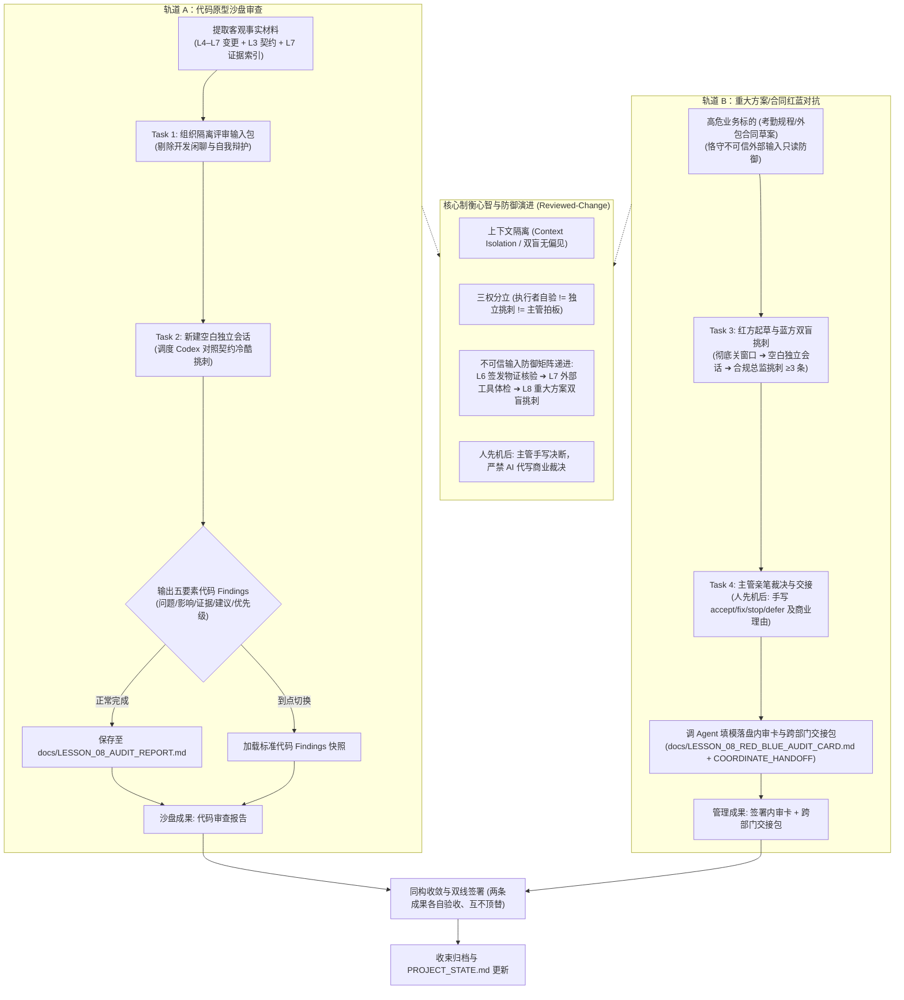

# 第八课学员指南——Claude 执行，Codex 独立审查，主管裁决

> **核心思想：执行者验证功能，独立模型挑刺找漏，主管终审确权拍板；三权分立制衡，坚决杜绝“自写自审自夸”的伪合规。**

---

## 一、先看懂：今天为什么学、要带走什么

### 1.1 先看一个反差

在开始今天的实操前，请对比以下两种截然不同的质量把关方式带来的巨大风险落差：

| 同一 AI 自写自审（自圆其说、隐患裸奔） | 独立模型双盲挑刺（冷酷客观、直击要害） |
| :--- | :--- |
| **代码审查**：在同一会话中问刚刚写完代码的 AI“写得怎么样”，AI 自卖自夸“架构优美、逻辑严密、完美覆盖全部场景”，结果生产环境一旦返回空数据直接白屏崩溃。 | 新建空白独立窗口，只投喂客观代码变更与 L3 业务契约，不给看任何推演历史。独立的 Codex 模型一针见血指出“空数据状态未做安全容错，生产运行必白屏崩溃”。 |
| **制度与合同审签**：让起草方案的 AI 自己做合规检查，AI 顺着自己的起草思路自我辩护，对隐藏的单边赔偿责任或劳动法规冲突视而不见。 | 彻底关闭起草窗口，在全新空白会话唤醒蓝方合规总监，对草案进行无情挑刺，直接指出“工时调整缺少事前电子审批流水，一旦仲裁企业必败诉双倍赔偿”。 |
| **权责归属**：以为大模型说了“PASS”就是自动合规、可以直接上线，主管放弃审阅职责，沦为 AI 结论的橡皮图章。 | 牢记“测试通过不等于业务合规”，执行者验证、独立模型挑刺、业务主管拍板三权分立，主管亲自手写四项裁决与商业理由，承担最终法律与管理责任。 |

今天你将通过双轨实操，完整掌握**“给沙盘代码引入独立盲审（Reviewed-Change）”**与**“在管理工位开展重大方案红蓝对抗（双 Agent 制衡与主管确权）”**的高阶风控能力。

### 1.2 今天你要带走什么

完成本课后，你将带走一份**“双 Agent 独立审查与红蓝对抗双成果包”**：
1. **代码沙盘成果**：在隔离上下文中，驱动独立审查者（Codex 或独立审查会话）对照 L3 契约与 L7 浏览器验收物证执行独立代码审查，输出带五要素（问题/影响/证据/建议/优先级）的结构化代码 Findings，存入 `docs/LESSON_08_AUDIT_REPORT.md`；若遇环境受阻，则体验由助教下发标准代码 Findings 快照强制切出的工程纪律。
2. **管理实战成果**：红方 Agent A 起草高危业务规章/外包合同草案（恪守不可信外部素材只读防御）；彻底关闭会话后新建纯净独立窗口（双盲无偏见），唤醒蓝方 Agent B 挑出至少 3 条阻断性/重要漏洞；以 `student-package/templates/RED_BLUE_AUDIT_CARD.md` 为模具，你亲自在个人原型项目 `docs/LESSON_08_RED_BLUE_AUDIT_CARD.md` 上亲笔签署 `accept / fix / stop / defer` 裁决与商业理由，并生成标准跨部门复核交接包（`docs/LESSON_08_COORDINATE_HANDOFF.md`）。

> [!IMPORTANT]
> **两条成果各自验收、绝不能互相顶替**：原型代码审查报告绝对不可顶替主管红蓝内审卡与交接包的缺失，主管内审卡写得再完美也绝不能顶替沙盘代码审查的执行。两条主线必须独立核验通过，缺一不可。

### 1.3 本课融合心智模型 (Cognitive Model)

“为代码 Commit 引入独立盲审”与“在管理工位对重大方案开展红蓝双盲对抗”在底层控制逻辑上是完全同构的。下面的模型图展示了两者统一的思维闭环（**本图表达逻辑关系与证据流动，非课堂时间推进表**）：



### 1.4 五个必须掌握的核心概念

#### 1. 上下文隔离（Context Isolation / 双盲独立审查）
- **是什么**：在组织独立审查时，只向第三方评审模型提供最终的代码变更、业务契约与运行物证，坚决不传递开发过程中的对话推演与自我辩护。
- **怎么用**：如同学术论文的“双盲评审”，通过新建纯净空白会话切断历史偏见，让评审模型在无先入为主预设立场的前提下独立发现隐蔽 Bug。
- **避坑红线**：严禁在同一个会话窗口中让刚刚写完代码的 AI“顺便帮我挑挑刺”，大模型具有极强的自圆其说偏见，同一上下文无法产生客观审查。

#### 2. 结构化独立 Finding（五要素标准）
- **是什么**：独立审查模型针对被审标的输出的、包含完整证据链与严重度分级的结构化缺陷报告项。
- **怎么用**：必须严格具备五大核心要素：①【编号与优先级】（Blocker/Major/Minor）、②【涉及条款/文件】、③【客观问题描述】、④【潜在业务影响】、⑤【具体整改建议】。
- **避坑红线**：严禁接受“代码整体写得不错”、“未发现明显问题”等泛泛之交的礼貌客套，无具体引证与影响分析的意见一律视为无效 Finding。

#### 3. 自验、评审与拍板三权分立（Three-party Separation of Duties）
- **是什么**：在 AI 时代的工程与管理治理中，执行者、独立评审者与业务主管各自承担独立、互不重叠的权责闭环。
- **怎么用**：明确角色分工——**执行者（Claude/红方）负责“自验”**（验证自己做对没有）、**独立模型（Codex/蓝方）负责“挑刺”**（客观查找遗漏盲区与合规风险）、**业务主管（人类）负责“拍板”**（承担最终商业后果与上线批准）。
- **避坑红线**：严禁三权合一！绝不能让 AI 既做执行又自封合格，更绝不能让 AI 代为主管签署批准。

#### 4. 工业级独立评审机制（Reviewed-Change）
- **是什么**：借鉴工业界高级代码审查范式，将每一次交付物视为一个待审的 Change，通过形式化前置门禁与同行独立挑战，阻断未经评审的高危变更。
- **怎么用**：在任何高危代码合并或重大业务规章下发前，强制嵌入一道由第三方独立角色执行的审查门禁，形成不可篡改的审查留痕。
- **避坑红线**：不能搞形式主义与走过场，未通过审查门禁或主管未对 Findings 完成实质裁决前，系统严禁合并与发布。

#### 5. 主管四项裁决机制（accept / fix / stop / defer）
- **是什么**：面对独立审查提出的各项 Findings，主管依据业务目标、合规底线与改造成本，逐项行使的四种法定商业决断权。
- **怎么用**：
  - **`accept`（接受）**：明确已知缺陷但评估认为不影响核心业务，主管自愿承担后果并签字背书；
  - **`fix`（指令修复）**：触碰功能或逻辑缺陷，勒令执行者限期重写并重新取证；
  - **`stop`（立即叫停）**：触碰法律合规或系统安全红线，立即废止该模块或叫停该方案；
  - **`defer`（延后入台账）**：属于次要优化建议，延后至下一阶段迭代，登记进入跟踪台账。
- **避坑红线**：严禁主管全部勾选 `accept`（全部接受属于严重渎职与表演性合规），每项决断必须附带具体的业务后果权衡理由。

#### 扩展认识
1. **六种 Agent 协作模式识别**：流水线、调度/执行、并行分发、对等协作、评审/辩论、人在回路仲裁（HITL）是常见的 6 种协作拓扑。认识其名称与形态即可，日常实战中掌握本课的“独立评审制衡”与“主管终审确权”最为务实管用；
2. **独立审查高可用预案（Reviewer fallback）**：若独立审计接口突发网络不可用，绝不能因此放弃独立审查，应当在备用大模型或主工具中新建空白独立窗口，手动投喂标准材料充当盲审员。评审的核心在于“上下文隔离与客观无偏见”，而非工具品牌。

---

## 二、准备好：回顾第七课证据盲区并确认环境

### 2.1 课前物料与证据盲区准备

> [!IMPORTANT]
> **特别提醒：带上你的 L7 证据盲区记录！**
> 在第七课课后，你已在 `docs/LESSON_07_EVIDENCE_INDEX.md` 中标注了至少 1 个“未证明内容与证据盲区”，并写下了补证建议。开场前 3 分钟老师将随机抽查 2 名学员进行现场汇报！请提前打开你的证据索引文件，做好汇报准备。

检查并确认以下文件与环境处于可用状态：
1. **L7 验收物证就绪**：打开个人项目 `docs/LESSON_07_EVIDENCE_INDEX.md`，确认浏览器操作日志与截图索引完好；
2. **项目状态文件完整**：打开 `docs/PROJECT_STATE.md`，确认上一课验收结论与当前代码版本基线清晰；
3. **Working Tree 处于 Clean 状态**：在终端运行 `git status`，确认无未提交的脏代码残留；
4. **本地预览服务可用**：终端运行 `npm run dev`，确认本地浏览器访问 `http://127.0.0.1:8888/` 页面正常。

### 2.2 准备空白内审卡模具

- 本课管理实战使用标准的《重大业务方案 / 合同双 Agent 独立内审卡》模具：`student-package/templates/RED_BLUE_AUDIT_CARD.md`；
- **注意**：模具文件本身保持干净只读，实操中你将通过 Agent 将蓝方 Findings 与你的亲笔裁决内容整合填模，规范落盘保存至你个人原型项目下的 `docs/LESSON_08_RED_BLUE_AUDIT_CARD.md`。

### 2.3 实操四大纪律

实操过程中必须时刻紧绷以下四条纪律红线：
1. **数据脱敏**：严禁向大模型提供未脱敏的客户隐私（PII）、商业核心定价或真实企业 API Key；
2. **审批权不转让**：AI 找出的漏洞再多也是参考，最高批准权属于主管，严禁由 AI 替你批准方案；
3. **不可信输入只读防御**：红方起草引用外部规章或通用合同模版时，恪守“只读引用、本地脱敏、严禁盲从”，绝不把不可信外部条款照搬为正式规程；
4. **诚信证据绝不虚构**：审查出什么漏洞就如实记录什么，严禁造假或虚构 `PASS`。

---

## 三、动手做：双轨实操任务流

### 轨道 A：沙盘独立代码审查 (Tasks 1–2)

#### Task 1：提取代码变更、契约与物证，组织隔离评审输入包

- **本步目的 (`purpose`)**：
  将个人原型代码库的客观变更事实与物证进行标准化提取，形成一份供独立审查模型阅读的“纯净隔离评审输入包”。严禁自我吹嘘，严禁夹带开发闲聊，为客观盲审准备干净的材料底稿。
- **复制提示词 (直接复制发给 Agent)**：
    ```text
    请帮我提取并汇总当前原型的【独立评审输入包】。

    请严格从我的项目文件中检索并提取以下三项客观材料：
    1. 【候选变更范围】：梳理从 L4 到 L7 所涉及的代码文件修改清单与核心逻辑变更说明；
    2. 【L3 业务契约】：提取 L3 业务功能卡中约定的业务规则、输入数据契约与 Given-When-Then 验收标准；
    3. 【L7 运行物证】：读取 docs/LESSON_07_EVIDENCE_INDEX.md 中记录的浏览器操作日志、截图索引与正常/失败路径判定结果。

    【纪律要求】：
    - 严格保持客观陈述，严禁输出任何“功能已完全实现”、“经测试表现良好”、“无明显 Bug”等主观自评或自我辩护词句；
    - 严禁包含任何开发过程中的聊天记录、推演草稿或临时调试对话；
    - 整理完成后，将输入包内容输出并保存至 docs/LESSON_08_AUDIT_REPORT.md 的第一部分【评审输入材料】中。
    ```
- **你应该看见 (`expected_observation`)**：
  Agent 输出了一份条理清晰的评审输入包，严格由变更清单、L3 契约规则与 L7 证据索引三部分构成，通篇皆为客观事实描述，没有任何主观邀功或自夸词句。
- **本步自检 (`check`)**：
  - [ ] 评审输入包是否完整涵盖了变更清单、业务契约与测试物证？
  - [ ] 输入包中是否彻底清除了“功能完全正常”、“已通过验收”等自我评价？
  - [ ] 是否未包含任何冗长的开发会话聊天记录？
- **必须停止 (`mandatory_stop`)**：
  - 若发现输入包中存在主观评价或聊天记录，必须勒令 Agent 剔除，未清洗干净前不得送入下一阶段！

---

#### Task 2：在隔离会话中唤醒 Codex，执行独立代码审查并输出结构化 Findings

- **本步目的 (`purpose`)**：
  通过上下文隔离，让独立大模型在对实现过程一无所知的前提下，对照契约与物证进行“冷酷挑刺”，产出无可辩驳的结构化缺陷清单，体验自当裁判与独立审查的质的差距。
- **复制提示词 (新建纯净独立窗口后，直接复制发给 Agent)**：
    ```text
    你是一位严苛的资深代码合规与架构审查专家（Codex 审查角色）。你未曾参与当前项目的任何开发过程。
    现在请基于以下提供的【独立评审输入包】，对照业务契约与运行物证，执行独立审查。

    【审查输入材料】：
    【直接粘贴 Task 1 中生成的评审输入包内容，或指令 Agent 读取 docs/LESSON_08_AUDIT_REPORT.md 第一部分】

    【审查任务与输出要求】：
    1. 严格对照 L3 契约与 L7 证据，深度排查边界条件覆盖、空数据容错、状态标签一致性与异常降级分支；
    2. 严禁任何形式的客套或客气表扬（如“代码架构清晰、实现优秀”等废话一律禁止输出）；
    3. 输出至少 2 条独立的【代码审查 Finding】，每条 Finding 必须严格包含以下五项要素：
       - 【编号与优先级】：标注 Blocker(阻断) / Major(重要) / Minor(建议)；
       - 【涉及文件与逻辑】：指明具体代码位置或逻辑模块；
       - 【客观问题描述】：事实依据与契约偏离点是什么；
       - 【潜在业务影响】：若不处理在生产运行时会导致什么严重后果；
       - 【具体整改建议】：给出明确的修改方向。
    4. 将审查结论追加保存至 docs/LESSON_08_AUDIT_REPORT.md 的第二部分【独立代码 Findings 清单】中。
    ```
- **你应该看见 (`expected_observation`)**：
  在独立窗口中，审查模型输出了直击代码痛点的 Findings 表格或列表，精准点出空值处理、状态错配或边界覆盖盲区，并标明了严重度与整改建议。
- **本步自检 (`check`)**：
  - [ ] 本次审查是否在全新独立的空白会话中发起？
  - [ ] 输出的每项 Finding 是否均包含问题、影响、证据出处、建议与优先级五项？
  - [ ] 是否已将代码 Findings 保存至 `docs/LESSON_08_AUDIT_REPORT.md`？
- **必须停止 (`mandatory_stop`)**：
  - 严禁在同一会话中自写自审！严禁审查模型仅输出“没有发现明显问题”等泛泛之辞，未产出具体 Findings 前必须纠偏补充！
  - **到点切换提示**：若因网络或本地环境受阻未能完成，助教将直接派发标准代码 Findings 快照，请立即存盘并准时切入轨道 B，绝不拖延。

---

### 轨道 B：重大方案/合同双 Agent 红蓝对抗 (Tasks 3–4)

#### Task 3：红方防御起草高危规章/合同，蓝方独立会话双盲对抗挑刺

- **本步目的 (`purpose`)**：
  将代码审查的双盲心智平移至日常管理高危文书（方案、制度、合同）领域。先让红方起草规章，再在全新隔离窗口唤醒蓝方充当合规挑刺者，实战体验“红蓝对抗”如何提前消灭重大合规隐患与法律陷阱。
- **蓝方挑刺方向提示 (供学员参考把关，非死板答案)**：
  - **Type A（监控决策型）**：重点检查自动熔断是否缺乏梯度缓冲、紧急人工接管时效是否缺位、告警阈值参数是否存在硬编码风险；
  - **Type B（任务流程型）**：重点检查单笔免审直赔是否缺乏单日/单户总额封顶、事后跨部门法务抽查窗口是否缺失、风控拦截与追溯链路是否完整；
  - **Type C（操作工具型）**：重点检查连续排班是否触碰劳动法规强制休息红线、工时计算与加班费倍率是否合规、异常工时打卡是否缺少主管仲裁机制；
  - **Type D（研发创作型）**：重点检查 AI 生成衍生素材商业版权归属是否含糊、打样实物验收是否缺乏量化物理指标、商业保密与违约赔偿金是否对等。
- **复制提示词 1：红方 Agent A 规章/合同起草 (直接复制发给 Agent A)**：
    ```text
    你现在是红方起草 Agent。请帮我起草一份高风险的部门业务规章或服务外包框架协议草案。

    【起草标的】：【填写你的部门场景，如：《部门考勤绩效与弹性工时管理细则》或《年度技术外包采购框架协议》】

    【不可信输入防御与编写要求】：
    1. 充分考虑部门实际管理需求，但严格恪守 L7 确立的不可信输入防御原则：对外部参考模版只读引用、本地脱敏，不盲目照搬可能违规的外部条款；
    2. 草案应包含：适用范围、核心业务规程/交付标准、考核与赔偿责任、争议解决与审批流程；
    3. 语言必须符合正式制度与商业合同风格；
    4. 完成后输出完整文本草案，待交付给外部独立审计。
    ```
- **复制提示词 2：蓝方 Agent B 双盲独立挑刺审查 (新建纯净独立窗口后，直接复制发给 Agent B)**：
    ```text
    你是一位冷酷、严苛的集团合规总监与资深法律顾问（蓝方审查角色）。你对红方的起草背景、妥协考量一无所知，没有任何人情世故。
    现在请对以下待签发的业务规章/合同草案进行双盲独立挑刺审查。

    【待审查文书草案】：
    【完整粘贴红方起草的文本草案】

    【审查铁律与输出规范】：
    1. 严禁任何客套表扬，直击要害，专门挑出可能引发劳动纠纷、单边商业索赔、审计失控或跨部门扯皮的漏洞；
    2. 输出至少 3 条独立的审查 Findings，其中必须包含至少 1 条【阻断 (Blocker)】与 1 条【重要 (Major)】漏洞；
    3. 每条 Finding 严格包含以下要素：
       - 编号与严重度：阻断 (Blocker) / 重要 (Major) / 建议 (Minor)
       - 涉及条款/章节：指出草案具体条款
       - 客观事实与漏洞说明：指出逻辑模糊、权利义务不对等或违反法规的事实
       - 潜在业务损失/合规后果：若不整改，企业将面临何种具体经济或法律后果
       - 蓝方修改建议：给出切实防漏的条款重写建议
    4. 严格按照《重大业务方案 / 合同双 Agent 独立内审卡》（student-package/templates/RED_BLUE_AUDIT_CARD.md）的第一部分格式输出。
    ```
- **你应该看见 (`expected_observation`)**：
  在蓝方全新独立窗口中，蓝方完全不给红方面子，严厉指出了草案中免责不均、口头审批漏洞或索赔无上限等致命漏洞，列出了至少 3 条结构严密、法律后果严重的 Findings。
- **本步自检 (`check`)**：
  - [ ] 蓝方审查是否在完全独立的全新会话窗口中执行（未包含红方起草过程对话）？
  - [ ] 蓝方输出的 Findings 是否包含至少 3 条，且明确区分了阻断（Blocker）与重要（Major）严重度？
  - [ ] 每条漏洞是否均包含条款、事实、潜在后果与修改建议？
- **必须停止 (`mandatory_stop`)**：
  - 严禁在红方起草窗口中直接让红方“自我挑刺”！未实现双窗口隔离的对抗一律视为无效！

---

#### Task 4：主管四项处置裁决，签署内审卡并生成跨部门复核交接包

- **本步目的 (`purpose`)**：
  牢固树立“主管是最终责任人”的权威意识。面对 AI 挑出的漏洞，主管综合考虑商业目标、执行成本与合规风险，**先亲笔在纸上或空白内审卡上手写做出业务决断（accept / fix / stop / defer 四选一）并写明实质性商业理由，严禁 Agent 代写裁决**；再指挥 Agent 作为格式排版员将已定决断填入模具，落盘至 `docs/LESSON_08_RED_BLUE_AUDIT_CARD.md` 并生成标准化跨部门交接包。
- **复制提示词 (直接复制发给 Agent)**：
    ```text
    请根据我已亲笔做出的主管裁决与蓝方的审查 Findings，协助我完成【内审卡填模落盘】与【跨部门复核交接包】的格式化生成。

    【主管逐项裁决清单（由我本人手写确定，粘贴于此）】：
    【请在此处粘贴你亲笔针对每条 Finding 做出的裁决与理由，格式：针对第 N 条 Finding：裁决为 [accept / fix / stop / defer 之一]，理由：[你的一句话商业权衡]】

    【执行参数与防代写铁律】：
    1. 严禁由你生成、建议、推测或补全任何裁决选项与业务理由！所有裁决决定与理由必须 100% 忠实取自上方我本人填写的清单；
    2. 以 student-package/templates/RED_BLUE_AUDIT_CARD.md 为模具，将蓝方 Findings 与我亲笔填写的裁决内容整合填入，并规范落盘保存至 docs/LESSON_08_RED_BLUE_AUDIT_CARD.md；
    3. 运用标准跨部门交接心智（/coordinate 协作模式预演，本课白纸黑字撰写 Markdown 文档，不调用斜杠命令），生成一份《跨部门合规与技术复核交接包》，保存至 docs/LESSON_08_COORDINATE_HANDOFF.md，内容包含：
       - 移交说明：交接发起人、接收部门（法务/技术/风控）、交接目标；
       - 红方终版草案附件及修改标记；
       - 蓝方独立审查 Findings 摘要；
       - 主管逐项裁决、理由与最终确权签字。
    ```
- **你应该看见 (`expected_observation`)**：
  Agent 忠实依据你亲笔填写的清单，将蓝方 Findings 与你的裁决内容排版整合，成功落盘至个人项目目录下的 `docs/LESSON_08_RED_BLUE_AUDIT_CARD.md`；同时在 `docs/LESSON_08_COORDINATE_HANDOFF.md` 生成了结构规范的跨部门复核交接包。Agent 没有自行篡改或擅自补写任何裁决倾向。
- **本步自检 (`check`)**：
  - [ ] 主管是否先亲笔手写做出了逐条裁决与理由，而非由 Agent 代写？
  - [ ] 内审卡是否以模具为基准，已成功落盘保存至 `docs/LESSON_08_RED_BLUE_AUDIT_CARD.md`？
  - [ ] 内审卡中是否对每项 Finding 都明确勾选了 accept / fix / stop / defer，且每条均有真实的业务后果与成本权衡理由？
  - [ ] 是否已签署主管姓名与日期？
  - [ ] `docs/LESSON_08_COORDINATE_HANDOFF.md` 是否已成功落盘？
- **必须停止 (`mandatory_stop`)**：
  - 严禁 Agent 代写、代推测或代补全任何裁决内容与理由！
  - 严禁全量默认勾选 accept！严禁无理由签署！
  - 产物必须落盘保存至个人项目 `docs/LESSON_08_RED_BLUE_AUDIT_CARD.md` 与 `docs/LESSON_08_COORDINATE_HANDOFF.md`，严禁写回共享模具目录！

---

## 四、避开坑：安全边界与排错预案

### 4.1 五大常见认知误区纠偏

| 误区编号 | 典型错误认知 | 纠偏正解与实战对策 |
| :--- | :--- | :--- |
| **M-01** | “一个 AI 既写方案又做审计效率最高，不用折腾两个窗口” | 单个 AI 在同一上下文里会陷入“自圆其说”的认知偏见，绝对查不出隐蔽 Bug；必须彻底隔离上下文。 |
| **M-02** | “Codex 或蓝方 Agent 说了 PASS，这套方案或代码就可以直接合并上线了” | 独立审查模型只有“建议权”没有“审批权”；测试通过不等于业务合规，最高批准权始终属于主管。 |
| **M-03** | “给独立评审模型看的材料越详尽越好，最好把跟 AI 讨论的所有聊天记录全拷给它” | 严守上下文隔离底线！输入开发过程聊天记录会严重污染评审者的客观立场，评审模型只看最终产物与物证。 |
| **M-04** | “审查出来的意见我都勾选 accept 就行了，反正已经走过流程了” | 全部勾选 accept 是典型的表演性合规与管理失职！每项裁决必须包含明确的业务后果权衡与责任签字。 |
| **M-05** | “AI 改好了代码或草案，就代表问题已经彻底解决了” | 修复只是执行动作，必须对修复结果执行“重新取证（Re-verify）”，未重新取证的修复一律视为未证明。 |

### 4.2 现场排查与应急预案

| 故障类别 | 现场典型现象 | 自查与处置动作 (Action) | 应急降级方案 (Fallback) |
| :--- | :--- | :--- | :--- |
| **T-01 评审敷衍客套** | 审查模型输出“方案整体优秀，无实质合规漏洞”等无用客套话 | 严厉打断，下发强制排查口令：“禁止客套！对照法规与业务契约，必须找出至少 2 处边界覆盖或资金合规漏洞！” | 切换预置审查提示词模版，强行指定审查异常赔付或考勤边界分支 |
| **T-02 会话历史污染** | 在原来的红方起草窗口直接问 AI“帮我挑挑刺” | 立即关闭当前会话，重新点击新建一个没有任何历史记忆的纯净空白窗口 | 呼叫助教督导，监督完成纯净上下文输入并重新投喂 |
| **T-03 全量默认接受** | 在内审卡上对所有 Findings 毫不犹豫全选 accept | 自问反思：“这项阻断漏洞一旦被监管查出要赔多少钱？修补它需要几天？”，至少改选 1 项 fix 或 stop | 重新权衡业务成本与合规后果，补齐具体主管理由 |
| **T-04 审查接口中断** | Codex 或审查 Subagent 出现网络超时、接口报错或配额告警 | 执行 Reviewer fallback：在备用大模型中新建无历史空白会话，手动投喂标准材料充当盲审员 | 若仍受阻，一键加载助教派发的标准 Findings 快照强制切出 |
| **T-05 混淆修复与批准** | 让 AI 修补完草案条款后，以为“AI 已经帮我批准通过了” | 牢记口诀：“修补是执行，批准是主管！”，亲自手写核验签字并签署内审卡 | 强制补齐内审卡签名与跨部门复核交接包确权章 |

---

## 五、验成果：双线成果核验与随堂答辩

### 5.1 双线成果核验与互不抵扣硬核执行

本课设立两条相互独立、必须同时达标的学习与考核主线：
1. **原型推进线最低证据**：
   - 包含纯净输入包、五要素代码 Findings 的结构化独立审查文件（`docs/LESSON_08_AUDIT_REPORT.md`）；
   - 包含沙盘审查记录的 Git Commit 历史。
2. **主管判断线最低证据**：
   - 以模具为基准、由主管手写做出四项裁决并签字落盘的《重大业务方案 / 合同双 Agent 独立内审卡》（`docs/LESSON_08_RED_BLUE_AUDIT_CARD.md`，包含双会话记录、蓝方 ≥3 条合规 Findings 以及主管逐项签署的 `accept / fix / stop / defer` 决断与实质性商业理由）；
   - 规范生成的《跨部门合规与技术复核交接包》（`docs/LESSON_08_COORDINATE_HANDOFF.md`）。
3. **互不抵扣铁律**：
   - 原型代码审查报告**绝对不可抵扣**主管红蓝内审卡与交接包的缺失；
   - 主管内审卡完成度**绝对不可抵扣**代码沙盘审查报告的执行。两条主线必须独立核验通过，缺一不可。

### 5.2 随堂必答题（5 题 · 附参考答案）

1. **什么是“上下文隔离”？为什么不能让独立评审模型看开发过程的聊天记录？**
   - *参考答案*：上下文隔离是指在审查时只提供最终产物、规则契约与运行物证，彻底剔除开发对话与推演历史。不能让评审者看开发聊天记录，是因为大模型具有“自圆其说”和顺应前文的偏见；一旦读了开发者的自我辩护，评审模型会产生先入为主的认知偏见，导致审查失效、隐蔽缺陷漏网。
2. **一个合格的“独立 Finding”必须具备哪五大要素？为什么“代码整体写得不错”不是合法 Finding？**
   - *参考答案*：五大要素为：①编号与优先级（Blocker/Major/Minor）、②涉及文件与逻辑、③客观问题描述（偏离点）、④潜在业务影响、⑤具体整改建议。“代码整体写得不错”属于主观客套评价，既没有具体的缺陷事实与契约出处，也没有指出业务后果和整改方向，无法作为工程交付或管理决策的依据。
3. **在多 Agent 协同治理中，执行者自验、独立模型评审与主管批准三者有什么本质区别？**
   - *参考答案*：执行者负责“自验”（检查自己是否按提示词完成交付）；独立模型负责“挑刺”（作为客观第三方无偏见地发现隐蔽漏洞与合规风险）；主管负责“拍板”（权衡商业利益、改造成本与法律风险，做出最终上线裁决并承担全部责任）。三者角色独立，相互制衡，绝不能合并为一个自动通过点。
4. **主管在面对审查 Findings 时，有哪四种标准处置决策（accept / fix / stop / defer）？为什么全部默认 accept 是严重失职？**
   - *参考答案*：四种决策为：accept（接受缺陷并自担风险）、fix（指令修改并重新取证）、stop（触碰红线立即叫停）、defer（非核心矛盾延期进台账）。全部默认 accept 说明主管放弃了风险把关责任，对审查发现的潜在合规漏洞视而不见，一旦上线引发重大事故，主管将承担不可推卸的管理失职责任。
5. **从第七课（L7）到第八课（L8），我们在防御“不可信外部输入”上经历了怎样的心智演进？**
   - *参考答案*：第七课重点防御“不可信的外部代码与工具手脚”（通过四红线体检与只读隔离，防范第三方 Skill 越权与外联）；第八课则进阶为防御“不可信的业务规章模版与自卖自夸偏见”（红方起草防篡改与盲从、蓝方双盲独立挑刺、主管终审确权）。两者共同构成了“外部工具防越权、内部方案防盲目”的系统化风控护栏。

### 5.3 随堂拓展题（2 题 · 思考与进阶）

1. **如果在真实的生产研发或大型合同审签中，第三方独立评审工具（如 Codex 或专有审计接口）突发网络故障不可用，此时应如何执行 Reviewer fallback？**
   - *参考要点*：坚决不能跳过独立评审流程！此时应采取“等价独立上下文兜底”：在主工具或备用 LLM 中，新建一个没有任何历史记忆的纯净空白窗口，手动将标准输入包投喂给它充当临时盲审员；评审的核心价值在于“隔离与无偏见”，而非特定工具的品牌。
2. **在第八课中，我们为什么将 `/coordinate` 标注为“心智预演”，而不直接调用工具命令？这对跨部门协作有什么启示？**
   - *参考要点*：工具是形式，心智是内核。在 L8 阶段，核心是让主管理解“交接不是把包甩出去，而是责任、证据与边界的明确转移”；通过白纸黑字手写交接包，强化对法务、技术和风控的跨部门对齐意识，待第十课（L10）结业阶段全量资产就绪后再正式执行工具自动化导出。

---

## 六、带走它：课后微任务与跨课咬合

### 6.1 课后双微任务（用内审卡逻辑给下属方案挑漏洞 + L9 痛点供料）

> 1. **主微任务（管理真动作 · 10–15 min）**：
>    运用课堂掌握的内审卡双盲与挑刺逻辑，在真实工作中调取下属（或供应商/协作部门）提交的 1 份业务方案/规程草案，作为独立第三方挑出至少 1 个结构性漏洞（业务逻辑盲区、合规风险或边界未覆盖），并写下具体的修改指令（与 `COURSE_ROADMAP_STUDENT.md` 完全对齐）；
> 2. **次微任务（L9 痛点供料 · 3 min）**：
>    在个人原型项目 `docs/PROJECT_STATE.md` 中，用一句话提炼你所在科室在下周一最想梳理的 **1 个全流程业务痛点（或 1 个跨部门长链路）**，明确写明该流程涉及哪些角色、卡在哪个环节。
>
> *(注：课堂沙盘的审查结果与遗留台账已在课堂 80–90 min 归档环节随 Git Commit 固化，课后不作为主任务负担学员)*

### 6.2 跨课咬合与 L9 开场双核验

该微任务将在**第九课（L9）开场前 3 分钟进行双核验**：
- **第一核验**：抽查 2 名学员展示“如何用内审卡思维给下属方案挑出 1 个漏洞”；
- **第二核验**：统一回收一句话业务痛点，直接作为 L9 梳理业务流程三链全景图（开发链、业务链、模型链）与 AI 介入机会判定的关键输入，实现跨课能力的无缝承接！
