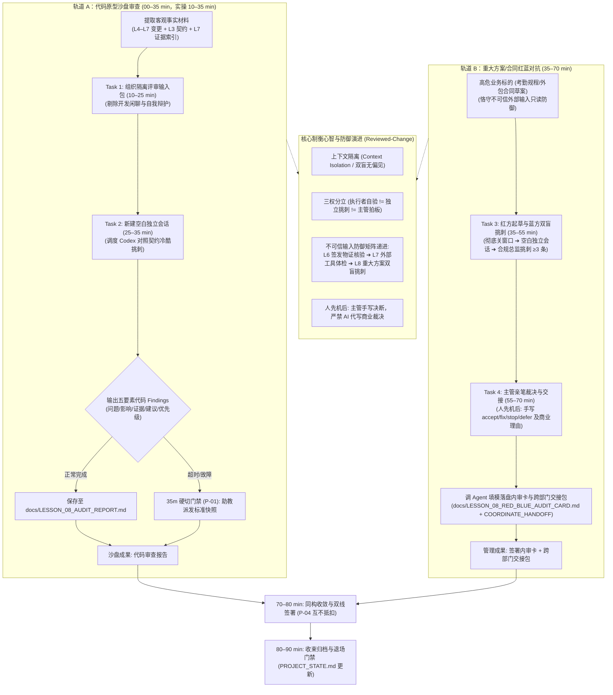

# 第八课教师教案——Claude 执行，Codex 独立审查，主管裁决

> **核心思想：执行者验证功能，独立模型挑刺找漏，主管终审确权拍板；三权分立制衡，坚决杜绝“自写自审自夸”的伪合规。**

---

## 一、课程元数据与定位

| 项目 | 本课设定与契约约束 |
| :--- | :--- |
| **课次名称** | 第八课《Claude 执行，Codex 独立审查，主管裁决》（双轨主题：独立审查与高危文档红蓝对抗 · Reviewed-Change 心智融合） |
| **权威依据** | 1. `lessons/TEN_LESSON_FROZEN_BASELINE.md` (§L8｜Claude 执行，Codex 独立评审，主管裁决)<br>2. `lessons/CURRICULUM_REBALANCING_AND_DUAL_TRACK_OPTIMIZATION_PROPOSAL.md` (v1.4.2 Approved Baseline · 2026-09-16, git tag `curriculum-v1.4.2`, §第 8 课：独立审查与高危文档红蓝对抗)<br>3. `lessons/COURSE_ROADMAP.md` (§第 8 课及总表第 225 行矩阵)<br>4. `lessons/COURSE_ROADMAP_STUDENT.md` (§第 8 课及每周成果汇总)<br>5. `GLOSSARY.md` (§三、接入、独立评审与产品决策交接) |
| **简报基线与批准追溯** | 1. 简报依据：`lessons/LESSON_08_DESIGN_BRIEF.md` (`contract_version: 2.1`, `candidate_version: 2.1.0`, `HANDOFF_READY`)<br>2. 独立评审记录：2026-09-16 第十九轮独立评审通过 (`HANDOFF_READY` 放行)<br>3. 课程所有者正式批准：2026-09-16 批准授权 PLAN 渲染 (Git Commit: `8ce416e`) |
| **学员画像** | 已完成 L1–L7，掌握数据契约、代码五层排错、浏览器自动化取证与外部技能体检能力的部门主管（非技术背景，AI 协作进阶学员） |
| **课时架构** | **90 分钟刚性上限**：严格执行 **35 + 35 + 10 + 10** 双轨工作坊结构（00–10 min 导入示范归入轨道 A 宏观时段） |
| **课堂主成果** | **双 Agent 独立审查与红蓝对抗双成果包**：<br>1. **代码沙盘成果**：在隔离上下文中，驱动独立审查者（Codex / 审计会话）对 Claude 生成的候选 Commit 与 L7 浏览器验收证据执行独立代码审查，输出带五要素的结构化代码 Findings，由主管签署处置意见并保存至 `docs/LESSON_08_AUDIT_REPORT.md`；<br>2. **管理实战成果**：红方 Agent A 起草高危业务规章/外包合同草案，严格恪守不可信外部素材只读防御；新建纯净独立会话（上下文隔离，双盲无偏见），唤醒蓝方 Agent B（合规总监角色）挑出至少 3 条阻断性/重要漏洞；以 `student-package/templates/RED_BLUE_AUDIT_CARD.md` 为模具，主管在个人原型项目 `docs/LESSON_08_RED_BLUE_AUDIT_CARD.md` 上亲笔签署 `accept / fix / stop / defer` 裁决与商业理由，并生成标准跨部门复核交接包（`docs/LESSON_08_COORDINATE_HANDOFF.md`）。 |
| **现场助教配比** | 1:15 线下或专属线上支持（3 分钟响应接管；负责预置 Codex 评审通道与 35 分钟硬切标准代码 Findings 快照派发） |
| **数据与安全边界** | 全程使用 Mock 数据与脱敏沙盘；严禁向独立审查模型投喂真实敏感机密、个人信息（PII）或生产 API Key；红方起草引用外部模版恪守只读隔离与本地脱敏 |

### 1.1 课次定位与双轨核心价值

本课是多 Agent 协同治理与质量门禁的成熟期核心节点，从单 Agent 内部排错（L6）与工具扩展（L7）跃升至**“多模型独立制衡与双盲对抗审查”**：
1. **沙盘工程能力跃迁（轨道 A）**：破除对 AI“自写自审自夸”的心理盲区，引入第三方独立大模型（Codex 或独立审查会话），只提供客观变更与运行物证（不给看推演历史与自我辩护），执行冷酷的工业级 Reviewed-Change 独立审查，产出结构化代码缺陷；
2. **管理工位红蓝对抗（轨道 B）**：将代码盲审心智平移至业务主管高频面对的高危管理文书（方案、制度、合同）。红方起草严守“不可信外部输入防御”，蓝方在全新空白窗口扮演合规总监进行双盲独立挑刺。主管牢牢握住最高批准权，先亲笔手写决断再指挥 Agent 填模落盘，完成标准跨部门交接；
3. **审查同构性与三权分立**：揭示“Codex 审查代码 Commit”与“蓝方 Agent 挑刺合同草案”在底层逻辑上的高度一致性——两者皆依赖**上下文隔离（双盲）**，坚守“执行者自验、独立模型挑刺、业务主管拍板”的三权分立铁律。

### 1.2 严肃声明“不做清单”（Non-goals）

教师在授课现场必须严格坚守以下非目标红线，绝不允许发生教学发散：
- **严禁让 AI 替人批准**：Codex 或蓝方 Agent 无论表现多么惊艳，都只是“挑刺的参谋”，绝不能代替业务主管行使业务批准与上线拍板权；
- **严禁搭建复杂多 Agent 拓扑**：本课仅实践“执行者与独立评审者隔离制衡”这一种最高频实用的双 Agent 协作模式，绝不要求学员编写调度代码或搭建 6 种协作网络；
- **严禁传输真实机密与未脱敏数据**：审查与对抗演练全程使用脱敏素材或虚构沙盘用例，严禁向评审模型提供未脱敏的商业机密、真实身份证号或生产 API Key；
- **严禁提前调用 `/coordinate` 斜杠命令**：本课仅进行跨部门交接与责任划分的“心智预演”，白纸黑字撰写 Markdown 文档；正式的 `/coordinate` 命令调用与打包交付严格锁定在第十课（L10）结业阶段；
- **严禁将自检自改冒充为独立评审**：在同一会话中让写草案的 AI 自己修改、自己说“已改好”，绝不能等同于独立评审，必须坚决杜绝此类表演性伪合规。

### 1.3 开场反差与信任链回环策略

开场 00–10 分钟内，教师**严禁平铺直叙念概念**，必须按以下节奏制造强烈教学反差：
1. **回环回收（前 3 分钟）**：开场抽查 2 名学员汇报 L7 课后微任务落实情况（在证据索引中找出并标注的证据盲区与补证建议），顺势串联信任节点链叙事：“上节课大家标出的证据盲区，正是系统上线前最脆弱的破绽。今天我们把版本、契约与盲区物证交给互不知情的独立审查者，看看‘自写自审’到底掩盖了多少重大隐患！”
2. **反差演示（后 7 分钟）**：
   - **反差 A（自写自审自夸路线）**：主管在同一个开发窗口问写代码的 AI：“我这套表单验证与异常分支写得如何？”AI 热情回答：“逻辑严谨、架构优雅，已完美覆盖全部场景！”主管以为高枕无忧；
   - **反差 B（双盲独立审查路线）**：教师新建一个空白独立窗口，只投喂代码变更与 L3 数据契约，不给任何聊天推演。独立的 Codex 模型一针见血指出：“空数据状态未做安全容错，生产运行必白屏崩溃；工时调整缺少事前流水，违反劳动法举证规约！”
   - **反差提炼**：“没有隔离的审查全是表演！今天这节课，我们用制度和机制砸碎 AI 自卖自夸的皇帝新衣！”

---

## 二、逆向目标、证据与核心概念

### 2.1 目标—活动—证据对齐图

| 学习目标 | 对应课堂活动 | 验收硬证据 | 主管裁决动作 |
| :--- | :--- | :--- | :--- |
| **1. 组织隔离评审输入包** | Task 1 (沙盘输入组织) | `docs/LESSON_08_AUDIT_REPORT.md` 中的客观评审输入包段落 | 审查输入是否仅含契约、变更与物证，坚决剔除自评与闲聊 |
| **2. 独立会话代码盲审** | Task 2 (Codex 代码审查) | `docs/LESSON_08_AUDIT_REPORT.md` 中带五要素的结构化代码 Findings | 审阅缺陷客观性与影响严重度，确认是否符合契约规范 |
| **3. 红蓝双盲方案挑刺** | Task 3 (合同规程对抗) | 双窗口隔离记录 + 蓝方输出的 ≥3 条带严重度的合规 Findings | 验证双窗口隔离真实性，审查漏洞是否切中业务合规要害 |
| **4. 主管亲笔裁决与交接** | Task 4 & 70–80 收敛 (裁决交接) | 手写裁决签字的 `docs/LESSON_08_RED_BLUE_AUDIT_CARD.md` + `docs/LESSON_08_COORDINATE_HANDOFF.md` | 主管逐项手写 `accept/fix/stop/defer` 与商业理由，签署确权 |

### 2.2 课程融合心智模型 (Method Loop + Evidence Chain)

该模型揭示了“沙盘独立代码审查”与“管理高危文档红蓝对抗”在底层认知逻辑上的完全同构性。**该图表达逻辑拓扑与证据流动，非课堂时间推进表**：



### 2.3 核心概念清单（共 5 个，三段实战化 + 交接价值）

所有概念严格按「是什么 / 怎么用 / 避坑红线 / 交接价值」四部分交付：

#### 概念 1：上下文隔离（Context Isolation / 双盲独立审查）

1. **是什么**：在组织独立审查时，只向第三方评审模型提供最终的代码变更、业务契约与运行物证，坚决不传递开发过程中的对话推演与自我辩护；
2. **怎么用**：如同学术论文的“双盲评审”，通过新建纯净空白会话切断历史偏见，让评审模型在无先入为主预设立场的前提下独立发现隐蔽 Bug；
3. **避坑红线**：严禁在同一个会话窗口中让刚刚写完代码的 AI“顺便帮我挑挑刺”，大模型具有极强的自圆其说偏见，同一上下文无法产生客观审查；
4. **交接价值**：直接指导 Task 1（输入包只提取客观材料）与 Task 3（必须彻底关闭红方窗口，开启全新空白窗口唤醒蓝方）。

#### 概念 2：结构化独立 Finding（五要素标准）

1. **是什么**：独立审查模型针对被审标的输出的、包含完整证据链与严重度分级的结构化缺陷报告项；
2. **怎么用**：必须严格具备五大核心要素：①【编号与优先级】（Blocker/Major/Minor）、②【涉及条款/文件】、③【客观问题描述】、④【潜在业务影响】、⑤【具体整改建议】；
3. **避坑红线**：严禁接受“代码整体写得不错”、“未发现明显问题”等泛泛之交的礼貌客套，无具体引证与影响分析的意见一律视为无效 Finding；
4. **交接价值**：直接作为 Task 2 代码审查与 Task 3 蓝方合规审查的硬性输出标准，是主管进行实质性裁决的唯一事实依据。

#### 概念 3：自验、评审与拍板三权分立（Three-party Separation of Duties）

1. **是什么**：在 AI 时代的工程与管理治理中，执行者、独立评审者与业务主管各自承担独立、互不重叠的权责闭环；
2. **怎么用**：明确角色分工——**执行者（Claude/红方）负责“自验”**（验证自己做对没有）、**独立模型（Codex/蓝方）负责“挑刺”**（客观查找遗漏盲区与合规风险）、**业务主管（人类）负责“拍板”**（承担最终商业后果与上线批准）；
3. **避坑红线**：严禁三权合一！绝不能让 AI 既做执行又自封合格，更绝不能让 AI 代为主管签署批准；
4. **交接价值**：贯穿整课教学主线，是 70–80 min 同构收敛与内审卡确权的核心理论基石。

#### 概念 4：工业级独立评审机制（Reviewed-Change）

1. **是什么**：借鉴工业界高级代码审查范式，将每一次交付物视为一个待审的 Change，通过形式化前置门禁与同行独立挑战，阻断未经评审的高危变更；
2. **怎么用**：在任何高危代码合并或重大业务规章下发前，强制嵌入一道由第三方独立角色执行的审查门禁，形成不可篡改的审查留痕；
3. **避坑红线**：不能搞形式主义与走过场，未通过审查门禁或主管未对 Findings 完成实质裁决前，系统严禁合并与发布；
4. **交接价值**：连接软件工程防线与企业日常风控，为业务主管提供制度化的 AI 交付防御手脚。

#### 概念 5：主管四项裁决机制（accept / fix / stop / defer）

1. **是什么**：面对独立审查提出的各项 Findings，主管依据业务目标、合规底线与改造成本，逐项行使的四种法定商业决断权；
2. **怎么用**：
   - **`accept`（接受）**：明确已知缺陷但评估认为不影响核心业务，主管自愿承担后果并签字背书；
   - **`fix`（指令修复）**：触碰功能或逻辑缺陷，勒令执行者限期重写并重新取证；
   - **`stop`（立即叫停）**：触碰法律合规或系统安全红线，立即废止该模块或叫停该方案；
   - **`defer`（延后入台账）**：属于次要优化建议，延后至下一阶段迭代，登记进入跟踪台账；
3. **避坑红线**：严禁主管全部勾选 `accept`（全部接受属于严重渎职与表演性合规），每项决断必须附带具体的业务后果权衡理由；
4. **交接价值**：直接指导 Task 4 与 70–80 min 收敛环节，是《内审卡》上主管唯一不可转让的法定证据。

### 2.4 扩展认识概念（2 个）

1. **六种 Agent 协作模式识别（认识级）**：流水线、调度/执行、并行分发、对等协作、评审/辩论、人在回路仲裁（HITL）是常见的 6 种拓扑。教师用 2 分钟展示全景对比图，明确告知学员：“本课采用的是最具实战价值的‘独立评审制衡’与‘HITL 终审’模式，掌握核心制衡逻辑远比搭建复杂网络重要，切勿盲目追求 Agent 数量。”
2. **独立审查高可用预案（Reviewer fallback · 认识级）**：在真实企业环境中，若独立审计接口或 Codex 突发网络不可用，绝不能因此放弃独立审查。主管应当在备用大模型或主工具中新建无历史记忆的纯净窗口，手动投喂标准材料充当盲审员。评审的核心在于“上下文隔离与客观无偏见”，而非工具品牌。

---

## 三、教学准备与安全边界

### 3.1 课前预检清单

开课前，主讲教师与助教必须完成以下 8 项检查，确保实训环境 100% 就绪：
1. **L7 验收成果就绪**：学员原型项目中已存在 `docs/LESSON_07_EVIDENCE_INDEX.md` 与截图目录，且已完成课后证据盲区标注；
2. **项目状态文件完整**：`docs/PROJECT_STATE.md` 记录了上一课的验收结论与当前代码版本状态；
3. **独立评审通道畅通**：Codex 评审指令或用于双盲盲审的独立会话入口已在浏览器/工具中配置完毕，学员随时可一键新建；
4. **代码工作区处于 Clean 状态**：教师示范机与学员项目在开课前执行 `git status`，确认无未提交的脏代码残留；
5. **本地服务启动顺畅**：运行 `npm run dev`，确认 `http://127.0.0.1:8888/` 页面可正常访问渲染；
6. **标准模具完好且只读**：`student-package/templates/RED_BLUE_AUDIT_CARD.md` 与 `student-package/templates/CLAUDE.md` 存放于模具目录，内容完好，严禁学员直接修改模具；
7. **硬切快照预置就绪**：助教电脑中已准备好针对 4 类原型的《标准代码 Findings 快照》，确保第 35 分钟一到能瞬间下发；
8. **教师侧标准答案隔离备查**：教师已熟读四类原型蓝方合规挑刺要点（见 §3.3），用于巡视现场精准对账。

### 3.2 实操前只讲四条红线

实操开始前，教师用 1 分钟向全场严正宣读四条高压红线：
1. **脱敏红线**：严禁向评审模型提供未经脱敏的真实客户个人信息（PII）、企业商业机密定价或真实生产 API Key；
2. **审批权不转让红线**：大模型挑刺再厉害也是参谋，最高批准权始终属于人类主管，严禁让 AI 替你签字批准；
3. **不可信输入只读防御红线**：红方起草引用外部模版或供应商草案时，恪守“只读引用、本地脱敏、严禁盲从”，绝不把外部不可信条款直接当作正式制度发布；
4. **诚信证据绝不虚构红线**：实际审查出什么 Finding 就如实填入内审卡，严禁虚构通过状态或伪造审查记录。

### 3.3 教师侧标准答案隔离与巡视对账表

> [!CAUTION]
> **`[教师巡视专用标准答案 · 隔离标记]`**
> 本表所列为四类业务原型的预置合规挑刺标准答案。**此内容仅供教师在 Task 3 巡视与答疑时快速核对学员蓝方输出，属于标准答案库。渲染学员指南（GUIDE）时严禁整体带出，学员视角只能保留“挑刺方向提示”级别的语言！**

| 原型类别 | 业务标的名称 | [教师巡视专用标准答案 · 隔离标记] 蓝方标准挑刺漏洞清单 |
| :--- | :--- | :--- |
| **Type A（监控决策型）** | 《实时经营监控与自动熔断停机实施细则草案》 | 1. **阻断级 (Blocker)**：熔断机制缺乏梯度缓冲，一旦触发指标异常直接全量停机，将引发大面积业务瘫痪；<br>2. **重要级 (Major)**：未设置人工紧急介入与接管的时效要求，系统告警后存在责任真空期；<br>3. **建议级 (Minor)**：告警阈值参数硬编码在制度中，缺少动态容错与按季度调整机制。 |
| **Type B（任务流程型）** | 《跨部门客户退换货免审极速直赔管理规程草案》 | 1. **阻断级 (Blocker)**：单笔免审直赔未设单日与单户累计总额封顶，存在被恶意刷单套现的巨大资金风险；<br>2. **重要级 (Major)**：缺少跨部门法务与风控的事后抽查复核窗口，责任追溯链路不完整；<br>3. **建议级 (Minor)**：未建立黑名单用户自动拦截与交叉核验机制。 |
| **Type C（操作工具型）** | 《仓库智能排班与超时加班工时结算规程草案》 | 1. **阻断级 (Blocker)**：法定节假日连班缺少强制防疲劳硬性阻断，违反《劳动法》关于休息权的强制性规定，面临行政处罚；<br>2. **重要级 (Major)**：加班费结算倍率与地方最新法规标准冲突，存在单边败诉仲裁风险；<br>3. **建议级 (Minor)**：异常工时调整未设置科室主管人工仲裁流程，全凭算法自动核算。 |
| **Type D（研发创作型）** | 《第三方设计工作室企划打样外包服务框架协议草案》 | 1. **阻断级 (Blocker)**：AI 生成衍生设计素材的商业知识产权归属含糊不清，企业面临知识产权被侵权或反向索赔风险；<br>2. **重要级 (Major)**：打样验收标准缺乏物理量化指标，仅以“风格符合”等主观描述为主，易引发付款违约纠纷；<br>3. **建议级 (Minor)**：保密责任与违约赔偿金条款不对等，未能切实约束外包工作室的泄密行为。 |

---

## 四、90 分钟控场主线

### 4.1 刚性时间预算与里程碑

必须刚性锁定 **35 + 35 + 10 + 10 = 90 分钟** 双轨工作坊结构，严禁前松后紧：

| 时间 | 宏观阶段与任务划分 | 教师动作 | 学员动作 | 阶段产出物证 |
| :--- | :--- | :--- | :--- | :--- |
| **00–10 min** | **开场回环、痛点唤醒与模型建立** | 1. **开场前 3 分钟抽查 2 名学员汇报 L7 微任务（证据盲区与补证建议）**；<br>2. 顺势点拨信任链回环，演示“自写自审自夸 vs 双盲独立审查”的反差；<br>3. 讲解 5 大核心概念与不可信防御矩阵演进。 | 汇报证据盲区思考；观察认知冲突；掌握上下文隔离与三权分立原理。 | 破除自评迷信；确立双盲审查认知。 |
| **10–25 min** | **Task 1 (Track A)：组织隔离评审输入包** | 示范提取代码变更、L3 契约与 L7 证据索引；强调只留客观事实，剔除开发闲聊与自评词句。 | 组织纯净输入材料，保存至 `docs/LESSON_08_AUDIT_REPORT.md` 第一部分。 | 纯净客观的隔离评审输入包（无自夸、无闲聊）。 |
| **25–35 min** | **Task 2 (Track A)：Codex 独立代码审查** | 示范新建空白会话调度 Codex 执行审查，强调不留情面；巡视输出是否包含五要素 Findings。 | 新建纯净会话投喂输入包，驱动审查模型挑出 ≥2 条代码 Findings，存入报告第二部分。 | 带五要素的代码审查 Findings 清单。 |
| **第 35 min** | **P-01 轨道 A 硬切门禁** | **敲桌宣布第 35 分钟门禁到！**未跑通或卡顿学员，助教立即下发标准代码 Findings 快照并存盘，全员准时切出！ | 受阻学员一键加载快照，准时切入轨道 B，绝不拖延一秒。 | 沙盘代码审查报告保底落地。 |
| **35–55 min** | **Task 3 (Track B)：红方起草与蓝方双盲挑刺** | 示范红方起草（恪守不可信输入只读防御）；**示范彻底关掉窗口，新建空白会话唤醒蓝方合规总监严厉挑刺**。 | 红方起草草案；关闭会话；新建空白窗口唤醒蓝方，挑出 ≥3 条带严重度合规 Findings。 | 双窗口隔离记录；蓝方输出的 ≥3 条合规漏洞。 |
| **55–70 min** | **Task 4 (Track B)：主管亲笔裁决与交接包** | **示范“人先机后”：主管先在纸上亲笔写下四项裁决与理由**；示范调 Agent 填模落盘与生成交接包。 | 通读意见，手写裁决与理由；调 Agent 填入内审卡落盘，生成跨部门交接包。 | 填模落盘的 `RED_BLUE_AUDIT_CARD.md` 与交接包。 |
| **70–80 min** | **同构收敛、三权分立与内审卡签署** | 点拨代码审查与合同对抗同构性，确立三权分立铁律；指导主管在内审卡上正式签字确权。 | 签署《重大业务方案/合同双 Agent 独立内审卡》；完成双线成果汇聚。 | 正式签署的主管红蓝内审卡。 |
| **80–90 min** | **收束归档、双线验收与退场门禁** | 指导 Git Commit 存档；更新 `PROJECT_STATE.md` 独立审查处置台账；抽查随堂必答题。 | 执行提交；更新状态台账；完成 5 道测试题并接受退场验收。 | Git 提交历史；更新的台账；随堂答题记录。 |

### 4.2 第 35 分钟硬切门禁 (P-01) 细则

- **门禁触发条件**：时钟走到第 35 分钟整；
- **执行纪律**：不管学员的代码沙盘审查是否跑出结果，主讲教师立刻叫停 Track A 操作；
- **降级动作**：助教针对学员的原型类别（A/B/C/D），将预置的标准代码 Findings 报告内容拷贝给学员，指令其直接存入 `docs/LESSON_08_AUDIT_REPORT.md` 并标记 `[FALLBACK_SNAPSHOT]`；
- **核心目的**：坚决捍卫轨道 B（管理实战）的 35 分钟黄金实操时间，绝不让沙盘排错挤占主管风控决策的训练空间。

### 4.3 控场压缩与延展次序

- **若前段拖堂需压缩**：优先压缩 10–25 min 的教师示范时间与 70–80 min 的发散讨论；**绝对禁止压缩 Task 3 蓝方双盲挑刺时间与 Task 4 主管亲笔手写裁决时间**；
- **若学有余力可延展**：引导学员深入探究 2 道拓展题（Reviewer fallback 机制与 `/coordinate` 跨部门交接心智），或在蓝方挑刺中追加“针对第三方合规审计的反向质证”演练。

---

## 五、逐 Task 示范、口令、巡视与降级

### Task 1 (Track A, 10–25 min)：提取代码变更、契约与物证，组织隔离评审输入包

- **教师示范 (`demonstration`)**：
  - 教师投屏演示：从个人项目中调出 L4–L7 的文件变更清单、L3 的业务契约规则以及 L7 的浏览器验收证据索引（`docs/LESSON_07_EVIDENCE_INDEX.md`）；
  - 展示如何将这三部分客观材料组装为一个“纯净隔离评审输入包”；
  - 重点示范**“无情删除自我辩护”**：如果文本中包含“功能运行完美”、“经过全面测试无 Bug”等主观判断，当场全部手动删掉，仅保留冰冷的事实与数据。
- **教师口令 (`cue`)**：“整理你的隔离评审输入包！必须恰好包含变更清单、L3 契约规则与 L7 浏览器验收证据；严禁夹带任何自我邀功或自夸词句，严禁包含开发聊天记录，整理完毕后存入 docs/LESSON_08_AUDIT_REPORT.md 第一部分！”
- **巡视判断 (`patrol_judgment`)**：
  - 学员的评审输入包是否恰好包含变更、契约、证据三要素；
  - 输入包中是否彻底剔除了“已完美通过”等自卖自夸言论；
  - 是否清空了冗长的开发会话历史，输入材料是否纯净可读。
- **失败降级 (`failure_fallback`)**：
  - 若学员缺少 L3 契约或 L7 证据，指导其从模具备份中快速调取关键片段补齐；
  - 若发现学员带入了聊天记录或自评，教师立刻敲桌勒令学员手动删减。
- **学员复制提示词 (直接复制发给 Agent)**：
    ```text
    请帮我提取并汇总当前原型的【独立评审输入包】。

    请严格从我的项目文件中检索并提取以下三项客观材料：
    1. 【候选变更范围】：梳理从 L4 到 L7 所涉及的代码文件修改清单与核心逻辑变更说明；
    2. 【L3 业务契约】：提取 L3 业务功能卡中约定的业务规则、输入数据契约与 Given-When-Then 验收标准；
    3. 【L7 运行物证】：读取 docs/LESSON_07_EVIDENCE_INDEX.md 中记录的浏览器操作日志、截图索引与正常/失败路径判定结果。

    【纪律要求】：
    - 严格保持客观陈述，严禁输出任何“功能已完全实现”、“经测试表现良好”、“无明显 Bug”等主观自评或自我辩护词句；
    - 严禁包含任何开发过程中的聊天记录、推演草稿或临时调试对话；
    - 整理完成后，将输入包内容输出并保存至 docs/LESSON_08_AUDIT_REPORT.md 的第一部分【评审输入材料】中。
    ```

---

### Task 2 (Track A, 25–35 min)：在隔离会话中唤醒 Codex，执行独立代码审查并输出结构化 Findings

- **教师示范 (`demonstration`)**：
  - 演示新建一个空白独立会话窗口（或使用独立的 Codex 审查指令通道），将 Task 1 沉淀的纯净输入包发送给审查模型；
  - 展示审查模型如何以严苛的“第三方代码法官”视角进行审查，输出带五要素的代码 Findings：
    - *示例 Finding*：“空数据状态下标签未渲染——严重度：重要（Major）；违反契约：L3 数据契约第 4 条空数据展示兜底规则；影响：生产环境下若接口返回空列表，页面可能出现白屏或排版塌陷；修改建议：在组件中增加 `v-if="list.length"` 兜底空状态插槽。”
- **教师口令 (`cue`)**：“新建独立空白会话，把纯净输入包投喂给 Codex。命令它扮演第三方代码审查员，绝不客套，挑出至少 2 项结构化 Findings，指明出处与建议！”
- **巡视判断 (`patrol_judgment`)**：
  - 学员是否在**全新的独立会话窗口**中执行审查，而非直接在开发窗口续问；
  - 输出的 Findings 是否逐项具备“问题描述、业务影响、证据引证、修改建议与优先级”五要素；
  - 是否有学员误以为 AI 挑出刺就是自己做失败了（及时纠正：“独立找刺是工程最高护栏”）。
- **失败降级 (`failure_fallback`)**：
  - 若审查模型输出泛泛而谈的“代码写得很好”，强制使用纠偏指令追问：“不要客套！对照 L3 契约，找出至少 2 处边界条件未覆盖或空值处理缺陷！”；
  - **第 35 分钟硬切门禁 (P-01)**：若学员因网络或本地环境未跑通审查，助教立即下发对应原型的预置《标准代码 Findings 报告快照》，命令学员立即存盘，准时切入轨道 B！
- **学员复制提示词 (新建纯净独立窗口后，直接复制发给 Agent)**：
    ```text
    你是一位严苛的资深代码合规与架构审查专家（Codex 审查角色）。你未曾参与当前项目的任何开发过程。
    现在请基于以下提供的【独立评审输入包】，对照业务契约与运行物证，执行独立审查。

    【审查输入材料】：
    【直接粘贴 Task 1 中生成的评审输入包内容，或指令 Agent 读取 docs/LESSON_08_AUDIT_REPORT.md 第一部分】

    【审查任务与输出要求】：
    1. 严格对照 L3 契约与 L7 证据，深度排查边界条件覆盖、空数据容错、状态标签一致性与异常降级分支；
    2. 严禁任何形式的客套或客气表扬（如“代码架构清晰、实现优秀”等废话一律禁止输出）；
    3. 输出至少 2 条独立的【代码审查 Finding】，每条 Finding 必须严格包含以下五项要素：
       - 【编号与优先级】：标注 Blocker(阻断) / Major(重要) / Minor(建议)；
       - 【涉及文件与逻辑】：指明具体代码位置或逻辑模块；
       - 【客观问题描述】：事实依据与契约偏离点是什么；
       - 【潜在业务影响】：若不处理在生产运行时会导致什么严重后果；
       - 【具体整改建议】：给出明确的修改方向。
    4. 将审查结论追加保存至 docs/LESSON_08_AUDIT_REPORT.md 的第二部分【独立代码 Findings 清单】中。
    ```

---

### Task 3 (Track B, 35–55 min)：红方防御起草高危规章/合同，蓝方独立会话双盲对抗挑刺

- **教师示范 (`demonstration`)**：
  - **示范红方起草与不可信输入防御**：以高危规章（如《部门考勤绩效与弹性工时管理细则》）为例，展示红方起草过程。顺势呼应 L7“不可信外部输入防御”心智：“红方参考外部通用模板起草时，严格遵循只读与本地脱敏，不盲从模板的模糊霸王条款”；
  - **示范蓝方双盲对抗**：**彻底关掉红方窗口，打开一个全新的纯净窗口**，向蓝方 Agent B 下达“集团合规法务总监”人格，投喂红方草案，下达挑刺指令；
  - 演示蓝方如何挑出致命漏洞：“第 3.2 条‘因工作需要主管可口头调整考勤并于次月补录’——严重度：阻断（Blocker）；法律合规后果：违反《劳动合同法》关于工时与加班事实的举证责任规约，一旦发生劳动仲裁企业将面临单边败诉并被判双倍赔偿；整改建议：坚决废除口头调整，必须在系统内保留事前电子审批流水。”
- **教师口令 (`cue`)**：“红方 Agent 起草一份部门待发布的规章或外包合同草案；随后**立刻关掉会话，开启全新独立窗口**，唤醒蓝方合规总监！命令蓝方不要留情面，挑出至少 3 条阻断性与重要漏洞，直接写入内审卡第一部分！”
- **巡视判断 (`patrol_judgment`)**：
  - 学员是否真正做到了**双窗口上下文隔离**（蓝方窗口绝对不能看到红方的起草思考过程）；
  - 蓝方挑出的漏洞是否切中要害（对照 §3.3 标准答案库，核对学员是否抓住了熔断缓冲、免审封顶、工时法规或版权归属等核心矛盾）；
  - 学员是否将 Findings 规范填入《重大业务方案 / 合同双 Agent 独立内审卡》（以 `student-package/templates/RED_BLUE_AUDIT_CARD.md` 为模具，准备落盘至 `docs/LESSON_08_RED_BLUE_AUDIT_CARD.md`）。
- **失败降级 (`failure_fallback`)**：
  - 若学员不知道起草什么，提供预置标的备选：①《部门考勤绩效管理细则》；②《第三方外包劳务服务采购协议》；③《跨部门退换货与赔付免审直通规程》；
  - 若蓝方审查太客气，教员下发口令打断：“蓝方你现在是外部审计合规总监，如果被集团审计查出漏洞你要被问责！立刻挑出 3 条阻断漏洞！”
- **学员复制提示词 1：红方 Agent A 规章/合同起草 (直接复制发给 Agent A)**：
    ```text
    你现在是红方起草 Agent。请帮我起草一份高风险的部门业务规章或服务外包框架协议草案。

    【起草标的】：【填写你的部门场景，如：《部门考勤绩效与弹性工时管理细则》或《年度技术外包采购框架协议》】

    【不可信输入防御与编写要求】：
    1. 充分考虑部门实际管理需求，但严格恪守 L7 确立的不可信输入防御原则：对外部参考模版只读引用、本地脱敏，不盲目照搬可能违规的外部条款；
    2. 草案应包含：适用范围、核心业务规程/交付标准、考核与赔偿责任、争议解决与审批流程；
    3. 语言必须符合正式制度与商业合同风格；
    4. 完成后输出完整文本草案，待交付给外部独立审计。
    ```
- **学员复制提示词 2：蓝方 Agent B 双盲独立挑刺审查 (新建纯净独立窗口后，直接复制发给 Agent B)**：
    ```text
    你是一位冷酷、严苛的集团合规总监与资深法律顾问（蓝方审查角色）。你对红方的起草背景、妥协考量一无所知，没有任何人情世故。
    现在请对以下待签发的业务规章/合同草案进行双盲独立挑刺审查。

    【待审查文书草案】：
    【完整粘贴红方起草的文本草案】

    【审查铁律与输出规范】：
    1. 严禁任何客套表扬，直击要害，专门挑出可能引发劳动纠纷、单边商业索赔、审计失控或跨部门扯皮的漏洞；
    2. 输出至少 3 条独立的审查 Findings，其中必须包含至少 1 条【阻断 (Blocker)】与 1 条【重要 (Major)】漏洞；
    3. 每条 Finding 严格包含以下要素：
       - 编号与严重度：阻断 (Blocker) / 重要 (Major) / 建议 (Minor)
       - 涉及条款/章节：指出草案具体条款
       - 客观事实与漏洞说明：指出逻辑模糊、权利义务不对等或违反法规的事实
       - 潜在业务损失/合规后果：若不整改，企业将面临何种具体经济或法律后果
       - 蓝方修改建议：给出切实防漏的条款重写建议
    4. 严格按照《重大业务方案 / 合同双 Agent 独立内审卡》（student-package/templates/RED_BLUE_AUDIT_CARD.md）的第一部分格式输出。
    ```

---

### Task 4 (Track B, 55–70 min)：主管四项处置裁决，签署内审卡并生成跨部门复核交接包

- **教师示范 (`demonstration`)**：
  - **人先机后，示范主管亲笔裁决**：教师强调“面对蓝方 Findings，主管必须先在纸上或空白内审卡上手写做出处置决断与商业理由，严禁让 Agent 替你写裁决！Agent 无法替你承担法律责任！”；
  - 展示主管手写裁决示范动作：
    - Finding 1（阻断级：工时口头补录）：手写裁决为 `fix`（指令红方重写该条款为强制事前线上打卡，并重新取证）；
    - Finding 2（重要级：违约金计算滞纳期模糊）：手写裁决为 `accept`（主管理由：本项目属于内部科室试点协同，不存在对外付款违约金结算场景，修改成本高于收益，由主管签字背书）；
    - Finding 3（建议级：缺少年终复盘条款）：手写裁决为 `defer`（主管理由：留待次年管理制度大修时统一纳入台账）；
  - **示范调 Agent 填模落盘与跨部门交接**：手写完成后，再把主管亲笔裁决清单发给 Agent，指令其严格按照主管决断填入模具并落盘至 `docs/LESSON_08_RED_BLUE_AUDIT_CARD.md`，同时生成标准的跨部门交接包（`docs/LESSON_08_COORDINATE_HANDOFF.md`，心智预演，锁定 L10 正式调用）。
- **教师口令 (`cue`)**：“主管不能当甩手掌柜！先通读蓝方意见，亲笔手写对每条 Finding 的 accept / fix / stop / defer 决定与商业理由；严禁全部 accept，严禁让 Agent 替你做决定！写好后再调 Agent 将你的亲笔裁决与蓝方 Findings 填入模具，落盘至 docs/LESSON_08_RED_BLUE_AUDIT_CARD.md，并生成跨部门复核交接包 docs/LESSON_08_COORDINATE_HANDOFF.md！”
- **巡视判断 (`patrol_judgment`)**：
  - 学员是否真正做到了“人先机后”（先手写做出裁决与理由，而非由 Agent 自动生成）；
  - 学员是否逐条签署了裁决，且每条均写有具体的业务后果与成本权衡理由（绝非“问题不大”）；
  - 是否有学员全部勾选 accept（敲桌纠偏：“全部接受等于没有审查！”）；
  - 内审卡是否落盘至 `docs/LESSON_08_RED_BLUE_AUDIT_CARD.md`（而非篡改共享模具），跨部门交接包是否完整落盘至 `docs/LESSON_08_COORDINATE_HANDOFF.md`。
- **失败降级 (`failure_fallback`)**：
  - 若学员让 Agent 代写了裁决理由，勒令清屏重来，必须由学员口述或手写后方可录入；
  - 若学员理由写得太抽象，追问：“这个漏洞一旦爆发，你们部门要赔多少钱？修补它需要几天？把这个权衡写进理由里！”；
  - 若学员不会写交接包，指导使用标准模板结构。
- **学员复制提示词 (直接复制发给 Agent)**：
    ```text
    请根据我已亲笔做出的主管裁决与蓝方的审查 Findings，协助我完成【内审卡填模落盘】与【跨部门复核交接包】的格式化生成。

    【主管逐项裁决清单（由我本人手写确定，粘贴于此）】：
    【请在此处粘贴你亲笔针对每条 Finding 做出的裁决与理由，格式：针对第 N 条 Finding：裁决为 [accept / fix / stop / defer 之一]，理由：[你的一句话商业权衡]】

    【执行参数与防代写铁律】：
    1. 严禁由你生成、建议、推测或补全任何裁决选项与业务理由！所有裁决决定与理由必须 100% 忠实取自上方我本人填写的清单；
    2. 以 student-package/templates/RED_BLUE_AUDIT_CARD.md 为模具，将蓝方 Findings 与我亲笔填写的裁决内容整合填入，并规范落盘保存至 docs/LESSON_08_RED_BLUE_AUDIT_CARD.md；
    3. 运用标准跨部门交接心智（/coordinate 协作模式预演，本课白纸黑字撰写 Markdown 文档，不调用斜杠命令），生成一份《跨部门合规与技术复核交接包》，保存至 docs/LESSON_08_COORDINATE_HANDOFF.md，内容包含：
       - 移交说明：交接发起人、接收部门（法务/技术/风控）、交接目标；
       - 红方终版草案附件及修改标记；
       - 蓝方独立审查 Findings 摘要；
       - 主管逐项裁决、理由与最终确权签字。
    ```

---

## 六、现场 Debug 与降级预案

### 6.1 现场 5 类故障排查与对策表

| 故障类别 | 现场典型现象 | 教师处置动作 (Action) | 降级预案 (Fallback) |
| :--- | :--- | :--- | :--- |
| **T-01 评审敷衍客套** | 审查模型输出“方案整体优秀，无实质合规漏洞”等无用客套话 | 严厉打断，下发强制排查口令：“禁止客套！对照法规与业务契约，必须找出至少 2 处边界覆盖或资金合规漏洞！” | 切换预置审查提示词模版，强行指定审查异常赔付或考勤边界分支 |
| **T-02 会话历史污染** | 学员在原来的红方起草窗口直接问 AI“帮我挑挑刺” | 立即喝止，指令学员关闭当前会话，重新点击新建一个没有任何历史记忆的纯净空白窗口 | 助教上门督导，监督其完成纯净上下文输入并重新投喂 |
| **T-03 全量默认接受** | 学员在内审卡上对所有 Findings 毫不犹豫全选 accept | 教师敲桌提问：“这项阻断漏洞一旦被监管查出要赔多少钱？修补它需要几天？”，要求至少改选 1 项 fix 或 stop | 退回内审卡，指导其重新权衡业务成本与合规后果并补写理由 |
| **T-04 审查接口中断** | Codex 或审查 Subagent 出现网络超时、接口报错或配额告警 | 执行 Reviewer fallback：指导学员在备用大模型中新建无历史空白会话，手动投喂标准材料充当盲审员 | **第 35 分钟一律执行硬切门禁**，助教下发标准 Findings 快照强制切出 |
| **T-05 混淆修复与批准** | 学员让 AI 修补完草案条款后，声称“AI 已经帮我批准通过了” | 纠正错误认知：“修补是执行，批准是主管！”，要求主管亲自手写核验签字 | 强制补齐内审卡签名与跨部门复核交接包确权章 |

### 6.2 5 项常见认知误区纠偏表

| 误区编号 | 典型错误认知 | 纠偏正解与实战对策 |
| :--- | :--- | :--- |
| **M-01** | “一个 AI 既写方案又做审计效率最高，不用折腾两个窗口” | 单个 AI 在同一上下文里会陷入“自圆其说”的认知偏见，绝对查不出隐蔽 Bug；必须彻底隔离上下文。 |
| **M-02** | “Codex 或蓝方 Agent 说了 PASS，这套方案或代码就可以直接合并上线了” | 独立审查模型只有“建议权”没有“审批权”；测试通过不等于业务合规，最高批准权始终属于主管。 |
| **M-03** | “给独立评审模型看的材料越详尽越好，最好把跟 AI 讨论的所有聊天记录全拷给它” | 严守上下文隔离底线！输入开发过程聊天记录会严重污染评审者的客观立场，评审模型只看最终产物与物证。 |
| **M-04** | “审查出来的意见我都勾选 accept 就行了，反正已经走过流程了” | 全部勾选 accept 是典型的表演性合规与管理失职！每项裁决必须包含明确的业务后果权衡与责任签字。 |
| **M-05** | “AI 改好了代码或草案，就代表问题已经彻底解决了” | 修复只是执行动作，必须对修复结果执行“重新取证（Re-verify）”，未重新取证的修复一律视为未证明。 |

---

## 七、随堂测试、通过标准与课后任务

### 7.1 双线最低证据契约与 P-04 互不抵扣判定标准

本课设立两条相互独立、必须同时达标的学习与考核主线：
1. **原型推进线最低证据**：
   - 包含纯净输入包、五要素代码 Findings 的结构化独立审查文件（`docs/LESSON_08_AUDIT_REPORT.md`）；
   - 包含沙盘审查记录的 Git Commit 历史。
2. **主管判断线最低证据**：
   - 以模具为基准、由主管手写做出四项裁决并签字落盘的《重大业务方案 / 合同双 Agent 独立内审卡》（`docs/LESSON_08_RED_BLUE_AUDIT_CARD.md`，包含双会话记录、蓝方 ≥3 条合规 Findings 以及主管逐项签署的 `accept / fix / stop / defer` 决断与实质性商业理由）；
   - 规范生成的《跨部门合规与技术复核交接包》（`docs/LESSON_08_COORDINATE_HANDOFF.md`）。
3. **P-04 互不抵扣铁律**：
   - 原型代码审查报告**绝对不可抵扣**主管红蓝内审卡与交接包的缺失；
   - 主管内审卡完成度**绝对不可抵扣**代码沙盘审查报告的执行。两条主线必须独立核验通过，缺一不可。

### 7.2 随堂必答题（5 题 · 附参考答案与出题时机）

1. **什么是“上下文隔离”？为什么不能让独立评审模型看开发过程的聊天记录？**
   - *出题时机*：Task 1 / Task 2 之间。
   - *参考答案*：上下文隔离是指在审查时只提供最终产物、规则契约与运行物证，彻底剔除开发对话与推演历史。不能让评审者看开发聊天记录，是因为大模型具有“自圆其说”和顺应前文的偏见；一旦读了开发者的自我辩护，评审模型会产生先入为主的认知偏见，导致审查失效、隐蔽缺陷漏网。
2. **一个合格的“独立 Finding”必须具备哪五大要素？为什么“代码整体写得不错”不是合法 Finding？**
   - *出题时机*：Task 2 完成后。
   - *参考答案*：五大要素为：①编号与优先级（Blocker/Major/Minor）、②涉及文件与逻辑、③客观问题描述（偏离点）、④潜在业务影响、⑤具体整改建议。“代码整体写得不错”属于主观客套评价，既没有具体的缺陷事实与契约出处，也没有指出业务后果和整改方向，无法作为工程交付或管理决策的依据。
3. **在多 Agent 协同治理中，执行者自验、独立模型评审与主管批准三者有什么本质区别？**
   - *出题时机*：Task 3 完成后。
   - *参考答案*：执行者负责“自验”（检查自己是否按提示词完成交付）；独立模型负责“挑刺”（作为客观第三方无偏见地发现隐蔽漏洞与合规风险）；主管负责“拍板”（权衡商业利益、改造成本与法律风险，做出最终上线裁决并承担全部责任）。三者角色独立，相互制衡，绝不能合并为一个自动通过点。
4. **主管在面对审查 Findings 时，有哪四种标准处置决策（accept / fix / stop / defer）？为什么全部默认 accept 是严重失职？**
   - *出题时机*：Task 4 完成后。
   - *参考答案*：四种决策为：accept（接受缺陷并自担风险）、fix（指令修改并重新取证）、stop（触碰红线立即叫停）、defer（非核心矛盾延期进台账）。全部默认 accept 说明主管放弃了风险把关责任，对审查发现的潜在合规漏洞视而不见，一旦上线引发重大事故，主管将承担不可推卸的管理失职责任。
5. **从第七课（L7）到第八课（L8），我们在防御“不可信外部输入”上经历了怎样的心智演进？**
   - *出题时机*：70–80 min 同构收敛时。
   - *参考答案*：第七课重点防御“不可信的外部代码与工具手脚”（通过四红线体检与只读隔离，防范第三方 Skill 越权与外联）；第八课则进阶为防御“不可信的业务规章模版与自卖自夸偏见”（红方起草防篡改与盲从、蓝方双盲独立挑刺、主管终审确权）。两者共同构成了“外部工具防越权、内部方案防盲目”的系统化风控护栏。

### 7.3 随堂拓展题（2 题 · 选做）

1. **如果在真实的生产研发或大型合同审签中，第三方独立评审工具（如 Codex 或专有审计接口）突发网络故障不可用，此时应如何执行 Reviewer fallback？**
   - *参考要点*：坚决不能跳过独立评审流程！此时应采取“等价独立上下文兜底”：在主工具或备用 LLM 中，新建一个没有任何历史记忆的纯净空白窗口，手动将标准输入包投喂给它充当临时盲审员；评审的核心价值在于“隔离与无偏见”，而非特定工具的品牌。
2. **在第八课中，我们为什么将 `/coordinate` 标注为“心智预演”，而不直接调用工具命令？这对跨部门协作有什么启示？**
   - *参考要点*：工具是形式，心智是内核。在 L8 阶段，核心是让主管理解“交接不是把包甩出去，而是责任、证据与边界的明确转移”；通过白纸黑字手写交接包，强化对法务、技术和风控的跨部门对齐意识，待第十课（L10）结业阶段全量资产就绪后再正式执行工具自动化导出。

### 7.4 课后微任务设计 (`between_lesson_task`)

- **微任务内容 (10–15 min)**：
  > 1. **主微任务（管理真动作）**：运用课堂掌握的内审卡双盲与挑刺逻辑，在真实工作中调取下属（或供应商/协作部门）提交的 1 份业务方案/规程草案，作为独立第三方挑出至少 1 个结构性漏洞（业务逻辑盲区、合规风险或边界未覆盖），并写下具体的修改指令（10–15 min，与 `COURSE_ROADMAP_STUDENT.md` 完全对齐）；
  > 2. **次微任务（L9 痛点供料）**：在个人原型项目 `docs/PROJECT_STATE.md` 中，用一句话提炼你所在科室在下周一最想梳理的 **1 个全流程业务痛点（或 1 个跨部门长链路）**，明确写明该流程涉及哪些角色、卡在哪个环节（3 min）。
  > *(注：课堂沙盘的审查结果与遗留台账已在 80–90 min 归档环节随 Git Commit 固化，课后不作为主任务负担学员)*
- **闭环与检验机制**：
  该微任务将在**第九课（L9）开场前 3 分钟进行抽查核对**：先抽查 2 名学员展示“如何用内审卡思维给下属方案挑出 1 个漏洞”，再统一回收一句话业务痛点，直接作为 L9 梳理业务流程三链全景图（开发链、业务链、模型链）与 AI 介入机会判定的关键输入，实现跨课能力的无缝承接。

---

## 八、教师备课质量自测 Checklist

- [ ] **开场信任链回环落实**：开场 00–10 min 首行已安排 3 分钟抽查 L7 微任务证据盲区，已准备好自写自审自夸与独立盲审的反差案例。
- [ ] **双轨时间算术与硬切锁定**：严格落实 35+35+10+10 预算，第 35 分钟 P-01 硬切门禁准备完毕，助教已备好 4 类原型标准 Findings 快照。
- [ ] **五大核心概念四件套完备**：上下文隔离、独立 Finding、三权分立、Reviewed-Change、主管裁决均按四件套结构展开并与真实 Task 强绑定。
- [ ] **教师侧标准答案隔离就绪**：§3.3 与 Task 3 巡视判断已标注 `[教师巡视专用标准答案 · 隔离标记]`，明确严禁在学员指南中泄露标准答案。
- [ ] **防代写人先机后示范落地**：Task 4 教师示范明确主管先亲笔手写裁决与商业理由，提示词 Block 5 采用纯格式防代写模版且与简报逐字一致。
- [ ] **落盘文件路径严格规范**：区分只读模具（`student-package/templates/RED_BLUE_AUDIT_CARD.md`）与学员落盘路径（`docs/LESSON_08_RED_BLUE_AUDIT_CARD.md`），交接包落盘至 `docs/LESSON_08_COORDINATE_HANDOFF.md`。
- [ ] **双线最低证据与 P-04 互不抵扣**：代码审查报告与主管红蓝内审卡/交接包独立考核，严禁相互抵扣。
- [ ] **零占位符与安全红线守死**：全文无 TODO/TBD/省略号占位符，严肃声明非目标，明确禁止提前调用 `/coordinate` 斜杠命令。
