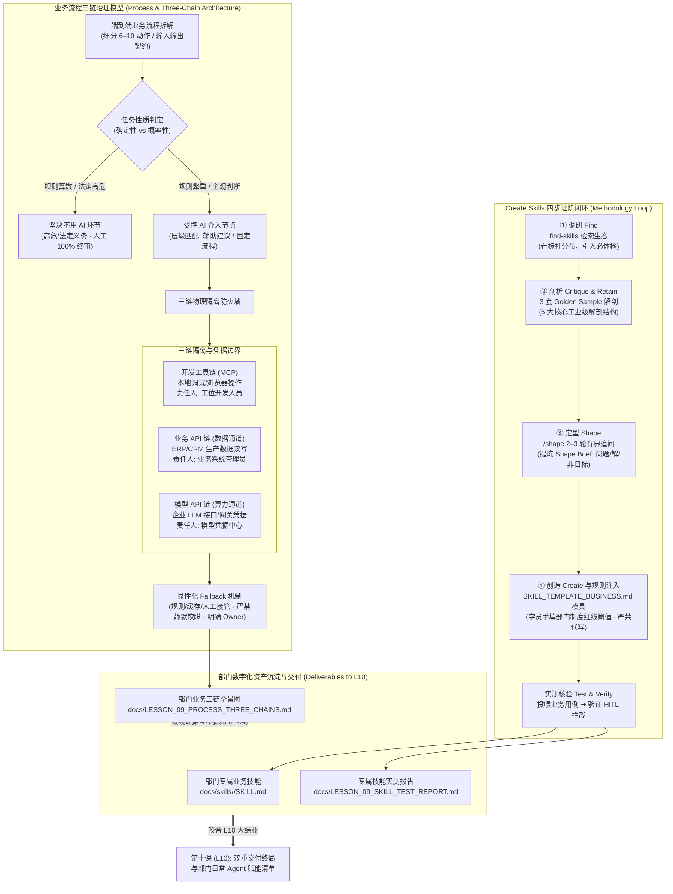

# 第九课课程设计简报 (Lesson Design Brief)

<!-- candidate_version: 2.1.0 双轨架构改造：Track A 业务流程三链全景梳理 (Tasks 1–2) + Track B Create Skills 标杆解剖、/shape 定型与业务规则注入 (Tasks 3–4) · 深度落实工位技能沉淀与防代写铁律 -->

`contract_version: 2.1`

---

## 1. 课程元数据与权威依据 (Metadata and Authority)

| 字段 | 设定值 | 契约约束说明 |
| :--- | :--- | :--- |
| `lesson_number` | 9 | 对应第 9 课《画出部门 AI 机会与 Agent 范式选型图》（双轨主题：部门 AI 机会全景与 Create Skills 标杆解剖、`/shape` 定型与规则注入） |
| `course_context` | 目标学员为具备业务管理经验的部门主管（非技术背景/AI 进阶应用），已连续完成 L1–L8，掌握了数据契约、代码五层排错、浏览器自动化取证、外部技能体检与红蓝对抗双盲审查能力；采用线下/线上混合工作坊模式；配备专业助教（3 分钟内介入响应）；课时硬上限 90 分钟 | 严格执行双轨工作坊 35+35+10+10 刚性时间预算，坚决杜绝让学员当观众或陷入盲目手写代码的泥潭 |
| `authority_refs` | 1. `lessons/TEN_LESSON_FROZEN_BASELINE.md` (§L9｜画出部门 AI 机会与 Agent 范式选型图)<br>2. `lessons/CURRICULUM_REBALANCING_AND_DUAL_TRACK_OPTIMIZATION_PROPOSAL.md` (v1.4.2 Approved & Frozen Baseline · 2026-09-16, git tag `curriculum-v1.4.2`, §第 9 课：部门 AI 机会与 Create Skills 标杆解剖、`/shape` 定型与规则注入)<br>3. `lessons/COURSE_ROADMAP.md` (§阶段五、AI 融入与交付·第 9 课契约)<br>4. `lessons/COURSE_ROADMAP_STUDENT.md` (§阶段五、AI 融入与交付·第 9 课每周成果)<br>5. `GLOSSARY.md` (§二、AI 与 Agent 架构及 §四、接入、独立评审与产品决策交接) | 严禁引用陈旧 `docs/` 目录；所有引用均基于 `lessons/` 权威文件与 `curriculum-v1.4.2` 冻结标签，引用章节名避免行号腐化 |
| `contract_version` | 2.1 | 严格遵循 2.1 契约标准 |
| `candidate_version` | 2.1.0 | 本次升级设计版本号（双轨架构化、Create Skills 标杆工业化、`/shape` 首次实战与防代写红线注入） |
| `comparison_baseline` | `lessons/LESSON_09_TEACHER_PLAN.md` 与 `lessons/LESSON_09_GUIDE.md` (原 90 分钟单轨机会选型图版本) | 用于显式对比并形成继承表，严禁无故删除原有用例与思考题 |

---

## 2. 成果与非目标 (Result and Non-goals)

### 2.1 课堂主成果 (`classroom_main_result`)
**业务流程三链全景与 Create Skills 部门规则注入双成果包**：
1. **代码沙盘成果**：把个人原型中的智能薄片放回部门真实业务流程，梳理三链关系（开发工具链、业务 API 链、模型 API 链），标记每条链路的凭据责任人与权限边界；完成流程节点任务性质评估（确定性 vs 概率性），标注至少 1 个明确拒绝 AI 介入的环节与真实业务理由；设计显性化兜底降级方案（Fallback 不伪装真实结果），形成完整的《部门业务流程三链全景图》（存入 `docs/LESSON_09_PROCESS_THREE_CHAINS.md`）；
2. **管理实战成果**：四步闭环完成部门工位技能沉淀——
   - **① 调研 Find**：用 `find-skills` 检索本部门业务领域技能并登记候选；
   - **② 剖析 Critique & Retain**：拆解 3 套工业级成熟模具（财务 `fin-invoice-audit`、人事 `hr-interview-screener`、采购 `ops-supplier-quote-compare`）的 5 大解剖结构，挑选标杆留存；
   - **③ 定型 Shape**：**首次调用 `/shape`**，设定 **2–3 轮有界追问预算 (Bounded Questioning Budget)**，对部门高频业务痛点进行结构化追问，提炼真实问题、最小充分解与明确非目标，生成《Shape Brief》；
   - **④ 创造 Create**：依托《业务主管专属 SKILL.md 模具》（`student-package/templates/SKILL_TEMPLATE_BUSINESS.md`），将 `/shape` 结论转化为**注入本部门刚性制度条款、真实红线阈值（学员亲手填入，严禁预填代写）与强制 HITL 门禁**的《部门专属业务 SKILL.md》（存入 `docs/skills/<dept-skill>/SKILL.md`），并投喂测试用例产出实测核验记录（`docs/LESSON_09_SKILL_TEST_REPORT.md`）。

### 2.2 双轨结构分配 (`dual_track_structure`)
严格执行 **35 + 35 + 10 + 10** 刚性时间预算：
- **`track_a_sandpit` (00–35 min)**：导入与沙盘三链全景梳理 (Tasks 1–2)。
  - **导入、痛点唤醒与模型建立 (00–10 min)**：
    - 开场前 3 分钟抽查 2 名学员汇报 L8 课后微任务落实情况：① 展示如何用内审卡逻辑给下属方案挑出 1 个漏洞；② 统一回收一句话 L9 业务痛点供料；
    - 顺势完成**信任节点链回环（工位技能沉淀节点）**：“上节课大家带回的一句话痛点与卡点，正是今天三链梳理与技能沉淀的绝佳输入！今天我们从单个原型的修修补补，上升到整个部门业务链的全局把控，亲手打造工位即插即用的数字资产！”；
    - 制造认知冲突反差：对比“泛泛问 AI‘我们部门能不能用 Agent’（空泛胡扯、盲目落地）” vs “逐环节拆解任务性质、隔离三链、手写注入制度红线（精准受控、安全可信）”；
    - 讲解 5 大核心概念与防御矩阵演进：确立“能用规则不用模型，单 Agent 足够绝不拆多 Agent”的工程纪律（10 min）。
  - **Task 1 (10–25 min)**：**拆解部门业务流程链，评估任务性质并明确拒绝环节 (15 min)**：
    - 调取 L8 一句话痛点输入，梳理部门 1 条真实全流程（6–10 个动作），标注每个动作的输入、输出、当前执行人与任务性质（确定性 vs 概率性）；
    - 明确做出至少 1 个“不使用 AI/Agent”的决定，写出引用部门真实业务约束的具体拒绝理由（拒绝泛泛而谈）。
  - **Task 2 (25–35 min)**：**梳理三链关系与凭据责任，设计显性化兜底方案 (10 min)**：
    - 梳理开发工具链（代码与 MCP）、业务 API 链（企业系统接口）与模型 API 链（LLM 接口），明确三链物理隔离与各自的凭据责任人；
    - 为保留的 AI 节点设计显性化兜底路径（规则兜底 / 缓存兜底 / 人工兜底），标明 Fallback 标识与第一责任人，保存至 `docs/LESSON_09_PROCESS_THREE_CHAINS.md`。
  - **35 分钟硬切门禁 (P-01)**：第 35 分钟一到，未画完流程图的学员，由助教一键下发对应原型的标准流程三链模板快照，全员准时切入轨道 B，绝不拖堂！
- **`track_b_management` (35–70 min)**：Create Skills 标杆解剖、`/shape` 定型与规则注入 (Tasks 3–4)。
  - **Task 3 (35–50 min)**：**调研 Find、剖析 Critique & Retain 与 `/shape` 定型 (15 min)**：
    - ① **调研 Find (3 min)**：使用 `find-skills` 亲自检索本部门业务领域现有技能（呼应 L7 检索体验，但定位完全升级：L7 检索办公通用工具，L9 检索部门垂直业务技能）；
    - ② **剖析 Critique & Retain (5 min)**：拆解 3 套 Golden Sample（财务发票审核、人事面试初筛、采购供应商比价）的 5 大解剖结构（Frontmatter 元数据、业务背景、输入契约、SOP 流程、红线与 HITL 门禁），挑选一套作为本部门模具底座；
    - ③ **定型 Shape (7 min)**：**首次调用 `/shape`**，设定 **2–3 轮有界追问预算 (Bounded Questioning Budget)**，对部门高频痛点进行结构化追问，提炼真实问题、最小充分解与明确非目标，生成《Shape Brief》。
  - **Task 4 (50–70 min)**：**创造 Create 与业务规则注入实测 (20 min)**：
    - ① **创造 Create 与规则注入 (12 min · 防代写铁律)**：依托 `student-package/templates/SKILL_TEMPLATE_BUSINESS.md`，将 `/shape` 结论转化为标准 `SKILL.md`。**特别防代写铁律：红线阈值必须来自学员手填的部门真实规程，提示词严禁预填具体示例数字**！
    - ② **测试核验 (8 min)**：投喂业务测试用例进行测试运行，验证红线拦截与 HITL 触发是否生效，产出《部门专属技能实测核验报告》（`docs/LESSON_09_SKILL_TEST_REPORT.md`）。
- **同构收敛与签署 (70–80 min)**：
  - 点拨“传统硬编码系统”与“高质量数字化 SOP 规则注入”在业务治理上的替代与制衡价值；
  - 确立“高质量 Skill 胜过半吊子系统代码，防错门禁重于自由发挥”的管理心智；
  - 签署《部门专属业务技能验收与红线确认卡》（10 min）。
- **收束与归档 (80–90 min)**：
  - 执行 Git Commit、更新 `docs/PROJECT_STATE.md`（整理部门专属 Skill 资产索引与优先候选），完成 5 道随堂必答题并执行退场验收（10 min）。

### 2.3 双线最低证据契约 (`prototype_progress_line` & `supervisor_judgment_line`)
- **`prototype_progress_line`（原型推进线）**：
  - 包含流程动作拆解、任务性质评估、三链隔离与显性化 Fallback 的结构化文档（`docs/LESSON_09_PROCESS_THREE_CHAINS.md`）；
  - Git Commit 存档记录。
- **`supervisor_judgment_line`（主管判断线）**：
  - 包含 `/shape` 结构化定型记录（真实问题/最小充分解/非目标）的《Shape Brief》；
  - 注入学员亲手填写的刚性制度条款、真实红线阈值与 HITL 门禁的《部门专属业务 SKILL.md》（保存至 `docs/skills/<dept-skill>/SKILL.md`）；
  - 包含真实测试输入、红线拦截与 HITL 验证证据的《部门专属技能实测核验报告》（`docs/LESSON_09_SKILL_TEST_REPORT.md`）。
- **`line_merge`（双线汇聚与 P-04 互不抵扣铁律）**：
  - 原型流程三链全景图**绝对不可抵扣**部门专属 SKILL.md 与实测报告的缺失；
  - 部门专属 SKILL.md 完成度**绝对不可抵扣**沙盘流程拆解与三链分析的执行。两条主线必须独立核验通过，缺一不可。

### 2.4 明确非目标 (`non_goals`)
1. **严禁零基础凭空手写脆弱代码或垃圾 Skill**：零基础学员凭空手写复杂脚本必然沦为伪产出，本课严格要求依托工业级 Golden Sample 标杆解剖，经过 `/shape` 定型后填模注入；
2. **严禁写真实生产接口接入代码**：本课仅梳理业务 API 链与凭据责任，绝对不向学员发放真实生产 Key，不编写连接生产系统的接口代码；
3. **严禁把所有概率任务自动判成 Agent**：能用固定规则搞定的坚决不引入模型，能用单步提问搞定的坚决不搭建多步 Agent；
4. **严禁把多 Agent 视作成熟度象征**：单 Agent 足够时坚决不拆分多个角色，多 Agent 是应对复杂度的无奈之举，绝非技术先进的标签；
5. **严禁将 Mock/缓存伪装成真实计算成功**：系统切入降级状态时必须显式输出 Fallback 标识与责任人，严禁欺瞒下游。

### 2.5 业务 AI/Agent 融入节点 (`next_ai_integration_boundary`)
- 本课是日常 Agent 赋能沉淀的黄金节点。学员不仅看清了部门全局的 AI 机会地图，更掌握了将老员工业务经验与部门制度转化为可复用数字化资产（`SKILL.md`）的核心工程方法；
- 为第十课（L10）全课大结业的双重交付终局（生成交付 IT 的《开发启动包》或工位自治的《单机工具包》+ 汇总《部门日常 Agent 赋能落地清单》）提供最坚实的资产输入与信心支撑。

### 2.6 四类业务原型差异化适配矩阵 (`archetype_adaptations`)

| 原型类别 | 流程拆解与三链梳理重点 (Track A Task 1–2) | 对应 Golden Sample 标杆参考 (Track B Task 3) | 部门专属 Skill 规则注入方向 (Track B Task 4) |
| :--- | :--- | :--- | :--- |
| **Type A（监控决策型，如经营分析/能耗看板）** | 梳理实时指标上报、异动检测、告警分级与紧急切断流程；隔离实时时序数据链与大模型分析链 | 采购/运营比价模具 (`ops-supplier-quote-compare`) | 《异常能耗与指标异动智能初筛技能》：注入部门异常判定浮动比率阈值、强制人工复核时效与熔断阻断门禁。 |
| **Type B（任务流程型，如工单流转/退换货审批）** | 梳理客户申请、多部门初审、财务赔付与仓储拦截流程；隔离内部审批状态链与大模型摘要链 | 财务报销发票审核模具 (`fin-invoice-audit`) | 《售后免审直赔风险初筛与核验技能》：注入部门单笔赔付金额上限、高频退赔黑名单拦截与主管终审门禁。 |
| **Type C（操作工具型，如智能排班/物料计算器）** | 梳理班次需求申报、合规约束计算、冲突仲裁与排班发布流程；隔离排班算法计算链与规则解析链 | 人事面试初筛模具 (`hr-interview-screener`) | 《仓储工时合规校验与防疲劳预警技能》：注入部门连班时限上限、法定加班工时红线与人工仲裁门禁。 |
| **Type D（研发创作工作台型，如服装研发/视觉企划）** | 梳理企划立项、素材搜集、版权初筛、打样验收与外包结算流程；隔离核心素材版权库与衍生设计生成链 | 采购比价模具与人事初筛模具复合解剖 | 《企划设计素材合规初筛与版权风险检测技能》：注入商用字体/素材白名单红线、AI 衍生版权免责条款与法务终审门禁。 |

---

## 3. 逆向目标与证据矩阵 (Objectives and Evidence Matrix)

### 3.1 学习目标表 (`objectives` & `objective_levels`)
- **目标 1 (分析 / Bloom L4)**：学员能将部门真实业务流程拆解为具体动作，精准识别确定性算数与概率性判断，并能基于真实业务约束明确拒绝至少 1 个不该使用 AI 的环节；
- **目标 2 (评估 / Bloom L5)**：学员能清晰界定开发工具链、业务 API 链与模型 API 链的凭据责任与物理隔离边界，并能为 AI 节点设计出不伪装真实成功的显性化 Fallback 路径；
- **目标 3 (应用 / Bloom L3)**：学员能运用 `find-skills` 检索业务技能，并能解剖工业级 Golden Sample 的 5 大核心结构，掌握数字化 SOP 的解剖标准；
- **目标 4 (创造 / Bloom L6)**：学员能首次使用 `/shape` 在有界预算内定型真实痛点，并依托标准模具亲手注入部门刚性制度条款、真实红线阈值与 HITL 门禁，生成可独立运行测试的部门专属 `SKILL.md`。

### 3.2 逆向对齐矩阵 (`alignment_map`)

| 序号 | 学习目标 | 课堂活动映射 | 产出证据 (Artifact) | 评估决策与裁决人 |
| :---: | :--- | :--- | :--- | :--- |
| **1** | 拆解业务流程并明确拒绝 AI 环节 | Task 1 流程拆解 | `docs/LESSON_09_PROCESS_THREE_CHAINS.md` 中的流程节点与拒绝清单 | **讲师**：核验是否有至少 1 个拒绝环节，且理由是否包含部门真实业务约束 |
| **2** | 梳理三链隔离与显性化 Fallback | Task 2 三链梳理 | `docs/LESSON_09_PROCESS_THREE_CHAINS.md` 中的三链架构图与兜底责任表 | **助教**：核验三链凭据是否混淆，Fallback 是否带有显式来源与责任人 |
| **3** | 检索生态并解剖 Golden Sample | Task 3 调研与剖析 | 检索登记清单 + 5 大结构解剖笔记（保留于实操记录） | **助教**：抽查是否准确指认 5 大结构，是否识别工业级标杆精髓 |
| **4** | `/shape` 定型与部门规则注入实测 | Task 4 创造与实测 | `docs/skills/<dept-skill>/SKILL.md` + `docs/LESSON_09_SKILL_TEST_REPORT.md` | **讲师**：核验红线阈值是否由学员手填（无预填代写），测试报告是否包含 HITL 触发证据 |

---

## 4. 概念曝光台账 (Concept Exposure Ledger)

严格遵循 commit `7114ddc` 规范，所有 5 个核心概念均采用**「是什么 / 怎么用 / 避坑红线」**三段式结构，并附带明确的**交接价值**与回指 Task。

### 4.1 核心概念清单 (`core_concepts`，共 5 个)

#### 概念 1：业务流程 AI 机会（Business Process AI Opportunity）
- **首次/重访**：首次（从 L5 单点智能机会拓展为端到端业务链的系统性机会扫描）
- **是什么**：在部门端到端真实业务链上，经过业务价值、验证成本、错误代价与责任边界四重评估后，被证明确实值得引入 AI 赋能的具体工序节点。
- **怎么用**：以具体业务节点为最小评估单位做可行性初筛，挑选“痛点显著、规则繁重但容易核验”的场景作为切入点。
- **避坑红线**：严禁从“大模型能做什么”出发倒找场景；凡是没有明确技术验证手段、错误代价无限大或没有主管敢当责任人的环节，坚决不建 AI 机会。
- **任务回指 & 交接价值**：直接指导 Task 1（流程拆解与评估），帮助主管在立项之初阻断 80% 的无效伪需求，向技术团队提需求时只聚焦高价值低风险切口。

#### 概念 2：全流程 AI 介入层级（AI Intervention Levels）
- **首次/重访**：首次（深化 L5 确定性 vs 概率性划分，建立阶梯化自治度标准）
- **是什么**：业务任务接入 AI 的自治度梯度阶梯，划分为：不用 AI（规则搞定）、AI 辅助建议、固定流程执行、受控多步决策、低风险闭环执行。
- **怎么用**：针对每个环节的确定性程度与错误严重度，选择“最低且足够”的介入程度，把系统风险与实现成本锁定在最低线。
- **避坑红线**：牢记 Anthropic 核心工程原则：“能用固定规则搞定的，绝不引入多余复杂度”；严禁盲目给高危任务赋予高自主决策权。
- **任务回指 & 交接价值**：直接指导 Task 1（层级选择），为每个业务动作贴上精准的治理标签，避免过度开发与失控风险。

#### 概念 3：Agent 范式选型（Agent Paradigm Selection）
- **首次/重访**：首次（系统梳理 Prompt、Workflow、ReAct 到 Plan & Execute 的工程分水岭）
- **是什么**：针对选定接入 AI 的业务任务，在 Prompt 增强、Workflow 流程图、ReAct 动态调查、Plan & Execute 增量实施等架构中匹配最简单的实现模式。
- **怎么用**：路径完全确定选 Workflow，需要根据外部环境动态调查选 ReAct，步骤复杂长耗时选 Plan & Execute。
- **避坑红线**：单 Agent 足够时严禁盲目拆分多 Agent，绝不把 Agent 数量多少作为架构先进的衡量标准。
- **任务回指 & 交接价值**：连接软件工程架构与部门实务，指导学员做出最经济理性的技术选型决策，杜绝向 IT 提出不切实际的“全能大 Agent”妄念。

#### 概念 4：三条通道各归其位（三链隔离 / Three-Chain Segregation）
- **首次/重访**：首次（深化 L7 工具外接与沙箱边界，建立企业级三链物理隔离机制）
- **是什么**：把“写代码与自动化的开发工具链（MCP）”、“企业业务系统的数据通道（业务 API）”以及“底层大模型的调用通道（模型 API）”在物理和权限上彻底切开的治理机制。
- **怎么用**：为三条链路配置独立账号、划分不同安全等级、明确各自的第一责任人，确保沙盘调试绝对不污染业务生产系统。
- **避坑红线**：严禁把三条链路的权限、凭据或环境变量混为一谈；MCP 只是本地工具通道，绝不等于企业内部业务系统 API。
- **任务回指 & 交接价值**：直接指导 Task 2（三链梳理），筑牢企业级系统落地的最高安全防火墙，是与企业网安和 IT 部门对接的核心语言。

#### 概念 5：兜底降级与责任归属（Fallback & Failure Ownership）
- **首次/重访**：首次（从单点报错重试升级为全流程高可用业务降级规约）
- **是什么**：当大模型接口超时、调用失败、置信度低于阈值或输出乱码时，系统能够安全切入备用规则或人工流转的保底防御方案。
- **怎么用**：为每个 AI 节点配备标准降级路径（规则兜底 / 缓存兜底 / 人工接管），且降级结果在界面或报告中必须显式标记来源与责任人。
- **避坑红线**：严禁“静默失败”！严禁用 Mock 数据或虚构假数据冒充“AI 实时计算成功”来欺瞒用户或下游审计。
- **任务回指 & 交接价值**：直接指导 Task 2（Fallback 设计）与课后微任务（失败显性化与 owner 补充），是企业软件上线验收的必验指标。

### 4.2 扩展认识概念 (`extension_concepts`，共 2 个 · 识别级)
1. **自动化红线清单（认识级）**：不可逆（如数据库删除、物理打款）、高敏感（如薪资全表、未脱敏身份证号）、责任归属不清与开放难验证的事项，默认严禁进入全自动执行，必须设立强制 HITL 阻断门禁；
2. **多 Agent 复杂度响应法则（认识级）**：多 Agent 不是能力的成熟度象征，而是对极端复杂业务分工的被动响应。只有当专业领域隔离、独立审查制衡（如 L8 红蓝对抗）确有不可替代价值时才引入多 Agent。

### 4.3 操作术语与动作短语 (`operation_language`)
- `/shape`（需求定型与最小充分解提取，限定 2–3 轮追问预算）
- `三链隔离（Three-Chain Segregation: 开发工具链 MCP != 业务 API 数据链 != 模型 API 算力链）`
- `确定性 vs 概率性（Deterministic vs Probabilistic）`
- `显性化 Fallback（Explicit Fallback & Ownership 标识）`
- `业务规则注入（Business Rule Injection: 手填制度红线与阈值）`
- `Create Skills 四步闭环（Find 调研 ➔ Critique 剖析 ➔ Shape 定型 ➔ Create 创造）`

### 4.4 教师专业工程背景 (`teacher_background`)
- Anthropic 核心工程原则：“能用固定规则搞定的，绝不引入多余复杂度”；
- 需求收敛工程（Shaping & Bounded Questioning）：发散需求必须在预算内收敛为真实问题、最小充分解与明确非目标；
- 企业级架构最小特权原则（Principle of Least Privilege）与三链物理隔离；
- SOP（标准作业程序）的数字化契约演进：从松散 Prompt 到工业级 `SKILL.md` 契约模具。

### 4.5 复合规则核查 (`composite_rule_check`)
- 经严格核查，上述 5 大核心概念均为单一、独立的管理与工程概念，不存在将“三链隔离”与“Fallback 设计”打包混淆，或将“/shape 定型”与“规则注入”打包混淆的情况，符合单项独立评估契约。

---

## 5. 课程融合心智模型 (Integrated Lesson Model)

- **模型类别 (`type`)**：`architecture` & `method_loop`（系统架构与方法论闭环模型）
- **核心认知目标 (`learning_function`)**：让主管看清从“流程三链治理”到“工位技能沉淀”的工程闭环，掌握通过“/shape 定型 + 规则注入”将业务制度转化为可复用数字化资产的标准方法，并牢记三链隔离与红线防代写铁律。
- **非时间表声明 (`not_timetable`)**：`true`（本图仅展示业务拓扑、概念制衡与四步闭环逻辑，绝非课堂时间推进表）。



---

## 6. 活动与任务流设计 (Activity and Task Flow Design)

### 6.1 90 分钟双轨时间控制表

| 时间段 | 阶段与任务划分 | 核心操作与教学动作 | 产出物证与验收标准 |
| :--- | :--- | :--- | :--- |
| **00–10 min** | **开场回环、痛点唤醒与模型建立** | 1. **开场前 3 分钟抽查 2 名学员汇报 L8 课后微任务**（下属方案挑漏洞 + L9 痛点供料）；<br>2. 顺势完成信任节点链回环（工位技能沉淀节点），演示泛泛问 AI vs 逐环节评估反差；<br>3. 讲解 5 大核心概念与工程原则。 | 唤醒业务痛点；确立逐环节评估与三链隔离认知。 |
| **10–25 min** | **Task 1 (Track A)：业务流程拆解与层级判定** | 调取 L8 痛点输入，拆解 6–10 个动作，标注输入/输出与任务性质（确定性 vs 概率性）；明确至少 1 个拒绝 AI 的环节与具体理由。 | 包含动作评估与明确拒绝项的业务流程清单。 |
| **25–35 min** | **Task 2 (Track A)：三链隔离梳理与 Fallback 设计** | 梳理开发工具链、业务 API 链与模型 API 链凭据归属；为 AI 环节设计 3 类显性化 Fallback 与责任人；存入 `docs/LESSON_09_PROCESS_THREE_CHAINS.md`。 | 带三链标注与 Fallback 责任人的三链全景图。 |
| **第 35 min** | **P-01 轨道 A 硬切门禁** | **敲桌宣布硬切！**未画完的学员由助教一键派发对应原型的标准流程三链模板快照，全员准时切入轨道 B！ | 确保沙盘成果保底，捍卫轨道 B 实操时间。 |
| **35–50 min** | **Task 3 (Track B)：调研、剖析与 `/shape` 定型** | 1. `find-skills` 检索部门业务技能 (3 min)；<br>2. 解剖 3 套 Golden Sample 标杆结构 (5 min)；<br>3. 首次调用 `/shape`（2–3 轮追问预算）定型痛点 (7 min)。 | 检索登记清单 + 标杆解剖记录 + 《Shape Brief》。 |
| **50–70 min** | **Task 4 (Track B)：创造 Create 与业务规则注入实测** | 1. **恪守防代写铁律**：依托模具，学员亲手填入部门制度条款与真实红线阈值（严禁预填），生成专属 `SKILL.md` (12 min)；<br>2. 投喂测试用例进行测试核验，记录 HITL 触发与拦截 (8 min)。 | 《部门专属业务 SKILL.md》+《实测核验报告》。 |
| **70–80 min** | **同构收敛与专属技能确权签署** | 点拨软件系统与高质量数字化 SOP 的替代价值；核验防错门禁；签署《部门专属业务技能验收与红线确认卡》。 | 签署确权的主管业务技能确认卡。 |
| **80–90 min** | **收束归档、双线核验与退场门禁** | Git Commit 存档；更新 `PROJECT_STATE.md` 资产索引；抽查随堂必答题并执行退场验收。 | Git 提交记录；更新的状态文档；随堂答题记录。 |

---

### 6.2 逐 Task 详细设计 (Tasks 1–4)

#### Task 1 (Track A, 10–25 min)：拆解部门业务流程链，评估任务性质并明确拒绝环节

- **教师卡 (`teacher_card`)**：
  - **教师示范 (`demonstration`)**：
    - 教师投屏演示以仓储物流为例：“收货 ➔ 质检 ➔ 上架 ➔ 拣货 ➔ 发货”；
    - 展示如何将“质检”拆为“外观排查 ➔ 缺陷记录 ➔ 判定是否合格”三个细分动作，标明输入输出；
    - 示范**明确拒绝 AI 介入**：“‘判定是否合格’环节涉及法定特种设备合格证核验与重大安全责任，错误代价无限大，坚决不用 AI，由持证质检员 100% 人工终审”；
  - **教师口令 (`cue`)**：“调出你们上节课思考的一句话部门痛点，拆出一条 6–10 个动作的业务流程链！必须标注输入、输出和性质；必须至少找出 1 个坚决不用 AI 的环节，写下你部门真实的业务约束理由！”
  - **巡视判断 (`patrol_judgment`)**：
    - 流程是否为连贯端到端的真实业务链，而非碎片；
    - 动作是否区分了确定性算数与概率性判断；
    - **是否有至少 1 个“明确拒绝 AI”的环节，且理由是否基于真实的合规/责任/法规约束**（严禁写“责任重大所以不用”等假空大套话）。
  - **失败降级 (`failure_fallback`)**：
    - 若学员不知道拆什么，指导调取其原型对应的标准流程模版备选；
    - 若学员全选了 AI，敲桌追问：“这个动作算错了谁去坐牢？立刻挑出必须人工承担法律责任的环节！”
- **学员卡 (`learner_card`)**：
  - **本步目的 (`purpose`)**：
    将单点功能思考扩展为部门全局业务流程把控。通过将流程动作细化并区分确定性与概率性，学会主动拒绝不应自动化的环节，避免盲目全面 AI 化。
  - **复制提示词 (直接复制发给 Agent)**：
    ```text
    请协助我梳理并评估部门的一条核心业务流程链。

    【业务场景与输入痛点】：
    【在此粘贴你上节课准备的一句话部门痛点，如：售后退换货审批流程卡顿 / 供应商比价与发票审核繁琐】

    【梳理要求与评估指标】：
    1. 请帮我拆解出该业务流程的 6 到 10 个端到端具体操作动作；
    2. 针对每个操作动作，严格按表格列出以下评估要素：
       - 动作名称与当前执行人角色；
       - 输入材料与输出产物；
       - 任务性质：标注为【确定性（规则明确）】还是【概率性（需要主观判断）】；
       - 错误代价与数据风险：标注为【高 / 中 / 低】；
       - 建议 AI 介入层级：【不用 AI / 辅助建议 / 固定流程 / 受控决策】。
    3. 【刚性拒绝红线】：必须从流程中明确挑出至少 1 个【坚决不使用 AI/Agent】的环节，并结合我部门的特定商业责任、法律法规或安全风险，给出不可反驳的具体拒绝理由！
    4. 整理完成后，将表格输出，准备合并存入 docs/LESSON_09_PROCESS_THREE_CHAINS.md 的第一部分。
    ```
  - **你应该看见 (`expected_observation`)**：
    Agent 输出了一份规范的流程拆解评估表格，每个节点输入输出清晰、任务性质定性准确，且明确指出了至少 1 个坚决不使用 AI 的环节及详实的合规理由。
  - **本步自检 (`check`)**：
    - [ ] 流程链是否完整覆盖了 6–10 个端到端具体动作？
    - [ ] 每个动作是否均明确区分了确定性与概率性？
    - [ ] 是否包含至少 1 个坚决不用 AI 的环节，且理由具体真实？
  - **必须停止 (`mandatory_stop`)**：
    - 严禁所有环节全选 AI！凡是没有拒绝环节的流程清单，必须推翻重写！

---

#### Task 2 (Track A, 25–35 min)：梳理三链关系与凭据责任，设计显性化兜底方案

- **教师卡 (`teacher_card`)**：
  - **教师示范 (`demonstration`)**：
    - 投屏展示三链隔离架构图：
      - **开发工具链（MCP）**：如 Claude Code、Playwright 浏览器扩展，归属个人工位与开发环境；
      - **业务 API 链（数据通道）**：如企业 ERP、CRM、工单系统接口，归属 IT 架构与部门系统管理员；
      - **模型 API 链（算力通道）**：如企业级 LLM 接口通道，归属大模型网关与企业凭据中心；
    - 展示 Fallback 设计：当模型 API 超时报错时，系统自动切入备用规则兜底，并在界面上打上 `[规则兜底 · 责任人: 张主管]` 显性化标签，严禁静默伪装。
  - **教师口令 (`cue`)**：“切开三条链！把开发工具、业务系统接口和大模型接口的权限和责任人分清楚；为你的核心 AI 环节设计 3 种 Fallback 路径，严禁静默失败，保存到 docs/LESSON_09_PROCESS_THREE_CHAINS.md！”
  - **巡视判断 (`patrol_judgment`)**：
    - 三链边界是否清晰，有无将 MCP 误判为业务 API；
    - Fallback 方案是否具备显性化标识与明确的第一责任人；
    - 是否将全量梳理结果规范落盘保存至 `docs/LESSON_09_PROCESS_THREE_CHAINS.md`。
  - **失败降级 (`failure_fallback`)**：
    - 若三链混淆，纠偏口诀：“MCP 是手脚，业务 API 是存款，模型 API 是外脑，绝不能共用一套密码！”；
    - **第 35 分钟硬切门禁 (P-01)**：时钟一到，未画完的学员助教立即派发预置标准流程三链模板快照，强制存盘切出！
- **学员卡 (`learner_card`)**：
  - **本步目的 (`purpose`)**：
    建立工程级的系统安全边界与高可用心智。理清开发、业务与模型三条通道的物理隔离，杜绝生产权限混用；为不可避免的模型失败设计兜底降级方案，落实失败显性化与责任人机制。
  - **复制提示词 (直接复制发给 Agent)**：
    ```text
    请基于 Task 1 的流程评估结果，协助我完成【三链隔离架构设计】与【显性化 Fallback 兜底方案】。

    【架构梳理要求】：
    1. 【三链物理隔离】：明确区分并列出本业务系统涉及的三条独立链路：
       - 【开发工具链】：涉及的本地开发辅助工具或 MCP 扩展（如：文件读取、浏览器测试）；
       - 【业务 API 链】：企业内部核心业务系统与数据库接口（如：ERP 订单查询、财务结算系统）；
       - 【模型 API 链】：外部大模型调用通道与中继网关。
       明确写明每条链路的凭据保管人角色与调用安全权限。
    2. 【显性化 Fallback 设计】：针对保留的 AI 介入节点，设计明确的异常降级处理规约：
       - 当遇到模型超时、断网或返回格式异常时，系统自动切入哪种兜底模式（规则兜底 / 缓存兜底 / 人工接管）；
       - 降级发生时，必须向用户或下游系统显式输出何种来源标识（如：[系统已降级为基础规则审核 · 责任人: XX]）；
       - 明确指定该异常环节的第一业务责任人 (Owner)。
    3. 整理完成后，将 Task 1 与 Task 2 的全部成果整合，以规范的 Markdown 格式保存至 docs/LESSON_09_PROCESS_THREE_CHAINS.md。
    ```
  - **你应该看见 (`expected_observation`)**：
    Agent 输出了规范的三链隔离表与 Fallback 应急表，各链路责任人明确，降级机制具有可操作的显式标识，文件成功落盘至 `docs/LESSON_09_PROCESS_THREE_CHAINS.md`。
  - **本步自检 (`check`)**：
    - [ ] 三条链路是否物理隔离，凭据责任人是否互不重叠？
    - [ ] Fallback 是否包含显式标识与明确责任人，彻底杜绝静默失败？
    - [ ] 文档是否已成功保存至 `docs/LESSON_09_PROCESS_THREE_CHAINS.md`？
  - **必须停止 (`mandatory_stop`)**：
    - 严禁将开发工具权限与业务生产接口权限混为一谈！严禁不设 Fallback 责任人！

---

#### Task 3 (Track B, 35–50 min)：调研 Find、剖析 Critique & Retain 与 `/shape` 定型

- **教师卡 (`teacher_card`)**：
  - **教师示范 (`demonstration`)**：
    - **① 调研 Find**：终端运行 `find-skills`，展示如何检索本业务领域的外部技能（如输入 `finance invoice` 或 `purchase compare`），强调“检索看生态，但不盲目乱装”；
    - **② 剖析 Critique & Retain**：展示 3 套工业级成熟模具（财务/人事/采购），解剖标准 `SKILL.md` 的 5 大核心结构：
      1. YAML Frontmatter 元数据（激活名与触发描述）；
      2. 业务背景与角色定位；
      3. 前置输入契约（Input Contract）；
      4. 分步 SOP 作业流程；
      5. 业务红线与强制人在回路门禁（Guardrails & HITL）；
    - **③ 定型 Shape**：示范首次调用 `/shape` 命令，设定 **2–3 轮有界追问预算**，演示如何被追问出“真实痛点到底是什么、最小充分解包含哪几步、哪些功能坚决不做”。
  - **教师口令 (`cue`)**：“先用 find-skills 检索生态看标杆；解剖成熟模具的 5 大骨架结构；随后启动 /shape，在 2 到 3 轮追问内收敛出你部门高频痛点的 Shape Brief！”
  - **巡视判断 (`patrol_judgment`)**：
    - 学员是否在 3 分钟内完成检索并登记（或明确记录“无果”）；
    - 学员是否真正理解了 `SKILL.md` 的 5 大解剖结构，而非当作普通提示词；
    - `/shape` 是否在 2–3 轮内收敛出明确的最小充分解与非目标，避免发散聊天；
    - 学员是否选定了对应的业务模具底座。
  - **失败降级 (`failure_fallback`)**：
    - 断网或检索受阻，跳过登记直接进入②剖析；
    - 若 `/shape` 聊得太散，教师指令学员下发收敛口令：“停止发散！直接提炼：① 真实问题；② 最小充分解；③ 明确非目标！”；
    - 本地预置 3 套 Golden Sample 随时作为兜底剖析标杆底座。
- **学员卡 (`learner_card`)**：
  - **本步目的 (`purpose`)**：
    拒绝从零凭空瞎写脆弱的垃圾技能。通过解剖工业级 Golden Sample 掌握企业级数字化 SOP 的标准解剖结构；通过 `/shape` 有界追问，将模糊的部门需求定型为严密的交付规格。
  - **步骤 ① 检索指引 (3 min · 只检索不安装)**：
    复用第七课的检索提示词，将关键词替换为你部门的垂直业务场景（如“发票 审核”“排班 合规”“供应商 比价”），检索并记下 1–3 个候选（名称与一句话功能即可，登记在 `docs/LESSON_09_PROCESS_THREE_CHAINS.md` 文件末尾的“生态调研候选”小节）；检索无果属正常结果——生态里没有你部门的现成技能，恰恰说明本课第④步创造的价值，此时直接进入步骤②，以 3 套 Golden Sample 为标杆底座。**注意：本步只检索不安装（沿用第七课“只读不装”铁律）**。
  - **复制提示词 1：标杆剖析与结构解剖 (直接复制发给 Agent)**：
    ```text
    请帮我读取并解剖以下三套工业级 Golden Sample 技能模具中的任意一套（依据我的业务方向选择）：
    - 财务审核模具：student-package/templates/skills/fin-invoice-audit/SKILL.md
    - 人事初筛模具：student-package/templates/skills/hr-interview-screener/SKILL.md
    - 采购比价模具：student-package/templates/skills/ops-supplier-quote-compare/SKILL.md

    【解剖分析要求】：
    请拆解并提炼该模具的五大核心标准结构，向我汇报：
    1. 【元数据定义】：它的 name 与 description 是如何编写以确保准确触发的？
    2. 【前置输入契约】：它约定了哪些必须具备的材料，缺少时如何主动索取？
    3. 【SOP 执行步骤】：它分成了哪几个不可跳步的检查阶段？
    4. 【刚性红线与 HITL 门禁】：它定义了哪些绝对禁止动作和强制人工暂停条件？
    5. 【结构化输出格式】：它的 Markdown 输出模板是如何规范的？
    ```
  - **复制提示词 2：`/shape` 需求定型与边界锁定 (直接复制发给 Agent)**：
    ```text
    你现在是严苛的需求定型器（执行 /shape 规约）。请根据我所在部门的高频业务痛点，在 2 到 3 轮追问预算内协助我完成《Shape Brief》定型。

    【我的部门业务痛点与场景】：
    【在此简要描述你的部门高频业务痛点，如：每月供应商报价单格式各异、比价繁琐且容易漏看隐藏运费条款】

    【追问预算与定型规则】：
    1. 追问轮次严格限制在 2 到 3 轮，聚焦业务核心矛盾，严禁漫无边际的开放式闲聊；
    2. 请向我连续追问以下三类关键边界问题：
       - 【真实问题到底是什么】：痛点是在格式整理上，还是在规则比对上？谁是最终责任人？
       - 【最小充分解包含什么】：本技能第一版必须解决哪 2 到 3 个核心规则校验？
       - 【明确非目标（坚决不做项）】：本技能绝对不做什么？遇到什么情况必须踢回人工？
    3. 在我回答后，请立即收敛并生成一份标准的《Shape Brief》，包含：真实问题描述、最小充分解功能清单、明确非目标列表与强制 HITL 门禁。
    ```
  - **你应该看见 (`expected_observation`)**：
    Agent 完成了对模具结构的清晰解剖，并在 2–3 轮追问后，收敛输出了一份边界极其清晰、不带任何废话的《Shape Brief》。
  - **本步自检 (`check`)**：
    - [ ] 是否已在 3 分钟内完成生态检索登记（或明确标注“生态无果”）？
    - [ ] 是否已完整解剖了 Golden Sample 的 5 大核心结构？
    - [ ] `/shape` 追问是否在 2–3 轮内收敛，而非无休止闲聊？
    - [ ] 《Shape Brief》是否明确包含了真实问题、最小充分解与明确非目标？
  - **必须停止 (`mandatory_stop`)**：
    - 严禁在需求边界未锁定前直接动手写代码或写 Skill！严禁没有非目标清单！

---

#### Task 4 (Track B, 50–70 min)：创造 Create 与业务规则注入实测

- **教师卡 (`teacher_card`)**：
  - **教师示范 (`demonstration`)**：
    - **示范业务规则与红线阈值手写注入**：以采购比价为例，教师展示如何基于 `SKILL_TEMPLATE_BUSINESS.md` 模具，将部门真实的规章制度与审批额度亲手填入；
    - **防代写铁律现场示范**：教师严正强调：“**部门制度红线与具体金额阈值，必须由你亲手从真实规章中调取填入，绝对禁止由大模型自行编造或示例推荐！大模型不知道你们部门的审批权限，代写就是重大失职！**”；
    - **示范投喂用例与实测核验**：展示将一份包含超标异常的测试数据喂给该 Skill，观察 Agent 是否严格遵照注入的规则阻断放行并输出结构化异常报表。
  - **教师口令 (`cue`)**：“将你的 Shape 结论填入业务模具！部门红线阈值必须亲自手填，严禁让 AI 代写或建议金额！写好后投喂测试用例跑一遍，产出实测报告存到 docs/LESSON_09_SKILL_TEST_REPORT.md！”
  - **巡视判断 (`patrol_judgment`)**：
    - 学员产出的 `SKILL.md` 是否严格遵循 5 大解剖结构；
    - **红线阈值与业务条款是否为学员本人手写填入（坚决杜绝 AI 代写或预填通用数字）**；
    - 是否完成了测试用例运行，测试报告是否真实记录了触发 HITL 或拦截的事实。
  - **失败降级 (`failure_fallback`)**：
    - 若学员让 AI 代写了金额阈值，勒令清屏重填：“把你们部门最新的报销或审批制度翻出来，亲手把数字填进去！”；
    - 若测试未通过，指导检查输入契约是否对齐。
- **学员卡 (`learner_card`)**：
  - **本步目的 (`purpose`)**：
    亲手打造第一份属于自己部门的高质量数字化资产。将 `/shape` 定型结论注入模具，**恪守防代写铁律，亲手写入本部门真实制度条款与红线阈值**，并通过投喂测试用例闭环验证防错门禁的有效性。
  - **复制提示词 (直接复制发给 Agent)**：
    ```text
    请协助我基于《业务主管专属 SKILL.md 模具》（student-package/templates/SKILL_TEMPLATE_BUSINESS.md）与刚才定型的《Shape Brief》，生成本部门专属的【业务 SKILL.md】，并协助我完成测试核验。

    【我亲手提供的部门制度条款与红线阈值（由我本人确定，严禁代写）】：
    【请在此处粘贴你部门真实的规章条款、红线数值与责任人，格式：
     - 适用场景与角色：[填入角色与时机]
     - 刚性校验规则：[填入如：必须具备合同原件、抬头必须完全一致等]
     - 强制阻断与 HITL 阈值：[填入如：单笔超过 X 元、单月累计超过 Y 元必须暂停审批]
     - 违规处置建议：[填入如：打回补正 / 扣除超标部分]】

    【执行参数与防代写铁律】：
    1. 严禁由你生成、建议、推测或编造任何具体的金额阈值、报销上限或业务处罚标准！所有红线规则与数值必须 100% 忠实取自上方我本人手填提供的制度条款清单；
    2. 严格遵循工业级 SKILL.md 五大解剖结构，产出排版严密的 Markdown 文本，并保存至 docs/skills/【你的技能英文名】/SKILL.md；
    3. 生成完毕后，请立即构造 1 组包含“正常放行项”与“触碰红线违规项”的业务测试用例进行模拟运行，验证刚性规则与强制 HITL 门禁是否被正确触发；
    4. 将测试过程、输入数据、Agent 拦截输出与最终审核结论整理保存至 docs/LESSON_09_SKILL_TEST_REPORT.md。
    ```
  - **你应该看见 (`expected_observation`)**：
    Agent 在 `docs/skills/` 目录下生成了结构完备、注入了你亲填制度红线的专属 `SKILL.md`；同时对测试数据执行了严谨的规则校验，准确识别出违规超标项并触发强制 HITL 暂停，产出了规范的 `docs/LESSON_09_SKILL_TEST_REPORT.md`。
  - **本步自检 (`check`)**：
    - [ ] `SKILL.md` 是否完整具备五大核心结构？
    - [ ] 红线阈值与刚性条款是否全部来自你本人亲手提供，而非由 Agent 代写？
    - [ ] 是否执行了用例实测，实测报告是否记录了真实的 HITL 触发与拦截过程？
    - [ ] 文件是否成功落盘至对应目录？
  - **必须停止 (`mandatory_stop`)**：
    - 严禁 Agent 代写部门制度红线与金额阈值！
    - 严禁不经过用例测试直接宣称技能“已通过”！

---

## 7. 评估设计与教学支架 (Assessment Design and Support Scaffolds)

### 7.1 随堂必答题（5 题 · 附参考答案与出题时机）

1. **业务流程 AI 机会以什么为最小评估单位？为什么不能以“部门想用 AI”为单位？**
   - *出题时机*：Task 1 完成后。
   - *参考答案*：以端到端流程中的“具体业务操作节点”为最小评估单位。因为“部门想用 AI”是空泛宏大的愿望，无法量化衡量投入产出；只有拆细到具体节点，才能精准评估其输入确定性、错误代价与责任边界，从而阻断伪需求。
2. **在选择全流程 AI 介入层级时，应遵循什么核心原则？为什么不是所有环节自治度越高越好？**
   - *出题时机*：Task 1 / Task 2 之间。
   - *参考答案*：遵循“最低且足够”原则（能用固定规则解决的坚决不引入模型）。因为 AI 自治度越高，其不可解释性、注意力漂移风险与运维改造成本呈指数级上升；在高危业务节点过度赋予 AI 自治权，会导致失控并引发无法挽回的重大事故。
3. **“三链隔离”区分的是哪三条链路？为什么不能把开发工具权限与业务生产接口混用？**
   - *出题时机*：Task 2 完成后。
   - *参考答案*：区分“开发工具链（MCP）”、“业务 API 链（数据通道）”与“模型 API 链（算力通道）”。不能混用是因为三者安全级别与责任主体完全不同；混用权限会导致本地调试的脏数据污染生产数据库，甚至造成凭据泄露导致系统被越权攻击。
4. **一个合格的工业级 `SKILL.md` 必须具备哪五大核心解剖结构？为什么临时写的一次性 Prompt 无法替代 Skill？**
   - *出题时机*：Task 3 完成后。
   - *参考答案*：五大结构为：元数据定义、业务背景、前置输入契约、分步 SOP 流程、刚性红线与 HITL 门禁。临时 Prompt 缺乏前置契约约束、防错红线与标准化输出模板，表现高度不可控且容易遗忘规则；真正的 Skill 是标准化的可复用数字化资产。
5. **在第七课、第八课与第九课中，我们在“防代写”与“主管判断线”上确立了怎样的铁律？**
   - *出题时机*：70–80 min 同构收敛时。
   - *参考答案*：铁律是“人先机后，决断权绝不由 AI 代劳”。L7 要求主管亲自核准工具体检红线；L8 要求主管面对缺陷先手写做出裁决与理由再调 Agent 排版；L9 则要求部门专属 Skill 的制度条款与金额阈值必须来自主管亲笔提供，严禁 AI 代写推荐。主管始终是最终商业后果与制度责任的唯一承担者。

### 7.2 随堂拓展题（2 题 · 选做）

1. **如果在真实的业务部门中，一个复杂的业务流程既涉及文本处理又涉及数据计算，在什么情况下才值得拆分为多个协同 Agent？**
   - *参考要点*：必须满足“专业领域高度隔离”、“上下文严重冲突”或“需要独立背靠背制衡（如红蓝对抗）”的硬性条件。若单 Agent 通过分步 SOP 即可胜任，坚决不拆分；盲目拆分多 Agent 会显著增加通信失真与系统脆弱点。
2. **在第九课中，我们为什么强调“高质量的 Skill 是传统硬编码系统的有力制衡与补充”？这对部门日常数字化有什么启示？**
   - *参考要点*：传统 IT 软件立项周期长、成本高、变更慢；而业务主管亲手配置的 Skill 将老员工经验与制度红线快速封装为可执行 SOP，具有即插即用、灵活迭代与极低成本的优势，是业务主管武装工位生产力的最务实利器。

---

### 7.3 常见认知误区清单 (`misconceptions` · 5 项)

| 误区编号 | 典型错误认知 | 纠偏正解与实战对策 |
| :--- | :--- | :--- |
| **M-01** | “大模型能力很强，我们部门整个业务流程都可以全自动跑起来” | 盲目全面自动化必酿大祸！必须逐环节评估错误代价，错误代价高的环节必须设立强制人工终审。 |
| **M-02** | “写 Skill 就是写一段比较长、比较详细的提示词” | 真正的 Skill 是标准数字化 SOP，必须包含前置输入契约、不可跳步流程与刚性红线门禁，而非简单对话。 |
| **M-03** | “多 Agent 协同肯定比单 Agent 更高级，架构图画得越复杂越好” | 多 Agent 是应对复杂度的无奈选择而非成熟度象征！单 Agent 足够时强拆多 Agent 只会带来通信混乱。 |
| **M-04** | “系统降级（Fallback）只要不报错就行，不用特意告诉用户” | 隐瞒降级是严重的造假行为！降级结果必须显式标注来源、限制与责任人，严禁欺瞒下游。 |
| **M-05** | “让 AI 替我建议一套报销金额上限和处罚标准，省得我查制度了” | 严禁代写制度红线！大模型不承担管理后果，部门刚性阈值必须由业务主管亲自对照真实制度手写注入。 |

---

### 7.4 现场 Debug 与故障排查预案 (`troubleshooting_categories` · 5 类)

| 故障类别 | 现场典型现象 | 处置动作 (Action) | 降级预案 (Fallback) |
| :--- | :--- | :--- | :--- |
| **T-01 流程全选 AI** | 学员在拆解流程时将所有环节无脑标注为“适合 AI 自动化” | 严厉打断，敲桌质问：“哪个环节出错要追责？”，强制要求选出至少 1 个坚决不用的环节 | 退回流程表，指导其识别合规与高危责任环节 |
| **T-02 追问发散失控** | `/shape` 定型时学员与 AI 探讨宏大愿景，聊了七八轮停不下来 | 下发强制收敛口令：“停止发散！对照 3 个问题直接提炼 Shape Brief！” | 限制在 2–3 轮预算内，强制截断并提取最小充分解 |
| **T-03 阈值代写偷懒** | 学员让 AI“帮我随便写几个合理的金额上限填进去” | 勒令清屏重来，批评其放弃主管职责，指令其翻出部门实际规章亲笔录入 | 提供标准模具空插槽，监督其手填真实规程数值 |
| **T-04 标杆理解偏差** | 学员将 `SKILL.md` 简化为一段几行字的一般性 Prompt | 指令其重新对照 Golden Sample 标杆的 5 大解剖结构逐一比对检查 | 强制套用 `SKILL_TEMPLATE_BUSINESS.md` 完整模具 |
| **T-05 测试静默放行** | 投喂包含超标违规的数据后，AI 依然输出“完全合格已通过” | 指导学员检查 `SKILL.md` 中的红线与 HITL 逻辑，补充显式拦截指令 | 调整红线判断逻辑，重新投喂测试用例直至成功拦截 |

---

### 7.5 教学支撑脚手架与物料清单 (`support_scaffolds`)
1. **业务专属模具**：`student-package/templates/SKILL_TEMPLATE_BUSINESS.md`（标准业务主管专用 `SKILL.md` 模具，包含 5 大解剖结构与空插槽）；
2. **3 套工业级防冷启动 Golden Sample**：
   - 财务审核模具：`student-package/templates/skills/fin-invoice-audit/SKILL.md`；
   - 人事初筛模具：`student-package/templates/skills/hr-interview-screener/SKILL.md`；
   - 采购比价模具：`student-package/templates/skills/ops-supplier-quote-compare/SKILL.md`；
3. **流程全景图规范模版**：`docs/LESSON_09_PROCESS_THREE_CHAINS.md` 规范模版；
4. **测试核验报告模版**：`docs/LESSON_09_SKILL_TEST_REPORT.md` 规范模版；
5. **预置标准流程快照**：供第 35 分钟硬切门禁派发，保障受阻学员无缝切入轨道 B。

---

### 7.6 课后微任务设计 (`between_lesson_task`)
- **微任务内容 (10–15 min)**：
  > 1. **主微任务（失败显性化与 Owner 补齐 · 10–15 min）**：
  >    在个人原型项目 `docs/PROJECT_STATE.md` 中，针对今天梳理的业务三链全景图，重点检查并补充**至少 1 条关键 AI 节点的“失败显性化规则与第一责任人（Owner）”**（明确：当 AI 算不出或置信度低时，界面如何显式标记、工单如何流转至具体人员，与 `COURSE_ROADMAP.md` 阶段五第 9 课“微任务 5：补一条失败显性化与 owner”契约完全对齐）；
  > 2. **次微任务（专属 Skill 工位离线自测 · 3 min）**：
  >    在工位真实办公环境中，调取 1 份真实的脱敏工作样本，离线运行测试你今天产出的《部门专属业务 SKILL.md》，记录是否能正确阻断超标项，并将输出简要记入个人实测记录，作为第十课（L10）结业赋能清单的核心物料。
  > *(注：课堂沙盘的三链梳理与技能配置已在 80–90 min 归档环节随 Git Commit 固化，课后不重复占用学员精力)*
- **闭环与检验机制**：
  该微任务将在**第十课（L10）大结业开场前 3 分钟进行双核验**：先抽查 2 名学员展示“失败显性化规则与责任人是如何锁定的”，再核对工位离线实测结果，直接作为 L10 汇总《部门日常 Agent 赋能落地清单》的核心输入，完成全课程能力的终局咬合！

---

## 8. 产物渲染契约 (Output Rendering Contracts)

| 契约条款 | 约束规范 | 强制执行指标 |
| :--- | :--- | :--- |
| **`teacher_plan_contract`** | 严格渲染为 8 个 H2 模块的教师教案；必须忠实执行 35+35+10+10 双轨时间模型；Task 教师卡必须具备示范、口令、巡视与降级四件套 | 模块一至模块八结构完备，严禁缺少任何模块 |
| **`learner_guide_contract`** | 严格渲染为 6 个 H2 章节的学员指南；一课一份 GUIDE；Task 学员卡必须具备五件套（目的/提示词/预期/检查/停止）；提示词与教案 100% 逐字保真；门禁去编号化；教师时间与控场隔离 | 恰好 6 个 H2 章节，零占位符，纯净学员视角 |
| **`guide_requires_approved_plan`** | **`true`**（学员指南必须在教师教案获得同行与课程所有者独立评审批准后方可渲染） | 坚决禁止自我批准，坚决禁止同时单次产出教案与指南 |
| **`guide_conformance_required`** | **`true`**（指南必须通过全量 conformance 校验：6 章映射、五件套、提示词保真、隔离检查） | 违规直接判定不合格 |

---

## 9. 数据红线与安全护栏 (Data Redlines and Safety Guardrails)

1. **三链绝对隔离红线**：严禁将开发工具链（MCP）、业务 API 链与模型 API 链的权限、凭据混用；严禁向大模型投喂真实生产数据库连接串或未脱敏机密数据；
2. **制度红线防代写红线**：部门制度条款与红线金额阈值必须来自学员亲自填入，严禁大模型代编代写；
3. **不可逆操作人工阻断红线**：凡涉及资金支付、正式发文、人事任免与数据删除等不可逆高危动作，必须设置强制 HITL 阻断门禁，绝不允许全自动流转；
4. **失败显性化与诚信红线**：系统发生降级或失败时必须显式标注来源与责任人，严禁用假数据伪装成成功结果。

---

## 10. 准备度裁决与内容继承表 (Readiness Adjudication and Inheritance Table)

### 10.1 准备度判定 (`brief_readiness`)
- **判定结论**：`HANDOFF_READY`
- **判定理由**：
  1. 权威依据全部锚定 `curriculum-v1.4.2` 冻结基线，元数据与版本号准确无误；
  2. 严格执行 35+35+10+10 双轨时间预算与 35 分钟硬切门禁；
  3. 双线最低证据（沙盘三链全景图 vs 部门专属 SKILL.md 与实测报告）界定清晰，严格遵守 P-04 互不抵扣铁律；
  4. 5 大核心概念全部按四件套结构展开，并建立与 Task 的强映射；
  5. 完整实现“调研 Find ➔ 剖析 Critique & Retain ➔ `/shape` 定型 ➔ 创造 Create”四步闭环；
  6. 严格落实防代写铁律：红线阈值必须由学员手填提供，提示词严禁预填具体示例数值；
  7. 开场回环完备回收 L8 双微任务，课后微任务精准咬合 L10 大结业；
  8. 包含完整内容继承表，零占位符。

---

### 10.2 内容继承与调整表 (`inheritance_table`)

| 原始内容项 (旧版 L9) | 冻结基线与双轨规范要求 | 判定 (Judgment) | 具体处理动作 (Treatment) | 理由与决策依据 (Rationale) |
| :--- | :--- | :---: | :--- | :--- |
| **核心概念 1：业务流程 AI 机会** | 契约化四件套规范 | **Rewrite** | 改写为“业务流程 AI 机会”，按四件套深化展开 | 核心精髓保留，强化最小评估单位与任务回指 |
| **核心概念 2：全流程 AI 介入层级** | 契约化四件套规范 | **Rewrite** | 改写为“全流程 AI 介入层级”，按四件套深化展开 | 强化 Anthropic 最简原则与拒绝高危任务机制 |
| **核心概念 3：Agent 范式选型** | 契约化四件套规范 | **Rewrite** | 改写为“Agent 范式选型”，规范各架构适用场景 | 消除多 Agent 盲从，确立最简实用架构标准 |
| **核心概念 4：三条通道各归其位** | 契约化四件套规范 | **Rewrite** | 改写为“三条通道各归其位（三链隔离）”，强化边界 | 明确开发/业务/模型物理隔离，筑牢企业安全底线 |
| **核心概念 5：兜底降级与责任归属** | 契约化四件套规范 | **Rewrite** | 改写为“兜底降级与责任归属（Fallback）”，细化 3 路径 | 杜绝静默失败与假数据伪装，落实第一责任人 |
| **扩展概念：自动化红线预览** | 认知分层规范 | **Retain** | 原样保留在扩展概念卡中，作为背景识别 | 识别四类不可自动化事项，作为红线参考 |
| **扩展概念：多 Agent 必要条件** | 认知分层规范 | **Retain** | 原样保留在扩展概念卡中，明确复杂度响应法则 | 纠正“多 Agent 即高级”的浮夸认知 |
| **流程图与心智模型** | 整课统一工作模型 | **Rewrite** | 重新绘制为包含“三链全景 + Create Skills 四步闭环 + 防错红线”的一体化模型图 | 表达认知演进与资产沉淀流动，非时间表 |
| **Task 1：画出部门业务流程** | 双轨架构 Track A | **Rewrite** | 映射为 Track A Task 1（拆解业务流程链，评估任务性质并明确拒绝环节） | 保留拆细动作要求，限时 15 min，强化真实业务约束拒绝项 |
| **Task 2：逐环节评估** | 双轨架构 Track A | **Consolidate** | 与 Task 1 合并，将评估要素嵌入流程节点表格 | 消除多余碎片步骤，适应 35 min 硬切 |
| **Task 3：选择介入层级** | 双轨架构 Track A | **Consolidate** | 与 Task 1 合并，作为层级建议与拒绝项在 Task 1 闭环 | 保持流程连贯性，为三链梳理腾出专注空间 |
| **Task 4：范式选型** | 双轨架构 Track A/B | **Migrate & Elevate** | 基础范式理解前移至概念，具体落地转化为 Track B Task 4 的专属 Skill 结构 | 摆脱纯纸上谈兵，转入实战可运行数字化资产 |
| **Task 5：画三链责任与 fallback** | 双轨架构 Track A | **Rewrite** | 映射为 Track A Task 2（三链隔离梳理与显性化 Fallback 设计） | 突出凭据责任与显式标识，限时 10 min，第 35 min 硬切 |
| **新增：调研 Find 与标杆剖析** | 双轨架构 Track B 核心 | **Add** | 新增 Track B Task 3（find-skills 调研 + 3 套 Golden Sample 5 大解剖结构） | 杜绝凭空手写，依托工业级标杆打消冷启动恐惧 |
| **新增：/shape 需求定型** | 双轨架构 Track B 核心 | **Add** | 新增 Track B Task 3（首次实战 `/shape`，2–3 轮有界追问预算提炼 Shape Brief） | 落实方案定型工具，锁定真实问题、最小充分解与非目标 |
| **新增：创造 Create 与规则注入** | 双轨架构 Track B 核心 | **Add** | 新增 Track B Task 4（模具注入手填制度红线阈值，投喂测试用例核验） | 落地管理平移，产生真正属于部门的 `SKILL.md` |
| **新增：防代写特殊铁律** | 课程设计意图规范 | **Add** | 在 Task 4 明确红线阈值必须由学员手填提供，严禁 AI 代写预填示例数值 | 恪守人先机后，杜绝 AI 越权代写部门制度 |
| **5 道随堂必答题** | 逆向评估契约 | **Rewrite & Refine** | 逐一对应 5 大核心概念与工程原则，提供明确参考答案 | 检验教学目标达成度，题目更具针对性 |
| **2 道拓展题** | 逆向评估契约 | **Retain & Refine** | 保留多 Agent 必要条件与高质量 Skill 对传统系统的替代价值辨析 | 引导学有余力者深入思考 |
| **5 项误区清单** | 边界防御契约 | **Rewrite & Refine** | 规范为 M-01 至 M-05，贴合流程梳理与 Skill 创造实战 | 紧贴业务主管现场常见错误认知 |
| **5 类故障排查** | 现场可用性契约 | **Rewrite & Refine** | 规范为 T-01 至 T-05，明确动作与降级预案 | 保证现场教学流畅度，强化硬切兜底 |
| **课后微任务** | 路线图契约 | **Rewrite & Refine** | 主微任务：补一条失败显性化规则与责任 owner；次微任务：部门专属 Skill 工位实测 | 严格对齐路线图阶段五第 9 课微任务契约，紧密咬合 L10 结业大礼包 |
