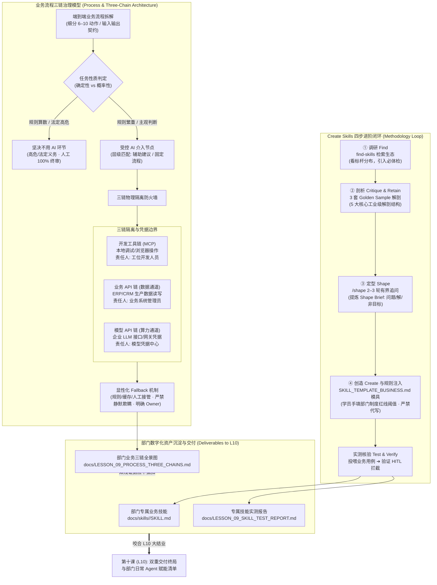

# 第九课学员指南——画出部门 AI 机会与 Agent 范式选型图

> **核心思想：能用固定规则搞定的，绝不引入多余复杂度；三链物理隔离筑牢安全底线；人先机后手填规章红线，高质量 Skill 胜过脆弱代码。**

---

## 一、先看懂：今天为什么学、要带走什么

### 1.1 先看一个反差

在开始今天的实操前，请对比以下两种截然不同的 AI 落地方式带来的巨大风险落差：

| 盲目全盘 AI 化（虚假繁荣、一击即溃） | 逐环节评估与三链隔离（严谨风控、生产可用） |
| :--- | :--- |
| **流程接入方式**：直接把部门整个复杂业务丢给大模型，命令“把采购比价/发票审核全流程全自动跑起来”，生成一套充满“自动审批、自动扣款、无感放行”的脆弱代码。 | 先细分 6–10 个端到端具体动作，区分“确定性算数”与“概率性判断”；对涉及合规责任与重大资金的高危动作，明确亮出“坚决不用 AI、人工 100% 终审”红牌。 |
| **接口安全边界**：本地开发工具、业务数据库与模型 API 混用同一组账号和环境变量，本地调试代码直接能读写生产库，一旦模型产生越权代码造成重大数据灾难。 | 实行三链物理隔离（开发工具链 MCP != 业务 API 数据链 != 模型 API 算力链），各链路配置独立凭据与责任人，沙盘调试绝不污染生产环境。 |
| **异常降级机制**：模型一旦超时、乱码或服务不可用，系统直接静默崩溃，或者用虚假 Mock 数据冒充“计算成功”蒙混过关，引发严重业务欺瞒。 | 为所有 AI 节点配置显性化 Fallback（备用规则/缓存/人工接管），失败时在界面打上显式标识并指派明确的第一责任人（Owner），绝不伪装成功。 |
| **技能规则资产**：让 AI“帮我随便写几个合理的报销上限和处罚标准”，主管放弃规则定义权，大模型幻觉编造的规程漏洞百出。 | 人先机后，主管亲手翻阅部门真实规章，亲笔手填刚性条款与红线阈值（严禁 AI 代写）；通过 `/shape` 有界收敛定型，依托工业级模具注入为高质量专属 Skill。 |

今天你将通过双轨实操，完整掌握**“端到端业务流程三链治理与高可用兜底设计”**与**“Create Skills 四步法沉淀部门工位专属数字化资产”**的高阶落地能力。

### 1.2 今天你要带走什么

完成本课后，你将带走一份**“业务三链全景与 Create Skills 部门专属业务技能双成果包”**：
1. **代码沙盘成果**：把个人原型放回部门真实端到端流程，拆解 6–10 个动作，标注确定性 vs 概率性性质，锁定至少 1 个明确拒绝 AI 介入的环节与真实业务理由；梳理三链关系（开发工具链 MCP、业务 API 链、模型 API 链），划清凭据边界与责任人；为 AI 节点配置 3 类显性化 Fallback 方案，形成《部门业务流程三链全景图》（存入 `docs/LESSON_09_PROCESS_THREE_CHAINS.md`）；若到点未画完，体验助教派发标准快照强制切出的工程纪律。
2. **管理实战成果**：四步闭环沉淀工位专属资产——① 调研 Find：`find-skills` 检索部门业务技能生态并登记候选（检索无果属正常，只读不装）；② 剖析 Critique & Retain：解剖 3 套工业级 Golden Sample 掌握 5 大核心解剖结构；③ 定型 Shape：首次实战 `/shape` 在 2–3 轮有界追问预算内收敛出《Shape Brief》（真实问题/最小充分解/非目标）；④ 创造 Create：依托《业务主管专属 SKILL.md 模具》（`student-package/templates/SKILL_TEMPLATE_BUSINESS.md`），恪守防代写铁律，亲手手填注入部门真实制度条款与红线阈值（严禁 AI 预填代写），生成《部门专属业务 SKILL.md》（存入 `docs/skills/<dept-skill>/SKILL.md`），并投喂测试用例闭环验证，产出《实测核验报告》（`docs/LESSON_09_SKILL_TEST_REPORT.md`）。

> [!IMPORTANT]
> **两条成果各自验收、绝不能互相顶替**：沙盘业务流程三链全景图绝对不可顶替部门专属 SKILL.md 与实测报告的缺失，专属技能写得再完美也绝不能顶替沙盘三链全景图的执行。两条主线必须独立核验通过，缺一不可。

### 1.3 本课融合心智模型 (Cognitive Model)

“业务流程三链治理”与“工位技能数字化沉淀”在底层工程治理与管理确权上是一体两面、紧密咬合的。下面的模型图展示了两者统一的思维闭环（**本图表达业务拓扑制衡与方法论闭环，非课堂时间推进表**）：



### 1.4 五个必须掌握的核心概念

#### 1. 业务流程 AI 机会（Business Process AI Opportunity）
- **是什么**：在部门端到端真实业务链上，经过业务价值、验证成本、错误代价与责任边界四重评估后，被证明确实值得引入 AI 赋能的具体工序节点。
- **怎么用**：以具体业务节点为最小评估单位做可行性初筛，挑选“痛点显著、规则繁重但容易核验”的场景作为切入点。
- **避坑红线**：严禁从“大模型能做什么”出发倒找场景；凡是没有明确技术验证手段、错误代价无限大或没有主管敢当责任人的环节，坚决不建 AI 机会。

#### 2. 全流程 AI 介入层级（AI Intervention Levels）
- **是什么**：业务任务接入 AI 的自治度梯度阶梯，划分为：不用 AI（规则搞定）、AI 辅助建议、固定流程执行、受控多步决策、低风险闭环执行。
- **怎么用**：针对每个环节的确定性程度与错误严重度，选择“最低且足够”的介入程度，把系统风险与实现成本锁定在最低线。
- **避坑红线**：牢记 Anthropic 核心工程原则：“能用固定规则搞定的，绝不引入多余复杂度”；严禁盲目给高危任务赋予高自主决策权。

#### 3. Agent 范式选型（Agent Paradigm Selection）
- **是什么**：针对选定接入 AI 的业务任务，在 Prompt 增强、Workflow 流程图、ReAct 动态调查、Plan & Execute 增量实施等架构中匹配最简单的实现模式。
- **怎么用**：路径完全确定选 Workflow，需要根据外部环境动态调查选 ReAct，步骤复杂长耗时选 Plan & Execute。
- **避坑红线**：单 Agent 足够时严禁盲目拆分多 Agent，绝不把 Agent 数量多少作为架构先进的衡量标准。

#### 4. 三条通道各归其位（三链隔离 / Three-Chain Segregation）
- **是什么**：把“写代码与自动化的开发工具链（MCP）”、“企业业务系统的数据通道（业务 API）”以及“底层大模型的调用通道（模型 API）”在物理和权限上彻底切开的治理机制。
- **怎么用**：为三条链路配置独立账号、划分不同安全等级、明确各自的第一责任人，确保沙盘调试绝对不污染业务生产系统。
- **避坑红线**：严禁把三条链路的权限、凭据或环境变量混为一谈；MCP 只是本地工具通道，绝不等于企业内部业务系统 API。

#### 5. 兜底降级与责任归属（Fallback & Failure Ownership）
- **是什么**：当大模型接口超时、调用失败、置信度低于阈值或输出乱码时，系统能够安全切入备用规则或人工流转的保底防御方案。
- **怎么用**：为每个 AI 节点配备标准降级路径（规则兜底 / 缓存兜底 / 人工接管），且降级结果在界面或报告中必须显式标记来源与责任人。
- **避坑红线**：严禁“静默失败”！严禁用 Mock 数据或虚构假数据冒充“AI 实时计算成功”来欺瞒用户或下游审计。

#### 扩展认识
1. **自动化红线清单（认识级）**：不可逆（如数据库删除、物理打款）、高敏感（如薪资全表、未脱敏身份证号）、责任归属不清与开放难验证的事项，默认严禁进入全自动执行，必须设立强制 HITL 阻断门禁；
2. **多 Agent 复杂度响应法则（认识级）**：多 Agent 不是能力的成熟度象征，而是对极端复杂业务分工的被动响应。只有当专业领域隔离、独立审查制衡（如 L8 红蓝对抗）确有不可替代价值时才引入多 Agent。

---

## 二、准备好：回顾第八课微任务并确认环境

### 2.1 课前物料与第八课微任务成果就绪

> [!IMPORTANT]
> **特别提醒：带上你的第八课双微任务成果！**
> 在第八课课后，你已完成了两项核心微任务：
> 1. 运用双盲对抗与内审卡思维，给下属（或协作部门）的业务方案挑出的 **1 个结构性漏洞与整改指令**；
> 2. 在 `docs/PROJECT_STATE.md` 中写下的 **一句话部门业务痛点（或跨部门长链路）**。
> 
> **开场前 3 分钟老师将随机抽查 2 名学员现场汇报！** 请立即打开你的 `docs/PROJECT_STATE.md`，这不仅是开场抽查的依据，更是今天整节课进行流程拆解、`/shape` 定型与工位技能沉淀的**源头活水素材**！

同时检查并确认以下文件与环境处于就绪状态：
1. **三套 Golden Sample 模具完好只读**：确认 `student-package/templates/skills/` 目录下财务审核、人事初筛、采购比价 3 套工业级标杆模具完好，严禁直接修改原始模具；
2. **业务专属模具就绪**：确认 `student-package/templates/SKILL_TEMPLATE_BUSINESS.md` 存在，具备规范的 5 大解剖结构与空白插槽；
3. **`find-skills` 工具就绪**：终端预置技能检索工具可用（明确：检索无果属于正常现象）；
4. **Working Tree Clean 状态**：在终端运行 `git status`，确认无脏代码遗留。

### 2.2 四类原型分流与规则注入方向参考

本课实操依托个人原型进行定制化扩展，四类原型的标杆模具与规则注入方向如下（**测试用例由学员依据本部门真实制度独立设计，严禁对照标准答案校准**）：

| 原型类别 | 对应 Golden Sample 标杆 | 部门专属 Skill 规则注入方向（方向级参考） |
| :--- | :--- | :--- |
| **Type A（监控决策型，如经营分析/能耗看板）** | 采购/运营比价模具 (`ops-supplier-quote-compare`) | 《异常能耗与指标异动智能初筛技能》：注入部门异常判定浮动比率阈值、强制人工复核时效与熔断阻断门禁。 |
| **Type B（任务流程型，如工单流转/退换货审批）** | 财务报销发票审核模具 (`fin-invoice-audit`) | 《售后免审直赔风险初筛与核验技能》：注入部门单笔赔付金额上限、高频退赔黑名单拦截与主管终审门禁。 |
| **Type C（操作工具型，如智能排班/物料计算器）** | 人事面试初筛模具 (`hr-interview-screener`) | 《仓储工时合规校验与防疲劳预警技能》：注入部门连班时限上限、法定加班工时红线与人工仲裁门禁。 |
| **Type D（研发创作工作台型，如服装研发/视觉企划）** | 采购比价模具与人事初筛模具复合解剖 | 《企划设计素材合规初筛与版权风险检测技能》：注入商用字体/素材白名单红线、AI 衍生版权免责条款与法务终审门禁。 |

### 2.3 实操四大高压红线

实操开始前，必须时刻紧绷以下四条纪律红线：
1. **三链绝对隔离红线**：严禁将开发工具链（MCP）、业务 API 链与模型 API 链的权限、凭据混用；严禁向大模型投喂真实生产数据库连接串或未脱敏机密数据；
2. **制度红线防代写红线**：部门制度条款与红线金额阈值必须来自学员亲自填入，严禁大模型代编代写；
3. **不可逆操作人工阻断红线**：凡涉及资金支付、正式发文、人事任免与数据删除等不可逆高危动作，必须设置强制 HITL 阻断门禁，绝不允许全自动流转；
4. **失败显性化与诚信红线**：系统发生降级或失败时必须显式标注来源与责任人，严禁用假数据伪装成成功结果。

---

## 三、动手做：四步攻坚任务卡

### 轨道 A：沙盘业务三链治理与兜底设计 (Tasks 1–2)

#### Task 1：拆解部门业务流程链，评估任务性质并明确拒绝环节

- **本步目的 (`purpose`)**：
  将单点功能思考扩展为部门全局业务流程把控。通过将流程动作细化并区分确定性与概率性，学会主动拒绝不应自动化的环节，避免盲目全面 AI 化。
- **复制提示词 (直接复制发给 Agent)**：
    ```text
    请协助我梳理并评估部门的一条核心业务流程链。

    【业务场景与输入痛点】：
    【在此粘贴你上节课准备的一句话部门痛点，如：售后退换货审批流程卡顿 / 供应商比价与发票审核繁琐】

    【梳理要求与评估指标】：
    1. 请帮我拆解出该业务流程的 6 到 10 个端到端具体操作动作；
    2. 针对每个操作动作，严格按表格列出以下评估要素：
       - 动作名称与当前执行人角色；
       - 输入材料与输出产物；
       - 任务性质：标注为【确定性（规则明确）】还是【概率性（需要主观判断）】；
       - 错误代价与数据风险：标注为【高 / 中 / 低】；
       - 建议 AI 介入层级：【不用 AI / 辅助建议 / 固定流程 / 受控决策】。
    3. 【刚性拒绝红线】：必须从流程中明确挑出至少 1 个【坚决不使用 AI/Agent】的环节，并结合我部门的特定商业责任、法律法规或安全风险，给出不可反驳的具体拒绝理由！
    4. 整理完成后，将表格输出，准备合并存入 docs/LESSON_09_PROCESS_THREE_CHAINS.md 的第一部分。
        ```
- **你应该看见 (`expected_observation`)**：
  Agent 输出了一份规范的流程拆解评估表格，每个节点输入输出清晰、任务性质定性准确，且明确指出了至少 1 个坚决不使用 AI 的环节及详实的合规理由。
- **本步自检 (`check`)**：
  - [ ] 流程链是否完整覆盖了 6–10 个端到端具体动作？
  - [ ] 每个动作是否均明确区分了确定性与概率性？
  - [ ] 是否包含至少 1 个坚决不用 AI 的环节，且理由具体真实？
- **必须停止 (`mandatory_stop`)**：
  - 严禁所有环节全选 AI！凡是没有拒绝环节的流程清单，必须推翻重写！

---

#### Task 2：梳理三链关系与凭据责任，设计显性化兜底方案

- **本步目的 (`purpose`)**：
  建立工程级的系统安全边界与高可用心智。理清开发、业务与模型三条通道的物理隔离，杜绝生产权限混用；为不可避免的模型失败设计兜底降级方案，落实失败显性化与责任人机制。
- **复制提示词 (直接复制发给 Agent)**：
    ```text
    请基于 Task 1 的流程评估结果，协助我完成【三链隔离架构设计】与【显性化 Fallback 兜底方案】。

    【架构梳理要求】：
    1. 【三链物理隔离】：明确区分并列出本业务系统涉及的三条独立链路：
       - 【开发工具链】：涉及的本地开发辅助工具或 MCP 扩展（如：文件读取、浏览器测试）；
       - 【业务 API 链】：企业内部核心业务系统与数据库接口（如：ERP 订单查询、财务结算系统）；
       - 【模型 API 链】：外部大模型调用通道与中继网关。
       明确写明每条链路的凭据保管人角色与调用安全权限。
    2. 【显性化 Fallback 设计】：针对保留的 AI 介入节点，设计明确的异常降级处理规约：
       - 当遇到模型超时、断网或返回格式异常时，系统自动切入哪种兜底模式（规则兜底 / 缓存兜底 / 人工接管）；
       - 降级发生时，必须向用户或下游系统显式输出何种来源标识（如：[系统已降级为基础规则审核 · 责任人: XX]）；
       - 明确指定该异常环节的第一业务责任人 (Owner)。
    3. 整理完成后，将 Task 1 与 Task 2 的全部成果整合，以规范的 Markdown 格式保存至 docs/LESSON_09_PROCESS_THREE_CHAINS.md。
        ```
- **你应该看见 (`expected_observation`)**：
  Agent 输出了规范的三链隔离表与 Fallback 应急表，各链路责任人明确，降级机制具有可操作的显式标识，文件成功落盘至 `docs/LESSON_09_PROCESS_THREE_CHAINS.md`。
- **本步自检 (`check`)**：
  - [ ] 三条链路是否物理隔离，凭据责任人是否互不重叠？
  - [ ] Fallback 是否包含显式标识与明确责任人，彻底杜绝静默失败？
  - [ ] 文档是否已成功保存至 `docs/LESSON_09_PROCESS_THREE_CHAINS.md`？
- **必须停止 (`mandatory_stop`)**：
  - 严禁将开发工具权限与业务生产接口权限混为一谈！严禁不设 Fallback 责任人！

---

### 第 35 分钟硬切门禁与标准流程三链快照保底

- **硬切纪律**：时钟到达第 35 分钟整，沙盘流程三链梳理必须立即叫停！
- **降级机制**：若沙盘流程图未能全部完成，助教将立即派发对应原型的《标准业务流程三链全景图快照》，直接存入 `docs/LESSON_09_PROCESS_THREE_CHAINS.md` 并标注 `[FALLBACK_SNAPSHOT]`；
- **核心保障**：坚决捍卫轨道 B（管理实战与技能创造）的 35 分钟黄金实操时间，绝不让画图挤占工位资产沉淀。

---

### 轨道 B：Create Skills 模具解剖、`/shape` 定型与规则注入 (Tasks 3–4)

#### Task 3：调研 Find、剖析 Critique & Retain 与 `/shape` 定型

- **本步目的 (`purpose`)**：
  拒绝从零凭空瞎写脆弱的垃圾技能。通过解剖工业级 Golden Sample 掌握企业级数字化 SOP 的标准解剖结构；通过 `/shape` 有界追问，将模糊的部门需求定型为严密的交付规格。
- **步骤 ① 检索指引 (3 min · 只检索不安装)**：
  复用第七课的检索提示词，将关键词替换为你部门的垂直业务场景（如“发票 审核”“排班 合规”“供应商 比价”），检索并记下 1–3 个候选（名称与一句话功能即可，登记在 `docs/LESSON_09_PROCESS_THREE_CHAINS.md` 文件末尾的“生态调研候选”小节）；检索无果属正常结果——生态里没有你部门的现成技能，恰恰说明本课第④步创造的价值，此时直接进入步骤②，以 3 套 Golden Sample 为标杆底座。**注意：本步只检索不安装（沿用第七课“只读不装”铁律）**。
- **复制提示词 1：标杆剖析与结构解剖 (直接复制发给 Agent)**：
    ```text
    请帮我读取并解剖以下三套工业级 Golden Sample 技能模具中的任意一套（依据我的业务方向选择）：
    - 财务审核模具：student-package/templates/skills/fin-invoice-audit/SKILL.md
    - 人事初筛模具：student-package/templates/skills/hr-interview-screener/SKILL.md
    - 采购比价模具：student-package/templates/skills/ops-supplier-quote-compare/SKILL.md

    【解剖分析要求】：
    请拆解并提炼该模具的五大核心标准结构，向我汇报：
    1. 【元数据定义】：它的 name 与 description 是如何编写以确保准确触发的？
    2. 【前置输入契约】：它约定了哪些必须具备的材料，缺少时如何主动索取？
    3. 【SOP 执行步骤】：它分成了哪几个不可跳步的检查阶段？
    4. 【刚性红线与 HITL 门禁】：它定义了哪些绝对禁止动作和强制人工暂停条件？
    5. 【结构化输出格式】：它的 Markdown 输出模板是如何规范的？
        ```
- **复制提示词 2：`/shape` 需求定型与边界锁定 (直接复制发给 Agent)**：
    ```text
    你现在是严苛的需求定型器（执行 /shape 规约）。请根据我所在部门的高频业务痛点，在 2 到 3 轮追问预算内协助我完成《Shape Brief》定型。

    【我的部门业务痛点与场景】：
    【在此简要描述你的部门高频业务痛点，如：每月供应商报价单格式各异、比价繁琐且容易漏看隐藏运费条款】

    【追问预算与定型规则】：
    1. 追问轮次严格限制在 2 到 3 轮，聚焦业务核心矛盾，严禁漫无边际的开放式闲聊；
    2. 请向我连续追问以下三类关键边界问题：
       - 【真实问题到底是什么】：痛点是在格式整理上，还是在规则比对上？谁是最终责任人？
       - 【最小充分解包含什么】：本技能第一版必须解决哪 2 到 3 个核心规则校验？
       - 【明确非目标（坚决不做项）】：本技能绝对不做什么？遇到什么情况必须踢回人工？
    3. 在我回答后，请立即收敛并生成一份标准的《Shape Brief》，包含：真实问题描述、最小充分解功能清单、明确非目标列表与强制 HITL 门禁。
        ```
- **你应该看见 (`expected_observation`)**：
  Agent 完成了对模具结构的清晰解剖，并在 2–3 轮追问后，收敛输出了一份边界极其清晰、不带任何废话的《Shape Brief》。
- **本步自检 (`check`)**：
  - [ ] 是否已在 3 分钟内完成生态检索登记（或明确标注“生态无果”）？
  - [ ] 是否已完整解剖了 Golden Sample 的 5 大核心结构？
  - [ ] `/shape` 追问是否在 2–3 轮内收敛，而非无休止闲聊？
  - [ ] 《Shape Brief》是否明确包含了真实问题、最小充分解与明确非目标？
- **必须停止 (`mandatory_stop`)**：
  - 严禁在需求边界未锁定前直接动手写代码或写 Skill！严禁没有非目标清单！

---

#### Task 4：创造 Create 与业务规则注入实测

- **本步目的 (`purpose`)**：
  亲手打造第一份属于自己部门的高质量数字化资产。将 `/shape` 定型结论注入模具，**恪守防代写铁律，亲手写入本部门真实制度条款与红线阈值**，并通过投喂测试用例闭环验证防错门禁的有效性。
- **复制提示词 (直接复制发给 Agent)**：
    ```text
    请协助我基于《业务主管专属 SKILL.md 模具》（student-package/templates/SKILL_TEMPLATE_BUSINESS.md）与刚才定型的《Shape Brief》，生成本部门专属的【业务 SKILL.md】，并协助我完成测试核验。

    【我亲手提供的部门制度条款与红线阈值（由我本人确定，严禁代写）】：
    【请在此处粘贴你部门真实的规章条款、红线数值与责任人，格式：
     - 适用场景与角色：[填入角色与时机]
     - 刚性校验规则：[填入如：必须具备合同原件、抬头必须完全一致等]
     - 强制阻断与 HITL 阈值：[填入如：单笔超过 X 元、单月累计超过 Y 元必须暂停审批]
     - 违规处置建议：[填入如：打回补正 / 扣除超标部分]】

    【执行参数与防代写铁律】：
    1. 严禁由你生成、建议、推测或编造任何具体的金额阈值、报销上限或业务处罚标准！所有红线规则与数值必须 100% 忠实取自上方我本人手填提供的制度条款清单；
    2. 严格遵循工业级 SKILL.md 五大解剖结构，产出排版严密的 Markdown 文本，并保存至 docs/skills/【你的技能英文名】/SKILL.md；
    3. 生成完毕后，请立即构造 1 组包含“正常放行项”与“触碰红线违规项”的业务测试用例进行模拟运行，验证刚性规则与强制 HITL 门禁是否被正确触发；
    4. 将测试过程、输入数据、Agent 拦截输出与最终审核结论整理保存至 docs/LESSON_09_SKILL_TEST_REPORT.md。
        ```
- **你应该看见 (`expected_observation`)**：
  Agent 在 `docs/skills/` 目录下生成了结构完备、注入了你亲填制度红线的专属 `SKILL.md`；同时对测试数据执行了严谨的规则校验，准确识别出违规超标项并触发强制 HITL 暂停，产出了规范的 `docs/LESSON_09_SKILL_TEST_REPORT.md`。
- **本步自检 (`check`)**：
  - [ ] `SKILL.md` 是否完整具备五大核心结构？
  - [ ] 红线阈值与刚性条款是否全部来自你本人亲手提供，而非由 Agent 代写？
  - [ ] 是否执行了用例实测，实测报告是否记录了真实的 HITL 触发与拦截过程？
  - [ ] 文件是否成功落盘至对应目录？
- **必须停止 (`mandatory_stop`)**：
  - 严禁 Agent 代写部门制度红线与金额阈值！
  - 严禁不经过用例测试直接宣称技能“已通过”！

---

### 同构收敛与专属技能确权签署

- **理解同构性**：传统硬编码系统开发周期长、成本高；高质量数字化 SOP（`SKILL.md`）即插即用、门禁透明，是业务主管在工位武装生产力最务实的利器；
- **确权签字**：检查你的 `docs/skills/<dept-skill>/SKILL.md`，确认红线阈值无误后，签署业务主管确权声明。

---

## 四、避开坑：高频误区与现场排错

### 4.1 5 项常见认知误区纠偏表

| 误区编号 | 典型错误认知 | 纠偏正解与实战对策 |
| :--- | :--- | :--- |
| **M-01** | “大模型能力很强，我们部门整个业务流程都可以全自动跑起来” | 盲目全面自动化必酿大祸！必须逐环节评估错误代价，错误代价高的环节必须设立强制人工终审。 |
| **M-02** | “写 Skill 就是写一段比较长、比较详细的提示词” | 真正的 Skill 是标准数字化 SOP，必须包含前置输入契约、不可跳步流程与刚性红线门禁，而非简单对话。 |
| **M-03** | “多 Agent 协同肯定比单 Agent 更高级，架构图画得越复杂越好” | 多 Agent 是应对复杂度的无奈选择而非成熟度象征！单 Agent 足够时强拆多 Agent 只会带来通信混乱。 |
| **M-04** | “系统降级（Fallback）只要不报错就行，不用特意告诉用户” | 隐瞒降级是严重的造假行为！降级结果必须显式标注来源、限制与责任人，严禁欺瞒下游。 |
| **M-05** | “让 AI 替我建议一套报销金额上限和处罚标准，省得我查制度了” | 严禁代写制度红线！大模型不承担管理后果，部门刚性阈值必须由业务主管亲自对照真实制度手写注入。 |

### 4.2 现场 5 类典型故障排查与对策表

| 故障类别 | 现场典型现象 | 自查与处置动作 (Action) | 应急降级方案 (Fallback) |
| :--- | :--- | :--- | :--- |
| **T-01 流程全选 AI** | 在拆解流程时将所有环节无脑标注为“适合 AI 自动化” | 严厉打断，敲桌质问：“哪个环节出错要追责？”，强制要求选出至少 1 个坚决不用的环节 | 退回流程表，识别合规与重大资金法定义务环节 |
| **T-02 追问发散失控** | `/shape` 定型时与 AI 探讨宏大愿景，聊了七八轮停不下来 | 下发强制收敛口令：“停止发散！对照 3 个问题直接提炼 Shape Brief！” | 限制在 2–3 轮预算内，强制截断并提取最小充分解 |
| **T-03 阈值代写偷懒** | 让 AI“帮我随便写几个合理的金额上限填进去” | 勒令清屏重来，批评其放弃主管职责，翻出部门实际规章亲笔录入 | 提供标准模具空插槽，手填真实规程数值 |
| **T-04 标杆理解偏差** | 将 `SKILL.md` 简化为一段几行字的一般性 Prompt | 重新对照 Golden Sample 标杆的 5 大解剖结构逐一比对检查 | 强制套用 `SKILL_TEMPLATE_BUSINESS.md` 完整模具 |
| **T-05 测试静默放行** | 投喂包含超标违规的数据后，AI 依然输出“完全合格已通过” | 检查 `SKILL.md` 中的红线与 HITL 逻辑，补充显式拦截指令 | 调整红线判断逻辑，重新投喂测试用例直至成功拦截 |

---

## 五、验成果：双线成果核验与随堂自测

### 5.1 双线成果核验与互不抵扣硬核执行

本课设立两条相互独立、必须同时达标的学习与考核主线：
1. **原型推进线最低证据**：
   - 包含流程动作拆解、任务性质评估、三链隔离与显性化 Fallback 的结构化文档（`docs/LESSON_09_PROCESS_THREE_CHAINS.md`）；
   - 包含沙盘梳理记录的 Git Commit 历史。
2. **主管判断线最低证据**：
   - 包含 `/shape` 结构化定型记录（真实问题/最小充分解/非目标）的《Shape Brief》；
   - 注入学员亲手填写的刚性制度条款、真实红线阈值与 HITL 门禁的《部门专属业务 SKILL.md》（保存至 `docs/skills/<dept-skill>/SKILL.md`）；
   - 包含真实测试输入、红线拦截与 HITL 验证证据的《部门专属技能实测核验报告》（`docs/LESSON_09_SKILL_TEST_REPORT.md`）。
3. **互不抵扣铁律**：
   - 原型流程三链全景图**绝对不可抵扣**部门专属 SKILL.md 与实测报告的缺失；
   - 部门专属 SKILL.md 完成度**绝对不可抵扣**沙盘流程拆解与三链分析的执行。两条主线必须独立核验通过，缺一不可。

### 5.2 随堂必答题（5 题 · 附参考答案与自测要点）

1. **在评估业务流程的 AI 机会时，为什么要坚持“逐环节评估”而非直接从“大模型能做什么”出发？**
   - *参考答案*：大模型能力是通用且发散的，如果从“模型能做什么”倒推，很容易把大量不需要、无法验证或责任风险极高的环节强行自动化；而“逐环节评估”从业务痛点出发，精准界定每个动作的确定性、错误代价与责任边界，能够从源头阻断 80% 的伪需求。
2. **如何区分业务任务是“确定性任务”还是“概率性任务”？对于确定性任务，我们的工程选型原则是什么？**
   - *参考答案*：确定性任务是规则死板、计算路径唯一、有标准对错答案的任务（如发票税额校验、加减乘除、数据格式转换）；概率性任务则是涉及主观理解、语义归纳、策略博弈或模式识别的任务。工程原则是：能用固定规则搞定的，绝不引入大模型，坚守最简架构。
3. **“三链隔离”区分的是哪三条链路？为什么不能把开发工具权限与业务生产接口混用？**
   - *参考答案*：区分“开发工具链（MCP）”、“业务 API 链（数据通道）”与“模型 API 链（算力通道）”。不能混用是因为三者安全级别与责任主体完全不同；混用权限会导致本地调试的脏数据污染生产数据库，甚至造成凭据泄露导致系统被越权攻击。
4. **一个合格的工业级 `SKILL.md` 必须具备哪五大核心解剖结构？为什么临时写的一次性 Prompt 无法替代 Skill？**
   - *参考答案*：五大结构为：元数据定义、业务背景、前置输入契约、分步 SOP 流程、刚性红线与 HITL 门禁。临时 Prompt 缺乏前置契约约束、防错红线与标准化输出模板，表现高度不可控且容易遗忘规则；真正的 Skill 是标准化的可复用数字化资产。
5. **在第七课、第八课与第九课中，我们在“防代写”与“主管判断线”上确立了怎样的铁律？**
   - *参考答案*：铁律是“人先机后，决断权绝不由 AI 代劳”。L7 要求主管亲自核准工具体检红线；L8 要求主管面对缺陷先手写做出裁决与理由再调 Agent 排版；L9 则要求部门专属 Skill 的制度条款与金额阈值必须来自主管亲笔提供，严禁 AI 代写推荐。主管始终是最终商业后果与制度责任的唯一承担者。

### 5.3 随堂拓展题（2 题 · 选做）

1. **如果在真实的业务部门中，一个复杂的业务流程既涉及文本处理又涉及数据计算，在什么情况下才值得拆分为多个协同 Agent？**
   - *参考要点*：必须满足“专业领域高度隔离”、“上下文严重冲突”或“需要独立背靠背制衡（如红蓝对抗）”的硬性条件。若单 Agent 通过分步 SOP 即可胜任，坚决不拆分；盲目拆分多 Agent 会显著增加通信失真与系统脆弱点。
2. **在第九课中，我们为什么强调“高质量的 Skill 是传统硬编码系统的有力制衡与补充”？这对部门日常数字化有什么启示？**
   - *参考要点*：传统 IT 软件立项周期长、成本高、变更慢；而业务主管亲手配置的 Skill 将老员工经验与制度红线快速封装为可执行 SOP，具有即插即用、灵活迭代与极低成本的优势，是业务主管武装工位生产力的最务实利器。

---

## 六、带走它：资产沉淀与课后微任务

### 6.1 个人沙盘与数字化资产归档

在 80–90 分钟内，完成以下资产归档与 Git 提交：
1. **执行 Git Commit**：
   ```bash
   git add docs/LESSON_09_PROCESS_THREE_CHAINS.md docs/skills/ docs/LESSON_09_SKILL_TEST_REPORT.md
   git commit -m "feat(lesson-09): complete three-chain panorama and department business skill with test verification"
   ```
2. **更新项目状态**：在 `docs/PROJECT_STATE.md` 中登记本课产出的流程图路径与专属技能名称。

### 6.2 课后双微任务（失败显性化与 Owner 补齐 + 专属 Skill 工位离线自测）

> 1. **主微任务（失败显性化与 Owner 补齐 · 10–15 min）**：
>    在个人原型项目 `docs/PROJECT_STATE.md` 中，针对今天梳理的业务三链全景图，重点检查并补充**至少 1 条关键 AI 节点的“失败显性化规则与第一责任人（Owner）”**（明确：当 AI 算不出或置信度低时，界面如何显式标记、工单如何流转至具体人员，与课程大纲阶段五第 9 课契约完全对齐）；
> 2. **次微任务（专属 Skill 工位离线自测 · 3 min）**：
>    在工位真实办公环境中，调取 1 份真实的脱敏工作样本，离线运行测试你今天产出的《部门专属业务 SKILL.md》，记录是否能正确阻断超标项，并将输出简要记入个人实测记录，作为第十课（L10）结业赋能清单的核心物料。
>
> *(注：课堂沙盘的三链梳理与技能配置已在 80–90 min 归档环节随 Git Commit 固化，课后不重复占用学员精力)*

### 6.3 预告第十课（L10 开场双核验与双重交付终局）

本微任务将在**第十课（L10）大结业开场前 3 分钟进行双核验**：
- **第一核验**：抽查 2 名学员展示“关键 AI 节点的失败显性化规则与责任人是如何锁定的”；
- **第二核验**：核对工位离线实测结果，直接作为 L10 汇总《部门日常 Agent 赋能落地清单》的核心输入。
- **大结业终局预告**：第十课你将带着前九课积累的完整沙盘代码与数字化资产，登上“双重交付终局大答辩”舞台，迎接课程结业！
