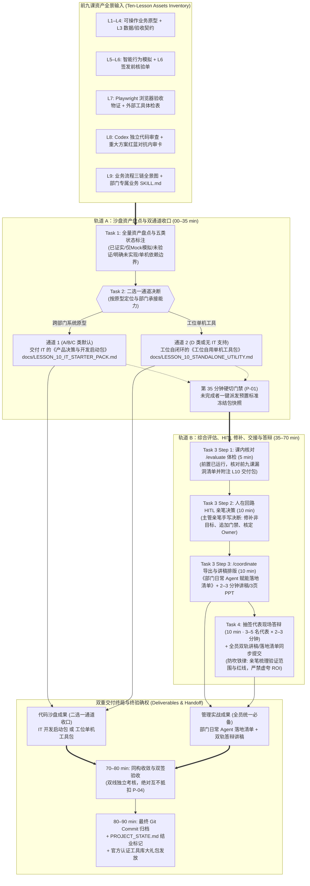

# 第十课课程设计简报 (Lesson Design Brief)

<!-- candidate_version: 2.1.0 结业交付收官战：双重交付通道收口 (Tasks 1–2) + 综合评估 /evaluate、HITL 决策、/coordinate 导出与抽签答辩 (Tasks 3–4) · 严禁虚夸 ROI，全面落实终验节点与防代写铁律 -->

`contract_version: 2.1`

---

## 1. 课程元数据与权威依据 (Metadata and Authority)

| 字段 | 设定值 | 契约约束说明 |
| :--- | :--- | :--- |
| `lesson_number` | 10 | 对应第 10 课《双重交付终局与部门日常 Agent 赋能落地清单》（结业双轨主题：双重交付通道收口、综合评估 `/evaluate`、人在回路 HITL 修补、标准交接 `/coordinate` 与抽签答辩） |
| `course_context` | 目标学员为具备业务管理经验的部门主管（非技术背景/AI 进阶应用），已完整完成 L1–L9，拥有个人业务原型、L3 契约、L6 签发核验单、L7 外部工具体检表与浏览器验收物证、L8 红蓝对抗内审卡与交接包、L9 三链全景图与部门专属 Skill；课前已接收并完成教师在 L9 结束当日下发的结业前置指令包（前置运行 `/evaluate` + 亲笔梳理答辩五要素提纲）；采用线下/线上混合工作坊模式；配备专业助教（3 分钟内响应）；课时硬上限 90 分钟 | 严格执行双轨工作坊 35+35+10+10 刚性时间预算，严禁前松后紧，确保抽签答辩与双重交付闭环在课内扎实完成 |
| `authority_refs` | 1. `lessons/TEN_LESSON_FROZEN_BASELINE.md` (§L10｜冻结原型包，形成产品决策与开发启动包)<br>2. `lessons/CURRICULUM_REBALANCING_AND_DUAL_TRACK_OPTIMIZATION_PROPOSAL.md` (v1.4.2 Approved & Frozen Baseline · 2026-09-16, git tag `curriculum-v1.4.2`, §第 10 课：结业交付“双重交付终局”与综合评估交接)<br>3. `lessons/COURSE_ROADMAP.md` (§阶段五、AI 融入与交付·第 10 课契约)<br>4. `lessons/COURSE_ROADMAP_STUDENT.md` (§阶段五、AI 融入与交付·第 10 课每周成果)<br>5. `GLOSSARY.md` (§四、接入、独立评审与产品决策交接) | 严禁引用陈旧 `docs/` 目录；所有引用均基于 `lessons/` 权威文件与 `curriculum-v1.4.2` 冻结标签，引用章节名避免行号腐化 |
| `contract_version` | 2.1 | 严格遵循 2.1 契约标准 |
| `candidate_version` | 2.1.0 | 本次升级设计版本号（全量落地双重交付通道、`/evaluate` 结业体检、主管亲笔 HITL 决策、`/coordinate` 规范导出、抽签答辩求真防吹法与终验节点闭环） |
| `comparison_baseline` | `lessons/LESSON_10_TEACHER_PLAN.md` 与 `lessons/LESSON_10_GUIDE.md` (原 90 分钟单轨开发启动包版本) | 用于显式对比并形成继承表，严禁无故删除原有用例与思考题 |

---

## 2. 成果与非目标 (Result and Non-goals)

### 2.1 课堂主成果 (`classroom_main_result`)
**双重交付终局与综合评估交接双成果包**：
1. **代码沙盘成果（二选一通道收口）**：
   - **通道 1（部门级系统原型，A/B/C 类默认）**：依托 `student-package/templates/IT_DEVELOPMENT_STARTER_PACK_TEMPLATE.md`，系统盘点十课资产与证据链（明确区分已证实/仅Mock模拟/未验证/明确未实现/单机依赖边界五类状态），输出交付 IT 架构与工程团队的《产品决策与开发启动包》（包含问题与系统定义、L3 数据契约、生产就绪缺口分析、非目标红线与 IT 排期建议，严格附加“非生产就绪代码声明”，存入 `docs/LESSON_10_IT_STARTER_PACK.md`）；
   - **通道 2（工位单机工具/IT无法承接，D 类或独立工位默认）**：依托 `student-package/templates/DESK_STANDALONE_UTILITY_SOP.md`，生成工位自治闭环的《工位自用单机工具包》（包含代码与配置清单、依赖环境表、数据脱敏规约、桌面一键启动脚本与工位部署实施 SOP，存入 `docs/LESSON_10_STANDALONE_UTILITY.md`）。
2. **管理实战成果**：
   - **综合体检与人在回路修补**：课前前置运行 `/evaluate` 对前九课全量成果进行系统化挑刺，课内 5 分钟核对并附注 L10 交付包，出具客观《结业成果综合体检与漏洞清单》；业务主管**亲手手写做出业务决断（HITL，10 min）**，手动修补明确非目标、追加审批门禁、核定生产差距第一责任人（严禁 AI 越权代写决策）；
   - **标准交接导出与讲稿排版**：调用 `/coordinate` 导出全员统一沉淀的《部门日常 Agent 赋能落地清单与认证工具包》（包含官方认证工具库 + L9 淬炼的部门专属业务 Skill + 周一安全试水 SOP 与第一责任人，依托 `student-package/templates/DEPARTMENT_AGENT_DEPLOYMENT_SOP_TEMPLATE.md`，存入 `docs/LESSON_10_DEPARTMENT_DEPLOYMENT_SOP.md`）；同时由 Agent 协助对课前已亲手梳理的五要素讲稿提纲进行排版落盘（存入 `docs/LESSON_10_DEFENSE_SCRIPT.md`，10 min）；
   - **抽签代表答辩与全员双轨提交**：现场随机抽签 3–5 名学员代表上台进行 2–3 分钟务实双轨汇报（交代验证边界、生产差距与四项红线；交代工位低风险日常启动方案，10 min）；全体学员同步提交亲笔梳理的双轨答辩讲稿/PPT 与签署的落地清单，实事求是、杜绝画大饼，闭环全课程**信任节点链终局（终验节点）**。

### 2.2 双轨结构分配 (`dual_track_structure`)
严格执行 **35 + 35 + 10 + 10** 刚性时间预算：
- **【教师课前前置双指令（L9 结课当日随结课通知下发）】**：
  1. **前置指令 ①（/evaluate 全量体检）**：学员在课前对前九课累积成果运行 `/evaluate`，出具初版漏洞清单备查；
  2. **前置指令 ②（讲稿提纲亲笔梳理）**：学员在纸上亲手梳理 2–3 分钟答辩五要素核心提纲。
  该前置机制确保课内无需把时间浪费在等待模型输出，课内 35–40 min 仅用 5 分钟快速核对并附注 L10 交付包，将宝贵的 10 分钟完整留给主管亲笔做出 HITL 业务决断！
- **`track_a_sandpit` (00–35 min)**：导入与双重交付通道收口 (Tasks 1–2)。
  - **导入、信任链收官与模型建立 (00–10 min)**：
    - 开场前 3 分钟抽查 2 名学员汇报 L9 课后双微任务落实情况：① 检查关键 AI 节点的失败显性化规则与责任人（Owner）补充；② 核对 L9 部门专属 Skill 工位离线自测结果；
    - 顺势完成**信任节点链全景贯通与终局收口（终验节点）**：“从 L1 的手忙脚乱，到 L6 的排错核验、L7 的工具体检、L8 的红蓝对抗、L9 的机会全景与规则注入，今天我们迎来整条信任链的终局节点——终验与交付！今天我们不拿半吊子代码去蒙骗 IT，也不在台上吹嘘不切实际的商业神话，而是拿出扎实的证据、诚实的缺口清单与实事求是的工位落地清单！”；
    - 制造认知冲突反差：对比“散乱把 HTML 代码丢给 IT 被拒收、在答辩台上夸大 ROI（每周省 20 小时）被评委无情戳穿” vs “结构化双通道启动包让 IT 赞不绝口、实事求是交代已证实与未验证缺口的主管赢得满堂喝彩”；
    - 讲解 5 大核心概念与双通道交付机制（10 min）。
  - **Task 1 (10–25 min)**：**盘点十课全量资产与证据链，标注五类状态 (15 min)**：
    - 调取前九课累积成果，梳理十课全量资产清单；
    - 严格区分五类状态：【已证实 (Proven)】、【仅 Mock 模拟 (Mocked)】、【未验证 (Unverified)】、【明确未实现 (Unimplemented)】、【单机依赖边界 (Standalone Dependency)】；
    - 显式引证 L1 路径、L3 契约、L4 薄切片、L6 诊断证据、L7 浏览器截图、L8 Codex Finding、L9 三链图与专属 Skill。
  - **Task 2 (25–35 min)**：**按原型定位二选一通道收口，生成启动包/工具包 (10 min)**：
    - 依据业务原型定位与部门承接能力进行二选一决断：
      - 通道 1（A/B/C 类默认）：生成交付 IT 的《产品决策与开发启动包》（系统定义、数据契约、生产就绪缺口分析、非目标红线，保存至 `docs/LESSON_10_IT_STARTER_PACK.md`）；
      - 通道 2（D 类或独立工位默认）：生成工位自治闭环的《工位自用单机工具包》（代码与配置清单、依赖环境表、数据脱敏规约、桌面一键启动与实施 SOP，保存至 `docs/LESSON_10_STANDALONE_UTILITY.md`）；
    - 明确产品决策（继续 / 调整 / 暂缓 / 停止）及四项权衡依据（价值/证据/风险/成本）。
  - **35 分钟硬切门禁 (P-01)**：第 35 分钟一到，沙盘操作强制停止！未完成收口的学员，由助教一键下发对应通道的预置标准冻结包快照（标记 `[FALLBACK_SNAPSHOT]`），全员准时切入轨道 B，绝不拖堂！
- **`track_b_management` (35–70 min)**：综合评估 Evaluate ➔ 人在回路 HITL ➔ 标准交接 Coordinate ➔ 抽签答辩 (Tasks 3–4，子时长 strictly 5+10+10+10=35 min)。
  - **Task 3 (35–60 min · 25 min)**：**综合评估 `/evaluate` 核对 (5m) ➔ 人在回路 HITL 修补 (10m) ➔ 标准交接 `/coordinate` 导出与讲稿排版 (10m)**：
    - *Step 1（课内核对 Evaluate，35–40 min · 5 min）*：核对课前运行的 `/evaluate` 体检结果，审查前九课累积成果清单并附注 L10 新收口通道包，确认客观缺陷；
    - *Step 2（人在回路 HITL 修补，40–50 min · 10 min · 防代写铁律）*：主管审阅漏洞清单，**亲笔手写做出业务决断**（修补明确非目标、追加审批门禁、核定生产差距责任人，严禁 AI 越权代写决断）；
    - *Step 3（标准交接 Coordinate 导出与讲稿排版，50–60 min · 10 min）*：**调用 `/coordinate`**，导出全员统一沉淀的《部门日常 Agent 赋能落地清单与认证工具包》（保存至 `docs/LESSON_10_DEPARTMENT_DEPLOYMENT_SOP.md`）；同时由 Agent 协助对课前已亲手梳理的五要素讲稿提纲进行排版，生成务实的 2–3 分钟答辩讲稿与 3 页 PPT 骨架（保存至 `docs/LESSON_10_DEFENSE_SCRIPT.md`）。
  - **Task 4 (60–70 min · 10 min)**：**抽签代表现场答辩与全员双轨讲稿/落地清单同步提交 (10 min)**：
    - 助教现场随机抽签 3–5 名学员代表上台进行 2–3 分钟务实双轨汇报（通道 1 向 IT 交代验证边界与生产差距，或通道 2 向部门交代工位单机工具部署边界与四项红线；交代低风险日常启动方案）；
    - 主讲教师对照《结业答辩求真防吹评审表》（`student-package/templates/DEFENSE_TRUTHFULNESS_RUBRIC.md`）现场点评打分；
    - 全体学员在座席同步提交签署的《部门日常 Agent 赋能落地清单》与 `docs/LESSON_10_DEFENSE_SCRIPT.md`。
- **同构收敛与双签验收 (70–80 min)**：
  - 点拨“向 IT 交代系统级工程差距”与“向部门交代工位级安全落地规程”的同构性；
  - 确立“求真交付胜过虚假繁荣，严守红线重于盲目上线”的结业终局心智；
  - 签署《双重交付终局验收与责任确权卡》（10 min）。
- **收束结业与大礼包分发 (80–90 min)**：
  - 最终 Git Commit 存档与 `docs/PROJECT_STATE.md` 标记训练营结业；
  - 发放官方认证工具库与结业大礼包（10 min）。

### 2.3 双线最低证据契约与 P-04 互不抵扣准则
- **原型推进线最低证据 (`prototype_progress_line`)**：
  1. 包含全量资产状态盘点、五类状态清晰标注与二选一通道收口的结构化启动包或单机工具包（`docs/LESSON_10_IT_STARTER_PACK.md` 或 `docs/LESSON_10_STANDALONE_UTILITY.md`）；
  2. 包含全十课完整提交历史与冻结版本标记的 Git Commit 记录。
- **主管判断线最低证据 (`supervisor_judgment_line`)**：
  1. 包含 `/evaluate` 漏洞清单审阅与主管亲笔做出 HITL 决断的整改记录；
  2. 签署的《部门日常 Agent 赋能落地清单与认证工具包》（`docs/LESSON_10_DEPARTMENT_DEPLOYMENT_SOP.md`）；
  3. 学员亲笔撰写、实事求是的 2–3 分钟双轨答辩讲稿/PPT（`docs/LESSON_10_DEFENSE_SCRIPT.md`）与抽签答辩现场记录。
- **P-04 互不抵扣铁律 (`line_merge`)**：
  - 原型启动包/单机工具包**绝对不可抵扣**部门日常落地清单与答辩讲稿的缺失；
  - 部门落地清单与讲稿完成度**绝对不可抵扣**代码沙盘资产盘点与二选一冻结包的执行。两条主线独立核验通过，缺一不可。

### 2.4 严肃声明“不做清单”（Non-goals）
- **严禁在最后一课新增功能填满“完整度”**：十课主线在此收口，坚决不在最后一节课临时赶工添加新页面、新按钮或新能力；
- **严禁使用 placeholder 假装缺口已完成**：未完成项必须如实标记为“明确未实现”，Mock 环节必须如实标记为“仅 Mock 模拟”；
- **严禁声称课程产物生产就绪**：原型包是“开发起点”与“立项依据”，绝对不是生产就绪系统，严禁在课内或结业后执行真实生产上线；
- **严禁在答辩中虚夸 ROI 商业神话**：坚决杜绝“每周省 20 小时”、“年节约成本 500 万”、“完全替代 5 名员工”等毫无测算依据的假空大谎言，答辩只看验证证据与安全红线；
- **严禁大模型代写答辩词与整改决断**：漏洞整改裁决必须主管亲笔做出，答辩讲稿的核心观点必须学员手写亲笔提炼，严禁 AI 越权代写。

### 2.5 业务 AI/Agent 融入边界 (`next_ai_integration_boundary`)
本课是全课程的**系统结业收口节点**。AI/Agent 融入业务从“单点机会（L5）➔ 代码排错（L6）➔ 工具体检（L7）➔ 双盲审查（L8）➔ 流程选型（L9）”最终跃升至**“全量交付、风险交接与工位日常赋能闭环（L10）”**：不仅说明要用哪种 AI/Agent，还必须交代为什么用、依赖什么外部环境、如何做自动化验证、何时触发降级、由谁批准和由谁承担管理后果，实现企业级系统立项与部门工位日常双重交付。

### 2.6 四类原型决策循环与双通道收口适配矩阵 (`archetype_adaptations`)

| 原型类别 | 推荐收口通道 | 核心交付成果物物料 | 生产/落地差距重点声明与防吹重点 |
| :--- | :--- | :--- | :--- |
| **Type A（监控决策型，如经营分析/能耗看板）** | **通道 1**：交付 IT 的《产品决策与开发启动包》 | `docs/LESSON_10_IT_STARTER_PACK.md`（依托 `IT_DEVELOPMENT_STARTER_PACK_TEMPLATE.md`） | 重点交代实时数据管道接入、指标异动单日 > 20% 熔断门禁、人工复核时效与生产高可用差距；严禁宣称“已实现无人值守全自动调度”。 |
| **Type B（任务流程型，如工单流转/退换货审批）** | **通道 1**：交付 IT 的《产品决策与开发启动包》 | `docs/LESSON_10_IT_STARTER_PACK.md`（依托 `IT_DEVELOPMENT_STARTER_PACK_TEMPLATE.md`） | 重点交代企业 ERP/CRM 接口鉴权、单笔退赔额度封顶、高频风控黑名单与法务复审门禁；严禁宣称“发票与赔付已实现 100% 自动打款”。 |
| **Type C（操作工具型，如智能排班/物料计算器）** | **通道 1 或通道 2**（企业排班走通道 1；科室自用走通道 2） | `docs/LESSON_10_IT_STARTER_PACK.md` 或 `docs/LESSON_10_STANDALONE_UTILITY.md` | 若走通道 1 重点交代法定工时红线与防疲劳门禁；若走通道 2 重点交代本地 Python/Node 依赖环境、数据脱敏规约与桌面一键启动脚本。 |
| **Type D（研发创作工作台型，如服装研发/视觉企划）** | **通道 2**：工位自治闭环的《工位自用单机工具包》 | `docs/LESSON_10_STANDALONE_UTILITY.md`（依托 `DESK_STANDALONE_UTILITY_SOP.md`） | 重点交代本地独立 GPU/模型网关依赖、离线设计素材白名单、商用版权脱敏规约与设计师个人桌面启动 SOP；严禁要求 IT 立项全自动研发系统。 |

---

## 3. 逆向目标与证据链 (Objectives and Evidence)

### 3.1 教学目标声明 (`objectives`)
- **目标 1 (分析·Analyze)**：能够系统盘点前九课累积的原型、契约、证据与选型资产，准确标注五类成熟度状态（已证实/仅Mock模拟/未验证/明确未实现/单机依赖边界），明确原型的真实能力边界与未完成项；
- **目标 2 (创造·Create)**：能够根据原型定位与部门承接能力二选一收口，生成符合工程规范的《IT 开发启动包》或《工位自用单机工具包》，清晰列出生产差距或工位部署 SOP；
- **目标 3 (评价·Evaluate)**：能够基于课前前置运行的 `/evaluate` 体检清单在课内核对漏洞，并以人在回路（HITL）机制亲笔手写决断修补非目标与审批门禁，运用 `/coordinate` 规范导出《部门日常 Agent 赋能落地清单与认证工具包》；
- **目标 4 (综合·Synthesize)**：能够亲笔提炼双轨答辩提纲，完成 2–3 分钟实事求是的结业答辩（或提交规范讲稿/PPT），清晰向 IT 交代工程差距、向部门交代安全红线与落地责任人，杜绝虚夸 ROI。

### 3.2 目标—活动—证据对齐图 (`alignment_map`)

| 学习目标 | 认知层级 | 对应课堂活动 | 验收硬证据 | 主管裁决动作 |
| :--- | :--- | :--- | :--- | :--- |
| **1. 盘点十课资产并标注五类状态** | 分析 (Analyze) | Task 1 (十课资产与证据链盘点) | 包含五类状态标注的结构化资产盘点表 | **讲师**：核验五类状态是否均出现，是否有将 Mock 当已证实的情况 |
| **2. 二选一收口生成交付包** | 创造 (Create) | Task 2 (双重通道收口与启动包生成) | `docs/LESSON_10_IT_STARTER_PACK.md` 或 `docs/LESSON_10_STANDALONE_UTILITY.md` | **助教**：核验通道选择是否匹配原型定位，生产差距分析是否真实完整 |
| **3. 综合体检、HITL 决策与导出** | 评价 (Evaluate) | Task 3 (`/evaluate` ➔ HITL ➔ `/coordinate`) | `/evaluate` 漏洞清单 + 主管亲笔 HITL 决策 + `docs/LESSON_10_DEPARTMENT_DEPLOYMENT_SOP.md` | **讲师**：核验漏洞是否由主管亲笔决断修补（防代写），落地清单是否有责任人 |
| **4. 务实双轨答辩与讲稿提交** | 综合 (Synthesize) | Task 4 (抽签答辩与全员讲稿提交) | `docs/LESSON_10_DEFENSE_SCRIPT.md` + 抽签答辩现场评分记录 | **讲师/评审**：按《结业答辩求真防吹评审表》打分，核验是否实事求是交代缺口与红线 |

---

## 4. 概念清单与四步解析 (Concept Exposure Ledger)

### 4.1 核心概念清单（共 5 个，三段实战化 + 交接价值）

#### 概念 1：原型 ≠ 生产系统（样板间不是交付住房 / Prototype vs Production System）
- **首次/重访**：首次（系统终局收口）
- **是什么**：原型只用于在最低成本下验证业务逻辑是否跑得通、场景值不值得做；生产系统则必须经过正式的高可用架构设计、企业级网络安全审计、高并发压力测试、真实数据管道接入与运维监控保障。
- **怎么用**：拿原型去向业务主管领导汇报要资源、向 IT 架构部门提需求，作为立项前最直观、最具说服力的业务论证物；在交接文件中明确附带“非生产代码声明”。
- **避坑红线**：严禁拿着跑通的原型直接要求 IT“明天直接打包上线”；原型验证了需求，但绝对无法替代生产系统的工程严密性。
- **任务回指 & 交接价值**：直接指导 Task 1（资产状态盘点）与 Task 2（生产差距分析），帮助主管建立成熟理性的工程交付认知，赢得 IT 部门的尊重。

#### 概念 2：风险红线与非目标（确定不做比盲目去做更重要 / Risk Redlines & Non-goals）
- **首次/重访**：首次（从单课不做清单升级为交付级非目标契约）
- **是什么**：在交给 IT 或在工位日常运行前，明确圈定系统不能自动执行的高危动作（如资金打款、对外发文、人事任免）、高敏感未脱敏数据以及本期坚决不予研发的事项边界。
- **怎么用**：写入交接清单与开发启动包的首要核心位置，让 IT 工程师、网安部门与合规专家一眼看清安全防火墙与交付边界。
- **避坑红线**：严禁隐藏已知风险！严禁把未攻克的技术难点包装成“已完成功能”模糊交接；在软件工程中，“所有风险都要被看见”远比“所有风险都被解决”更重要。
- **任务回指 & 交接价值**：直接指导 Task 2（启动包非目标界定）与 Task 3（HITL 修补），是防止跨部门扯皮和避免系统越权失控的核心盾牌。

#### 概念 3：综合评估与人在回路（全量体检与主管终验 / Evaluate & HITL Remediation）
- **首次/重访**：首次（实战调用 `/evaluate` 斜杠命令与终验闭环）
- **是什么**：利用专门的评估判决机制对前九课全量交付成果进行系统化挑刺体检，输出结构化客观漏洞清单；再由业务主管作为最高责任人介入，进行商业权衡并亲笔做出整改决断（HITL）。
- **怎么用**：课前前置运行 `/evaluate` 获取客观缺陷清单，课内核对后亲笔手写裁定整改方案（如追加门禁、剔除出范围、指定责任人），严禁大模型越权代为主管做出整改决断。
- **避坑红线**：严禁让 AI“自评自改、全自动修复”！`/evaluate` 负责客观找茬，人类主管负责政治与商业决断，AI 代写决策等于放弃管理把关职责。
- **任务回指 & 交接价值**：直接指导 Task 3（全量体检与 HITL 修订），落实信任节点链终验闭环，树立主管作为最终责任人的管理权威。

#### 概念 4：双重交付通道（因地制宜与分流收口 / Dual Handoff Channels）
- **首次/重访**：首次（系统收口，解决部门级系统与工位单机工具的分流承接问题）
- **是什么**：业务原型在训练营终局收口时的“二选一”交付路径——交付 IT 架构立项的《产品决策与开发启动包》vs 面向工位自治闭环的《工位自用单机工具包》。
- **怎么用**：根据业务原型的系统定位与 IT 承接能力科学选定通道（A/B/C 类默认走通道 1 交付 IT 架构；D 类或工位单机工具走通道 2 沉淀工位闭环），双轨资产分别依托标准化模板导出。
- **避坑红线**：单机自用必须严守“非生产代码声明”与四项安全红线，严禁把工位自用包装为生产系统直接上线，严禁将高危跨部门流程私自作为单机工具运行。
- **任务回指 & 交接价值**：直接指导 Task 2（二选一通道收口），让每一位主管带走的成果都能在周一找到真实的落地归宿。

#### 概念 5：责任交接与落地清单（责任清晰转移与工位赋能 / Ownership Handoff & Department Deployment List）
- **首次/重访**：首次（深化三链责任，形成企业日常赋能制度）
- **是什么**：把业务逻辑、数据质量、模型选型、审批门禁与失败降级的责任明确移交给具体部门或个人（Owner）；全员统一沉淀面向工位日常的官方认证工具库、专属 Skill 与周一安全启动规程。
- **怎么用**：在清单中为每一个关键节点指定第一责任人（Owner）；全员签署并带走《部门日常 Agent 赋能落地清单与认证工具包》，明确周一晨会试水启动规程。
- **避坑红线**：严禁一句“这套东西交给 IT 了”含糊了事！交接是责任的清晰转移，绝非责任消失；业务主管始终是业务逻辑与数据合规的最终责任人。
- **任务回指 & 交接价值**：直接指导 Task 3（`/coordinate` 导出）与 Task 4（答辩与签署），是训练营成果转化为企业持久生产力的终局保障。

### 4.2 扩展认识概念（2 个）与术语
1. **生产就绪缺口分析（Production-readiness Gap Analysis，认识级）**：原型到生产系统之间必须跨越的“八大生产化门禁”——架构安全审计、真实数据管道对接、接口权限鉴权隔离、高并发容灾与限流、端到端自动化回归测试、实时监控与异常告警、一键回滚降级预案、法律法规与隐私合规；
2. **抽签答辩与求真防吹法（Defense & Anti-bloat Delivery Culture，认识级）**：结业汇报采用随机抽签机制，打破“只有优秀学员才展示”的表演性套路；答辩的核心评价标准是“实事求是交代已证实能力、诚实暴露未验证缺口、严守风险红线”，凡吹嘘无依据商业回报（如“每周省 20 小时”）者一票否决。

#### 操作术语与动作短语 (`operation_language`)
- `/evaluate`（综合评估命令：结业成果系统化挑刺，输出客观漏洞与改进清单）
- `/coordinate`（跨部门标准交接命令：规范导出交付启动包与工位落地清单）
- `双重交付通道（通道 1 IT 开发启动包 vs 通道 2 工位单机工具包）`
- `人在回路整改（HITL Remediation：主管手写决断修补非目标与审批门禁）`
- `求真防吹答辩（Anti-bloat Defense：2–3 分钟实事求是交代验证边界与生产差距）`
- `五类成熟度状态标注（已证实 / 仅 Mock 模拟 / 未验证 / 明确未实现 / 单机依赖边界）`

#### 教师专业工程背景 (`teacher_background`)
- 软件工程中“PoC（概念验证）➔ Prototype（业务原型）➔ Production（生产系统）”的三级演进规律；
- 企业级 IT 架构的立项评审标准与“非生产代码声明”的法律责任边界；
- 部门工位数字化影子 IT（Shadow IT）的治理与收编之道：用标准化脱敏 SOP 代替一刀切禁止；
- 交付文化中的诚实性原则（Radical Candor）：软件交付中，暴露未知与风险往往比虚报进展带来更高的商业价值。

#### 复合规则核查声明 (`composite_rule_check`)
- 经严格核查，上述 5 大核心概念均为单一、独立的管理与工程概念，不存在将“原型与生产系统”与“生产差距”打包混淆，或将“/evaluate 评估”与“/coordinate 交接”打包混淆的情况，符合单项独立评估契约。

---

## 5. 课程融合心智模型 (Integrated Lesson Model)

- **模型类别 (`type`)**：`evidence_chain` & `judgment_framework`（证据链贯通与交付判决框架）
- **核心认知目标 (`learning_function`)**：让主管看清十课成果如何从“前九课散落物证”汇聚为“双重交付终局”，理解 `/evaluate` 挑刺、主管亲笔 HITL 决断、`/coordinate` 规范导出与双重交付通道的严密咬合，牢记两线证据互不抵扣与终验节点人先机后铁律。
- **非时间表声明 (`not_timetable`)**：`true`（本图仅展示全课程资产拓扑、闭环制衡与交付流向，绝非课堂时间推进表）。



---

## 6. 课堂活动与双轨任务逻辑 (Activity and Task Logic)

### 6.1 90 分钟刚性时间预算与宏观阶段 (`macro_phases`)
必须严格锁定 **35 + 35 + 10 + 10 = 90 分钟** 刚性时间预算：
1. **00–10 min（看见区别，建立模型）**：开场抽查 2 名学员汇报 L9 课后双微任务（Fallback 规则与离线测试），激活信任链终验节点；对比散乱丢代码给 IT vs 结构化开发启动包，讲解 5 大核心概念与双通道交付机制；
2. **10–25 min（Task 1, Track A）**：盘点十课资产与证据链，标注五类状态（已证实/仅Mock模拟/未验证/明确未实现/单机依赖边界）；
3. **25–35 min（Task 2, Track A）**：二选一通道收口，生成《IT 开发启动包》或《工位单机工具包》，界定生产差距与非目标；
4. **第 35 min（硬切门禁 P-01）**：敲桌宣布硬切！助教一键派发对应通道的预置标准冻结包快照，全员准时切入轨道 B；
5. **35–50 min（Task 3 前段, Track B）**：核对课前前置运行的 `/evaluate` 体检结果 (5 min) ➔ 主管亲笔手写决断 HITL 修补非目标与审批门禁 (10 min)；
6. **50–70 min（Task 3 后段与 Task 4, Track B）**：`/coordinate` 导出部门落地清单与讲稿排版 (10 min) ➔ 现场抽签 3–5 名学员代表上台答辩（每人 2–3 分钟）与全员双轨讲稿同步提交 (10 min)；
7. **70–80 min（同构收敛与双签验收）**：点拨双重交付同构性，签署《双重交付终局验收与责任确权卡》；
8. **80–90 min（收束结业与大礼包分发）**：最终 Git Commit 存档，更新 `PROJECT_STATE.md` 标记结业，发放认证工具库大礼包。

### 6.2 任务卡设计（Tasks 1–4，含教师卡与学员卡五件套）

#### Task 1 (Track A, 10–25 min)：盘点十课全量资产与证据链，标注五类状态

- **教师示范 (`demonstration`)**：
  - 投屏演示仓储管理原型案例：
    - 展示如何盘点十课累积资产：L1 原型可操作路径、L3 数据契约、L4 薄切片、L5 智能行为、L6 诊断修复证据、L7 浏览器验收截图、L8 Codex 独立 Finding、L9 业务三链图与专属 Skill；
    - 示范如何客观贴上五类状态标签：
      - `[已证实 (Proven)]`：如 L1 正常操作流、L3 契约、L7 浏览器截图；
      - `[仅 Mock 模拟 (Mocked)]`：如 L5 智能算法返回、L9 模拟接口调用；
      - `[未验证 (Unverified)]`：如未做极端并发、真实生产数据库对接；
      - `[明确未实现 (Unimplemented)]`：如自动扣款、复杂权限管理；
      - `[单机依赖边界 (Standalone Dependency)]`：如通道 2 依赖的本地 Python/Node 环境、本地小模型网关配置；
    - 严正指出：“凡是全标‘已证实’的，直接退回重写！原型用了 Mock 数据，绝不是已证实的生产能力！”
- **教师口令 (`cue`)**：“调出你们十课的所有代码、文档与测试记录！列出全量资产清单，每一项必须标明来自哪课、当前属于五类状态的哪一种！严禁全部标已证实，诚实面对缺口是主管立足的第一步！”
- **巡视判断 (`patrol_judgment`)**：
  - 资产清单是否完整覆盖了十课的核心产出（原型、契约、物证、评审、三链、Skill）；
  - 五类状态标签是否均已出现；
  - 是否存在将 Mock 模拟误标为“已证实”的造假行为；
  - 未实现功能是否诚实登记为“明确未实现”而非故意遗漏。
- **失败降级 (`failure_fallback`)**：
  - 若学员所有项都标“已证实”，追问：“你的智能行为调的是真实模型还是本地模拟？你的数据是生产库还是 Mock 文件？立刻改回‘仅 Mock 模拟’！”；
  - 若学员漏掉了某些课次，指令其打开 `docs/PROJECT_STATE.md` 快速对账补齐。
- **学员卡 (`learner_card`)**：
  - **本步目的 (`purpose`)**：
    走出自欺欺人的“全功能幻想”。对十课所做的全部原型代码、数据契约、测试物证与管理资产进行地毯式盘点，以工程级的严谨态度为每一项资产打上真实的成熟度标签。
  - **复制提示词 (直接复制发给 Agent)**：
    ```text
    请协助我对当前原型项目进行结业前的【全量资产与证据链盘点】。

    请全面检索并提取我项目中从 L1 到 L9 的所有累积产出物，包括：
    1. 【原型代码与可操作路径】（L1 原型、L4 薄切片、L5 智能功能）；
    2. 【数据与验收契约】（L3 功能卡、字段规则与 Given-When-Then 标准）；
    3. 【测试与验收物证】（L6 诊断修复记录、L7 docs/LESSON_07_EVIDENCE_INDEX.md 浏览器截图与日志）；
    4. 【独立评审与对抗记录】（L8 docs/LESSON_08_AUDIT_REPORT.md 中的 Codex Finding、docs/LESSON_08_RED_BLUE_AUDIT_CARD.md）；
    5. 【流程治理与技能资产】（L9 docs/LESSON_09_PROCESS_THREE_CHAINS.md 三链图、docs/skills/ 专属 Skill 与实测报告）。

    【状态分类与标记铁律】：
    请输出一份格式严密的 Markdown 表格，包含列：【资产名称】、【对应课次】、【落盘文件路径】、【核心交付内容】、【成熟度状态】。
    其中【成熟度状态】必须严格从以下五类中客观判定，严禁虚标：
    - 【已证实 (Proven)】：在本地沙盘中已完成真实操作，且具备截图、测试日志或明确物理证据支持的功能；
    - 【仅 Mock 模拟 (Mocked)】：依赖静态假数据、随机生成逻辑或模拟函数实现，未接入真实生产环境的智能/计算环节；
    - 【未验证 (Unverified)】：逻辑虽已编写，但未经过真实多并发、网络超时或边界异常压力测试的环节；
    - 【明确未实现 (Unimplemented)】：业务流程中不可或缺，但本次课程明确界定为不做或留待后续研发的功能；
    - 【单机依赖边界 (Standalone Dependency)】：针对工位单机自用工具，明确标注对本地特定 Python/Node 依赖环境、本地小模型或脱敏规约的边界。

    整理完成后，将表格展示在对话中供我审核确认。
    ```
  - **你应该看见 (`expected_observation`)**：
    Agent 输出了一份详尽、结构清晰的十课资产盘点表，各课次关键物证完整在列，且成熟度状态分类客观合理，五类标签均有分布，通篇无虚夸词句。
  - **本步自检 (`check`)**：
    - [ ] 资产清单是否涵盖了原型代码、数据契约、L7 浏览器物证、L8 审查 Finding 与 L9 专属 Skill？
    - [ ] 五类成熟度状态（已证实/仅Mock模拟/未验证/明确未实现/单机依赖边界）是否均有分布？
    - [ ] 是否彻底杜绝了将 Mock 模拟标注为“已证实”的情况？
  - **必须停止 (`mandatory_stop`)**：
    - 严禁所有资产全标“已证实”！凡未诚实标注 Mock 与未验证项的盘点表，必须驳回修正！

---

#### Task 2 (Track A, 25–35 min)：按原型定位二选一通道收口，生成启动包/工具包

- **教师示范 (`demonstration`)**：
  - 展示如何根据业务原型定位做出二选一收口决断：
    - **通道 1（部门级系统原型）**：针对仓储管理原型，展示依托 `student-package/templates/IT_DEVELOPMENT_STARTER_PACK_TEMPLATE.md` 生成《产品决策与开发启动包》；重点示范“生产差距分析”（如指出“当前使用本地 SQLite/Mock，交付 IT 需接入集团统一 Oracle/ERP 数据中台”）、“非生产就绪声明”与“IT 下一步排期建议”；
    - **通道 2（工位自用单机工具包）**：针对 D 类设计企划原型，展示依托 `student-package/templates/DESK_STANDALONE_UTILITY_SOP.md` 生成《工位自用单机工具包》；重点示范“环境依赖清单（Python 3.10 + 本地离线小模型）”、“数据脱敏规约”与“桌面一键启动与实施 SOP”；
  - 示范产品决策四依据：价值（算清账）、证据（摆事实）、风险（明红线）、成本（知投入）。
- **教师口令 (`cue`)**：“按你们的原型定位选定通道！A/B/C 类默认走通道 1 交付 IT，D 类或独立工具走通道 2 沉淀单机工具包！写清楚生产差距与非目标，作出你的产品决策，分别保存到 docs 目录下！”
- **巡视判断 (`patrol_judgment`)**：
  - 学员是否明确选择了通道 1 或通道 2，且选择依据合理；
  - 是否规范生成了对应模板的 Markdown 文档；
  - 通道 1 是否包含明确的生产差距分析与“非生产代码声明”；
  - 通道 2 是否包含清晰的环境依赖与工位脱敏 SOP；
  - 产品决策是否有实质理由，而非盲目写“全面继续”。
- **失败降级 (`failure_fallback`)**：
  - 若学员犹豫不决，强制指令：A/B/C 类选通道 1，D 类选通道 2；
  - **第 35 分钟硬切门禁 (P-01)**：时钟一到，未完成收口的学员，助教立即下发预置标准冻结包快照（标记 `[FALLBACK_SNAPSHOT]`），强制存盘切出，全员进入轨道 B！
- **学员卡 (`learner_card`)**：
  - **本步目的 (`purpose`)**：
    完成个人代码沙盘成果的最终收口与封存。告别漫无目的的代码微调，根据部门真实承接能力果断二选一，产出规范的交付物包，清晰界定生产差距与非目标。
  - **复制提示词 (直接复制发给 Agent)**：
    ```text
    请根据 Task 1 盘点确认的全量资产与成熟度状态，协助我完成项目的最终收口，生成交付包文件。

    【收口通道选择（二选一，请根据我的原型类型匹配）】：
    - 若我的项目为【通道 1：部门级系统原型（A/B/C 类默认）】：
      请严格依托《IT 开发启动包规范模具》（student-package/templates/IT_DEVELOPMENT_STARTER_PACK_TEMPLATE.md），生成交付给 IT 团队的《产品决策与开发启动包》，保存至 docs/LESSON_10_IT_STARTER_PACK.md。必须包含：
      1. 系统定义与商业价值陈述；
      2. L3 数据契约与验收准则归档；
      3. 生产就绪缺口分析（架构隔离、生产数据库接入、并发容灾、真实网关认证等）；
      4. 严肃声明：包含“本包代码仅为业务原型验证资产，严禁直接作为生产环境运行代码”；
      5. 产品决断（继续/调整/暂缓/停止）与 IT 下一步排期建议。

    - 若我的项目为【通道 2：工位自用单机工具（D 类或 IT 无法排期）】：
      请严格依托《工位单机自治运行自检表与交接规程》（student-package/templates/DESK_STANDALONE_UTILITY_SOP.md），生成工位自闭环的《工位自用单机工具包》，保存至 docs/LESSON_10_STANDALONE_UTILITY.md。必须包含：
      1. 工位工具定位与单机适用范围；
      2. 本地运行依赖环境表（Node/Python 版本、本地小模型配置）；
      3. 严格的单机数据安全与离线脱敏规约；
      4. 桌面一键启动脚本配置与日常实施 SOP；
      5. 工位自治管理规范与异常手工介入流程。

    请严格按照选定模具的结构生成完整排版的 Markdown 文件，确保格式专业、边界清晰。
    ```
  - **你应该看见 (`expected_observation`)**：
    Agent 在 `docs/` 目录下成功生成了对应通道的交付文档，结构完备严密，生产差距或工位依赖分析透彻，包含醒目的安全声明与非目标清单。
  - **本步自检 (`check`)**：
    - [ ] 是否已根据原型定位明确选择了通道 1 或通道 2？
    - [ ] 通道 1 是否包含生产差距分析与“非生产就绪代码声明”？
    - [ ] 通道 2 是否包含本地依赖表与数据脱敏规约？
    - [ ] 文件是否已成功保存至 `docs/LESSON_10_IT_STARTER_PACK.md` 或 `docs/LESSON_10_STANDALONE_UTILITY.md`？
  - **必须停止 (`mandatory_stop`)**：
    - 严禁声称当前代码可直接上线！严禁省略生产差距分析！
    - **第 35 分钟硬切提醒**：时钟一到，若未写完，必须立即接受助教派发的标准冻结包快照存盘，准时切入轨道 B！

---

#### Task 3 (Track B, 35–60 min · 25 min)：综合评估 `/evaluate` 核对 (5m) ➔ 人在回路 HITL 修补 (10m) ➔ 标准交接 `/coordinate` 导出与讲稿排版 (10m)

- **教师示范 (`demonstration`)**：
  - **前置联动说明**：教师向全场展示课前指令落实情况，强调课前已前置运行 `/evaluate` 并手写提纲；
  - **Step 1（课内核对 Evaluate，35–40 min · 5 min）**：投屏演示如何快速核对课前产出的漏洞清单，重点审查前九课累积物证的客观漏洞（如“异常断网兜底未做真实日志上报”、“单笔赔付超过 500 元缺乏法务工单联动”），并简要附注刚生成的 L10 交付包路径；
  - **Step 2（人在回路 HITL 修补，40–50 min · 10 min · 杜绝代写示范）**：教师严肃投屏示范：“**大家看，大模型挑出了 3 个漏洞，此时严禁让大模型替你决定怎么改！大模型不知道你们部门有没有钱、法务同不同意！业务主管必须拿起笔，在空白处亲手写下业务裁决：针对第 1 项漏洞判定为追加审批门禁；针对第 2 项漏洞判定为划入明确非目标！人先机后，决断权绝不由 AI 越权！把这完整的 10 分钟扎扎实实用来做商业决断！**”；
  - **Step 3（标准交接 Coordinate 导出与讲稿排版，50–60 min · 10 min）**：演示调用 `/coordinate`，将主管亲笔手写决断整合入模具，导出全员统一必备的《部门日常 Agent 赋能落地清单与认证工具包》（保存至 `docs/LESSON_10_DEPARTMENT_DEPLOYMENT_SOP.md`）；同时指示 Agent 将课前已梳理的五要素讲稿提纲快速排版为 2–3 分钟答辩讲稿与 3 页 PPT 骨架（保存至 `docs/LESSON_10_DEFENSE_SCRIPT.md`）。
- **教师口令 (`cue`)**：“调出课前运行的 /evaluate 清单，用 5 分钟核对并附注 L10 交付包！随后用足 10 分钟亲笔手写做出你的 HITL 整改决策，严禁让 AI 代劳！最后启动 /coordinate 导出部门日常落地清单，并把讲稿排版落盘！”
- **巡视判断 (`patrol_judgment`)**：
  - 学员是否在 5 分钟内完成了漏洞清单的核对与附注；
  - **漏洞整改与红线决策是否为学员本人亲笔手写做出（严禁大模型代写整改裁决），是否用足了 10 分钟商业决断时间**；
  - 是否调用 `/coordinate` 规范导出了《部门日常 Agent 赋能落地清单与认证工具包》；
  - 落地清单中是否明确指派了“周一安全试水第一责任人（Owner）”，严禁责任留空；
  - 讲稿是否排版为 2–3 分钟短汇报，严禁出现 5 分钟冗长结构。
- **失败降级 (`failure_fallback`)**：
  - 若学员课前未运行 `/evaluate`，助教立即下发《标准结业成果漏洞自检表》（`student-package/templates/GRADUATION_VULNERABILITY_QUICK_CHECKLIST.md`）供其人工快速打勾定位漏洞，严禁在课内等待全量重跑浪费时间；
  - 若学员让 AI 代写了整改决策，勒令清屏：“把你的决断亲笔手写在纸上或提示词槽内，Agent 只能排版，不能替你做主！”。
- **学员卡 (`learner_card`)**：
  - **本步目的 (`purpose`)**：
    落实终验节点的最高治理规约。先用独立评估机制对全量交付物进行彻底挑刺；再由业务主管亲自履行人在回路（HITL）终审决断（充分利用 10 分钟做出商业权衡）；最后通过标准交接导出面向部门日常的实战落地规程并完成讲稿排版。
  - **复制提示词 1：`/evaluate` 结业成果综合体检核对与附注 (课内核对使用，直接发给 Agent)**：
    ```text
    请协助我核对并完善结业成果的【全量综合评估与体检挑刺 (/evaluate)】。

    评估范围基于我课前已运行的前九课全量成果（L3 契约、L6 核验报告、L7 证据索引、L8 独立审查与内审卡、L9 流程三链图与专属 Skill），并附注纳入刚刚完成的 L10 交付包（docs/LESSON_10_IT_STARTER_PACK.md 或 docs/LESSON_10_STANDALONE_UTILITY.md）：
    1. 对照企业生产级标准与合规风控底线，核对客观挑刺清单，专门确认边界未覆盖、三链凭据混用风险、降级责任缺失或高危不可逆动作；
    2. 汇总一份结构化的【结业成果综合体检与漏洞清单】，包含：
       - 【漏洞编号与严重度】（Blocker 阻断 / Major 重要 / Minor 建议）；
       - 【涉及成果物与位置】；
       - 【客观缺陷描述】；
       - 【潜在业务与安全风险】；
       - 【待决断整改方向建议】。
    3. 严禁任何客套吹捧，输出完毕后立即暂停，等待我本人做出人在回路（HITL）的亲笔整改决断！
    ```
  - **复制提示词 2：`/coordinate` 结合主管手写决断导出落地清单与讲稿排版 (直接发给 Agent)**：
    ```text
    请根据我已亲笔做出的【主管人在回路 (HITL) 整改决断】与课前梳理的【答辩提纲】，执行标准交接 (/coordinate)，导出结业资产并完成讲稿排版。

    【主管亲手做出的 HITL 整改决断清单（由我本人手写确定，严禁代写）】：
    【请在此处粘贴你针对 /evaluate 每项漏洞亲手做出的整改裁决，格式：
     - 针对漏洞 1：裁决为 [修补并追加人工审批门禁 / 划入本期明确非目标 / 留待技术排期]，理由：[一句话业务权衡]
     - 针对漏洞 2：裁决为 [修补并追加人工审批门禁 / 划入本期明确非目标 / 留待技术排期]，理由：[一句话业务权衡]
     - 周一晨会试水启动第一责任人（Owner）：[填入你部门真实主管或工位姓名]】

    【我亲手梳理的 2–3 分钟答辩五要素核心事实（由我本人提供，严禁代写吹嘘）】：
    【请在此处粘贴你课前梳理的 5 个答辩核心要素：
     1. 部门业务痛点：[简要说明你解决的真实工位痛点]
     2. 原型已证实范围：[列出 1–2 项具备截图/日志支持的已验证功能]
     3. 生产就绪真实差距：[诚实列出 2–3 项未解决的生产差距，如未接真实数据库、未做压力测试等]
     4. AI 介入边界与红线：[列出 1 项坚决不用 AI 的环节及部门制度红线阈值]
     5. 周一低风险安全启动规程：[说明下周一你将在哪个具体工位、用何种脱敏数据试水专属 Skill，第一责任人是谁]】

    【执行参数与防代写铁律】：
    1. 严禁由你生成、建议或篡改任何整改决策与责任人！所有裁决必须 100% 忠实取自上方我手写的清单；
    2. 严格依托《部门日常 Agent 赋能落地清单与安全启动规程》（student-package/templates/DEPARTMENT_AGENT_DEPLOYMENT_SOP_TEMPLATE.md），生成《部门日常 Agent 赋能落地清单与认证工具包》，保存至 docs/LESSON_10_DEPARTMENT_DEPLOYMENT_SOP.md；
    3. 严禁生成任何虚浮商业回报吹嘘（严禁出现“每周节省 X 小时”、“全流程全自动替代人力”等假大空词句），严格排版为 2–3 分钟务实汇报讲稿（含演讲逐字稿提示与 3 页 PPT 骨架），保存至 docs/LESSON_10_DEFENSE_SCRIPT.md。
    ```
  - **你应该看见 (`expected_observation`)**：
    Agent 首先客观输出了无情挑刺的漏洞清单；在你输入亲笔裁决与答辩提纲后，忠实依据你的指令进行排版，规范落盘保存了 `docs/LESSON_10_DEPARTMENT_DEPLOYMENT_SOP.md` 与 `docs/LESSON_10_DEFENSE_SCRIPT.md`，责任人明确，无任何 AI 代写幻觉。
  - **本步自检 (`check`)**：
    - [ ] `/evaluate` 是否输出了具体的漏洞与风险项，而非通篇表扬？
    - [ ] 整改决断是否为本人亲自手写提供，杜绝了 AI 越权代写？
    - [ ] 是否用足了 10 分钟做出严肃的商业与合规决断？
    - [ ] 是否成功导出了 `docs/LESSON_10_DEPARTMENT_DEPLOYMENT_SOP.md` 与 `docs/LESSON_10_DEFENSE_SCRIPT.md`？
    - [ ] 讲稿是否严格排版为 2–3 分钟务实汇报（3 页 PPT 骨架），彻底清除了虚假 ROI 吹嘘？
  - **必须停止 (`mandatory_stop`)**：
    - 严禁让 Agent 代为主管做整改决策！未手写决断前不得导出落地清单！

---

#### Task 4 (Track B, 60–70 min · 10 min)：抽签代表现场答辩与全员双轨讲稿/落地清单同步提交

- **教师示范 (`demonstration`)**：
  - **示范实事求是的双轨答辩风貌（求真防吹法 · 2–3 分钟严格限时）**：
    - 教师投屏演示 2 分钟标准汇报示范：
      - 第 30 秒交代业务痛点与原型验证范围（仓储拣货路径优化，已证实正常路径操作顺畅）；
      - 第 60 秒坦诚交代生产差距与未验证缺口（目前仅用 Mock 数据，未接企业 ERP，高并发未验证，离生产上线还差真实接口接入与网安审计）；
      - 第 90 秒说明 AI/Agent 选型边界与四项红线（拣货算法选 ReAct，特种设备质检坚决不用 AI，单日异动超 20% 必须人工复核）；
      - 第 120 秒展示周一低风险试水 SOP 与第一责任人（张主管周一在工位用脱敏排班表试运行专属 Skill，100% 人工双签放行）；
    - 严肃批评虚夸答辩：“凡在台上说‘本系统全自动运行、每周省 20 小时、替代 5 个人’的，直接判定违规扣除 30 分！我们要的是懂边界、敢负责的主管，不是满嘴跑火车的骗子！”；
  - **抽签答辩组织纪律**：现场随机抽签 3–5 名学员代表上台汇报（每人严格限时 2–3 分钟），其余学员作为评审团并在座位上完成全员双轨讲稿与落地清单同步提交。
- **教师口令 (`cue`)**：“全员准备！现场随机抽签 3–5 名学员代表上台汇报，每人严格限时 2 到 3 分钟！实事求是交代缺口，严禁虚夸 ROI！其余学员在座席同步提交讲稿与落地清单！”
- **巡视判断 (`patrol_judgment`)**：
  - 抽签代表是否在 2–3 分钟内完成陈述，回答提问是否直面证据；
  - 讲稿中是否包含明确的“生产就绪差距”与“非目标红线”陈述；
  - **是否存在“每周省 20 小时”、“降本 80%”等无测算依据的虚假吹嘘（对照评审表一票扣分项执行）**；
  - 全员是否在 70 分钟前同步完成了 `docs/LESSON_10_DEFENSE_SCRIPT.md` 与落地清单的提交。
- **失败降级 (`failure_fallback`)**：
  - 若抽签代表出现吹嘘套话，教师当场敲桌打断：“把省多少小时的套话删掉，老老实实讲你验证了什么、还差什么！”；
  - 若抽签学员紧张超时，助教提示：“直接讲最后两点：生产还差什么、周一回去怎么试水！”。
- **学员卡 (`learner_card`)**：
  - **本步目的 (`purpose`)**：
    登上结业答辩舞台，交出实事求是的管理答卷。将十课所学的工程理性转化为高阶汇报能力，实事求是交代成果与缺口，展现业务主管面对数字化转型的责任担当。
  - **复制提示词 (直接复制发给 Agent · 备用微调提示词)**：
    ```text
    请检查我刚刚生成的【2–3 分钟务实双轨答辩讲稿与 3 页 PPT 大纲】（docs/LESSON_10_DEFENSE_SCRIPT.md）：

    1. 严格核验是否彻底消除了任何商业吹嘘词句（严禁出现“每周省 X 小时”、“完全替代人工”、“创造巨大经济价值”等字样）；
    2. 确保 3 页 PPT 骨架精炼聚焦：
       - 第 1 页：业务痛点与原型定位（说明解决何种工位真问题）；
       - 第 2 页：沙盘验证事实与生产差距分析（诚实列出未验证项与红线非目标）；
       - 第 3 页：周一工位安全试水规程（明确脱敏要求与第一责任人 Owner 签字）；
    3. 输出最终确认版本，确保能在 2–3 分钟内完成口头清晰陈述，供现场答辩与结业提交使用。
    ```
  - **你应该看见 (`expected_observation`)**：
    Agent 输出了经过严格求真核验的 2–3 分钟精炼讲稿与 3 页 PPT 骨架，语言中肯沉稳，完全符合工程规范，无任何假空大吹嘘。
  - **本步自检 (`check`)**：
    - [ ] 讲稿是否能在 2–3 分钟内朗读或陈述完毕？
    - [ ] 讲稿中是否坦诚交代了生产差距与未完成缺口？
    - [ ] 是否彻底清除了任何无依据的 ROI 吹嘘词句？
    - [ ] 是否已在座席完成文件落盘并准备好现场双轨提交？
  - **必须停止 (`mandatory_stop`)**：
    - 严禁在答辩材料中宣称系统已生产就绪！
    - 严禁虚夸商业回报与节约工时！

---

## 7. 评估设计与脚手架支持 (Assessment and Support)

### 7.1 随堂必答题（5 题 · 附参考答案与出题时机）

1. **原型与生产系统有什么本质区别？为什么原型跑通绝不等于能直接上线？**
   - *出题时机*：Task 1 资产盘点完成后。
   - *参考答案*：原型只用于在低成本沙盘中验证业务逻辑是否闭环、功能切片是否值得投入；生产系统则需要通过正式的高可用架构、安全合规审计、真实数据库与鉴权体系对接、容灾备份与持续运维监控。原型使用了大量 Mock 模拟数据与受控环境，缺少生产级工程防御，因此跑通原型绝不等于具备生产上线资格。
2. **在交给 IT 或向管理层交付时，为什么“明确非目标和风险红线”比“把功能列表写得满满当当”更有价值？**
   - *出题时机*：Task 2 双通道收口完成后。
   - *参考答案*：把功能写满往往包含大量未验证的伪需求与高危隐患，容易导致 IT 团队误判工程量或盲目开发造成事故；明确非目标与风险红线清晰划定了系统的安全底线（哪些坚决不做、哪些必须人工终审），不仅阻断了 80% 的无效开发浪费，更保护了企业核心资产不受系统越权侵害。在交付中，“所有风险被看见”远比“假装所有问题已解决”更重要。
3. **为什么要用 `/evaluate` 专门出具“漏洞与改进清单”？为什么整改决断必须由人类主管（HITL）亲笔做出？**
   - *出题时机*：Task 3 体检与 HITL 完成后。
   - *参考答案*：`/evaluate` 能够跳出开发者的思维定势，站在第三方独立判决视角对成果物进行冷酷挑刺，暴露隐藏在契约和流程中的脆弱点；但 AI 不承担商业后果与法律责任，不知道部门的预算、人手与外部法规底线。整改决断本质是商业权衡与责任确权，必须由承担最终管理责任的人类主管亲自拍板。
4. **为什么本课要设计“双重交付通道（IT 启动包 vs 工位单机工具包）”？两者分别适合什么样的业务场景？**
   - *出题时机*：Task 2 过程中及 70–80 min 同构收敛时。
   - *参考答案*：企业现实中 IT 资源有限且研发排期漫长，不可能所有需求都由 IT 立项解决。双重通道实现了因地制宜：通道 1（IT 启动包）适合涉及跨部门协作、企业核心数据库读写的高价值系统（A/B/C 类），走正规立项流程；通道 2（工位单机工具包）适合科室内部自治、轻量辅助计算、依赖特定工位环境的场景（D 类或单机小工具），通过本地脱敏规约与一键启动脚本实现安全合规的工位自闭环生产力。
5. **责任交接要求什么？为什么交接是“责任的清晰转移”而不是“责任消失”？**
   - *出题时机*：Task 3 导出后及结业总结时。
   - *参考答案*：责任交接要求对业务逻辑、数据准确性、模型选型、审批门禁与失败兜底逐项落实明确的第一责任人（Owner）。一句含糊的“交给 IT 了”是极其危险的管理渎职；交接是明确 IT 负责系统架构与运维稳定性、业务主管负责业务规则合规与审批把关的权责划分过程，双方共同对生产负责，责任绝对不会凭空消失。

### 7.2 随堂拓展题（2 题 · 选做）

1. **在向管理层或 IT 部门进行成果汇报时，为什么“实事求是交代已证实与未验证缺口”比“宣称每周省 20 小时、全流程全自动”更能赢得信任与立项支持？**
   - *参考要点*：具备资深工程与管理经验的评委一眼就能看穿没有测算依据的浮夸数据，夸大吹嘘只会暴露汇报者的盲目与不可靠；而坦诚交代哪些已证实、哪些仅为 Mock 模拟、面临哪些具体生产差距，展现了主管成熟严谨的风险意识和对工程规律的敬畏，反而证明该项目具备极高的立项可行性。
2. **生产就绪缺口分析中，除了技术接口和高并发之外，为什么“法务合规与第一责任人（Owner）”通常是企业级 AI 系统落地的最难关卡？**
   - *参考要点*：技术差距可以通过增加算力、接入 API 和编写代码逐步弥补，但法律责任与组织权责具有不可逆性。一旦大模型产生偏见、泄露商业机密或造成资金错配，必须有法定主体承担赔偿与行政责任。明确第一责任人需要重塑业务部门与技术部门的契约关系，是企业智能化转型中制度建设的核心硬骨头。

### 7.3 常见认知误区纠偏表 (`misconceptions` · 5 项)

| 误区编号 | 典型错误认知 | 纠偏正解与实战对策 |
| :--- | :--- | :--- |
| **M-01** | “原型跑通了，证明我们部门不需要 IT 了，下周直接把它部署上线” | 样板间绝不是交付住房！原型缺乏高可用、安全鉴权与并发容灾，直接上线必引发生产数据崩溃灾难。 |
| **M-02** | “给 IT 写的交接清单里，尽量别提没做完的和报错的，免得被 IT 刁难不给立项” | 隐瞒缺口是严重的渎职！诚实暴露未完成项与生产差距，才能帮助 IT 准确评估排期与架构改造工作量。 |
| **M-03** | “答辩一定要把 ROI 吹大，比如写‘每年帮部门节省 500 万成本、全自动替代 5 个人’” | 严禁画大饼！虚浮吹嘘只会丧失专业信誉；结业答辩一票否决虚假商业谎言，只认可实事求是的证据链。 |
| **M-04** | “`/evaluate` 找出的漏洞，直接让大模型帮我全部自动改好、自动决定怎么处理就行” | 绝不能放弃主管终审权！AI 不懂部门利益与法规红线，漏洞整改裁决必须由人类主管亲笔手写决断。 |
| **M-05** | “交接就是‘把包甩给 IT’，以后系统出了 Bug 或者算错钱都是 IT 的责任，跟业务主管无关” | 交接是责任的明确划分而非消失！业务规则与审批放行的最终责任始终属于业务主管，严禁甩锅。 |

### 7.4 现场 5 类故障排查与对策表 (`troubleshooting_categories`)

| 故障类别 | 现场典型现象 | 处置动作 (Action) | 降级预案 (Fallback) |
| :--- | :--- | :--- | :--- |
| **T-01 资产全标证实** | 学员在盘点时将所有功能均标记为“已证实” | 严厉打断，追问：“你的数据是 Mock 的吗？真实并发测过吗？”，强制改回“仅 Mock 模拟” | 逐项核对 L5/L7/L9 记录，强制归入五类成熟度状态 |
| **T-02 通道选型纠结** | 学员在通道 1 与通道 2 之间摇摆不定，耗费大量时间 | 指令决断口诀：“跨部门立项走通道 1，科室自闭环小工具走通道 2” | A/B/C 类默认指派通道 1，D 类默认指派通道 2 |
| **T-03 整改 AI 越权** | 学员让 AI 替自己做 `/evaluate` 漏洞的整改裁决 | 勒令清屏重来，批评其放弃终验职责，要求亲手写下裁决与理由 | 提供标准 HITL 空插槽，监督其亲笔填写裁决并用足 10 分钟 |
| **T-04 答辩讲稿吹嘘** | 学员讲稿中出现“每周省 20 小时、完全替代人工”等套话 | 敲桌警告，指令其当场删除吹嘘段落，改为主管亲笔梳理的实事求是事实 | 强制替换为标准求真答辩模版框架（3 页 PPT 骨架） |
| **T-05 责任交接留空** | 落地清单中 Owner 一栏全填“IT”或留空待定 | 严肃质问：“这个功能算错钱找谁扣工资？”，强制填入具体岗位与姓名 | 业务与审批责任一律指定学员本人为第一责任人 |

### 7.5 配套脚手架支持 (`support_scaffolds`)
1. **IT 开发启动包模板**：`student-package/templates/IT_DEVELOPMENT_STARTER_PACK_TEMPLATE.md`；
2. **工位单机工具 SOP 模板**：`student-package/templates/DESK_STANDALONE_UTILITY_SOP.md`；
3. **部门日常落地清单模板**：`student-package/templates/DEPARTMENT_AGENT_DEPLOYMENT_SOP_TEMPLATE.md`；
4. **结业答辩求真防吹评审表**：`student-package/templates/DEFENSE_TRUTHFULNESS_RUBRIC.md`（包含五维求真标准与虚夸 ROI 一票扣分项）；
5. **标准结业成果漏洞自检表**：`student-package/templates/GRADUATION_VULNERABILITY_QUICK_CHECKLIST.md`（用于课前未跑 /evaluate 学员 3 分钟人工打勾快速定位十大漏洞，同构兜底物证）；
6. **工具命令支持**：`/evaluate`（结业全量体检）与 `/coordinate`（跨部门标准交接导出）；
7. **结业大礼包**：官方认证工具库清册 + 调优规则卡 + 周一晨会试水规程。

### 7.6 课后微任务设计 (`between_lesson_task`)
- **微任务内容 (10–15 min · 工位周一落地启动微任务)**：
  在周一晨会或工位日常办公中，对照已签署的《部门日常 Agent 赋能落地清单与认证工具包》（`docs/LESSON_10_DEPARTMENT_DEPLOYMENT_SOP.md`），正式在工位运行 1 次 L9 专属业务 Skill 或启动 1 个官方认证工具，将首周脱敏试跑日志与工位同事反馈简要记入个人数字化档案；
- **闭环机制**：本课为训练营正式结业收官课，课堂内已完成全部双重交付验收与 Git 提交；该微任务作为工位实际转化的首周落地动作，由各部门数字化推进行委会进行日常抽查跟踪。

---

## 8. 输出渲染契约 (Output Rendering Contracts)

| 契约项 | 设定值 | 契约约束说明 |
| :--- | :--- | :--- |
| `teacher_plan_contract` | 8 模块 | 严格输出包含 8 个 H2 模块的双轨教案；落实 35+35+10+10 刚性结构与第 35 分钟硬切门禁；包含逐 Task 示范/口令/巡视/降级与 5 个保真提示词块；包含抽签答辩组织细则 |
| `learner_guide_contract` | 6 章节 | 严格输出包含 6 个 H2 章节的学员指南；单一体例，无教师时间表泄漏；包含目的/提示词/看见/自检/必停五件套；门禁去编号化；包含双重交付收口指南 |
| `guide_requires_approved_plan` | `true` | 指南渲染严格依赖教案评审通过并获得课程所有者授权后方可启动，严禁双模式合并调用 |
| `guide_conformance_required` | `true` | 指南内容必须 100% 忠实对齐已批准教案，严禁引入教案之外的未经审核设定 |

---

## 9. 安全边界与数据红线 (Safety and Data Redlines)

| 字段 | 规则与契约要求 |
| :--- | :--- |
| `mock_chain` | 盘点与测试全程使用 Mock 数据或前九课已脱敏的历史测试样本；交付启动包严格附带“非生产就绪代码声明”，严禁用于生产直投 |
| `no_real_keys` | 全程不向大模型输入真实生产系统密码、企业内部 API Key 或真实连接串；环境依赖表仅列出配置项与权限申请指引 |
| `pre_deidentification` | 讲稿与单机工具包中引用的任何案例，必须经过严格的事前本地脱敏脱密处理，严禁泄漏真实客户姓名、身份证号与公司核心财务数据 |
| `teacher_real_calls` | 教师如展示真实 IT 工单系统联动或大模型部署，必须在受控脱敏演示环境中进行，严禁使用真实生产账号 |
| `no_fabricated_capabilities` | 严禁虚构一键全自动部署脚本、虚假全量校验通过报告或虚假商业 ROI 回报，所有交付物必须有据可查、实事求是 |

---

## 10. 交付就绪度自检与继承表 (Readiness and Inheritance)

### 10.1 交付就绪度状态 (`brief_readiness`)
**`HANDOFF_READY`**

### 10.2 契约核验自检清单 (`readiness_checks`)
- [x] **元数据完备**：`contract_version` 严格为 `2.1`，权威依据紧扣 `curriculum-v1.4.2`，无陈旧 `docs/` 引用与行号腐化；
- [x] **双轨时间锁定**：严格遵循 35+35+10+10 预算，Track B 子时长严格为 5+10+10+10=35 min，明确定义第 35 分钟硬切门禁 (P-01) 与预置冻结包派发机制；
- [x] **双通道收口严密**：通道 1（IT 启动包）与通道 2（工位单机工具包）定位清晰，对齐 4 类业务原型；
- [x] **双线证据独立 (P-04)**：代码沙盘启动包/工具包与管理实战落地清单/答辩讲稿独立考核，严禁相互抵扣；
- [x] **防代写铁律第四代全量落地**：`/evaluate` 出漏洞不代做决断；HITL 整改主管亲笔手写做出（10 min）；答辩讲稿学员亲写、Agent 仅排版，严禁 AI 代写虚假 ROI 吹嘘；
- [x] **前九课资产显式串联**：L1–L9 契约、物证、Finding、三链图与专属 Skill 全量登场，支撑终验节点闭环；
- [x] **概念与题目完备**：5 大核心概念四件套交付（包含与 GLOSSARY 对齐的“双重交付通道”），2 大扩展认识；5 道必答带答案时机，2 道拓展；5 项误区与 5 类排查；
- [x] **零占位符保证**：5 个提示词块完整可用，除学员手填插槽 `【...】` 外，无任何未完成占位标记或省略号。

### 10.3 内容继承与调整对比表 (`inheritance_table`)

| 原始课次内容 (Original L10) | 冻结基线与双轨契约要求 (v1.4.2) | 判定 (Judgment) | 具体处理动作 (Treatment) | 调整理由 (Rationale) |
| :--- | :--- | :--- | :--- | :--- |
| 单轨 5 步流程（盘资产→确认红线→核对证据→作决策→五分钟汇报） | 双轨 35+35+10+10 结构（Track A 资产盘点与二选一收口；Track B 课前前置运行/课内核对 Evaluate 5m ➔ HITL 决断 10m ➔ Coordinate 导出 10m ➔ 抽签答辩 10m） | 重构升级 (Rewrite) | 拆解为 Task 1–2（沙盘收口）与 Task 3–4（管理实战、交接与答辩），子时长 strictly 5+10+10+10=35 min | 适配双轨工作坊架构，强化工位实操与管理终验闭环 |
| 单一交付物（仅交付 IT 的开发启动包） | 双重交付通道（通道 1 交付 IT 启动包 vs 通道 2 交付工位单机工具包 + 部门落地清单） | 扩展升级 (Add/Rewrite) | 增加通道 2 工位单机工具包，面向 D 类及无 IT 支持的工位自闭环场景，GLOSSARY 同步补齐词条 | 解决非 IT 强支持部门的落地盲区，实现因地制宜交付 |
| 原版资产四类状态 | 扩展为五类状态（已证实 / 仅 Mock / 未验证 / 明确未实现 / 单机依赖边界） | 规范补齐 (Add) | 在盘点表中增加【单机依赖边界】，专门服务通道 2 工位单机工具的依赖审查 | 契合双重交付中单机工具对本地环境和脱敏边界的要求 |
| 原版概念：原型与生产系统、风险红线与非目标、产品决策、生产就绪缺口、责任交接 | 核心概念四步解析公式（是什么/怎么用/避坑红线/交接价值） | 规范改写 (Rewrite) | 全量保留 5 大核心概念，并补充“双重交付通道”词条，按实战四件套结构规范化重写 | 统一全课程概念解析标准，强化向 IT 与工位的交接价值 |
| 全员自发汇报（易超时、易走过场、出现历史旧案超时残留） | 随机抽签代表现场答辩（3–5 名，每人 2–3 分钟）+ 全员双轨讲稿提交 | 规范重构 (Rewrite) | Task 4 明确抽签答辩规则与求真防吹法评审机制，提示词 2 生成 2–3 分钟讲稿与 3 页 PPT 骨架，严禁任何形式的假大空汇报 | 保证 90 分钟控场纪律，彻底清除历史废案冗长汇报残留 |
| 缺乏前置客观体检手段 | 引入 `/evaluate` 全量体检与挑刺，输出客观漏洞清单 | 新增引入 (Add) | 教师于 L9 结课下发前置指令，Task 3 课内 5 分钟核对前九课体检清单并附注 L10 交付包 | 呼应全局意图-结果闭环心智，课内不浪费时间等待模型输出 |
| 缺乏标准交接自动化工具 | 引入 `/coordinate` 规范导出落地清单与交接包 | 新增引入 (Add) | Task 3 Step 3 嵌入 `/coordinate` 导出动作，整合部门认证工具库与讲稿排版 | 呼应 L8 交接心智预演，在 L10 终局完成工程化交接落地 |
| 易出现虚夸 ROI 吹嘘（如“每周省 20 小时”） | 防代写铁律第四代：严禁大模型代写吹嘘词，讲稿亲笔手写梳理，落盘《结业答辩求真防吹评审表》 | 新增落地 (Add) | 物理落盘 `student-package/templates/DEFENSE_TRUTHFULNESS_RUBRIC.md`，一票否决虚假 ROI | 树立务实求真的交付价值观，补齐虚构引用的实体物证 |
| 原版 5 道必答题与 2 道拓展题 | 5 必答（附答案与时机）+ 2 拓展 | 继承升级 (Retain/Rewrite) | 核心设问全量继承，对齐双重交付、`/evaluate` 与求真答辩最新内涵 | 检验核心概念掌握度，保持学术深度与严密性 |
| 原版 5 类问题排查与误区 | 5 项误区 (M-01~05) + 5 类排查 (T-01~05) | 继承优化 (Retain/Rewrite) | 继承原版对 Mock 假装、全选继续的警惕，补入防代写与求真防吹排错 | 切中结业现场最高频错误，具备立即可操作性 |
| 原版课后任务（补齐 PROJECT_STATE.md） | 工位周一落地启动微任务（10–15 min） | 继承优化 (Rewrite) | 课堂已完成全量成果提交；课后任务升级为周一首周工位实跑验证 | 推动课堂成果走出教室、真正走进部门工位日常 |
