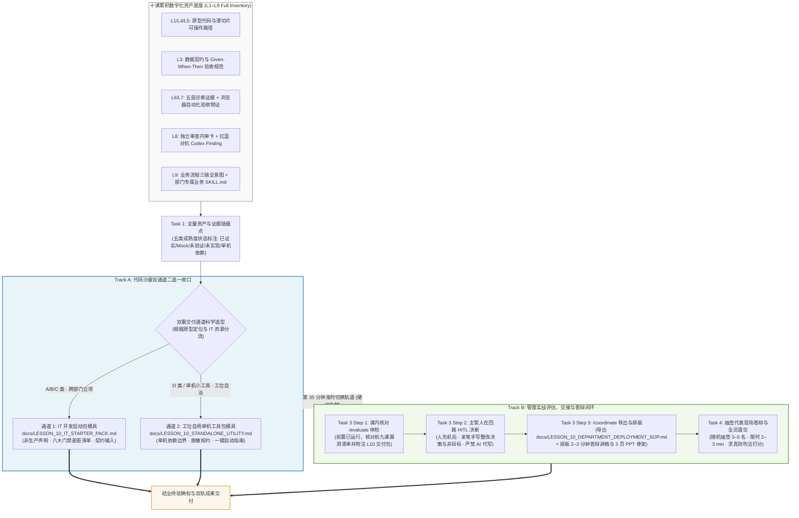

# 第十课学员指南——双重交付终局与部门日常 Agent 赋能落地清单

> **核心思想：求真交付胜过虚假繁荣，严守红线重于盲目上线；双重通道因地制宜收口，人在回路筑牢责任底线；客观挑刺坦陈生产差距，扎实规程开启周一赋能。**

---

## 一、先看懂：终局双重交付与日常实战赋能

### 1.1 先看一个反差

在开始今天的结业实操前，请对比以下两种截然不同的交付方式带来的巨大风险落差：

| 虚浮自嗨的交付方式（全网叫停、丧失信誉） | 实事求是的工程化交付（赢得敬畏、扎实落地） |
| :--- | :--- |
| **成果宣称**：通篇宣称“原型已全自动运行、完全替代人工、下周即可全网直接上线”，对技术团队宣称“我们部门不需要你们 IT 了”。 | 明确附带《非生产就绪代码声明》，将原型定位为业务逻辑验证的“样板间”；坦诚列出八大生产就绪缺口，作为向 IT 部门立项的高质量输入。 |
| **成熟度标注**：通篇把 Mock 模拟数据、静态页面或假数据直接标成“全链路已证实通过”，隐瞒未做并发测试与异常断网的事实。 | 严格采用五类成熟度状态（已证实 / 仅 Mock 模拟 / 未验证 / 明确未实现 / 单机依赖边界），Mock 模拟一律如实打标，不伪装成功。 |
| **评估与整改**：对漏洞视而不见，或者让大模型“帮我把漏洞全自动改掉”，大模型直接生成越权的自动放行代码，主管丧失风控责任。 | 课前运行 `/evaluate` 冷酷挑刺；业务主管用足 10 分钟亲笔手写做出 HITL 商业裁决（追加门禁 / 划入非目标），坚决不让 AI 越权代做主。 |
| **结业汇报答辩**：台上满嘴跑火车，大谈“每周帮部门节省 50 小时、每年降本数百万”，提问被技术专家一戳即穿，立项被一票否决。 | 严格在 2–3 分钟内实事求是汇报，3 页 PPT 精炼交代痛点、差距与红线；明确周一工位安全试水第一责任人（Owner），务实求真。 |

今天你将通过双轨实操，完成从代码沙盘到工位实战的终极收口，成为一名**懂边界、敢暴露差距、能扎实赋能日常工作**的合格业务主管。

### 1.2 今天你要带走什么

完成本课后，你将带走一套**“代码沙盘收口与部门日常落地双成果包”**：
1. **代码沙盘成果包（二选一通道收口）**：
   - **通道 1（面向技术/IT 部门立项）**：输出包含业务痛点、原型验证范围、契约规范、AI 选型边界、八大生产就绪差距清单与“非生产就绪声明”的《产品决策与开发启动包》（保存至 `docs/LESSON_10_IT_STARTER_PACK.md`）；
   - **通道 2（面向工位自闭环单机工具）**：输出包含工位业务场景、已验证功能范围、本地运行依赖清单、脱敏规约与一键启动批处理脚本的《工位自用单机工具包》（保存至 `docs/LESSON_10_STANDALONE_UTILITY.md`）；
2. **管理实战成果包（全员统一日常赋能与答辩）**：
   - **部门日常落地清单**：通过 `/coordinate` 导出全员统一必备的《部门日常 Agent 赋能落地清单与认证工具包》（保存至 `docs/LESSON_10_DEPARTMENT_DEPLOYMENT_SOP.md`），明确指派周一晨会安全试水第一责任人（Owner）；
   - **务实双轨答辩讲稿与 3 页 PPT 骨架**：完成 2–3 分钟实事求是答辩讲稿（保存至 `docs/LESSON_10_DEFENSE_SCRIPT.md`），抽签代表现场汇报，全员座席同步提交。

> [!IMPORTANT]
> **双轨成果各自独立验收、绝不能互相顶替**：代码沙盘启动包/工具包与部门日常落地清单/答辩讲稿属于两个独立的考核面。沙盘做得再好不能顶替落地清单缺失，讲稿讲得再精彩也不能掩盖代码盘点的弄虚作假。两条主线必须独立通关，缺一不可。

### 1.3 本课融合心智模型 (Cognitive Model)

从“代码沙盘双通道收口”到“客观体检与人在回路终审”，构成了完整的数字化闭环。下面的模型图展示了终局交付与管理赋能的业务拓扑（**本图表达业务拓扑分流与方法论闭环，非课堂时间推进表**）：



### 1.4 五个必须掌握的核心概念

#### 1. 原型 ≠ 生产系统（样板间不是交付住房）
- **是什么**：原型只用于在受控沙盘中验证业务逻辑是否闭环、功能切片是否值得投入；生产系统则必须具备企业级高可用架构、安全合规审计、真实数据库与鉴权体系对接、容灾备份与持续运维监控。原型使用了大量 Mock 模拟数据与受控环境，缺少生产级工程防御。
- **怎么用**：在所有交付物显著位置强制附带《非生产就绪代码声明》；将原型作为向技术团队立项的高质量输入材料，而不是要求 IT 直接上线的生产系统。
- **避坑红线**：严禁拿着跑通的原型要求技术人员“下周直接上线”；严禁隐瞒原型的工程缺陷与技术负债。

#### 2. 风险红线与非目标（确定不做比盲目去做更重要）
- **是什么**：明确圈定当前系统坚决不做的高危功能、坚决不接入的敏感数据以及坚决拒绝 AI 介入的法定义务节点（如大额资金划转、对外正式发函、特种资质终审）。
- **怎么用**：在交付清单首要章节设立独立的“非目标清单”与“AI 介入红线表”，为每个红线环节设立强制人在回路（HITL）审批门禁与熔断规则。
- **避坑红线**：严禁为了迎合领导将所有功能写满；严禁在缺乏风控审计的情况下尝试让 AI 全自动闭环高危动作。

#### 3. 综合评估与人在回路（Evaluate & HITL Remediation）
- **是什么**：由独立评估工具 `/evaluate` 对全量成果进行客观挑刺，暴露隐藏脆弱点；由承担最终管理与法律责任的人类主管（HITL）亲自对漏洞做出商业权衡与整改决断。
- **怎么用**：课前前置运行 `/evaluate` 获取客观缺陷清单，课内核对后亲笔手写裁定整改方案（如追加门禁、划入非目标、指定责任人），严禁大模型越权代写决策。
- **避坑红线**：严禁让大模型替主管做主；严禁对评估发现的高危漏洞视而不见或静默放行。

#### 4. 双重交付通道（IT 启动包 vs 工位单机工具包）
- **是什么**：业务原型在训练营终局收口时的“二选一”交付路径——交付 IT 架构立项的《产品决策与开发启动包》（通道 1）vs 面向工位自治闭环的《工位自用单机工具包》（通道 2）。
- **怎么用**：根据业务原型的系统定位与 IT 承接能力科学选定通道（A/B/C 类默认走通道 1 交付 IT 架构；D 类或科室内部小工具走通道 2 沉淀工位闭环），双轨资产分别依托标准化模板导出。
- **避坑红线**：单机自用必须严守“非生产代码声明”与四项安全红线，严禁把工位自用包装为生产系统直接上线，严禁将高危跨部门流程私自作为单机工具运行。

#### 5. 责任交接与落地清单（责任清晰转移与工位赋能）
- **是什么**：将原型的技术资产、业务规则、审批门禁与日常运行维护责任，明确移交给具体组织或个人的制度化动作；载体为《部门日常 Agent 赋能落地清单与认证工具包》。
- **怎么用**：逐项为业务规则、数据准确性、模型接口与异常兜底指派清晰的第一责任人（Owner）；载明下周一晨会安全试水具体工位与脱敏数据样本。
- **避坑红线**：严禁一句“交给 IT 了”或“大家日常用”模糊带过；交接是责任的清晰转移，绝不是责任消失。

#### 扩展认识
1. **生产就绪缺口分析（八大生产门禁 · 认识级）**：真实数据库对接、网络鉴权隔离、高并发容灾、自动化监控告警、数据备份回滚、法务隐私审计、降级人工兜底、日常运维第一责任人；
2. **抽签答辩与求真防吹法（认识级）**：现场随机抽签 3–5 名代表上台汇报（限时 2–3 分钟），其余学员同步提交；答辩只看已证实证据链与坦诚的生产差距，严禁无依据的商业 ROI 吹嘘，凡弄虚作假者评审一票扣 30 分。

---

## 二、准备好：课前自备输入与实操环境准备

### 2.1 课前自备准备清单（学员自助执行 · 关键输入）

> [!IMPORTANT]
> **重要前置动作：核对你的课前自备成果！**
> 在进入第十课课堂前，你应当已依据第九课结课通知完成以下三项前置准备。这是你在课堂内展开 Task 3 与 Task 4 及开场回环的**核心输入材料**：
> 1. **前置自备 ①（`/evaluate` 综合体检清单初版）**：在课前已调用 `/evaluate` 对前九课累积成果运行过全量体检挑刺，在本地终端或记事本中保存了一份初版漏洞清单备查；
> 2. **前置自备 ②（答辩五要素纸质手写提纲）**：在纸上亲手梳理了 5 个核心答辩事实（①业务痛点、②原型已证实范围、③生产就绪差距、④AI 介入红线与非目标、⑤周一低风险试水规程与第一责任人）；
> 3. **前置自备 ③（第九课双微任务成果）**：带上你在 L9 课后完成的两项成果——① 关键 AI 节点失败显性化规则与责任人（Owner）补充记录；② 部门专属业务 Skill 的工位离线自测记录。开场将随机抽查 2 名学员现场汇报，请务必有备而来。
> 
> **课堂提示**：若你在课前未能前置运行 `/evaluate`，请立刻参阅 2.2 节的《标准结业成果漏洞自检表》，在课堂开始前用 3 分钟进行人工快速打勾排查，定位核心缺陷！

### 2.2 学员降级兜底工具：标准结业成果漏洞自检表

若课前因网络或环境原因未能前置运行 `/evaluate`，请立即调取模具库中的《标准结业成果漏洞自检表》（`student-package/templates/GRADUATION_VULNERABILITY_QUICK_CHECKLIST.md`），在 3 分钟内对照以下 10 项核心风控维度进行人工打勾自检：

| 序号 | 核心核验维度与风控红线 | 自检要求与判定 |
| :---: | :--- | :--- |
| **1** | **断网/降级兜底显性化** | 接口超时或模型故障时，是否有明确规则兜底并标注第一责任人（Owner）？ |
| **2** | **金额/阈值亲笔手填** | 审批权限、金额上限与业务规则是否由主管亲笔确认，杜绝 AI 越权代写？ |
| **3** | **Mock 数据显式标注** | 测试数据、模拟接口是否 100% 明确打上 `[Mock]` 标签，严禁冒充真实链路？ |
| **4** | **三链凭据物理隔离** | 代码链、数据链、审批链的凭据是否严格物理隔离，杜绝混用与跨权限调用？ |
| **5** | **高危不可逆动作门禁** | 涉及打款、对外发函、删库等操作，是否设立强制人在回路（HITL）人工审批？ |
| **6** | **脱敏规约刚性执行** | 交付物中是否彻底清除真实数据库密码、企业生产 Key 与内部敏感客户信息？ |
| **7** | **失败显式报告机制** | 系统执行失败或置信度低时是否显式报错，杜绝伪造假数据伪装“成功”欺瞒下游？ |
| **8** | **成熟度五类状态诚实** | 资产盘点是否严格遵循五类状态，严禁将“未验证”或“Mock”冒充为“已证实”？ |
| **9** | **通道 2 单机依赖盘点** | 若选择通道 2，是否完整梳理本地 Python/Node 环境、系统权限与数据脱敏规约？ |
| **10** | **周一试水规程明确** | 落地清单中是否明确下周一试点运行的具体工位、脱敏数据样本及第一责任人？ |

### 2.3 模具与官方工具库物证就绪

请检查并确认当前工作区中以下模具与资产处于就绪状态：
1. **通道 1 IT 开发启动包模具**：`student-package/templates/IT_DEVELOPMENT_STARTER_PACK_TEMPLATE.md` 完好；
2. **通道 2 工位单机工具 SOP 模具**：`student-package/templates/DESK_STANDALONE_UTILITY_SOP.md` 完好；
3. **部门日常落地清单模具**：`student-package/templates/DEPARTMENT_AGENT_DEPLOYMENT_SOP_TEMPLATE.md` 完好；
4. **官方认证工具库清册**：`student-package/` 下的官方认证工具清单与调优规则卡完好；
5. **Git 工作区状态**：执行 `git status`，确认前九课代码与文档全部处于已提交的 Clean 状态。

### 2.4 实操四大高压红线

实操开始前，必须时刻紧绷以下四条纪律红线：
1. **非生产就绪红线**：所有交付物必须明确标注“非生产就绪代码声明”，严禁拿着原型直接部署生产环境；
2. **真实生产凭据红线**：严禁向大模型投喂真实数据库密码、企业生产 API Key 或未脱敏机密数据；
3. **防代写终审红线**：`/evaluate` 漏洞整改裁决必须由学员本人亲笔手写，严禁交由大模型代写决断；
4. **求真防吹诚信红线**：讲稿与答辩中严禁出现无测算依据的商业回报吹嘘（严禁“每周省 20 小时”、“全自动替代人工”），凡弄虚作假者评审一票否决。

---

## 三、动手做：双轨实操与全流程操作指引

### 轨道 A：代码沙盘双通道二选一收口 (Tasks 1–2)

#### Task 1：十课全量资产与证据链盘点，标注五类成熟度状态

- **本步目的 (`purpose`)**：
  建立工程级的资产归档与诚实验收心智。全面起底十课累积物证，客观划定已证实与未验证边界，彻底打破对原型能力的盲目乐观。
- **复制提示词 (直接复制发给 Agent)**：
    ```text
请协助我对当前原型项目进行结业前的【全量资产与证据链盘点】。

    请全面检索并提取我项目中从 L1 到 L9 的所有累积产出物，包括：
    1. 【原型代码与可操作路径】（L1 原型、L4 薄切片、L5 智能功能）；
    2. 【数据与验收契约】（L3 功能卡、字段规则与 Given-When-Then 标准）；
    3. 【测试与验收物证】（L6 诊断修复记录、L7 docs/LESSON_07_EVIDENCE_INDEX.md 浏览器截图与日志）；
    4. 【独立评审与对抗记录】（L8 docs/LESSON_08_AUDIT_REPORT.md 中的 Codex Finding、docs/LESSON_08_RED_BLUE_AUDIT_CARD.md）；
    5. 【流程治理与技能资产】（L9 docs/LESSON_09_PROCESS_THREE_CHAINS.md 三链图、docs/skills/ 专属 Skill 与实测报告）。

    【状态分类与标记铁律】：
    请输出一份格式严密的 Markdown 表格，包含列：【资产名称】、【对应课次】、【落盘文件路径】、【核心交付内容】、【成熟度状态】。
    其中【成熟度状态】必须严格从以下五类中客观判定，严禁虚标：
    - 【已证实 (Proven)】：在本地沙盘中已完成真实操作，且具备截图、测试日志或明确物理证据支持的功能；
    - 【仅 Mock 模拟 (Mocked)】：依赖静态假数据、随机生成逻辑或模拟函数实现，未接入真实生产环境的智能/计算环节；
    - 【未验证 (Unverified)】：逻辑虽已编写，但未经过真实多并发、网络超时或边界异常压力测试的环节；
    - 【明确未实现 (Unimplemented)】：业务流程中不可或缺，但本次课程明确界定为不做或留待后续研发的功能；
    - 【单机依赖边界 (Standalone Dependency)】：针对工位单机自用工具，明确标注对本地特定 Python/Node 依赖环境、本地小模型或脱敏规约的边界。

    整理完成后，将表格展示在对话中供我审核确认。
    ```
- **你应该看见 (`expected_observation`)**：
  Agent 检索并输出了清晰结构化的全量资产盘点表，前九课成果逐一在列，每项功能均如实打上了五类成熟度标签，引证了具体文件路径与行号。
- **本步自检 (`check`)**：
  - [ ] 资产清单是否涵盖了原型代码、数据契约、L7 浏览器物证、L8 审查 Finding 与 L9 专属 Skill？
  - [ ] 是否诚实区分了已证实、仅 Mock 模拟与未验证状态？
  - [ ] 是否明确列出了单机依赖边界与未实现项？
- **必须停止 (`mandatory_stop`)**：
  - 严禁将 Mock 模拟数据标记为“已证实”！发现一处即判定盘点不合格！

---

#### Task 2：按原型定位二选一通道收口，生成启动包/工具包

- **本步目的 (`purpose`)**：
  因地制宜完成原型的工程化收口。掌握交付技术团队与沉淀工位单机工具的两套不同规范，用标准模板封存沙盘代码成果。
- **复制提示词 (直接复制发给 Agent)**：
    ```text
请根据 Task 1 盘点确认的全量资产与成熟度状态，协助我完成项目的最终收口，生成交付包文件。

    【收口通道选择（二选一，请根据我的原型类型匹配）】：
    - 若我的项目为【通道 1：部门级系统原型（A/B/C 类默认）】：
      请严格依托《IT 开发启动包规范模具》（student-package/templates/IT_DEVELOPMENT_STARTER_PACK_TEMPLATE.md），生成交付给 IT 团队的《产品决策与开发启动包》，保存至 docs/LESSON_10_IT_STARTER_PACK.md。必须包含：
      1. 系统定义与商业价值陈述；
      2. L3 数据契约与验收准则归档；
      3. 生产就绪缺口分析（架构隔离、生产数据库接入、并发容灾、真实网关认证等）；
      4. 严肃声明：包含“本包代码仅为业务原型验证资产，严禁直接作为生产环境运行代码”；
      5. 产品决断（继续/调整/暂缓/停止）与 IT 下一步排期建议。

    - 若我的项目为【通道 2：工位自用单机工具（D 类或 IT 无法排期）】：
      请严格依托《工位单机自治运行自检表与交接规程》（student-package/templates/DESK_STANDALONE_UTILITY_SOP.md），生成工位自闭环的《工位自用单机工具包》，保存至 docs/LESSON_10_STANDALONE_UTILITY.md。必须包含：
      1. 工位工具定位与单机适用范围；
      2. 本地运行依赖环境表（Node/Python 版本、本地小模型配置）；
      3. 严格的单机数据安全与离线脱敏规约；
      4. 桌面一键启动脚本配置与日常实施 SOP；
      5. 工位自治管理规范与异常手工介入流程。

    请严格按照选定模具的结构生成完整排版的 Markdown 文件，确保格式专业、边界清晰。
    ```
- **你应该看见 (`expected_observation`)**：
  Agent 依托对应模具规范生成了完整的收口文档（`docs/LESSON_10_IT_STARTER_PACK.md` 或 `docs/LESSON_10_STANDALONE_UTILITY.md`），生产差距坦诚翔实，安全声明醒目。
- **本步自检 (`check`)**：
  - [ ] 是否依据原型定位选择了正确的交付通道？
  - [ ] 通道 1 是否包含八大门禁生产差距分析与非生产就绪声明？
  - [ ] 通道 2 是否包含本地依赖表与数据脱敏规约？
  - [ ] 文件是否已成功保存至对应路径？
- **必须停止 (`mandatory_stop`)**：
  - 严禁声称当前代码可直接上线！严禁省略生产差距分析！
  - **第 35 分钟准时切换轨道（硬切门禁）**：时钟一到，若未写完，必须立即接受助教派发的对应通道标准冻结包快照存盘，准时切入轨道 B！

---

### 轨道 B：管理实战客观评估、交接与求真答辩 (Tasks 3–4)

#### Task 3：综合评估 `/evaluate` 核对 ➔ 人在回路 HITL 亲笔决断 ➔ 标准交接 `/coordinate` 导出与讲稿排版

- **本步目的 (`purpose`)**：
  落实终验节点的最高治理规约。先用独立评估机制对全量交付物进行彻底挑刺；再由业务主管亲自履行人在回路（HITL）终审决断（充分利用 10 分钟做出商业权衡）；最后通过标准交接导出面向部门日常的实战落地规程并完成讲稿排版。
- **复制提示词 1：`/evaluate` 结业成果综合体检核对与附注 (课内核对使用，直接发给 Agent)**：
    ```text
请协助我核对并完善结业成果的【全量综合评估与体检挑刺 (/evaluate)】。

    评估范围基于我课前已运行的前九课全量成果（L3 契约、L6 核验报告、L7 证据索引、L8 独立审查与内审卡、L9 流程三链图与专属 Skill），并附注纳入刚刚完成的 L10 交付包（docs/LESSON_10_IT_STARTER_PACK.md 或 docs/LESSON_10_STANDALONE_UTILITY.md）：
    1. 对照企业生产级标准与合规风控底线，核对客观挑刺清单，专门确认边界未覆盖、三链凭据混用风险、降级责任缺失或高危不可逆动作；
    2. 汇总一份结构化的【结业成果综合体检与漏洞清单】，包含：
       - 【漏洞编号与严重度】（Blocker 阻断 / Major 重要 / Minor 建议）；
       - 【涉及成果物与位置】；
       - 【客观缺陷描述】；
       - 【潜在业务与安全风险】；
       - 【待决断整改方向建议】。
    3. 严禁任何客套吹捧，输出完毕后立即暂停，等待我本人做出人在回路（HITL）的亲笔整改决断！
    ```
- **复制提示词 2：`/coordinate` 结合主管手写决断导出落地清单与讲稿排版 (直接发给 Agent)**：
    ```text
请根据我已亲笔做出的【主管人在回路 (HITL) 整改决断】与课前梳理的【答辩提纲】，执行标准交接 (/coordinate)，导出结业资产并完成讲稿排版。

    【主管亲手做出的 HITL 整改决断清单（由我本人手写确定，严禁代写）】：
    【请在此处粘贴你针对 /evaluate 每项漏洞亲手做出的整改裁决，格式：
     - 针对漏洞 1：裁决为 [修补并追加人工审批门禁 / 划入本期明确非目标 / 留待技术排期]，理由：[一句话业务权衡]
     - 针对漏洞 2：裁决为 [修补并追加人工审批门禁 / 划入本期明确非目标 / 留待技术排期]，理由：[一句话业务权衡]
     - 周一晨会试水启动第一责任人（Owner）：[填入你部门真实主管或工位姓名]】

    【我亲手梳理的 2–3 分钟答辩五要素核心事实（由我本人提供，严禁代写吹嘘）】：
    【请在此处粘贴你课前梳理的 5 个答辩核心要素：
     1. 部门业务痛点：[简要说明你解决的真实工位痛点]
     2. 原型已证实范围：[列出 1–2 项具备截图/日志支持的已验证功能]
     3. 生产就绪真实差距：[诚实列出 2–3 项未解决的生产差距，如未接真实数据库、未做压力测试等]
     4. AI 介入边界与红线：[列出 1 项坚决不用 AI 的环节及部门制度红线阈值]
     5. 周一低风险安全启动规程：[说明下周一你将在哪个具体工位、用何种脱敏数据试水专属 Skill，第一责任人是谁]】

    【执行参数与防代写铁律】：
    1. 严禁由你生成、建议或篡改任何整改决策与责任人！所有裁决必须 100% 忠实取自上方我手写的清单；
    2. 严格依托《部门日常 Agent 赋能落地清单与安全启动规程》（student-package/templates/DEPARTMENT_AGENT_DEPLOYMENT_SOP_TEMPLATE.md），生成《部门日常 Agent 赋能落地清单与认证工具包》，保存至 docs/LESSON_10_DEPARTMENT_DEPLOYMENT_SOP.md；
    3. 严禁生成任何虚浮商业回报吹嘘（严禁出现“每周节省 X 小时”、“全流程全自动替代人力”等假大空词句），严格排版为 2–3 分钟务实汇报讲稿（含演讲逐字稿提示与 3 页 PPT 骨架），保存至 docs/LESSON_10_DEFENSE_SCRIPT.md。
    ```
- **你应该看见 (`expected_observation`)**：
  Agent 首先客观输出了无情挑刺的漏洞清单；在你输入亲笔裁决与答辩提纲后，忠实依据你的指令进行排版，规范落盘保存了 `docs/LESSON_10_DEPARTMENT_DEPLOYMENT_SOP.md` 与 `docs/LESSON_10_DEFENSE_SCRIPT.md`，责任人明确，无任何 AI 代写幻觉。
- **本步自检 (`check`)**：
  - [ ] `/evaluate` 是否输出了具体的漏洞与风险项，而非通篇表扬？
  - [ ] 整改决断是否为本人亲自手写提供，杜绝了 AI 越权代写？
  - [ ] 是否用足了 10 分钟做出严肃的商业与合规决断？
  - [ ] 是否成功导出了 `docs/LESSON_10_DEPARTMENT_DEPLOYMENT_SOP.md` 与 `docs/LESSON_10_DEFENSE_SCRIPT.md`？
  - [ ] 讲稿是否严格排版为 2–3 分钟务实汇报（3 页 PPT 骨架），彻底清除了虚假 ROI 吹嘘？
- **必须停止 (`mandatory_stop`)**：
  - 严禁让 Agent 代为主管做整改决策！未手写决断前不得导出落地清单！

---

#### Task 4：抽签代表现场答辩与全员双轨讲稿/落地清单同步提交

- **本步目的 (`purpose`)**：
  在实战汇报中淬炼实事求是的交付风貌。通过严格限时的 2–3 分钟答辩，展示已证实能力、坦承生产差距、亮明红线底线，提交面向周一工位赋能的落地清单。
- **复制提示词 (直接复制发给 Agent · 备用微调提示词)**：
    ```text
请检查我刚刚生成的【2–3 分钟务实双轨答辩讲稿与 3 页 PPT 大纲】（docs/LESSON_10_DEFENSE_SCRIPT.md）：

    1. 严格核验是否彻底消除了任何商业吹嘘词句（严禁出现“每周省 X 小时”、“完全替代人工”、“创造巨大经济价值”等字样）；
    2. 确保 3 页 PPT 骨架精炼聚焦：
       - 第 1 页：业务痛点与原型定位（说明解决何种工位真问题）；
       - 第 2 页：沙盘验证事实与生产差距分析（诚实列出未验证项与红线非目标）；
       - 第 3 页：周一工位安全试水规程（明确脱敏要求与第一责任人 Owner 签字）；
    3. 输出最终确认版本，确保能在 2–3 分钟内完成口头清晰陈述，供现场答辩与结业提交使用。
    ```
- **现场答辩求真防吹要领与 3 页 PPT 骨架**：
  - **第 1 页：业务痛点与原型验证范围**（陈述解决何种工位真问题，已证实哪些具体链路）；
  - **第 2 页：生产差距暴露与非目标红线**（坦承八大生产门禁差距，亮明坚决不用 AI 的红线环节）；
  - **第 3 页：周一工位安全试水规程与责任人**（明确脱敏要求与主管本人签字作为第一责任人 Owner）；
  - **限时纪律**：每人严格控制在 2–3 分钟（2 分 30 秒黄牌提示，3 分钟铃响切麦强制叫停）；
  - **全员座席同步提交**：未被抽中的学员在座席上同步检查并完成 `docs/LESSON_10_DEFENSE_SCRIPT.md` 与落地清单的本地提交。
- **你应该看见 (`expected_observation`)**：
  Agent 输出了经过严格求真核验的 2–3 分钟精炼讲稿与 3 页 PPT 骨架，语言中肯沉稳，完全符合工程规范，无任何假空大吹嘘。
- **本步自检 (`check`)**：
  - [ ] 讲稿是否能在 2–3 分钟内朗读或陈述完毕？
  - [ ] 讲稿中是否坦诚交代了生产差距与未完成缺口？
  - [ ] 是否彻底清除了任何无依据的 ROI 吹嘘词句？
  - [ ] 是否已在座席完成文件落盘并准备好现场双轨提交？
- **必须停止 (`mandatory_stop`)**：
  - 严禁在答辩材料中宣称系统已生产就绪！
  - 严禁虚夸商业回报与节约工时！

---

## 四、避开坑：结业交付五大高频翻车误区与现场排查

### 4.1 认知误区与纠偏对策 (`misconceptions`)

| 误区编号 | 典型错误认知 | 纠偏正解与实战对策 |
| :--- | :--- | :--- |
| **M-01** | “原型跑通了，证明我们部门不需要 IT 了，下周直接把它部署上线” | 样板间绝不是交付住房！原型缺乏高可用、安全鉴权与并发容灾，直接上线必引发生产数据崩溃灾难。 |
| **M-02** | “给 IT 写的交接清单里，尽量别提没做完的和报错的，免得被 IT 刁难不给立项” | 隐瞒缺口是严重的渎职！诚实暴露未完成项与生产差距，才能帮助 IT 准确评估排期与架构改造工作量。 |
| **M-03** | “答辩一定要把 ROI 吹大，比如写‘每年帮部门节省 500 万成本、全自动替代 5 个人’” | 严禁画大饼！虚浮吹嘘只会丧失专业信誉；结业答辩一票否决虚假商业谎言，只认可实事求是的证据链。 |
| **M-04** | “`/evaluate` 找出的漏洞，直接让大模型帮我全部自动改好、自动决定怎么处理就行” | 绝不能放弃主管终审权！AI 不懂部门利益与法规红线，漏洞整改裁决必须由人类主管亲笔手写决断。 |
| **M-05** | “交接就是‘把包甩给 IT’，以后系统出了 Bug 或者算错钱都是 IT 的责任，跟业务主管无关” | 交接是责任的明确划分而非消失！业务规则与审批放行的最终责任始终属于业务主管，严禁甩锅。 |

### 4.2 现场 5 类常见故障排查指引 (`troubleshooting`)

| 故障现象 | 根因诊断 | 处置方案与降级动作 |
| :--- | :--- | :--- |
| **T-01 资产全标证实** | 将 Mock 模拟或未经真实并发测试的功能全标为“已证实” | 强制打回，核对 L5/L7/L9 测试日志，没有真实接口证据的项一律改回“仅 Mock 模拟”。 |
| **T-02 通道选型纠结** | 在通道 1（IT 启动包）与通道 2（单机工具）间摇摆不定 | 口诀决断：“跨部门立项走通道 1，科室内部自闭环小工具走通道 2”；A/B/C 类默认走通道 1，D 类默认走通道 2。 |
| **T-03 整改 AI 越权** | 让大模型代为主管做漏洞整改裁决与非目标剔除 | 勒令清屏，主管必须在纸上或提示词插槽中亲笔写下业务裁决理由，AI 仅用于格式排版。 |
| **T-04 答辩讲稿吹嘘** | 讲稿中出现“每周省 20 小时”、“完全替代人工”等空话 | 立即调用 Task 4 备用微调提示词进行脱虚脱实处理，强制收敛为 3 页 PPT 务实骨架。 |
| **T-05 责任交接留空** | 落地清单中第一责任人（Owner）一栏全填“IT”或留空 | 严肃追问权责归属，业务规则与人工审批门禁的第一责任人必须由学员本人签字认领。 |

---

## 五、验成果：双轨独立通关标准与求真答辩验收

### 5.1 双轨独立通关标准（互不顶替铁律）

结业认证要求学员必须在以下两条学习线上分别达成通关标准。**双线成果属于双重独立考核面，互不顶替、互不抵扣**：

1. **学习线 1（代码沙盘成果包 · 权重 50%）**：
   - 通道 1 产物：`docs/LESSON_10_IT_STARTER_PACK.md` 包含规范的非生产声明、前九课资产盘点表与八大生产差距清单；
   - 或通道 2 产物：`docs/LESSON_10_STANDALONE_UTILITY.md` 包含本地运行依赖清单、数据脱敏规约与一键启动批处理脚本；
   - **通关硬指标**：盘点表五类状态标注无弄虚作假（未将 Mock 充当证实），有明确未实现项与单机依赖说明。
2. **学习线 2（管理实战落地清单与答辩 · 权重 50%）**：
   - 部门日常落地清单：`docs/LESSON_10_DEPARTMENT_DEPLOYMENT_SOP.md` 规范导出，包含官方认证工具清册与周一安全试水第一责任人（Owner）明确签署；
   - 求真答辩讲稿：`docs/LESSON_10_DEFENSE_SCRIPT.md` 包含 2–3 分钟短汇报逐字稿与 3 页 PPT 骨架；
   - **通关硬指标**：漏洞整改裁决由主管亲笔做出；答辩现场或讲稿无虚浮 ROI 吹嘘；符合结业答辩求真防吹合格判定。

### 5.2 结业答辩求真防吹评审导向

现场答辩与评审将对照以下核心方向严格检验，请对照自查：
1. **已证实范围清晰**：是否引证了真实的 L3 契约、L7 浏览器截图、L8 Finding 或 L9 实测日志；
2. **生产差距诚实暴露**：是否坦承了真实数据库对接、高并发压测等工程缺口，通道 1 是否附非生产声明；
3. **安全红线刚性界定**：是否明确了至少 1 个坚决不用 AI 的业务环节，是否设置了强制人在回路（HITL）门禁；
4. **周一试水规程可操作**：是否指派了明确的第一责任人（Owner），是否有具体的脱敏测试数据；
5. **务实沉稳限时控场**：陈述是否控制在 2–3 分钟内，是否彻底清除了“每周省 X 小时”等假大空商业吹嘘。

### 5.3 随堂自测题（检验交付本质）

#### 必答题（5 题）
1. **原型与生产系统有什么本质区别？为什么原型跑通绝不等于能直接上线？**
   - *要点*：原型是低成本验证逻辑的样板间，缺少高可用、安全鉴权与并发容灾；生产系统需要通过严格的工程审计与架构保障，跑通原型绝不等于具备生产上线资格。
2. **在交给 IT 或向管理层交付时，为什么“明确非目标和风险红线”比“把功能列表写得满满当当”更有价值？**
   - *要点*：功能写满常隐藏未验证隐患与伪需求；明确非目标划定了系统安全底线，阻断了无效开发浪费，保护了企业核心资产。
3. **为什么要用 `/evaluate` 专门出具“漏洞与改进清单”？为什么整改决断必须由人类主管（HITL）亲笔做出？**
   - *要点*：`/evaluate` 能跳出开发者盲区进行冷酷挑刺；但 AI 不承担商业后果与合规责任，整改决断本质是商业权衡与责任确权，必须由人类主管亲自拍板。
4. **为什么本课要设计“双重交付通道（IT 启动包 vs 工位单机工具包）”？两者分别适合什么样的业务场景？**
   - *要点*：企业 IT 资源有限；通道 1 面向跨部门核心系统走正规立项，通道 2 面向科室自治轻量工具沉淀工位闭环生产力，实现因地制宜交付。
5. **责任交接要求什么？为什么交接是“责任的清晰转移”而不是“责任消失”？**
   - *要点*：交接要求逐项落实业务规则、数据脱敏、模型接口与异常兜底的第一责任人（Owner）；交接是明确 IT 与业务的权责分工，责任绝不会凭空消失。

#### 拓展题（2 题 · 选做）
1. **在向管理层汇报时，为什么“实事求是交代缺口”比“宣称每周省 20 小时、全流程全自动”更能赢得信任？**
2. **生产就绪缺口分析中，除了技术接口之外，为什么“法务合规与第一责任人”通常是最难关卡？**

---

## 六、带走它：部门日常 Agent 赋能落地清单与行动指南

### 6.1 部门日常数字化资产清册

结业后，你的代码仓库与工位电脑中已沉淀了完整的数字化实战资产包：
- **沙盘交付资产**：`docs/LESSON_10_IT_STARTER_PACK.md`（或 `docs/LESSON_10_STANDALONE_UTILITY.md`）；
- **部门落地清单**：`docs/LESSON_10_DEPARTMENT_DEPLOYMENT_SOP.md`（包含认证工具清册与试水规程）；
- **务实答辩资产**：`docs/LESSON_10_DEFENSE_SCRIPT.md`（2–3 分钟精炼汇报逐字稿与 3 页 PPT 骨架）；
- **工位专属技能**：`docs/skills/<dept-skill>/SKILL.md`（注入部门真实制度与红线的可运行 Skill）；
- **全流程证据链**：L3 数据契约、L6 核验记录、L7 浏览器截图、L8 Codex Finding 与 L9 三链全景图。

### 6.2 工位周一落地启动微任务 (`between_lesson_task`)

- **微任务内容 (10–15 min · 工位周一落地启动微任务)**：
  在周一晨会或工位日常办公中，对照已签署的《部门日常 Agent 赋能落地清单与认证工具包》（`docs/LESSON_10_DEPARTMENT_DEPLOYMENT_SOP.md`），正式在工位运行 1 次 L9 专属业务 Skill 或启动 1 个官方认证工具，将首周脱敏试跑日志与工位同事反馈简要记入个人数字化档案；
- **行动指引**：在真实工位用小批量脱敏数据进行试水，第一责任人张主管全流程人工双签把关，验证专属 Skill 在真实业务中的辅助初筛效率。

### 6.3 结业寄语：从业务主管到数字化领航者

从第一课的手忙脚乱，到第十课的求真交付——你不仅掌握了代码排错、工具验收、独立审查与流程选型，更树立了敬畏工程规律、严守安全红线、敢于承担管理责任的专业精神。

AI 时代的优秀业务主管，不是被技术裹挟的盲从者，更不是盲目追求全自动化的空谈家，而是**懂业务痛点、明技术边界、划合规红线、扎根工位生产力**的数字化领航者。

祝贺你圆满完成 AI 原型制作实训营全量课程！周一早晨，带上你的落地清单，在工位开启扎实的数字化新征程！
